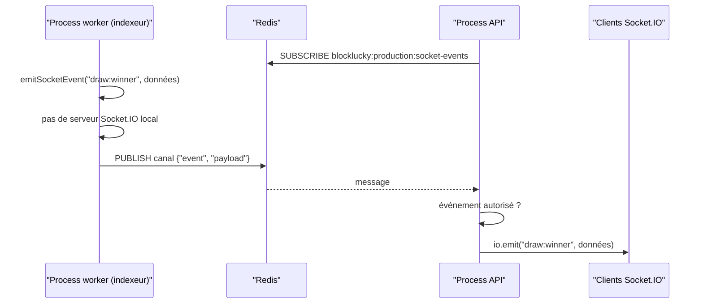

# Relais temps réel

Le serveur Socket.IO vit dans le process API ([`backend/src/server.ts`](src:backend/src/server.ts)). Or, dans la configuration Docker Compose, l'indexeur tourne dans le process worker ([`backend/src/worker.ts`](src:backend/src/worker.ts)), qui n'a pas de serveur Socket.IO. Quand le worker voit passer un `WinnerPicked` ou crédite des points, il doit pourtant prévenir les navigateurs et l'application mobile connectés à l'API.

[`backend/src/socket/event-bridge.ts`](src:backend/src/socket/event-bridge.ts) résout ce problème avec le mécanisme publication et abonnement (pub/sub) de Redis. La liste complète des événements Socket.IO est sur la page [Socket.IO](../backend/socket-io.md).

## Principe



## Émission : emitSocketEvent

`emitSocketEvent(événement, données)` est typée par `ServerToClientEvents` de [`backend/src/types/socket.types.ts`](src:backend/src/types/socket.types.ts). Elle procède ainsi :

1. si un serveur Socket.IO existe dans le process (`getSocketIo()` non nul), elle appelle `io.emit` et s'arrête là ;
2. sinon, si un client Redis existe, elle publie sur le canal le message JSON `{ "event": …, "payload": … }` ;
3. sinon, elle ne fait rien.

Un échec de publication est journalisé en avertissement (« Relais Socket.io indisponible, événement … non diffusé ») et l'événement est perdu. Aucune file ne conserve les événements non diffusés : le temps réel est un confort, l'état fait foi en base et sur la chaîne.

Seul l'indexeur appelle `emitSocketEvent`, pour deux événements :

| Événement | Moment | Données |
|---|---|---|
| `points:awarded` | Après le crédit des points d'un achat indexé | `userId`, `amount`, `reason` (`TICKET_PURCHASE`) |
| `draw:winner` | Après l'indexation de `WinnerPicked` | `roundId`, `contractRoundId`, `winnerWallet`, `prizePool` (cagnotte nette en ETH), `vrfProofHash` (hachage de la transaction de l'oracle), `timestamp` |

Le mode simulé n'utilise pas le relais : `lottery.services.ts` appelle directement `io.emit` ou `broadcastWinnerEvent`.

## Canal

Le nom du canal est construit avec le préfixe Redis et l'environnement :

```text
<REDIS_KEY_PREFIX>:<NODE_ENV>:socket-events
```

Avec les valeurs par défaut, cela donne `blocklucky:development:socket-events` en développement et `blocklucky:production:socket-events` en Docker Compose. Le préfixe isole plusieurs environnements qui partageraient une même instance Redis. Contrairement aux clés écrites par `RedisManager`, le préfixe est ajouté ici explicitement, car `publish` passe par le client brut.

## Réception : startSocketEventBridge

`startSocketEventBridge()` est appelée au démarrage de l'API, toujours, quelle que soit la valeur de `RUN_WORKERS`. Elle :

1. duplique le client Redis (`client.duplicate`) avec le nom de connexion `blocklucky-socket-bridge`, car une connexion abonnée ne peut plus envoyer d'autres commandes ;
2. s'abonne au canal ;
3. pour chaque message reçu sur ce canal, analyse le JSON, vérifie que l'événement figure dans la liste blanche `BRIDGED_EVENTS`, et le réémet localement par `io.emit`.

| Liste blanche `BRIDGED_EVENTS` |
|---|
| `draw:winner` |
| `points:awarded` |

Un message illisible est ignoré avec un avertissement. Un événement hors liste blanche est ignoré en silence : un message publié par un tiers sur le canal ne peut pas faire émettre `chat:message` ou `network:fallback` aux clients.

La fonction renvoie `{ stop }`, enregistré comme étape `socket-bridge` de l'arrêt propre : il ferme la connexion abonnée. Sans client Redis (tests), elle renvoie un `stop` vide.

## Où passe chaque événement

| Situation | Chemin |
|---|---|
| Achat ou cadeau par l'API, indexé depuis le reçu dans le process API | `io.emit` direct, sans Redis |
| Achat indexé par le worker (synchronisation périodique, achat externe) | Publication Redis, puis réémission par chaque process API abonné |
| `WinnerPicked`, toujours indexé par la synchronisation périodique | Publication Redis si l'indexeur tourne dans le worker ; `io.emit` direct s'il tourne dans l'API (`RUN_WORKERS=true`) |

Pour un achat, l'événement est en pratique émis par le traitement du reçu. Quand le worker relit le même bloc, l'achat est reconnu comme déjà indexé et aucun `points:awarded` n'est émis une seconde fois.

## Limites

- **Diffusion à tous** : `io.emit` envoie l'événement à tous les clients connectés. `points:awarded` contient l'identifiant interne du compte crédité ; c'est le client qui filtre les événements qui le concernent. Aucun salon par utilisateur n'est utilisé.
- **Plusieurs instances d'API** : un événement émis directement dans une instance (cas d'un achat indexé depuis le reçu) n'atteint que les clients de cette instance. Seuls les événements publiés par le worker atteignent toutes les instances. Socket.IO n'utilise pas d'adaptateur Redis.
- **Doublons** : si l'indexeur tourne à la fois dans l'API et dans le worker, ou lors d'une [reconstruction](../base-de-donnees/reconstruction.md), `draw:winner` peut être émis plusieurs fois pour le même tour, avec un `timestamp` différent.
- **Pas de garantie de livraison** : Redis pub/sub ne conserve pas les messages. Une API redémarrée pendant un tirage ne rediffuse pas le gagnant ; les clients doivent relire l'état par `GET /api/v1/lottery/status`.
