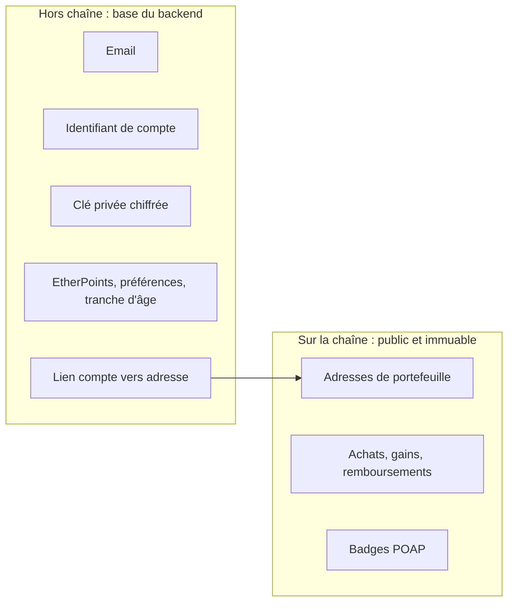

# Blockchain et données personnelles

Une blockchain publique est un registre répliqué sur des milliers de nœuds, lisible par tous et impossible à modifier rétroactivement. Ces propriétés font la transparence du tirage, mais elles se heurtent à deux principes du RGPD : la minimisation et le droit à l'effacement. Cette page décrit précisément ce que BlockLucky écrit sur la chaîne, ce qui reste hors chaîne, et les limites qui en découlent. Elle s'appuie sur la démarche recommandée par les lignes directrices 02/2025 du Comité européen de la protection des données (CEPD) : garder les données identifiantes hors chaîne et documenter ce qui ne peut pas être effacé. Elle ne constitue pas un avis juridique.

## Principe retenu

Le lien entre une personne et son adresse de portefeuille n'existe que dans la base du backend (colonne `User.walletAddress` et colonnes de la table `Ticket`). Supprimer ce lien rend les données de la chaîne non rattachables à une personne par la Ville. Elles restent des données pseudonymes pour quiconque peut faire ce lien par d'autres moyens.

## Ce qui est écrit sur la chaîne

### Par le contrat BlockLucky

Les données ci-dessous viennent des événements et de l'état de [`smart-contract/contracts/BlockLucky.sol`](src:smart-contract/contracts/BlockLucky.sol).

| Donnée | Où | Personnelle ? |
|---|---|---|
| Adresse du joueur (`player`) et du payeur (`payer`), nombre de tickets, montant | Événement `TicketsPurchased`, tableau `ticketOwners`, tables `ticketsByPlayer` et `contributions` | Pseudonyme |
| Adresse du gagnant, ticket gagnant, montant du gain, commission, identifiant de la demande VRF | Événement `WinnerPicked`, structure `Round` | Pseudonyme |
| Retrait du gain ou du remboursement | Événements `PrizeClaimed`, `RefundClaimed` | Pseudonyme |
| Ouverture, demande de tirage, annulation d'un tour | Événements `RoundOpened`, `DrawRequested`, `RoundCancelled` | Non |
| Trésorerie, configuration | Événements `FeesWithdrawn`, `TreasuryUpdated`, `RoundConfigUpdated`, `VrfConfigUpdated` | Non (comptes de la Mairie) |
| Rôles | Événements `RoleGranted`, `RoleRevoked` d'`AccessControl` | Non (comptes de service) |

### Par le contrat BlockLuckyPOAP

| Donnée | Où | Personnelle ? |
|---|---|---|
| Adresse du participant, numéro du tour, numéro du badge | Événements `BadgeMinted` et `Transfer` (ERC-721), table `badgeOf` | Pseudonyme |
| Métadonnées du badge | Servies par le backend (`GET /api/lottery/poap/<tour>.json`), générées par [`backend/src/blockchain/poap.metadata.ts`](src:backend/src/blockchain/poap.metadata.ts) | Non : elles ne dépendent que du numéro du tour |

### Par les transactions elles-mêmes

Chaque transaction publie son émetteur, son destinataire, son montant et son horodatage. Deux flux méritent attention :

| Flux | Ce qu'il révèle |
|---|---|
| Dotation de bienvenue : transfert du compte opérateur vers le portefeuille du citoyen | Que l'adresse appartient à un participant de BlockLucky, et la date approximative de son inscription |
| Cadeau : `buyTicketsFor(bénéficiaire, 1)` signé par le portefeuille de l'expéditeur | Un lien public entre deux adresses, donc entre deux participants qui se connaissent |

Ces informations restent pseudonymes, mais elles enrichissent le graphe des transactions, ce qui facilite une éventuelle réidentification par recoupement.

## Ce qui n'est jamais écrit sur la chaîne

| Donnée | Emplacement |
|---|---|
| Email | `User.email` |
| Identifiant de compte | `User.id` |
| Clé privée | `User.walletEncryptedKey`, chiffrée |
| Tranche d'âge, source UTM | Table `Analytics` |
| EtherPoints, récompenses, codes promo | Tables `User`, `PointTransaction`, `ClaimedReward` |
| Préférences, quêtes | Redis |
| Messages du chat en direct | Diffusés par Socket.IO, ni stockés ni écrits sur la chaîne |
| Message personnel d'un cadeau | Email au bénéficiaire, s'il est envoyé |

Les messages de chat affichent l'adresse du portefeuille sous forme abrégée (`0x1234...abcd`, fonction `anonymizeWallet`), comme le classement public.

## Immutabilité et droit à l'effacement

Une transaction inscrite dans un bloc ne peut ni être modifiée ni supprimée. Ni la Ville ni l'équipe ne peuvent effacer une adresse de la chaîne. Le droit à l'effacement est donc mis en œuvre hors chaîne :

| Action à l'anonymisation | Effet |
|---|---|
| `User.walletAddress` remplacée par `0xdeleted_gdpr_<préfixe>` | La fiche du compte ne désigne plus l'adresse |
| `User.walletEncryptedKey` mise à `null` | La clé privée est détruite : plus personne, Ville comprise, ne peut signer pour cette adresse |
| `User.email` mis à `null` | Le compte n'est plus rattachable à la personne par la base |

> [!WARNING]
> L'anonymisation laisse intactes les colonnes `Ticket.transactionHash` et `Ticket.payerWallet`, qui pointent vers l'ancienne adresse. L'identifiant du compte reste donc relié à l'adresse dans la base, même si plus aucune donnée identifiante directe n'y figure. Pour que le lien soit réellement rompu, ces colonnes doivent être effacées ou remplacées lors de l'anonymisation. Voir [RGPD](rgpd.md#effacement).

Conséquences de la destruction de la clé :

- les fonds encore présents sur l'adresse deviennent définitivement inaccessibles ;
- un gain non réclamé ou un remboursement en attente ne peut plus être retiré.

Sur un réseau de test, ces fonds n'ont pas de valeur. Avec des fonds réels, il faudrait proposer au citoyen de retirer ses fonds vers une adresse de son choix avant l'effacement.

## Information des personnes

La politique de confidentialité du web indique que seule l'adresse de portefeuille figure sur la chaîne et que l'email n'y est jamais inscrit. Pour être complète, l'information présentée à l'inscription devrait aussi préciser :

- que les transactions sont publiques et définitives ;
- que l'effacement du compte ne supprime pas les transactions déjà inscrites ;
- que la dotation et les cadeaux créent des liens visibles entre adresses ;
- que la clé est détruite à l'effacement, avec les fonds restants.

Ces ajouts sont repris dans [Points à valider](points-a-valider.md).

## Transferts hors de l'Union européenne

Les nœuds d'Ethereum, de Sepolia comme du réseau principal, sont répartis dans le monde. Inscrire une adresse sur la chaîne revient à la rendre accessible hors de l'UE. Seules des données pseudonymes y sont publiées. La qualification de ce transfert au regard du chapitre V du RGPD, que les lignes directrices du CEPD abordent, est à faire valider par le DPO. Chainlink ne reçoit que des demandes d'aléa, sans donnée personnelle.

## Recommandations pour une exploitation réelle

| Recommandation | Raison |
|---|---|
| Effacer `payerWallet` et `transactionHash` des tickets à l'anonymisation | Rompre le dernier lien en base |
| Proposer le retrait des fonds avant l'effacement | Éviter la perte des fonds avec la clé |
| Dotation depuis plusieurs comptes ou par contrat intermédiaire | Réduire la visibilité du lien entre l'opérateur et chaque citoyen |
| Réaliser une analyse d'impact | Traitement innovant, données publiques et immuables |
