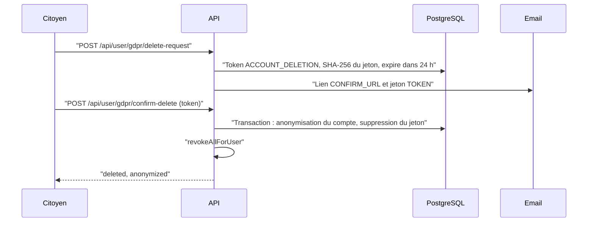

# RGPD

Cette page décrit l'application du règlement (UE) 2016/679 (RGPD) dans BlockLucky : qui est responsable, sur quelles bases les données sont traitées, combien de temps elles sont gardées, et surtout ce que le code fait réellement quand un citoyen exerce ses droits. Le détail traitement par traitement est dans le [registre des traitements](registre-traitements.md) ; les questions propres à la chaîne sont dans [Blockchain et données personnelles](blockchain-donnees.md). Elle ne constitue pas un avis juridique.

## Responsable et contacts

| Rôle | Entité | Contact |
|---|---|---|
| Responsable de traitement | Ville d'EtherBay, Direction des Systèmes d'Information | dsi@etherbay.fr |
| Délégué à la protection des données | DPO de la Ville | dpo@etherbay.fr |
| Appui technique | Équipe BlockLucky (Epitech Digital School) | |

Ces informations figurent aussi dans la politique de confidentialité, commune au web (`/confidentialite`) et à l'application mobile (écran `Legal`) et rédigée dans [`frontend-web/src/content/legal.ts`](src:frontend-web/src/content/legal.ts), ainsi que dans l'export JSON (`controller`). La désignation effective du DPO et l'adresse dpo@etherbay.fr sont à confirmer par la Ville.

## Données traitées

| Catégorie | Données | Stockage |
|---|---|---|
| Identification | Email, identifiant de compte, empreinte du mot de passe, prénom et nom facultatifs | Table `User` |
| Vérification d'âge | Photos du recto et du verso de la pièce d'identité, statut, dates d'envoi et de décision, motif d'un refus, agent qui a statué | Tables `IdentityDocument` (images chiffrées) et `User` |
| Portefeuille | Adresse, clé privée chiffrée, hash de la dotation de bienvenue | Table `User` |
| Participation | Tickets, hash de transaction, adresse payeuse, tours | Tables `Ticket`, `LotteryRound` |
| Fidélité | Solde et journal des points, récompenses et codes promo obtenus | Tables `User`, `PointTransaction`, `ClaimedReward` |
| Parrainage | Code de parrainage, parrain | Table `User` |
| Sécurité | Secret TOTP chiffré, empreintes des codes de secours, codes temporaires, compteurs, révocations | Table `User`, Redis |
| Déclaratif | Confirmation de majorité, exigée à la connexion web et à l'inscription mobile par mot de passe ; tranche d'âge (`18-25`, `26-35`, `36-50`, `50+`), demandée par la connexion web seulement ; acceptation des CGU et du règlement, vérifiée mais non enregistrée | Métadonnées de l'événement analytique `USER_SIGNUP` |
| Préférences | Thème, langue, interrupteur général et catégories de notifications, quêtes accomplies | Redis (`user:prefs:*`, `user:quests:*`) |
| Mesure d'audience | Type d'événement, source UTM, plateforme, page, identifiant du compte s'il est connecté ; sur le web, seulement après accord | Table `Analytics` |

Aucune donnée bancaire n'est collectée. Le prénom et le nom ne sont saisis que si le citoyen les renseigne dans l'écran Données personnelles du mobile ; ils servent à l'affichage des paramètres et aux messages envoyés au support. La date de naissance, le numéro du document et, le cas échéant, l'adresse ne sont pas saisis, mais ils figurent sur les photos de la pièce d'identité jusqu'à la décision de la Mairie : ce sont alors des données d'identité civile, à protéger en conséquence. Le modèle complet est décrit dans [Modèle de données](../base-de-donnees/modele.md).

## Bases légales

| Traitement | Base légale retenue | Commentaire |
|---|---|---|
| Compte et participation à la loterie | Exécution du contrat (CGU et règlement de participation) | Textes acceptés par une case obligatoire à la connexion web et à l'inscription mobile par mot de passe ; rédigés pour le scénario, à relire par un juriste |
| Programme EtherPoints et récompenses | Exécution du contrat | |
| Vérification d'âge par pièce d'identité | Obligation légale (exclusion des mineurs des jeux d'argent), à confirmer | Voir [Mineurs](#mineurs) |
| Sécurité des comptes (mot de passe, 2FA, limites, révocation) | Intérêt légitime | |
| Mesure d'audience du web | Consentement | Bandeau au premier passage ; aucun événement ni source UTM enregistré avant l'accord |
| Événements de connexion et d'inscription enregistrés par le serveur | Intérêt légitime | `USER_LOGIN` et `USER_SIGNUP`, hors du champ du bandeau |
| Journal d'administration | Obligation légale et intérêt légitime | |
| Emails transactionnels | Exécution du contrat et intérêt légitime | Codes, alertes, bienvenue, confirmation RGPD, codes promo |
| Messages au support | Exécution du contrat, à confirmer | Objet, message, identifiant, email, prénom et nom transmis à l'adresse `SUPPORT_EMAIL` ; aucune copie en base |

Le choix de l'exécution du contrat pour un service public communal, plutôt que la mission d'intérêt public, est à confirmer par le DPO (voir [Points à valider](points-a-valider.md)).

## Durées de conservation

| Donnée | Durée annoncée | Ce que fait le code |
|---|---|---|
| Code de connexion, d'inscription, de réinitialisation ou de changement d'email | 10 minutes | Fait : TTL Redis |
| Photos de la pièce d'identité | Jusqu'à la décision de la Mairie | Fait : effacées dans la transaction de la décision ; **aucune limite** pour une demande jamais traitée |
| Décision sur l'âge (statut, date, motif d'un refus) | Durée du compte | Conservée sur `User` et dans le journal d'administration (`IDENTITY_VERIFICATION_DECISION`, avec le motif) |
| Compteur d'échecs | 1 heure | Fait : TTL Redis |
| Révocation d'une session | Durée restante du jeton | Fait : TTL Redis |
| Marqueur anti-rejeu TOTP | 2 minutes | Fait : TTL Redis |
| Jeton de suppression RGPD | 24 heures | Fait pour la validité ; la ligne expirée n'est pas purgée de la table `Token` |
| Réponses idempotentes | 24 heures | Fait : TTL Redis |
| Compte et participation | Durée du pilote, puis anonymisation au plus tard six mois après le bilan (politique de confidentialité) | **Non implémenté** : aucune purge automatique |
| Mesure d'audience | 13 mois au plus (registre) | **Non implémenté** |
| Journal d'administration | 1 an (registre) | **Non implémenté** |
| Préférences dans Redis | Durée du compte | Sans expiration ; non supprimées à l'anonymisation |

> [!WARNING]
> Les durées longues ne sont aujourd'hui que des engagements écrits. Avant une exploitation réelle, il faut un traitement périodique (une tâche BullMQ planifiée, par exemple) qui anonymise les comptes inactifs, supprime les événements analytiques de plus de 13 mois, les entrées du journal d'administration de plus d'un an et les jetons expirés.

## Droits des personnes

### Accès et portabilité

`GET /api/user/gdpr/export` (authentifié) renvoie un document JSON construit par `exportGdprData` de [`backend/src/api/user/user.services.ts`](src:backend/src/api/user/user.services.ts). Le web le propose depuis Profil, puis Données personnelles ([`frontend-web/src/app/(citoyen)/profil/rgpd/page.tsx`](src:frontend-web/src/app/(citoyen)/profil/rgpd/page.tsx)) ; le mobile depuis Paramètres, puis Données personnelles, bouton « Télécharger mes données » ([`mobile-app/src/screens/settings/PersonalDataScreen.tsx`](src:mobile-app/src/screens/settings/PersonalDataScreen.tsx)).

| Clé de l'export | Contenu |
|---|---|
| `exportedAt`, `controller` | Date et responsable de traitement |
| `personalData` | Identifiant, adresse du portefeuille, email, prénom, nom, rôle, solde de points, code de parrainage, état de la 2FA, statut et date de la vérification d'âge, dates de création et de mise à jour |
| `ticketsHistory` | Tickets avec leur tour |
| `pointsLedger` | Journal complet des points |
| `claimedRewards` | Récompenses, offre et commerçant |
| `analyticsEvents` | Événements analytiques rattachés au compte |

L'export ne contient ni la clé privée chiffrée, ni l'empreinte du mot de passe, ni le secret TOTP, ni les empreintes des codes de secours. Il omet aussi des données qui devraient y figurer : préférences et quêtes stockées dans Redis, parrain et liste des filleuls, motif d'un refus de la pièce d'identité et dates de la demande. Les photos de la pièce n'y figurent pas ; elles sont de toute façon effacées dès la décision.

### Effacement

Le jeton de 32 octets aléatoires est stocké haché en SHA-256 ; seul l'email le contient en clair. Hors production, la réponse de `delete-request` contient aussi `confirmationToken`, pour faciliter les tests.

L'anonymisation, faite par `anonymizeUserAccount` de [`backend/src/api/user/user.repo.ts`](src:backend/src/api/user/user.repo.ts), modifie la ligne `User` :

| Champ | Après anonymisation |
|---|---|
| `walletAddress` | `0xdeleted_gdpr_<8 premiers caractères de l'identifiant>` |
| `walletEncryptedKey` | `null` : la clé privée est détruite |
| `welcomeGrantTxHash` | `null` |
| `email` | `null` |
| `passwordHash` | `null` |
| `firstName`, `lastName` | `null` |
| `ageVerificationNote` | `null` ; le statut et la date de vérification sont conservés |
| `twoFactorSecret`, `twoFactorMethod`, `twoFactorBackupCodes`, `isTwoFactorEnabled` | Effacés |
| `deletedAt` | Date de la suppression |

La même transaction supprime la ligne `IdentityDocument` du compte, avec ses photos si la demande était encore en attente.

Ce qui **n'est pas** effacé :

| Donnée | Situation |
|---|---|
| Ligne `User` | Conservée (suppression logique), avec `id`, `role`, `pointsBalance`, `referralCode`, `referredById` |
| Tickets | Conservés avec `transactionHash`, `payerWallet` et `userId` : le lien entre l'identifiant du compte et l'ancienne adresse du portefeuille subsiste par ces colonnes |
| Journal des points, récompenses et codes promo | Conservés, rattachés à l'identifiant |
| Événements analytiques | Conservés avec `userId` et leurs métadonnées, y compris le motif d'un refus de pièce d'identité dans le journal d'administration |
| Données Redis | Préférences et quêtes non supprimées |
| Entreprises partenaires | Restent rattachées au compte (`ownerId`), puisque la ligne `User` n'est pas supprimée |
| Transactions sur la chaîne | Impossibles à effacer (voir [Blockchain et données personnelles](blockchain-donnees.md)) |

Une fois l'email supprimé, ces données restantes ne permettent plus d'identifier directement la personne à partir de la base. Elles restent cependant pseudonymes, et non anonymes au sens strict : un tiers qui connaîtrait l'adresse du portefeuille du citoyen pourrait la retrouver dans `Ticket.payerWallet`. Le parcours est détaillé dans [Suppression RGPD](../architecture/flux/suppression-rgpd.md).

> [!WARNING]
> Le lien envoyé par email pointe vers `${FRONTEND_URL}/gdpr/confirm-delete?token=...`, mais le frontend web ne contient aucune page à ce chemin : le lien aboutit à une page 404. La confirmation fonctionne en collant le jeton, également présent dans l'email, dans la page Profil, puis Données personnelles. Par ailleurs, placer un jeton dans une URL l'expose dans l'historique du navigateur et les journaux des proxys.

### Rectification

Le citoyen peut modifier son thème, sa langue et ses notifications. Sur le mobile, il peut aussi rectifier lui-même :

| Donnée | Écran | Route |
|---|---|---|
| Prénom et nom (50 caractères au plus ; un champ vide efface la valeur) | Paramètres, puis Données personnelles | `PATCH /api/user/profile` |
| Adresse email, confirmée par un code envoyé à la nouvelle adresse ; l'ancienne reçoit une alerte | Paramètres, puis Sécurité | `POST /api/auth/email/change`, `POST /api/auth/email/confirm` |

Le web ne propose aucun de ces deux écrans. Les autres rectifications passent par une demande au DPO, avec une réponse sous un mois.

### Consentement à la mesure d'audience

Sur le web, la mesure ne fonctionne qu'après un accord donné dans le bandeau de consentement. Le choix est enregistré dans `bl.consent.choice` du `localStorage`, avec sa date, pour 182 jours ; il se modifie à tout moment par « Gérer mes traceurs » (pied de page, `/traceurs`, `/confidentialite`). Tant que l'accord manque, `trackEvent` de [`frontend-web/src/lib/analytics.ts`](src:frontend-web/src/lib/analytics.ts) n'envoie aucun événement et la source UTM n'est pas enregistrée ; un refus efface celle déjà enregistrée. Le choix est propre à l'appareil et au navigateur. Il ne couvre pas les événements `USER_LOGIN` et `USER_SIGNUP`, enregistrés par le serveur à chaque connexion et inscription. L'application mobile n'envoie pas d'événement de parcours. Voir [Analytique et consentement](../web/analytique-consentement.md).

### Délai de réponse

Les droits d'accès, de portabilité et d'effacement sont en libre-service et immédiats. Les autres demandes sont traitées par le DPO dans le délai d'un mois prévu par le RGPD.

## Mineurs

La participation est réservée aux majeurs. Deux mécanismes coexistent :

| Mécanisme | Où | Portée |
|---|---|---|
| Déclaration de majorité (`isAdultConfirmed: true`) | Connexion web `POST /api/auth/login` et inscription mobile `POST /api/auth/signup` | Déclarative ; la connexion Google ne la demande pas |
| Vérification d'âge par pièce d'identité | `POST /api/user/identity`, décision d'un agent de la Mairie | Exigée pour acheter ou offrir un ticket, échanger une récompense et acheter un ticket à gratter (`AGE_VERIFICATION_REQUIRED`, obligatoire en production) |

Le citoyen envoie depuis `/profil/identite` sur le web, ou depuis l'application mobile, une photo du recto et du verso, après avoir coché sur le web une case de consentement à la consultation par la Mairie. Les images sont chiffrées à la réception, consultées par un agent sur la page Identités de l'espace Mairie, puis effacées à la décision ; le citoyen reçoit la décision par email, avec le motif en cas de refus, et peut envoyer une nouvelle pièce. Chaque consultation et chaque décision sont journalisées. Le détail technique est dans [Autorisations](../securite/autorisations.md#verification-d-age).

Le contrôle a des limites à faire connaître :

- l'agent juge sur photo : aucun contrôle ne vérifie que la pièce est authentique ni qu'elle appartient à la personne qui joue ;
- l'API ne connaît pas la date de naissance : la décision est entièrement humaine et n'est pas réexaminée ;
- un achat direct sur le contrat, sans passer par BlockLucky, échappe au contrôle ;

La collecte d'une copie de pièce d'identité est un traitement sensible pour la CNIL, qui recommande de la limiter au strict nécessaire et de privilégier des solutions de vérification d'âge qui ne transmettent pas l'identité au service. La proportionnalité de ce choix et la nécessité d'une analyse d'impact sont à valider (voir [Points à valider](points-a-valider.md)).

> [!IMPORTANT]
> Le cadeau d'un ticket (`POST /api/lottery/gift`) crée un compte pour l'email du bénéficiaire s'il n'en a pas, avec un portefeuille, sans que ce bénéficiaire ait vérifié sa majorité ni accepté les conditions, et en le rattachant à l'expéditeur comme filleul. Le contrôle d'âge ne porte que sur l'expéditeur : le bénéficiaire détient un ticket sans avoir fait vérifier son âge. C'est un traitement de données d'un tiers sans démarche de sa part. La base légale de ce traitement et l'information du bénéficiaire sont à valider (voir [Points à valider](points-a-valider.md)).

## Sous-traitants et transferts

| Sous-traitant | Usage | Localisation | Contrat (article 28) |
|---|---|---|---|
| Hébergeur de l'API et de la base | Hébergement | À désigner, UE exigée | À signer |
| Fournisseur SMTP | Envoi des emails | À désigner, UE exigée | À signer |
| Stockage objet S3 | Exports comptables et visuels | `AWS_REGION`, `eu-west-3` (Paris) par défaut | À signer |
| Fournisseur RPC Ethereum | Lecture et écriture sur la chaîne | À désigner ; le RPC de secours par défaut est un service public (`FALLBACK_RPC_URL`) | À signer |
| Chainlink | Aléa du tirage | Réseau décentralisé | Ne reçoit aucune donnée personnelle |

Le fournisseur RPC voit passer les adresses de portefeuille et l'adresse IP du serveur, pas l'email.

## Sécurité du traitement

Les mesures de sécurité (article 32) sont décrites dans la partie [Sécurité](../securite/menaces.md). En cas de violation de données, la procédure de notification à la CNIL sous 72 heures et d'information des personnes figure dans le [plan de réponse aux incidents](../infrastructure/incidents.md).

## Ce qui reste à faire

| Sujet | État |
|---|---|
| Purges automatiques | À implémenter |
| Export complet (Redis, parrainage) | À compléter |
| Page web de confirmation de suppression | À créer, ou lien à retirer de l'email |
| Effacement des données Redis à l'anonymisation | À ajouter |
| Délai maximal pour une pièce d'identité jamais traitée | À fixer et à implémenter |
| Information sur la vérification d'âge dans la politique de confidentialité | Faite |
| Analyse d'impact (AIPD) | Version de travail rédigée ([AIPD](aipd.md)), avis du DPO à recueillir |
| Contrats de sous-traitance | À signer |
| Preuve du consentement | Choix conservé sur l'appareil seulement ; aucune trace côté serveur, ni de l'acceptation des CGU et du règlement |
