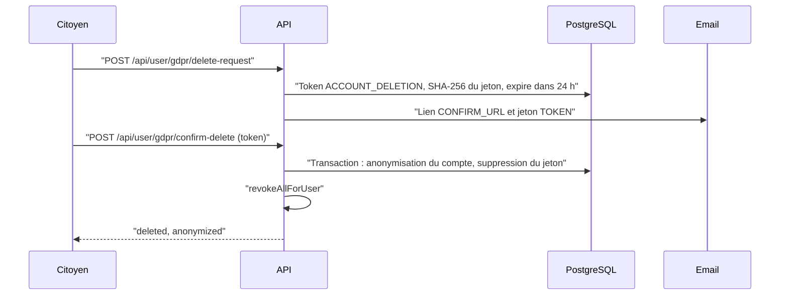

# RGPD

Cette page décrit l'application du règlement (UE) 2016/679 (RGPD) dans BlockLucky : qui est responsable, sur quelles bases les données sont traitées, combien de temps elles sont gardées, et surtout ce que le code fait réellement quand un citoyen exerce ses droits. Le détail traitement par traitement est dans le [registre des traitements](registre-traitements.md) ; les questions propres à la chaîne sont dans [Blockchain et données personnelles](blockchain-donnees.md). Elle ne constitue pas un avis juridique.

## Responsable et contacts

| Rôle | Entité | Contact |
|---|---|---|
| Responsable de traitement | Ville d'EtherBay, Direction des Systèmes d'Information | dsi@etherbay.fr |
| Délégué à la protection des données | DPO de la Ville | dpo@etherbay.fr |
| Appui technique | Équipe BlockLucky (Epitech Digital School) | |

Ces informations figurent aussi dans la politique de confidentialité du web ([`frontend-web/src/app/confidentialite/page.tsx`](src:frontend-web/src/app/confidentialite/page.tsx)) et dans l'export JSON (`controller`). La désignation effective du DPO et l'adresse dpo@etherbay.fr sont à confirmer par la Ville.

## Données traitées

| Catégorie | Données | Stockage |
|---|---|---|
| Identification | Email, identifiant de compte | Table `User` |
| Portefeuille | Adresse, clé privée chiffrée, hash de la dotation de bienvenue | Table `User` |
| Participation | Tickets, hash de transaction, adresse payeuse, tours | Tables `Ticket`, `LotteryRound` |
| Fidélité | Solde et journal des points, récompenses et codes promo obtenus | Tables `User`, `PointTransaction`, `ClaimedReward` |
| Parrainage | Code de parrainage, parrain | Table `User` |
| Sécurité | Secret TOTP chiffré, empreintes des codes de secours, codes temporaires, compteurs, révocations | Table `User`, Redis |
| Déclaratif | Confirmation de majorité, tranche d'âge (`18-25`, `26-35`, `36-50`, `50+`) | Métadonnées de l'événement analytique `USER_SIGNUP` |
| Préférences | Thème, langue, notifications, limite de jeu responsable, quêtes accomplies | Redis (`user:prefs:*`, `user:ticket_limit:*`, `user:quests:*`) |
| Mesure d'audience | Type d'événement, source UTM, plateforme, page, identifiant du compte s'il est connecté | Table `Analytics` |

Aucune donnée bancaire, aucun nom, aucune adresse postale ni aucun document d'identité n'est collecté. Le modèle complet est décrit dans [Modèle de données](../base-de-donnees/modele.md).

## Bases légales

| Traitement | Base légale retenue | Commentaire |
|---|---|---|
| Compte et participation à la loterie | Exécution du contrat (conditions de participation) | Les conditions publiées sont une version de travail |
| Programme EtherPoints et récompenses | Exécution du contrat | |
| Sécurité des comptes (2FA, limites, révocation) | Intérêt légitime | |
| Mesure d'audience | Intérêt légitime, avec opposition | Le droit d'opposition n'est offert que sur le web et ne couvre pas les événements enregistrés par le serveur |
| Journal d'administration | Obligation légale et intérêt légitime | |
| Emails transactionnels | Exécution du contrat et intérêt légitime | Codes, alertes, bienvenue, confirmation RGPD, codes promo |

Le choix de l'exécution du contrat pour un service public communal, plutôt que la mission d'intérêt public, est à confirmer par le DPO (voir [Points à valider](points-a-valider.md)).

## Durées de conservation

| Donnée | Durée annoncée | Ce que fait le code |
|---|---|---|
| Code de connexion email | 10 minutes | Fait : TTL Redis |
| Compteur d'échecs | 1 heure | Fait : TTL Redis |
| Révocation d'une session | Durée restante du jeton | Fait : TTL Redis |
| Marqueur anti-rejeu TOTP | 2 minutes | Fait : TTL Redis |
| Jeton de suppression RGPD | 24 heures | Fait pour la validité ; la ligne expirée n'est pas purgée de la table `Token` |
| Réponses idempotentes | 24 heures | Fait : TTL Redis |
| Compte et participation | Durée du pilote, puis anonymisation au plus tard six mois après le bilan (politique de confidentialité) | **Non implémenté** : aucune purge automatique |
| Mesure d'audience | 13 mois au plus (registre) | **Non implémenté** |
| Journal d'administration | 1 an (registre) | **Non implémenté** |
| Préférences dans Redis | Durée du compte | Sans expiration ; non supprimées à l'anonymisation |

> [!WARNING]
> Les durées longues ne sont aujourd'hui que des engagements écrits. Avant une exploitation réelle, il faut un traitement périodique (une tâche BullMQ planifiée, par exemple) qui anonymise les comptes inactifs, supprime les événements analytiques de plus de 13 mois, les entrées du journal d'administration de plus d'un an et les jetons expirés.

## Droits des personnes

### Accès et portabilité

`GET /api/user/gdpr/export` (authentifié) renvoie un document JSON construit par `exportGdprData` de [`backend/src/api/user/user.services.ts`](src:backend/src/api/user/user.services.ts). Le web le propose depuis Profil, puis Données personnelles ([`frontend-web/src/app/(citoyen)/profil/rgpd/page.tsx`](src:frontend-web/src/app/(citoyen)/profil/rgpd/page.tsx)) ; le mobile depuis l'écran [`mobile-app/src/screens/settings/GDPRScreen.tsx`](src:mobile-app/src/screens/settings/GDPRScreen.tsx).

| Clé de l'export | Contenu |
|---|---|
| `exportedAt`, `controller` | Date et responsable de traitement |
| `personalData` | Identifiant, adresse du portefeuille, email, rôle, solde de points, code de parrainage, état de la 2FA, dates de création et de mise à jour |
| `ticketsHistory` | Tickets avec leur tour |
| `pointsLedger` | Journal complet des points |
| `claimedRewards` | Récompenses, offre et commerçant |
| `analyticsEvents` | Événements analytiques rattachés au compte |

L'export ne contient ni la clé privée chiffrée, ni le secret TOTP, ni les empreintes des codes de secours. Il omet aussi des données qui devraient y figurer : préférences, limite de jeu responsable et quêtes stockées dans Redis, parrain et liste des filleuls.

### Effacement

Le jeton de 32 octets aléatoires est stocké haché en SHA-256 ; seul l'email le contient en clair. Hors production, la réponse de `delete-request` contient aussi `confirmationToken`, pour faciliter les tests.

L'anonymisation, faite par `anonymizeUserAccount` de [`backend/src/api/user/user.repo.ts`](src:backend/src/api/user/user.repo.ts), modifie la ligne `User` :

| Champ | Après anonymisation |
|---|---|
| `walletAddress` | `0xdeleted_gdpr_<8 premiers caractères de l'identifiant>` |
| `walletEncryptedKey` | `null` : la clé privée est détruite |
| `welcomeGrantTxHash` | `null` |
| `email` | `null` |
| `twoFactorSecret`, `twoFactorMethod`, `twoFactorBackupCodes`, `isTwoFactorEnabled` | Effacés |
| `deletedAt` | Date de la suppression |

Ce qui **n'est pas** effacé :

| Donnée | Situation |
|---|---|
| Ligne `User` | Conservée (suppression logique), avec `id`, `role`, `pointsBalance`, `referralCode`, `referredById` |
| Tickets | Conservés avec `transactionHash`, `payerWallet` et `userId` : le lien entre l'identifiant du compte et l'ancienne adresse du portefeuille subsiste par ces colonnes |
| Journal des points, récompenses et codes promo | Conservés, rattachés à l'identifiant |
| Événements analytiques | Conservés avec `userId` et leurs métadonnées |
| Données Redis | Préférences, limite de jeu et quêtes non supprimées |
| Entreprises partenaires | Restent rattachées au compte (`ownerId`), puisque la ligne `User` n'est pas supprimée |
| Transactions sur la chaîne | Impossibles à effacer (voir [Blockchain et données personnelles](blockchain-donnees.md)) |

Une fois l'email supprimé, ces données restantes ne permettent plus d'identifier directement la personne à partir de la base. Elles restent cependant pseudonymes, et non anonymes au sens strict : un tiers qui connaîtrait l'adresse du portefeuille du citoyen pourrait la retrouver dans `Ticket.payerWallet`. Le parcours est détaillé dans [Suppression RGPD](../architecture/flux/suppression-rgpd.md).

> [!WARNING]
> Le lien envoyé par email pointe vers `${FRONTEND_URL}/gdpr/confirm-delete?token=...`, mais le frontend web ne contient aucune page à ce chemin : le lien aboutit à une page 404. La confirmation fonctionne en collant le jeton, également présent dans l'email, dans la page Profil, puis Données personnelles. Par ailleurs, placer un jeton dans une URL l'expose dans l'historique du navigateur et les journaux des proxys.

### Rectification

Le citoyen peut modifier son thème, sa langue, ses notifications et sa limite de jeu. Aucune route ne permet de changer l'adresse email ; la rectification passe par une demande au DPO, avec une réponse sous un mois.

### Opposition à la mesure d'audience

Sur le web, le bouton de la page Confidentialité enregistre `bl.tracking.optout` dans le `localStorage`. `trackEvent` de [`frontend-web/src/lib/analytics.ts`](src:frontend-web/src/lib/analytics.ts) n'envoie alors plus d'événement. Le choix est propre à l'appareil et au navigateur. Il ne couvre pas les événements `USER_LOGIN` et `USER_SIGNUP`, enregistrés par le serveur à chaque connexion et inscription. L'application mobile n'envoie pas d'événement de parcours. Voir [Analytique et consentement](../web/analytique-consentement.md).

### Délai de réponse

Les droits d'accès, de portabilité et d'effacement sont en libre-service et immédiats. Les autres demandes sont traitées par le DPO dans le délai d'un mois prévu par le RGPD.

## Mineurs

La participation est réservée aux majeurs. Le schéma de connexion exige `isAdultConfirmed: true`, et les conditions de participation le rappellent. C'est une déclaration, sans vérification.

> [!IMPORTANT]
> Le cadeau d'un ticket (`POST /api/lottery/gift`) crée un compte pour l'email du bénéficiaire s'il n'en a pas, avec un portefeuille, sans que ce bénéficiaire ait confirmé sa majorité ni accepté les conditions, et en le rattachant à l'expéditeur comme filleul. C'est un traitement de données d'un tiers sans démarche de sa part. La base légale de ce traitement et l'information du bénéficiaire sont à valider (voir [Points à valider](points-a-valider.md)).

## Sous-traitants et transferts

| Sous-traitant | Usage | Localisation | Contrat (article 28) |
|---|---|---|---|
| Hébergeur de l'API et de la base | Hébergement | À désigner, UE exigée | À signer |
| Fournisseur SMTP | Envoi des emails | À désigner, UE exigée | À signer |
| Stockage objet S3 | Exports comptables et visuels | `AWS_REGION`, `eu-west-3` (Paris) par défaut | À signer |
| Fournisseur RPC Ethereum | Lecture et écriture sur la chaîne | À désigner ; le RPC de secours par défaut est un service public (`FALLBACK_RPC_URL`) | À signer |
| Chainlink | Aléa du tirage | Réseau décentralisé | Ne reçoit aucune donnée personnelle |

Le fournisseur RPC voit passer les adresses de portefeuille et l'adresse IP du serveur, pas l'email.

## Sécurité du traitement

Les mesures de sécurité (article 32) sont décrites dans la partie [Sécurité](../securite/menaces.md). En cas de violation de données, la procédure de notification à la CNIL sous 72 heures et d'information des personnes figure dans le [plan de réponse aux incidents](../infrastructure/incidents.md).

## Ce qui reste à faire

| Sujet | État |
|---|---|
| Purges automatiques | À implémenter |
| Export complet (Redis, parrainage) | À compléter |
| Page web de confirmation de suppression | À créer, ou lien à retirer de l'email |
| Effacement des données Redis à l'anonymisation | À ajouter |
| Analyse d'impact (AIPD) | Non réalisée ; sa nécessité est à apprécier par le DPO |
| Contrats de sous-traitance | À signer |
| Preuve du consentement | Sans objet tant qu'aucun traitement ne repose sur le consentement |
