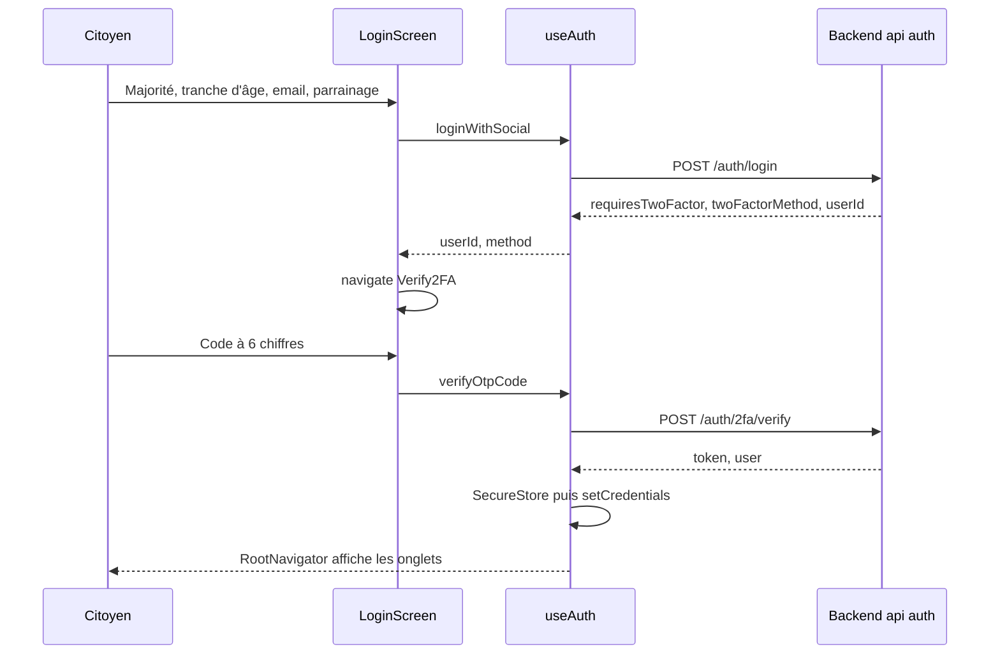

# Authentification et stockage sécurisé

L'application mobile utilise les mêmes routes d'authentification que le web : `POST /auth/login`, puis `POST /auth/2fa/verify` quand un code est demandé, et `POST /auth/logout`. Elle s'en distingue par le stockage : le jeton de session est rangé dans le trousseau d'iOS ou le Keystore d'Android grâce à `expo-secure-store`. Cette page décrit le parcours, le stockage et plusieurs défauts importants du code actuel. Les règles côté serveur sont dans [Authentification et 2FA](../securite/authentification.md) et [Sessions](../securite/sessions.md).

Fichiers principaux :

| Fichier | Rôle |
|---|---|
| [`mobile-app/src/screens/auth/SignInScreen.tsx`](src:mobile-app/src/screens/auth/SignInScreen.tsx) | Formulaire de connexion |
| [`mobile-app/src/screens/auth/Verify2FAScreen.tsx`](src:mobile-app/src/screens/auth/Verify2FAScreen.tsx) | Saisie du code |
| [`mobile-app/src/screens/auth/Setup2FAScreen.tsx`](src:mobile-app/src/screens/auth/Setup2FAScreen.tsx) | Activation de la 2FA |
| [`mobile-app/src/hooks/useAuth.ts`](src:mobile-app/src/hooks/useAuth.ts) | Connexion, vérification, déconnexion |
| [`mobile-app/src/services/secureStorage.ts`](src:mobile-app/src/services/secureStorage.ts) | Accès au stockage sécurisé |
| [`mobile-app/src/store/slices/authSlice.ts`](src:mobile-app/src/store/slices/authSlice.ts) | État `auth` |

## Parcours de connexion



### Formulaire

| Champ | Comportement |
|---|---|
| Majorité | Modale « 18+ » ouverte au premier affichage ; case obligatoire avant tout envoi |
| Tranche d'âge | `18-25` par défaut, choix parmi `18-25`, `26-35`, `36-50`, `50+` |
| Email | Prérempli avec `citoyen@etherbay.fr` ; validé par `isValidEmail` pour le bouton email |
| Parrainage | Champ libre, envoyé s'il n'est pas vide |
| Source | Toujours `utmSource: 'MOBILE_APP'` |
| Fournisseur | `GOOGLE` ou `EMAIL` selon le bouton |

Le bouton « Continuer avec Google » n'ouvre aucune authentification Google : il envoie l'email saisi avec `provider: 'GOOGLE'`. Si le champ est vide, l'écran utilise l'adresse de repli `google-user@etherbay.fr`. Ce comportement vient d'une ancienne intégration Web3Auth abandonnée, dont il reste la variable inutilisée `EXPO_PUBLIC_WEB3AUTH_CLIENT_ID`.

### Adresse envoyée au login

L'écran calcule `walletAddress` avec `generateDeterministicWallet(seed)` de [`useCitizenWallet`](src:mobile-app/src/hooks/useCitizenWallet.ts), un calcul non cryptographique identique à celui du web. Le backend exige ce champ (format `0x` et 40 caractères hexadécimaux), s'en sert comme première clé de recherche d'un compte existant, puis l'ignore à la création : le portefeuille réel est créé par `walletService.createCustodialWallet()` dans [`backend/src/api/auth/auth.services.ts`](src:backend/src/api/auth/auth.services.ts). L'adresse affichée par l'application est toujours celle de l'API. Le détail est dans [Portefeuilles intégrés](../integration-blockchain/portefeuilles.md).

### Réponse sans profil quand un code est demandé

Quand le backend demande un code (cas par défaut, `LOGIN_EMAIL_CODE_REQUIRED=true`, ou 2FA active), sa réponse contient `requiresTwoFactor`, `twoFactorMethod` et `userId`, mais pas d'objet `user`. Le type `SocialLoginResponse` de [`mobile-app/src/types/api.types.ts`](src:mobile-app/src/types/api.types.ts) déclare donc `user` comme facultatif, et `loginWithSocial` reprend l'email saisi quand le profil est absent :

```typescript
return {
  requiresTwoFactor: true,
  userId: result.userId,
  method: result.twoFactorMethod,
  email: result.user?.email ?? payload.email,
};
```

> [!NOTE]
> Une version précédente lisait `result.user.email` sans garde. La connexion par code levait alors une `TypeError`, affichée comme « Impossible de vous connecter au serveur ». Si ce message réapparaît, vérifier d'abord que cette branche n'a pas régressé.

### Vérification du code

`Verify2FAScreen` reçoit `userId`, `method` et `email` en paramètres de route. Il refuse tout code qui n'a pas exactement 6 chiffres (`isValidOtpCode`), puis appelle `verifyOtpCode`. En cas de succès, `useAuth` enregistre le jeton et le profil, dispatche `setCredentials`, et `RootNavigator` remplace l'`AuthStack` par les onglets. En cas d'erreur, le message du backend s'affiche sous le champ.

Comme sur le web, les codes de secours (alphanumériques, jusqu'à 16 caractères) ne peuvent pas être saisis : le validateur n'accepte que 6 chiffres. Le champ utilise `keyboardType="number-pad"`.

Contrairement au web, le mobile ne recharge pas le profil après la connexion (`GET /user/profile`) : l'objet `user` stocké est le profil réduit renvoyé par le login, sans statistiques ni plafond de jeu responsable. L'écran de sécurité affiche donc le plafond par défaut de 25 tant que l'utilisateur ne l'a pas modifié dans la session.

## 2FA

`Setup2FAScreen` propose les deux méthodes :

| Méthode | Affichage | Remarque |
|---|---|---|
| `APP` | Clé TOTP en texte et codes de secours | Le QR code renvoyé par l'API (`qrCodeDataUrl`) n'est pas affiché : la clé doit être saisie à la main dans l'application d'authentification |
| `EMAIL` | Message du backend | En développement, le code `devOtpPreview` est prérempli |

La confirmation appelle `verifyOtpCode(user.id, code)`. Le backend active la 2FA, révoque les autres sessions et renvoie un nouveau jeton, que l'application enregistre.

La désactivation, depuis `SecurityScreen`, appelle `disable2FA({})` sans code : le backend ne l'accepte que pour une session de moins de 15 minutes.

## Stockage sécurisé

[`secureStorage.ts`](src:mobile-app/src/services/secureStorage.ts) gère deux entrées :

| Clé | Contenu |
|---|---|
| `blocklucky_jwt_token` | Jeton JWT (12 h par défaut côté backend) |
| `blocklucky_user_profile` | Profil JSON de l'utilisateur |

Les écritures utilisent l'option `keychainAccessible: SecureStore.WHEN_UNLOCKED_THIS_DEVICE_ONLY` : sur iOS, l'entrée n'est lisible que lorsque l'appareil est déverrouillé et n'est jamais restaurée sur un autre appareil. Sur Android, `expo-secure-store` chiffre les valeurs avec une clé du Keystore. `app.json` désactive aussi la sauvegarde Android (`"allowBackup": false`), ce qui évite l'export des données de l'application dans les sauvegardes du système.

| Méthode | Comportement |
|---|---|
| `setToken`, `setUserJson` | Écrit dans un cache mémoire puis dans SecureStore |
| `getToken` | Lit le cache mémoire, sinon SecureStore (et remplit le cache) |
| `getUserJson` | Lit le cache mémoire, sinon SecureStore |
| `clearToken`, `clearSession` | Supprime le jeton, ou le jeton et le profil, du cache et de SecureStore |

Toutes les erreurs de SecureStore sont avalées par des `catch {}` vides. Si l'écriture échoue, la session tient grâce au cache mémoire jusqu'à la fermeture de l'application, sans message. Sur la cible web d'Expo (`Platform.OS === 'web'`), le module se rabat sur `localStorage` ; cette cible n'est pas utilisable en l'état (voir [Stack et structure](structure.md#scripts-npm)).

Le jeton est ajouté à chaque requête par `prepareHeaders` de [`baseApi.ts`](src:mobile-app/src/store/api/baseApi.ts), qui appelle `secureStorage.getToken()`, et au handshake Socket.IO par [`socket.client.ts`](src:mobile-app/src/services/socket.client.ts).

## Session au démarrage

> [!WARNING]
> L'application ne restaure pas la session. `authSlice` démarre avec `isAuthenticated: false` et aucun code ne relit `blocklucky_user_profile` au lancement : `getUserJson` n'est appelé nulle part. Après un redémarrage complet de l'application, l'utilisateur revient à l'introduction et doit se reconnecter, alors que le jeton est toujours dans SecureStore.

Effets de bord à connaître :

- l'ancien jeton reste stocké et continue d'être envoyé dans l'en-tête des requêtes faites depuis l'écran de connexion, jusqu'à ce qu'un nouveau login l'écrase ;
- `hasSeenOnboarding` n'est pas persisté non plus : l'introduction réapparaît à chaque démarrage à froid.

Pour restaurer la session, il faudrait, au montage de `App`, lire le jeton et le profil, dispatcher `setCredentials`, puis valider le jeton par `GET /user/profile`.

## Expiration et erreurs 401

Le `baseApi` mobile n'a pas de garde 401 : un jeton expiré ou révoqué n'entraîne pas de déconnexion. Les écrans connectés affichent alors des erreurs ou des données vides jusqu'à ce que l'utilisateur se déconnecte lui-même. Le web, lui, efface la session à la première réponse 401 (voir [État et appels API du web](../web/etat-api.md#le-client-de-base)).

## Déconnexion

`useAuth` expose `signOut` et `signOutEverywhere`, qui appellent `endSession(allDevices)` :

1. `POST /auth/logout` avec `{ allDevices }` ; le jeton part par `prepareHeaders` ; l'erreur est ignorée ;
2. `secureStorage.clearSession()` : suppression du jeton et du profil ;
3. `logout` dans le slice `auth`, ce qui ramène l'`AuthStack` ;
4. `baseApi.util.resetApiState()` pour vider le cache RTK Query.

| Déclencheur | Fonction |
|---|---|
| Bouton « Se déconnecter » du profil | `signOut` |
| Confirmation de l'anonymisation RGPD | `signOut` |
| Déconnexion de tous les appareils | `signOutEverywhere` existe dans le hook, mais aucun écran ne la propose |

La connexion Socket.IO n'est pas fermée à la déconnexion, contrairement au web : elle reste ouverte avec l'ancien jeton jusqu'à la fermeture de l'application. Côté serveur, la session est révoquée, donc une reconnexion de ce socket serait refusée.

## Comparaison avec le web

| Aspect | Web | Mobile |
|---|---|---|
| Stockage du jeton | `localStorage` | Trousseau iOS ou Keystore Android |
| Restauration au démarrage | Oui (`hydrateSession`) | Non |
| Garde 401 | Oui | Non |
| Rechargement du profil après connexion | Oui | Non |
| Connexion avec code | Fonctionne | Fonctionne |
| QR code TOTP | Affiché | Non affiché |
| Déconnecter tous les appareils | Bouton dans la sécurité | Non proposé |
| Fermeture du socket à la déconnexion | Oui | Non |

Les risques propres à chaque support sont analysés dans [Navigateur et mobile](../securite/navigateur-mobile.md).
