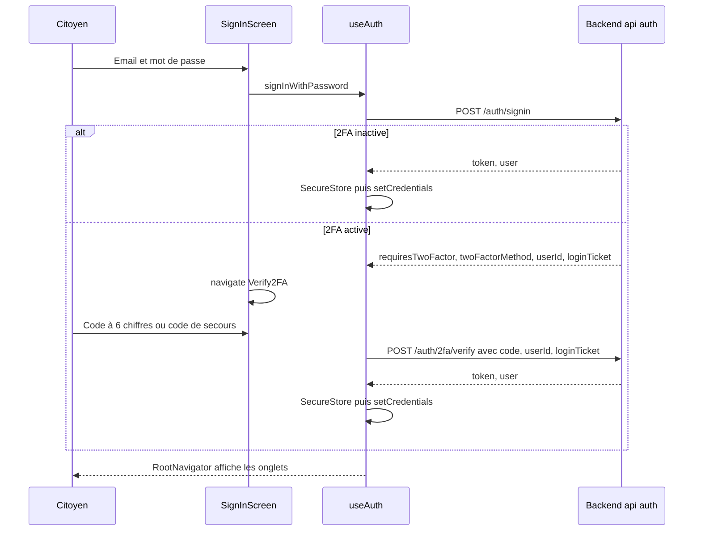
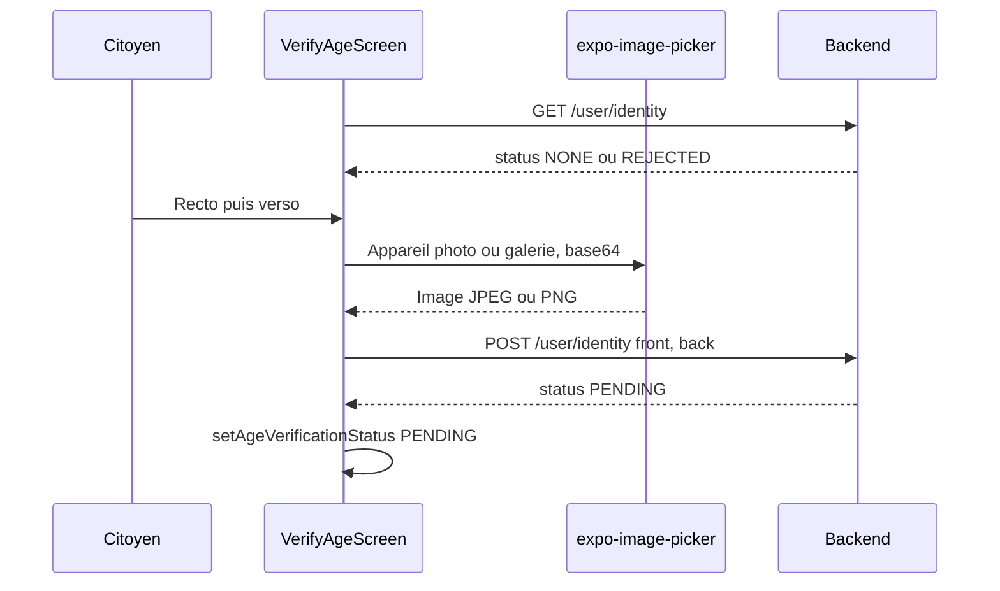

# Authentification et stockage sécurisé

L'application mobile utilise des comptes avec mot de passe : `POST /auth/signup` pour créer un compte, `POST /auth/signin` pour se connecter, `POST /auth/password/forgot` et `POST /auth/password/reset` pour un mot de passe oublié. Elle propose aussi la connexion Google (`POST /auth/oauth/google`) ; la connexion Apple a été retirée. `POST /auth/2fa/verify` confirme l'adresse email à l'inscription et sert d'étape de double authentification quand elle est activée. La connexion sans mot de passe par code email (`POST /auth/login`) n'est plus utilisée par le mobile ; le backend la conserve pour le web.

Le jeton de session est rangé dans le trousseau d'iOS ou le Keystore d'Android grâce à `expo-secure-store`. Cette page décrit les parcours, la vérification d'âge, le stockage et les défauts connus. Les règles côté serveur sont dans [Authentification et 2FA](../securite/authentification.md) et [Sessions](../securite/sessions.md).

Fichiers principaux :

| Fichier | Rôle |
|---|---|
| [`mobile-app/src/screens/auth/SignInScreen.tsx`](src:mobile-app/src/screens/auth/SignInScreen.tsx) | Connexion par email et mot de passe |
| [`mobile-app/src/screens/auth/SignUpScreen.tsx`](src:mobile-app/src/screens/auth/SignUpScreen.tsx) | Création de compte |
| [`mobile-app/src/screens/auth/Verify2FAScreen.tsx`](src:mobile-app/src/screens/auth/Verify2FAScreen.tsx) | Saisie du code |
| [`mobile-app/src/screens/auth/ForgotPasswordScreen.tsx`](src:mobile-app/src/screens/auth/ForgotPasswordScreen.tsx), [`ResetPasswordScreen.tsx`](src:mobile-app/src/screens/auth/ResetPasswordScreen.tsx) | Mot de passe oublié |
| [`mobile-app/src/screens/auth/Setup2FAScreen.tsx`](src:mobile-app/src/screens/auth/Setup2FAScreen.tsx) | Activation de la 2FA |
| [`mobile-app/src/components/auth/SocialAuthButtons.tsx`](src:mobile-app/src/components/auth/SocialAuthButtons.tsx) | Bouton Google |
| [`mobile-app/src/screens/settings/VerifyAgeScreen.tsx`](src:mobile-app/src/screens/settings/VerifyAgeScreen.tsx) | Envoi de la pièce d'identité |
| [`mobile-app/src/screens/settings/ChangeEmailScreen.tsx`](src:mobile-app/src/screens/settings/ChangeEmailScreen.tsx), [`ChangePasswordScreen.tsx`](src:mobile-app/src/screens/settings/ChangePasswordScreen.tsx) | Changement d'adresse email et de mot de passe depuis les paramètres |
| [`mobile-app/src/hooks/useAuth.ts`](src:mobile-app/src/hooks/useAuth.ts) | Connexion, inscription, vérification, mise à jour du profil local, session renouvelée, déconnexion |
| [`mobile-app/src/services/secureStorage.ts`](src:mobile-app/src/services/secureStorage.ts) | Accès au stockage sécurisé |
| [`mobile-app/src/store/slices/authSlice.ts`](src:mobile-app/src/store/slices/authSlice.ts) | État `auth` |

## Parcours de connexion

Toutes les fonctions de connexion de `useAuth` passent par `applySession`. Quand la réponse contient `requiresTwoFactor` et `userId`, elle enregistre la vérification en attente (`setPendingTwoFactor`) et renvoie `userId`, `method`, l'email, `devOtpPreview` et, pour la méthode `APP`, le `loginTicket` délivré par le backend après le mot de passe. `SignInScreen` et `SignUpScreen` le transmettent à `Verify2FA` en paramètre de route. Quand elle contient `token` et `user`, elle écrit le jeton et le profil dans SecureStore puis dispatche `setCredentials`, ce qui fait basculer `RootNavigator` vers les onglets.

`SignInScreen` vérifie le format de l'email (`isValidEmail`) et la présence du mot de passe avant l'envoi. Une erreur du backend, par exemple « Email ou mot de passe incorrect. », s'affiche dans un `FormMessage` annoncé par les lecteurs d'écran (`accessibilityLiveRegion="polite"`).

## Création de compte

`SignUpScreen` demande :

| Champ | Comportement |
|---|---|
| Email | Format vérifié par `isValidEmail` |
| Mot de passe | Règles affichées par `PasswordRules` : 10 à 128 caractères, au moins une lettre et un chiffre, les mêmes que `passwordPolicy` du backend |
| Confirmation | Doit être identique au mot de passe |
| Code de parrainage | Champ repliable, ouvert d'office si la route reçoit `referralCode` |
| Conditions | Case obligatoire « J'accepte les conditions générales d'utilisation et le règlement de participation. », envoyée comme `acceptTerms: true` ; liens « les CGU » et « le règlement » sous la case |
| Majorité | Case obligatoire « Je certifie avoir 18 ans ou plus. », envoyée comme `isAdultConfirmed: true` |
| Source | Toujours `utmSource: 'MOBILE_APP'` |

Le backend envoie un code à 6 chiffres par email et renvoie `requiresTwoFactor: true` avec un identifiant de demande. L'écran ouvre `Verify2FA` avec `purpose: 'signup'`. Le compte n'est créé qu'à la vérification du code. Les deux cases sont aussi exigées avant d'utiliser Google depuis cet écran (`canStart`). Le backend refuse une inscription sans `acceptTerms` ni `isAdultConfirmed` à `true`.

Les liens vers les CGU et le règlement, ainsi que la phrase finale « En créant un compte, vous reconnaissez avoir lu la politique de confidentialité. », ouvrent l'écran `Legal` de la pile racine avec le document demandé (`cgu`, `reglement` ou `confidentialite`), sans quitter l'inscription (voir [Navigation et écrans](navigation-ecrans.md)).

Le formulaire ne demande pas de tranche d'âge. La déclaration de majorité ne suffit pas pour jouer : l'âge est vérifié ensuite sur pièce d'identité (voir [Vérification d'âge](#verification-d-age)).

## Vérification du code

`Verify2FAScreen` reçoit `userId`, `method`, `loginTicket`, `email`, `purpose` et `devOtpPreview` en paramètres de route. `verifyOtpCode(userId, code, loginTicket)` ajoute le ticket au corps de `POST /auth/2fa/verify` quand il existe. Le backend n'accepte un code de l'application `APP` qu'avec un ticket valide pour ce compte ou une session du même compte (activation de la 2FA) ; sans ticket, il répond 401 « Connexion expirée ou incomplète : reconnectez-vous avant de saisir le code de votre application. ».

| Méthode | Saisie acceptée |
|---|---|
| `EMAIL` | 6 chiffres exactement (`isValidOtpCode`), clavier numérique ; lien pour revenir corriger l'adresse ou recommencer |
| `APP` | 6 chiffres, ou code de secours après appui sur le lien dédié : majuscules, au moins 6 caractères alphanumériques, format `XXXXX-XXXXX` |

En développement (`__DEV__`), `DevOtpHint` affiche le code renvoyé par le backend dans `devOtpPreview` et permet de le recopier dans le champ. En cas de succès, `verifyOtpCode` enregistre le jeton et le profil et dispatche `setCredentials`. Si la réponse demande encore un second facteur (`requiresTwoFactor`, `twoFactorMethod: 'APP'`, `userId`, `loginTicket`, cas d'un code email validé sur un compte protégé par application), l'écran vide le champ et se remplace par un nouveau `Verify2FA` avec la méthode `APP` et ce ticket. En cas d'erreur, le message du backend s'affiche sous le champ.

Contrairement au web, le mobile ne recharge pas le profil après la connexion : l'objet `user` stocké est le profil réduit renvoyé par la connexion. Il contient toutefois `hasPassword` et `ageVerificationStatus`, ajoutés par le backend. Les écrans Profil, Paramètres et Sécurité appellent eux-mêmes `GET /user/profile`.

## Mot de passe oublié

1. `ForgotPasswordScreen` envoie l'email à `POST /auth/password/forgot`. La réponse est identique que le compte existe ou non.
2. `ResetPasswordScreen` demande le code reçu, le nouveau mot de passe (mêmes règles qu'à l'inscription) et sa confirmation, et permet de redemander un code.
3. `POST /auth/password/reset` définit le mot de passe et révoque toutes les sessions du compte ; l'écran revient à `SignIn` par `popTo('SignIn')`.

Un compte créé sans mot de passe (connexion par code sur le web ou Google) peut ainsi en définir un.

## Google

[`SocialAuthButtons.tsx`](src:mobile-app/src/components/auth/SocialAuthButtons.tsx) est affiché sur `SignInScreen` et `SignUpScreen`.

| Fournisseur | Bibliothèque | Disponibilité | Jeton envoyé |
|---|---|---|---|
| Google | `Google.useIdTokenAuthRequest` de `expo-auth-session`, avec `expo-web-browser` | Si `EXPO_PUBLIC_GOOGLE_IOS_CLIENT_ID`, `EXPO_PUBLIC_GOOGLE_ANDROID_CLIENT_ID` ou `EXPO_PUBLIC_GOOGLE_WEB_CLIENT_ID` est défini pour la plateforme courante | `idToken` à `POST /auth/oauth/google` |

Le backend vérifie la signature et l'audience du jeton (voir [Authentification et 2FA](../securite/authentification.md)). Il répond 503 quand `GOOGLE_CLIENT_IDS` est vide : le bouton est alors désactivé et le message du backend s'affiche dessous. Sans identifiant Google côté application, le bouton reste visible mais désactivé.

La connexion Apple a été retirée du mobile et du backend : plus de bouton, de mutation `appleSignIn`, de dépendance `expo-apple-authentication` ni de capacité `usesAppleSignIn` dans `app.json`.

Les identifiants client de l'application doivent figurer dans `GOOGLE_CLIENT_IDS` du backend, sinon le jeton est refusé avec une erreur 401. Un compte protégé par une 2FA par application reçoit un `loginTicket` et passe par `Verify2FA` avant d'obtenir sa session.

> [!NOTE]
> Les variables `EXPO_PUBLIC_GOOGLE_*_CLIENT_ID` figurent vides dans [`mobile-app/.env.example`](src:mobile-app/.env.example). Il faut les renseigner dans `mobile-app/.env` pour tester la connexion Google.

## Vérification d'âge

L'achat et le cadeau de tickets, l'échange de récompenses et l'achat de tickets à gratter exigent un âge vérifié par la Mairie (`AGE_VERIFICATION_REQUIRED=true` côté backend). [`VerifyAgeScreen.tsx`](src:mobile-app/src/screens/settings/VerifyAgeScreen.tsx) envoie la pièce d'identité :

| Étape | Comportement |
|---|---|
| Statut | `GET /user/identity` à l'ouverture ; le statut reçu est recopié dans le profil stocké par `setAgeVerificationStatus` |
| Envoi possible | Seulement si le statut vaut `NONE` ou `REJECTED` ; un refus affiche le motif saisi par la Mairie |
| Choix de l'image | Feuille par côté : appareil photo ou galerie, après demande d'autorisation ; refus de l'autorisation expliqué à l'écran |
| Réglages de la prise | `quality: 0.6`, `base64: true`, sans recadrage ni données EXIF |
| Taille | 4 Mo au plus par image, vérifiés avant l'envoi, comme côté serveur |
| Format envoyé | URL `data:image/jpeg;base64,…` ou `data:image/png;base64,…` pour `front` et `back` |
| Après l'envoi | Images effacées de l'écran, statut `PENDING`, fenêtre « Document envoyé » qui annonce une réponse par email |

Un encart dépliable « Protection de vos données » explique le chiffrement et l'usage du document avant l'envoi. Les textes d'autorisation affichés par le système sont déclarés dans `app.json` (plugin `expo-image-picker`). Le traitement côté Mairie, le chiffrement des images et leur effacement après décision sont décrits dans [Authentification et 2FA](../securite/authentification.md) et [RGPD](../juridique/rgpd.md).

Après la connexion, `RootNavigator` ouvre `VerifyAge` automatiquement si le statut vaut `NONE` ou `REJECTED` (voir [Navigation et écrans](navigation-ecrans.md#ouverture-automatique-de-la-verification-d-age)). La carte d'identité du profil (`IdentityCard`) affiche le statut et mène au même écran.

> [!WARNING]
> Le statut stocké sur le téléphone n'est mis à jour que par `VerifyAgeScreen`. Après une décision de la Mairie, il reste `PENDING` dans le profil local tant que le citoyen ne rouvre pas cet écran. Cela n'ouvre aucun droit : le backend relit le statut en base à chaque opération protégée.

## 2FA

`Setup2FAScreen` propose les deux méthodes :

| Méthode | Affichage | Remarque |
|---|---|---|
| `APP` | QR code renvoyé par l'API (`qrCodeDataUrl`), clé TOTP et codes de secours, chacun copiable avec `expo-clipboard` | |
| `EMAIL` | Message du backend | En développement, le code `devOtpPreview` est proposé par `DevOtpHint` |

La confirmation appelle `verifyOtpCode(user.id, code)`. Le backend active la 2FA, révoque les autres sessions et renvoie un nouveau jeton, que l'application enregistre.

`SecurityScreen` affiche d'abord deux lignes « Connexion » : l'adresse email, qui mène à `ChangeEmail`, et le mot de passe, qui mène à `ChangePassword`. Il affiche ensuite l'état de la 2FA, mène à `Setup2FA` pour l'activer ou la reconfigurer et permet de la désactiver avec un code. Le champ peut rester vide si la session a moins de 15 minutes, seule situation où le backend accepte une désactivation sans code.

## Email et mot de passe du compte

Ces deux écrans de la pile racine sont ouverts depuis Paramètres, puis Sécurité.

**Changer d'adresse email.** `ChangeEmailScreen` se déroule en deux étapes :

1. le citoyen saisit la nouvelle adresse et, si le compte a un mot de passe (`hasPassword`), son mot de passe actuel ; l'écran refuse une adresse mal formée ou identique à l'actuelle, puis appelle `requestEmailChange` (`POST /auth/email/change`) ;
2. il saisit le code à 6 chiffres reçu sur la nouvelle adresse (en développement, `DevOtpHint` propose `devOtpPreview`) ; `confirmEmailChange` (`POST /auth/email/confirm`) renvoie l'adresse enregistrée, que `patchUser` reporte dans le slice `auth` et dans le stockage sécurisé.

Un bouton permet de revenir à la première étape pour corriger l'adresse. L'ancienne adresse reçoit une alerte de sécurité ; la session en cours reste valable.

**Créer ou changer le mot de passe.** `ChangePasswordScreen` demande le mot de passe actuel seulement si le compte en a un ; un compte créé avec Google ou par code email peut ainsi définir un premier mot de passe. Le nouveau mot de passe suit les règles affichées par `PasswordRules` et doit être saisi deux fois. `changePassword` (`POST /auth/password/change`) révoque toutes les sessions du compte et renvoie une nouvelle session, comme une connexion. `applyRenewedSession` de `useAuth` enregistre le nouveau jeton et le profil (avec `hasPassword` à vrai) dans SecureStore puis dispatche `setCredentials` : l'appareil reste connecté, les autres sont déconnectés.

`patchUser(patch)` fusionne un profil partiel dans le slice (`updateUserProfile`) et dans `blocklucky_user_profile`. Il sert aussi à l'écran Données personnelles après l'enregistrement du prénom et du nom.

## Stockage sécurisé

[`secureStorage.ts`](src:mobile-app/src/services/secureStorage.ts) gère deux entrées :

| Clé | Contenu |
|---|---|
| `blocklucky_jwt_token` | Jeton JWT (12 h par défaut côté backend) |
| `blocklucky_user_profile` | Profil JSON de l'utilisateur |

Les écritures utilisent l'option `keychainAccessible: SecureStore.WHEN_UNLOCKED_THIS_DEVICE_ONLY` : sur iOS, l'entrée n'est lisible que lorsque l'appareil est déverrouillé et n'est jamais restaurée sur un autre appareil. Sur Android, `expo-secure-store` chiffre les valeurs avec une clé du Keystore. `app.json` désactive aussi la sauvegarde Android (`"allowBackup": false`), ce qui évite l'export des données de l'application dans les sauvegardes du système.

| Méthode | Comportement |
|---|---|
| `setToken`, `setUserJson` | Écrit dans un cache mémoire puis dans SecureStore |
| `getToken` | Lit le cache mémoire, sinon SecureStore (et remplit le cache) |
| `getUserJson` | Lit le cache mémoire, sinon SecureStore |
| `clearToken`, `clearSession` | Supprime le jeton, ou le jeton et le profil, du cache et de SecureStore |

Toutes les erreurs de SecureStore sont avalées par des `catch {}` vides. Si l'écriture échoue, la session tient grâce au cache mémoire jusqu'à la fermeture de l'application, sans message. Sur la cible web d'Expo (`Platform.OS === 'web'`), le module se rabat sur `localStorage` (voir [Stack et structure](structure.md#scripts-npm)).

Le jeton est ajouté à chaque requête par `prepareHeaders` de [`baseApi.ts`](src:mobile-app/src/store/api/baseApi.ts), qui appelle `secureStorage.getToken()`, et au handshake Socket.IO par [`socket.client.ts`](src:mobile-app/src/services/socket.client.ts).

## Session au démarrage

> [!WARNING]
> L'application ne restaure pas la session. `authSlice` démarre avec `isAuthenticated: false` et aucun code ne relit `blocklucky_user_profile` au lancement : `getUserJson` n'est appelé nulle part. Après un redémarrage complet de l'application, l'utilisateur revient à l'introduction et doit se reconnecter, alors que le jeton est toujours dans SecureStore.

Effets de bord à connaître :

- l'ancien jeton reste stocké et continue d'être envoyé dans l'en-tête des requêtes faites depuis l'écran de connexion, jusqu'à ce qu'une nouvelle connexion l'écrase ;
- `hasSeenOnboarding` n'est pas persisté non plus : l'introduction réapparaît à chaque démarrage à froid.

Pour restaurer la session, il faudrait, au montage de `App`, lire le jeton et le profil, dispatcher `setCredentials`, puis valider le jeton par `GET /user/profile`.

## Expiration et erreurs 401

Le `baseApi` mobile n'a pas de garde 401 : un jeton expiré ou révoqué n'entraîne pas de déconnexion. Les écrans connectés affichent alors des erreurs ou des données vides jusqu'à ce que l'utilisateur se déconnecte lui-même. C'est aussi le cas après une réinitialisation ou un changement du mot de passe depuis un autre appareil, qui révoque toutes les sessions. Le web, lui, efface la session à la première réponse 401 (voir [État et appels API du web](../web/etat-api.md#le-client-de-base)).

## Déconnexion

`useAuth` expose `signOut` et `signOutEverywhere`, qui appellent `endSession(allDevices)` :

1. `POST /auth/logout` avec `{ allDevices }` ; le jeton part par `prepareHeaders` ; l'erreur est ignorée ;
2. `secureStorage.clearSession()` : suppression du jeton et du profil ;
3. `logout` dans le slice `auth`, ce qui ramène l'`AuthStack` ;
4. `baseApi.util.resetApiState()` pour vider le cache RTK Query.

| Déclencheur | Fonction |
|---|---|
| Bouton « Se déconnecter » du profil, après confirmation | `signOut` |
| Confirmation de l'anonymisation RGPD | `signOut` |
| Aucun écran depuis le retrait du bloc « Compte et appareils » de la sécurité | `signOutEverywhere` |

La connexion Socket.IO n'est pas fermée à la déconnexion, contrairement au web : elle reste ouverte avec l'ancien jeton jusqu'à la fermeture de l'application. Côté serveur, la session est révoquée, donc une reconnexion de ce socket serait refusée.

## Comparaison avec le web

| Aspect | Web | Mobile |
|---|---|---|
| Mode de connexion | Code envoyé par email (`POST /auth/login`) | Email et mot de passe, Google |
| Stockage du jeton | `localStorage` | Trousseau iOS ou Keystore Android |
| Restauration au démarrage | Oui (`hydrateSession`) | Non |
| Garde 401 | Oui | Non |
| Rechargement du profil après connexion | Oui | Non |
| QR code TOTP | Affiché | Affiché |
| Code de secours à la vérification | Non | Oui, pour la méthode `APP` |
| Envoi de la pièce d'identité | Non | Oui |
| Déconnecter tous les appareils | Bouton dans la sécurité | Aucun bouton ; un changement de mot de passe déconnecte les autres appareils |
| Changer d'adresse email ou de mot de passe | Non | Oui, dans Paramètres, puis Sécurité |
| Fermeture du socket à la déconnexion | Oui | Non |

Les risques propres à chaque support sont analysés dans [Navigateur et mobile](../securite/navigateur-mobile.md).
