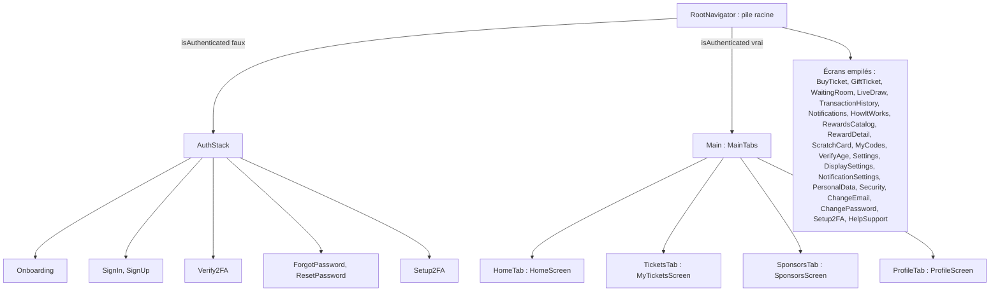
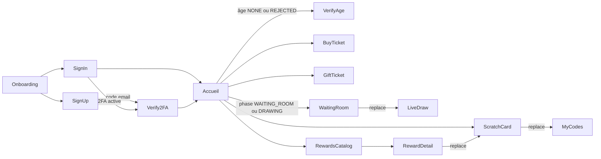

# Navigation et écrans

L'application mobile utilise React Navigation 7 avec deux types de navigateurs : des piles natives (`createNativeStackNavigator`) et une barre d'onglets (`createBottomTabNavigator`) dessinée par un composant maison. Tous les en-têtes natifs sont masqués (`headerShown: false`) : chaque écran affiche son propre en-tête avec `ScreenHeader` et, si besoin, un bouton retour.

Les trois navigateurs sont dans [`mobile-app/src/navigation`](src:mobile-app/src/navigation). Leurs paramètres sont typés dans [`mobile-app/src/types/navigation.types.ts`](src:mobile-app/src/types/navigation.types.ts), et [`mobile-app/src/navigation/hooks.ts`](src:mobile-app/src/navigation/hooks.ts) fournit deux hooks typés :

| Hook | Type renvoyé | Utilisé par |
|---|---|---|
| `useRootNavigation()` | Composition de la pile racine (`RootStackParamList`) et des onglets (`MainTabsParamList`) | Écrans connectés : un même objet ouvre un écran empilé ou change d'onglet |
| `useAuthNavigation()` | Pile d'authentification (`AuthStackParamList`) | Écrans non connectés |

Les écrans ne reçoivent plus de prop `navigation: any` : un nom de route ou un paramètre erroné est refusé par `npm run typecheck`.

## Arbre de navigation

### RootNavigator

[`RootNavigator.tsx`](src:mobile-app/src/navigation/RootNavigator.tsx) contient le `NavigationContainer` et une pile racine dont le contenu dépend de `state.auth.isAuthenticated` :

| État | Écrans enregistrés |
|---|---|
| Non connecté | `Auth` (tout l'`AuthStack`) |
| Connecté | `Main` (les onglets), puis les 21 écrans empilés de l'arbre ci-dessus |

Ce rendu conditionnel est le mécanisme de garde : quand `setCredentials` passe `isAuthenticated` à vrai, React Navigation démonte l'`AuthStack` et affiche les onglets ; `logout` fait l'inverse. Aucune navigation explicite n'est nécessaire après la connexion.

Tous les écrans secondaires sont poussés sur cette pile racine : ils s'affichent en plein écran, sans barre d'onglets, et le retour ramène à l'onglet d'origine. Il n'y a plus de pile imbriquée dans un onglet.

#### Ouverture automatique de la vérification d'âge

Après la connexion, `RootNavigator` ouvre de lui-même l'écran `VerifyAge` quand le profil stocké indique `ageVerificationStatus` égal à `NONE` ou `REJECTED`. La fonction `promptAgeVerification` est appelée 400 ms après le passage à l'état connecté et à `onReady` du conteneur. Une référence `agePromptShown` limite l'ouverture à une fois par session ; elle est remise à zéro à la déconnexion. Un statut `PENDING` ou `VERIFIED` n'ouvre rien. Le citoyen peut fermer l'écran : l'achat, le cadeau et les échanges lui seront alors refusés par le backend (403 `AGE_VERIFICATION_REQUIRED`), et chaque écran concerné propose de rouvrir `VerifyAge` (voir [Portefeuille et loterie](portefeuille-loterie.md#verification-d-age-requise)).

#### Fenêtres globales

`RootNavigator` rend aussi, au-dessus de la navigation, un bandeau de notification simulé et quatre `ResultDialog` pilotés par le slice `ui` : points crédités, réseau encombré, forte affluence et information réseau (voir [État et appels API](etat-api.md#slice-ui)).

### AuthStack

[`AuthStack.tsx`](src:mobile-app/src/navigation/AuthStack.tsx) démarre sur `Onboarding` si `hasSeenOnboarding` est faux, sinon sur `SignIn`. `hasSeenOnboarding` n'est pas persisté : l'introduction réapparaît à chaque démarrage à froid de l'application.

| Route | Paramètres |
|---|---|
| `Onboarding` | aucun |
| `SignIn` | aucun |
| `SignUp` | `referralCode` facultatif |
| `Verify2FA` | `userId`, `method` (`APP` ou `EMAIL`), `email`, `purpose` (`signin` ou `signup`), `devOtpPreview` |
| `ForgotPassword` | `email` facultatif |
| `ResetPassword` | `email`, `devOtpPreview` |
| `Setup2FA` | aucun |

`Setup2FA` est enregistré dans cette pile, mais aucun écran non connecté n'y mène et l'écran exige un utilisateur connecté pour fonctionner.

### MainTabs

[`MainTabs.tsx`](src:mobile-app/src/navigation/MainTabs.tsx) déclare quatre onglets avec des libellés traduits :

| Route | Libellé | Écran | Icône |
|---|---|---|---|
| `HomeTab` | Accueil | [`HomeScreen.tsx`](src:mobile-app/src/screens/lottery/HomeScreen.tsx) | `tabHome` |
| `TicketsTab` | Mes tickets | [`MyTicketsScreen.tsx`](src:mobile-app/src/screens/lottery/MyTicketsScreen.tsx) | `tabTickets` |
| `SponsorsTab` | Parrains | [`SponsorsScreen.tsx`](src:mobile-app/src/screens/sponsors/SponsorsScreen.tsx) | `tabSponsors` |
| `ProfileTab` | Profil | [`ProfileScreen.tsx`](src:mobile-app/src/screens/settings/ProfileScreen.tsx) | `tabProfile` |

La barre `TabBar` remplace celle de React Navigation : fond `surface` aux coins supérieurs arrondis (24), ombre portée, icône SVG au-dessus du libellé, onglet actif sur fond `sunNav` avec icône et texte `onSun` en gras. Sous les onglets, `SecurityFooter` rappelle « Application sécurisée · Aucun argent réel ». La marge basse suit l'encart de sécurité de l'appareil.

La rangée porte `accessibilityRole="tablist"` et chaque onglet `accessibilityRole="tab"`, `accessibilityState={{ selected }}` et son libellé : les lecteurs d'écran annoncent l'onglet sélectionné. `TabBar` émet l'événement `tabPress` avant de naviguer, comme la barre standard, mais ne gère pas l'appui long.

## Les 31 écrans

### Avant connexion

| Écran | Fichier | Rôle | Données et actions |
|---|---|---|---|
| Introduction | [`OnboardingScreen.tsx`](src:mobile-app/src/screens/auth/OnboardingScreen.tsx) | Trois diapositives (grand tirage, tirage en direct, portefeuille offert et accès réservé aux 18 ans et plus) | Texte codé en dur ; `markOnboardingComplete` puis `replace('SignIn')` ou `replace('SignUp')` |
| Connexion | [`SignInScreen.tsx`](src:mobile-app/src/screens/auth/SignInScreen.tsx) | Email et mot de passe, lien « Mot de passe oublié ? », boutons Google et Apple, lien vers l'inscription | `signInWithPassword` (`POST /auth/signin`) ; `navigate('Verify2FA')` si la 2FA est active |
| Inscription | [`SignUpScreen.tsx`](src:mobile-app/src/screens/auth/SignUpScreen.tsx) | Email, mot de passe et confirmation avec règles affichées, code de parrainage repliable, acceptation des conditions, boutons Google et Apple | `signUpWithPassword` (`POST /auth/signup`) puis `navigate('Verify2FA', { purpose: 'signup' })` |
| Vérification du code | [`Verify2FAScreen.tsx`](src:mobile-app/src/screens/auth/Verify2FAScreen.tsx) | Code à 6 chiffres reçu par email ou donné par l'application TOTP, ou code de secours | `verifyOtpCode` (`POST /auth/2fa/verify`) ; la connexion bascule seule vers les onglets |
| Mot de passe oublié | [`ForgotPasswordScreen.tsx`](src:mobile-app/src/screens/auth/ForgotPasswordScreen.tsx) | Saisie de l'email | `requestPasswordReset` (`POST /auth/password/forgot`) puis `navigate('ResetPassword')` |
| Nouveau mot de passe | [`ResetPasswordScreen.tsx`](src:mobile-app/src/screens/auth/ResetPasswordScreen.tsx) | Code reçu, nouveau mot de passe et confirmation, renvoi du code | `resetPassword` (`POST /auth/password/reset`), puis `popTo('SignIn')` |
| Configuration 2FA | [`Setup2FAScreen.tsx`](src:mobile-app/src/screens/auth/Setup2FAScreen.tsx) | Choix application TOTP ou email, QR code, clé et codes de secours copiables, confirmation | `setup2FA` (`POST /auth/2fa/setup`), `verifyOtpCode` |

### Onglets

| Écran | Rôle | Données et actions |
|---|---|---|
| Accueil | Logo, cloche des notifications et roue des paramètres, carte du grand tirage (cagnotte, phase, échéance, participants, paliers), achat ou accès à la salle, cadeau, tickets à gratter, points et offres, mission suivante, partage du code de parrainage ; tirer pour rafraîchir | `GET /lottery/status` toutes les 30 s, `GET /lottery/wallet`, `GET /lottery/my-tickets`, `GET /user/referrals`, `GET /user/quests`, `GET /marketplace/catalog`, `usePoints`, `usePushNotifications` |
| Mes tickets | Cloche et roue des paramètres, ticket du tirage en cours, filtres, résultats des tirages passés, codes obtenus par grattage, accès à l'historique | `GET /lottery/status` toutes les 30 s, `GET /lottery/my-tickets`, `GET /marketplace/my-codes` |
| Parrains | Code de parrainage (copie et partage), étapes du parrainage, classement des citoyens par EtherPoints, missions à valider | `GET /user/referrals`, `GET /lottery/leaderboard`, `GET /user/quests`, `POST /user/quests/complete` |
| Profil | Carte d'identité du compte avec statut d'âge, résumé (ETH fictifs, EtherPoints, tickets joués), raccourcis (codes, boutique, historique), déconnexion confirmée ; les réglages s'ouvrent par la roue de l'en-tête | `GET /user/profile`, `GET /lottery/wallet`, `signOut` |

### Écrans empilés

| Écran | Route | Rôle | Données et actions |
|---|---|---|---|
| [`BuyTicketScreen.tsx`](src:mobile-app/src/screens/lottery/BuyTicketScreen.tsx) | `BuyTicket` | Achat du ticket unique du grand tirage, solde avant et après | `GET /lottery/status`, `GET /lottery/wallet`, `GET /lottery/my-tickets`, `purchaseTickets` (`POST /lottery/buy`) |
| [`GiftTicketScreen.tsx`](src:mobile-app/src/screens/lottery/GiftTicketScreen.tsx) | `GiftTicket` (`ticketId` facultatif) | Cadeau d'un ticket par email avec message | `sendGiftTicket` (`POST /lottery/gift`) |
| [`WaitingRoomScreen.tsx`](src:mobile-app/src/screens/lottery/WaitingRoomScreen.tsx) | `WaitingRoom` | Salle d'attente : compte à rebours de révélation, ticket du citoyen, présence, discussion | `GET /lottery/status` toutes les 5 s, `useSocket`, puis `replace('LiveDraw')` |
| [`LiveDrawScreen.tsx`](src:mobile-app/src/screens/lottery/LiveDrawScreen.tsx) | `LiveDraw` | Roue animée, numéro gagnant, résultat du citoyen, retrait des gains | `GET /lottery/status` toutes les 4 s, `useSocket`, `claimPrize` (`POST /lottery/claim-prize`) |
| [`TransactionHistoryScreen.tsx`](src:mobile-app/src/screens/lottery/TransactionHistoryScreen.tsx) | `TransactionHistory` | Portefeuille, tickets et badges POAP avec liens vers l'explorateur | `GET /lottery/wallet`, `GET /lottery/my-tickets` |
| [`HowItWorksScreen.tsx`](src:mobile-app/src/screens/lottery/HowItWorksScreen.tsx) | `HowItWorks` | Règles, calendrier d'un tirage, engagements, charte, lien vers le contrat | `GET /lottery/status`, `GET /lottery/transparency-charter` |
| [`NotificationsScreen.tsx`](src:mobile-app/src/screens/settings/NotificationsScreen.tsx) | `Notifications` | Liste des notifications, marquées vues à la sortie | `GET /user/notifications` |
| [`RewardsCatalogScreen.tsx`](src:mobile-app/src/screens/marketplace/RewardsCatalogScreen.tsx) | `RewardsCatalog` | Boutique : solde de points, offres des commerces, accès aux tickets à gratter et aux codes | `GET /marketplace/catalog`, `usePoints` |
| [`RewardDetailScreen.tsx`](src:mobile-app/src/screens/marketplace/RewardDetailScreen.tsx) | `RewardDetail` (`rewardId`) | Coût, disponibilité, échange confirmé | `GET /marketplace/rewards/:id`, `POST /marketplace/claim`, puis `replace('ScratchCard', { claim })` |
| [`ScratchCardScreen.tsx`](src:mobile-app/src/screens/marketplace/ScratchCardScreen.tsx) | `ScratchCard` (`claim` ou `offer`) | Choix et achat d'un ticket à gratter, ou révélation d'un code déjà obtenu | `POST /marketplace/scratch`, puis `replace('MyCodes')` |
| [`MyCodesScreen.tsx`](src:mobile-app/src/screens/marketplace/MyCodesScreen.tsx) | `MyCodes` | Codes obtenus, actifs ou utilisés | `GET /marketplace/my-codes` |
| [`VerifyAgeScreen.tsx`](src:mobile-app/src/screens/settings/VerifyAgeScreen.tsx) | `VerifyAge` | Photo du recto et du verso de la pièce d'identité, statut de la vérification | `GET /user/identity`, `POST /user/identity` |
| [`SettingsScreen.tsx`](src:mobile-app/src/screens/settings/SettingsScreen.tsx) | `Settings` | Accueil des paramètres : carte d'identité (initiales, prénom et nom, email) puis cinq cartes de section | `GET /user/profile` |
| [`DisplaySettingsScreen.tsx`](src:mobile-app/src/screens/settings/DisplaySettingsScreen.tsx) | `DisplaySettings` | Mode clair ou sombre, langue français ou anglais | `PUT /user/preferences` (`theme`, `language`) |
| [`NotificationSettingsScreen.tsx`](src:mobile-app/src/screens/settings/NotificationSettingsScreen.tsx) | `NotificationSettings` | Interrupteur général et quatre catégories de notifications | `GET /user/profile`, `PUT /user/preferences` (`pushNotificationsEnabled`, `notifications`) |
| [`PersonalDataScreen.tsx`](src:mobile-app/src/screens/settings/PersonalDataScreen.tsx) | `PersonalData` | Prénom et nom, export JSON partagé par la feuille système, demande puis confirmation d'anonymisation | `PATCH /user/profile`, `GET /user/gdpr/export`, `POST /user/gdpr/delete-request`, `POST /user/gdpr/confirm-delete`, puis `signOut` |
| [`SecurityScreen.tsx`](src:mobile-app/src/screens/settings/SecurityScreen.tsx) | `Security` | Adresse email et mot de passe (liens vers les deux écrans suivants), état, activation et désactivation de la 2FA | `GET /user/profile`, `POST /auth/2fa/disable` |
| [`ChangeEmailScreen.tsx`](src:mobile-app/src/screens/settings/ChangeEmailScreen.tsx) | `ChangeEmail` | Nouvelle adresse et mot de passe actuel, puis code à 6 chiffres reçu sur la nouvelle adresse | `POST /auth/email/change`, `POST /auth/email/confirm`, puis `patchUser` |
| [`ChangePasswordScreen.tsx`](src:mobile-app/src/screens/settings/ChangePasswordScreen.tsx) | `ChangePassword` | Création d'un premier mot de passe ou modification avec le mot de passe actuel | `POST /auth/password/change`, puis `applyRenewedSession` |
| [`Setup2FAScreen.tsx`](src:mobile-app/src/screens/auth/Setup2FAScreen.tsx) | `Setup2FA` | Comme dans l'`AuthStack` | `POST /auth/2fa/setup`, `POST /auth/2fa/verify` |
| [`HelpSupportScreen.tsx`](src:mobile-app/src/screens/settings/HelpSupportScreen.tsx) | `HelpSupport` | Formulaire pour écrire à un administrateur (objet, message), carte du centre d'aide | `POST /user/support` ; lien `EXPO_PUBLIC_HELP_CENTER_URL` |

Toutes les routes appelées depuis les écrans connectés exigent un jeton, sauf `GET /lottery/status`, `/leaderboard`, `/transparency-charter`, `GET /marketplace/catalog` et `/rewards/:id`, qui sont publiques. Le rôle n'est pas vérifié côté mobile : l'application ne propose aucun écran réservé à `ADMIN` ou `PARTNER`. Un compte Mairie ou partenaire qui se connecte voit l'interface citoyenne.

## Boutons d'en-tête et paramètres

[`HeaderActions.tsx`](src:mobile-app/src/components/ui/HeaderActions.tsx) regroupe deux boutons ronds : la cloche `NotificationButton`, avec sa pastille quand `unreadCount` est positif, qui ouvre `Notifications`, et une roue dentée (icône `settings`, libellé d'accessibilité « Paramètres ») qui ouvre `Settings`. Le composant est placé dans l'en-tête de l'accueil ([`HomeScreen.tsx`](src:mobile-app/src/screens/lottery/HomeScreen.tsx)), de « Mes tickets » ([`MyTicketsScreen.tsx`](src:mobile-app/src/screens/lottery/MyTicketsScreen.tsx)) et dans [`TabTitle.tsx`](src:mobile-app/src/components/profile/TabTitle.tsx), le titre des onglets Profil et Parrains. L'onglet Profil n'a plus de liste « Mon compte » : la roue est le seul accès aux réglages.

[`SettingsScreen.tsx`](src:mobile-app/src/screens/settings/SettingsScreen.tsx), repris d'une maquette Figma, sert d'accueil des paramètres. Une carte jaune affiche un avatar avec les initiales, le prénom et le nom (ou « Citoyen d'EtherBay » s'ils sont vides) et l'email ; les initiales et le nom complet viennent de [`displayName.ts`](src:mobile-app/src/components/settings/displayName.ts), qui retombe sur les initiales de l'email. Suivent cinq cartes [`SettingsLinkCard`](src:mobile-app/src/components/settings/SettingsLinkCard.tsx), dans cet ordre :

| Carte | Route | Contenu |
|---|---|---|
| Affichage | `DisplaySettings` | Puces Clair ou Sombre, puces Français ou English |
| Notifications | `NotificationSettings` | Interrupteur « Autoriser les notifications », puis les catégories rappels du tirage (`drawReminders`), résultats (`results`), offres et récompenses (`rewards`), parrainage (`referrals`) |
| Données personnelles | `PersonalData` | Formulaire prénom et nom, téléchargement des données (export RGPD), suppression du compte |
| Sécurité | `Security` | Ligne email vers `ChangeEmail`, ligne mot de passe vers `ChangePassword` (« en créer un » si le compte n'en a pas), puis la 2FA : activation, reconfiguration, désactivation |
| Aide & Support | `HelpSupport` | Formulaire pour écrire à un administrateur, carte du centre d'aide |

La maquette prévoyait une entrée Langue séparée : elle n'a pas été reprise, la langue se règle dans Affichage.

Les réglages d'affichage et de notifications sont enregistrés à chaque changement par [`usePreferenceSaver.ts`](src:mobile-app/src/components/settings/usePreferenceSaver.ts), qui appelle `PUT /user/preferences`, remet l'ancienne valeur et affiche un message si l'envoi échoue. Quand l'interrupteur général est coupé, les catégories sont grisées et affichées désactivées, mais leurs valeurs enregistrées sont conservées.

La carte du centre d'aide ouvre l'adresse de `EXPO_PUBLIC_HELP_CENTER_URL`. Tant que la variable est vide, la carte affiche la pastille « Bientôt » et ne fait rien : le site du centre d'aide reste à créer.

Le bloc « Compte et appareils » de l'écran Sécurité (portefeuille intégré, déconnexion de tous les appareils) a été retiré. `signOutEverywhere` existe toujours dans `useAuth`, mais aucun écran ne l'appelle.

## Parcours principaux

L'échange d'une récompense remplace l'écran de détail par la carte à gratter, puis la carte par la liste des codes : le retour arrière ne repasse pas par une carte déjà grattée. De même, la salle d'attente est remplacée par l'écran du tirage dès que la phase devient `DRAWING` ou `COMPLETED`.

## Ce que la navigation ne fait pas

- **Pas de liens profonds.** `app.json` déclare désormais `"scheme": "blocklucky"`, utilisé par le retour de la connexion Google (`expo-web-browser`), mais le `NavigationContainer` n'a pas de configuration `linking`. Un lien de parrainage `/invite/<code>` ouvert sur le téléphone ne mène pas à un écran ; le code doit être saisi à la main dans l'inscription.
- **Pas de restauration de session.** Au démarrage, `isAuthenticated` vaut toujours faux, même si un jeton est stocké (voir [Authentification et stockage sécurisé](authentification.md#session-au-demarrage)).
- **Pas de garde par statut d'âge.** L'ouverture automatique de `VerifyAge` est une invitation : aucun écran n'est bloqué côté application, c'est le backend qui refuse les opérations.

Pour ajouter un écran, suivre [Ajouter un écran mobile](../guides/ajouter-ecran-mobile.md).
