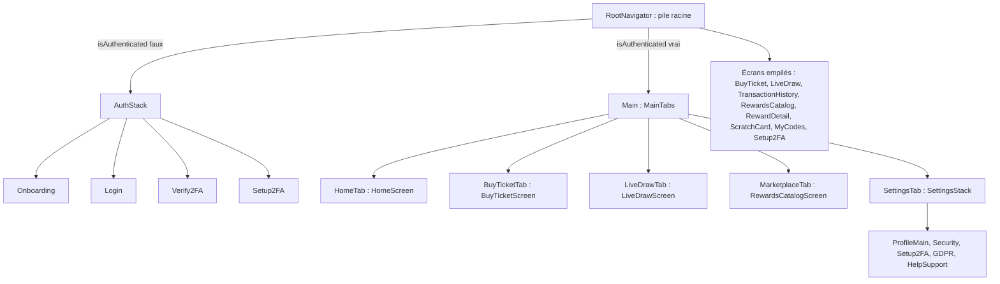
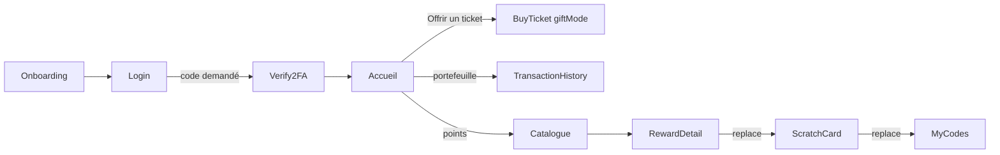

# Navigation et écrans

L'application mobile utilise React Navigation 7 avec deux types de navigateurs : des piles natives (`createNativeStackNavigator`) et une barre d'onglets (`createBottomTabNavigator`) dessinée par un composant maison. Tous les en-têtes natifs sont masqués (`headerShown: false`) : chaque écran affiche son propre titre et, si besoin, un `BackButton`.

Les quatre navigateurs sont dans [`mobile-app/src/navigation`](src:mobile-app/src/navigation) et leurs paramètres sont typés dans [`mobile-app/src/types/navigation.types.ts`](src:mobile-app/src/types/navigation.types.ts).

## Arbre de navigation

### RootNavigator

[`RootNavigator.tsx`](src:mobile-app/src/navigation/RootNavigator.tsx) contient le `NavigationContainer` et une pile racine dont le contenu dépend de `state.auth.isAuthenticated` :

| État | Écrans enregistrés |
|---|---|
| Non connecté | `Auth` (tout l'`AuthStack`) |
| Connecté | `Main` (les onglets), puis `BuyTicket`, `LiveDraw`, `TransactionHistory`, `RewardsCatalog`, `RewardDetail`, `ScratchCard`, `MyCodes`, `Setup2FA` |

Ce rendu conditionnel est le mécanisme de garde : quand `setCredentials` passe `isAuthenticated` à vrai, React Navigation démonte l'`AuthStack` et affiche les onglets ; `logout` fait l'inverse. Aucune navigation explicite n'est nécessaire après la connexion.

`RootNavigator` rend aussi, au-dessus de la navigation, le bandeau de notification simulé et cinq `BottomSheet` globales pilotées par le slice `ui` : points crédités, réseau encombré, file d'attente, information réseau et tiroir des notifications (voir [État et appels API](etat-api.md#slice-ui)).

### AuthStack

[`AuthStack.tsx`](src:mobile-app/src/navigation/AuthStack.tsx) démarre sur `Onboarding` si `hasSeenOnboarding` est faux, sinon sur `Login`. `hasSeenOnboarding` n'est pas persisté : l'introduction réapparaît à chaque démarrage à froid de l'application.

`Setup2FA` est enregistré dans cette pile, mais aucun écran non connecté n'y mène et l'écran exige un utilisateur connecté pour fonctionner.

### MainTabs

[`MainTabs.tsx`](src:mobile-app/src/navigation/MainTabs.tsx) déclare cinq onglets avec des libellés traduits : Accueil, Tickets, Tirage, Boutique, Profil. La barre `CustomTabBar` remplace celle de React Navigation : fond `surface`, bordure haute, marge basse égale à l'encart de sécurité (10 au minimum), onglet actif sur fond `surfaceElevated` avec un trait de couleur primaire au-dessus du libellé. Il n'y a pas d'icône.

`CustomTabBar` émet l'événement `tabPress` avant de naviguer, comme la barre standard, mais ne gère pas l'appui long.

### SettingsStack

`SettingsStack` était la pile de l'onglet Profil : `ProfileMain` (écran d'accueil), `Security`, `Setup2FA`, `GDPR`, `HelpSupport`. La barre d'onglets reste visible sur ces écrans.

### Écrans enregistrés plusieurs fois

| Écran | Enregistrements | Conséquence |
|---|---|---|
| `BuyTicketScreen` | onglet `BuyTicketTab` et écran racine `BuyTicket` | L'accueil ouvre `BuyTicket` (empilé, sans barre d'onglets, avec `giftMode`) ; l'onglet ouvre la version sans paramètre |
| `LiveDrawScreen` | onglet `LiveDrawTab` et écran racine `LiveDraw` | Seul l'onglet est utilisé par les écrans actuels |
| `RewardsCatalogScreen` | onglet `MarketplaceTab` et écran racine `RewardsCatalog` | Seul l'onglet est utilisé |
| `Setup2FAScreen` | `AuthStack`, `SettingsStack` et pile racine | L'écran de sécurité ouvre celui de `SettingsStack` |

## Les 16 écrans

| Écran | Fichier | Route | Rôle | Données et actions |
|---|---|---|---|---|
| Onboarding | [`OnboardingScreen.tsx`](src:mobile-app/src/screens/auth/OnboardingScreen.tsx) | `Onboarding` | Quatre diapositives (loterie, portefeuille intégré, EtherPoints, tirage), boutons « Passer » et « Suivant » | Texte codé en dur dans l'écran ; `markOnboardingComplete` puis `replace('Login')` |
| Connexion | [`SignInScreen.tsx`](src:mobile-app/src/screens/auth/SignInScreen.tsx) | `Login` | Majorité 18+ (modale ouverte d'office), tranche d'âge, email (prérempli `citoyen@etherbay.fr`), parrainage, choix FR ou EN, boutons Google et email | `loginWithSocial` (`POST /auth/login`), `navigate('Verify2FA')` si un code est demandé |
| Vérification 2FA | [`Verify2FAScreen.tsx`](src:mobile-app/src/screens/auth/Verify2FAScreen.tsx) | `Verify2FA` (`userId`, `method`, `email`) | Saisie du code à 6 chiffres | `verifyOtpCode` (`POST /auth/2fa/verify`) ; la connexion bascule seule vers les onglets |
| Configuration 2FA | [`Setup2FAScreen.tsx`](src:mobile-app/src/screens/auth/Setup2FAScreen.tsx) | `Setup2FA` | Choix application TOTP ou email, affichage de la clé et des codes de secours, confirmation | `setup2FA` (`POST /auth/2fa/setup`), `verifyOtpCode` ; prérempli par `devOtpPreview` en développement |
| Accueil | [`HomeScreen.tsx`](src:mobile-app/src/screens/lottery/HomeScreen.tsx) | `HomeTab` | Portefeuille, points, alertes, compte à rebours, garantie, achat d'un ticket, cadeau, accès au tirage, jauge, classement | `GET /lottery/status`, `GET /lottery/leaderboard`, `GET /lottery/wallet`, `usePoints`, `usePushNotifications`, `purchaseTickets(1, 0)` |
| Billetterie | [`BuyTicketScreen.tsx`](src:mobile-app/src/screens/lottery/BuyTicketScreen.tsx) | `BuyTicketTab`, `BuyTicket` (`giftMode`) | Achat de 1, 2, 5 ou 10 tickets, ou cadeau par email ; carte du portefeuille ; message de confirmation et lien vers l'explorateur | `GET /lottery/status`, `purchaseTickets`, `sendGiftTicket` (`POST /lottery/buy`, `POST /lottery/gift`), `IntegratedWalletCard` |
| Tirage en direct | [`LiveDrawScreen.tsx`](src:mobile-app/src/screens/lottery/LiveDrawScreen.tsx) | `LiveDrawTab`, `LiveDraw` | Salle d'attente, roue, certification VRF ou mode démonstration, retrait des gains, discussion | `GET /lottery/status`, `GET /lottery/wallet`, `useSocket(round.id)`, `WinnerClaimCard` |
| Historique et POAP | [`TransactionHistoryScreen.tsx`](src:mobile-app/src/screens/lottery/TransactionHistoryScreen.tsx) | `TransactionHistory` | Tickets avec liens vers l'explorateur, galerie des badges POAP | `GET /lottery/my-tickets` |
| Catalogue | [`RewardsCatalogScreen.tsx`](src:mobile-app/src/screens/marketplace/RewardsCatalogScreen.tsx) | `MarketplaceTab`, `RewardsCatalog` | Offres des commerces, solde et intégrité du registre de points, accès aux codes | `GET /marketplace/catalog`, `usePoints` (`GET /marketplace/points`) |
| Détail d'offre | [`RewardDetailScreen.tsx`](src:mobile-app/src/screens/marketplace/RewardDetailScreen.tsx) | `RewardDetail` (`rewardId`) | Coût, disponibilité, échange contre des points | `GET /marketplace/rewards/:id`, `POST /marketplace/claim`, puis `replace('ScratchCard', { claim })` |
| Carte à gratter | [`ScratchCardScreen.tsx`](src:mobile-app/src/screens/marketplace/ScratchCardScreen.tsx) | `ScratchCard` (`claim`) | Zone à gratter au doigt qui révèle le code | Aucun appel : le code arrive dans les paramètres de route |
| Mes codes | [`MyCodesScreen.tsx`](src:mobile-app/src/screens/marketplace/MyCodesScreen.tsx) | `MyCodes` | Codes obtenus, actifs ou utilisés | `GET /marketplace/my-codes` |
| Profil | [`ProfileScreen.tsx`](src:mobile-app/src/screens/settings/ProfileScreen.tsx) | `ProfileMain` | Portefeuille, thème et langue, parrainage (copie du lien, partage WhatsApp), missions, accès sécurité, RGPD, aide, déconnexion | `GET /user/referrals`, `GET /user/quests`, `POST /user/quests/complete`, `PUT /user/preferences`, `IntegratedWalletCard` |
| Sécurité | [`SecurityScreen.tsx`](src:mobile-app/src/screens/settings/SecurityScreen.tsx) | `Security` | Plafond de tickets par tirage, état et désactivation de la 2FA, rappel RBAC avec écran 403 simulé | `PUT /user/responsible-limit`, `POST /auth/2fa/disable` |
| RGPD | [`GDPRScreen.tsx`](src:mobile-app/src/screens/settings/GDPRScreen.tsx) | `GDPR` | Export JSON affiché à l'écran, demande puis confirmation d'anonymisation | `GET /user/gdpr/export`, `POST /user/gdpr/delete-request`, `POST /user/gdpr/confirm-delete`, puis `signOut` |
| Charte et aide | [`HelpSupportScreen.tsx`](src:mobile-app/src/screens/settings/HelpSupportScreen.tsx) | `HelpSupport` | Charte de transparence et notification simulée | `GET /lottery/transparency-charter`, `triggerSimulatedOsPush` |

Toutes les routes appelées depuis les écrans connectés exigent un jeton, sauf `GET /lottery/status`, `/leaderboard`, `/transparency-charter`, `GET /marketplace/catalog` et `/rewards/:id`, qui sont publiques. Le rôle n'est pas vérifié côté mobile : l'application ne propose aucun écran réservé à `ADMIN` ou `PARTNER`. Un compte Mairie ou partenaire qui se connecte voit l'interface citoyenne.

## Parcours principaux

L'échange d'une récompense remplace l'écran de détail par la carte à gratter, puis la carte par la liste des codes : le retour arrière ne repasse pas par une carte déjà grattée.

## Ce que la navigation ne fait pas

- **Pas de liens profonds.** Le `NavigationContainer` n'a pas de configuration `linking` et `app.json` ne déclare pas de `scheme`. Un lien de parrainage `/invite/<code>` ouvert sur le téléphone ne mène pas à l'application ; le code doit être saisi à la main.
- **Pas de restauration de session.** Au démarrage, `isAuthenticated` vaut toujours faux, même si un jeton est stocké (voir [Authentification et stockage sécurisé](authentification.md#session-au-demarrage)).
- **Pas de typage strict des écrans de pile racine.** Plusieurs écrans reçoivent `navigation: any`, ce qui masque les erreurs de nom de route au typecheck.

Pour ajouter un écran, suivre [Ajouter un écran mobile](../guides/ajouter-ecran-mobile.md).
