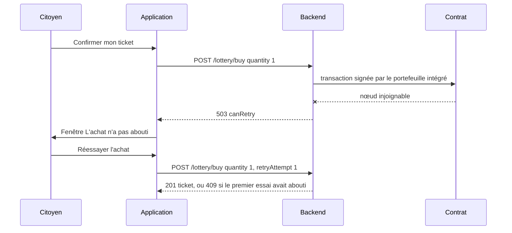

# Résilience réseau

Un téléphone perd souvent le réseau : passage en 4G, tunnel, Wi-Fi public, mise en veille. Cette page décrit ce que l'application mobile fait réellement face à ces coupures, ce qui existe dans le code sans être branché, et les écarts avec ce que l'ancien README annonce. Le comportement côté serveur (limitation de débit, idempotence, nœud de secours) est décrit dans [Protection des API](../securite/protection-api.md) et [Client RPC et compte opérateur](../integration-blockchain/client-rpc.md).

## Ce qui protège réellement l'utilisateur

| Mécanisme | Où | Effet |
|---|---|---|
| Boutons bloqués pendant l'envoi | `AppButton` avec `loading` (achat, cadeau, retrait, vérification, envoi de la pièce d'identité) | Empêche un double appui pendant la requête ; l'état « occupé » est annoncé aux lecteurs d'écran |
| Fenêtre « L'achat n'a pas abouti. » | Billetterie, sur `503`, `canRetry`, `FETCH_ERROR` ou absence de réponse | Explique l'échec et propose « Réessayer l'achat » avec un compteur `retryAttempt` incrémenté (5 au plus) |
| Fenêtre « Forte affluence » | Billetterie, sur `429` (le cadeau garde son titre « Le cadeau n'a pas abouti. ») | Message du backend, nouvel essai possible |
| Fenêtre d'information | `describeBlockchainError` sur `402`, `409`, ou `503` avec `circuitBreaker` | Message clair : solde insuffisant, tour fermé, contrat en pause |
| Ticket unique | Backend : un ticket par participant et par grand tirage | Un nouvel essai après une réponse perdue ne peut pas acheter un second ticket : il reçoit 409 et l'écran affiche « Ticket déjà validé » |
| Rafraîchissement périodique | `pollingInterval` sur l'accueil (30 s), « Mes tickets » (30 s), la salle d'attente (5 s) et le tirage (4 s) | Les changements de phase apparaissent sans action de l'utilisateur |
| Tirer pour rafraîchir | `Screen` avec `onRefresh` sur les quatre onglets, la salle d'attente, l'historique, la boutique, les codes, les notifications et la vérification d'âge | Rechargement manuel après une coupure |
| Discussion hors ligne | `sendChatMessage` sans connexion active | Le message n'est pas envoyé, le brouillon est conservé et `RoomChat` demande de réessayer |
| Reconnexion Socket.IO | `socket.io-client`, réglages par défaut, et `draw:join` réémis à chaque `connect` | Reconnexion automatique, sans limite de tentatives, avec retour dans la salle du tour |
| Repli des textes | Écrans de charte, d'introduction, de fonctionnement | Texte codé en dur si l'API ne répond pas |
| Écrans d'erreur avec « Réessayer » | Billetterie, accueil, salle d'attente, tirage, notifications | Message du backend ou texte de repli et bouton de rechargement |

## Ce qui n'est pas branché

### Le client axios avec nouvelles tentatives

[`mobile-app/src/services/api.client.ts`](src:mobile-app/src/services/api.client.ts) définit un client axios complet : délai de 15 secondes, ajout du jeton, et un intercepteur de réponse qui relance les requêtes idempotentes.

| Règle de l'intercepteur | Valeur |
|---|---|
| Méthodes relancées | `GET`, `HEAD`, `OPTIONS` |
| Statuts relancés | 408, 429, 502, 503, 504, ou absence de réponse (coupure réseau) |
| Nombre maximal de nouvelles tentatives | 2 |
| Délai | En-tête `Retry-After` en secondes (10 s au plus), sinon tirage aléatoire jusqu'à `500 × 2^tentative` ms |

Ce client n'est utilisé par aucune requête. Toutes les données passent par RTK Query et `fetchBaseQuery` ([`baseApi.ts`](src:mobile-app/src/store/api/baseApi.ts)), qui n'a ni délai maximal, ni nouvelle tentative. Seule la constante `API_BASE_URL` du fichier est importée. Pour activer cette logique, il faudrait soit écrire un `baseQuery` RTK Query qui appelle `apiClient`, soit utiliser `retry` de RTK Query sur les requêtes de lecture.

> [!WARNING]
> Sans délai maximal, une requête vers un serveur qui ne répond pas reste en attente jusqu'au délai du système, souvent bien plus d'une minute. Pendant ce temps, le bouton concerné reste en état de chargement. C'est sensible pour l'envoi de la pièce d'identité, dont le corps peut approcher 11 Mo encodé en base64.

### Détection de l'état du réseau

L'application n'utilise pas `@react-native-community/netinfo` ni aucune autre détection. Il n'y a pas de bandeau « hors ligne ». Une coupure se manifeste par des erreurs `FETCH_ERROR` traduites en textes de repli propres à chaque écran.

### Rafraîchissement au retour au premier plan

RTK Query peut relancer les requêtes au retour de l'application au premier plan ou à la reconnexion, à condition d'appeler `setupListeners` et de les relier à `AppState` et à l'état du réseau. Ce n'est pas fait. Les écrans avec `pollingInterval` se mettent à jour au tick suivant ; les autres affichent les données du dernier chargement jusqu'à un geste de rafraîchissement ou une action.

### Cache hors ligne

Le store Redux n'est pas persisté (pas de `redux-persist`). À chaque démarrage, l'application repart d'un cache vide et doit joindre le backend pour afficher quoi que ce soit, en plus de redemander la connexion (voir [Authentification et stockage sécurisé](authentification.md#session-au-demarrage)).

### Indicateurs d'état du réseau blockchain

Aucun écran ne lit plus `network.isFallback`, `network.isPaused` ni `guarantees.paused` de `GET /lottery/status`. Le relais RPC secondaire et la pause du contrat ne sont donc pas signalés à l'avance : le citoyen ne l'apprend qu'à l'échec d'un achat, par la fenêtre « Loterie en pause » (`503` avec `circuitBreaker`). Le web lit ces indicateurs. Le statut renvoyé par `blockchainService.getNetworkStatus` est décrit dans [Client RPC et compte opérateur](../integration-blockchain/client-rpc.md).

### Maintenance et version minimale

Le backend expose `GET /api/config`, qui renvoie `minimumMobileVersion` (variable `MOBILE_MIN_VERSION`) et `maintenance` (variable `MAINTENANCE_MODE`). L'application ne l'appelle pas. En mode maintenance, chaque requête reçoit une erreur 503 avec `Retry-After: 300`, que l'application affiche comme une erreur réseau ordinaire ; à l'achat, elle propose même de réessayer.

## Achat interrompu

Le cas le plus sensible est l'achat du ticket, puisqu'il dépense des ethers fictifs du portefeuille.

Deux limites ressortent de ce parcours :

1. **Pas d'idempotence.** Le backend accepte un en-tête `Idempotency-Key` sur `POST /lottery/buy`, `POST /lottery/gift`, `POST /marketplace/claim` et `POST /marketplace/scratch`, qui permettrait de rejouer une requête sans doublon. Le mobile ne l'envoie pas. Pour le ticket du grand tirage, la règle du ticket unique évite un second achat ; pour un ticket à gratter, un nouvel essai après une réponse perdue débite une seconde fois les EtherPoints.
2. **Cache partiellement rafraîchi.** Après un échec, la billetterie ne recharge la liste des tickets que sur une réponse 409 ; le solde n'est rechargé qu'après un succès.

En pratique, le citoyen peut vérifier son ticket dans « Mes tickets » ou dans l'historique (`TransactionHistory`), qui interrogent `GET /lottery/my-tickets`.

## Temps réel

La connexion Socket.IO se reconnecte seule, et `useSocket` réémet `draw:join` à chaque reconnexion. L'application ne suit pas l'état de la connexion : la discussion ne le signale qu'à l'envoi d'un message. L'annonce du gagnant reste reçue, puisqu'elle est diffusée à tous les clients, et l'écran du tirage interroge de toute façon le statut toutes les 4 secondes. Les détails sont dans [Temps réel et notifications](temps-reel-notifications.md).

## Améliorations recommandées

Par ordre de rapport effort et bénéfice :

1. Ajouter `timeout` à `fetchBaseQuery` (15 secondes, comme le web), avec un délai plus long pour l'envoi de la pièce d'identité.
2. Envelopper `fetchBaseQuery` avec `retry` de RTK Query pour les lectures, ou remplacer le `baseQuery` par un appel à `apiClient`, puis supprimer le code inutilisé.
3. Générer un `Idempotency-Key` par intention d'achat, de cadeau ou de ticket à gratter, et le réutiliser pour les nouvelles tentatives.
4. Appeler `setupListeners(store.dispatch)` avec `AppState` et ajouter un indicateur hors ligne.
5. Lire `network.isFallback`, `network.isPaused` et `guarantees.paused`, comme le web.
6. Appeler `GET /api/config` au démarrage pour gérer la maintenance et forcer la mise à jour.
7. Retirer les fenêtres globales du slice `ui` qui ne sont plus ouvertes (voir [État et appels API](etat-api.md#slice-ui)).
