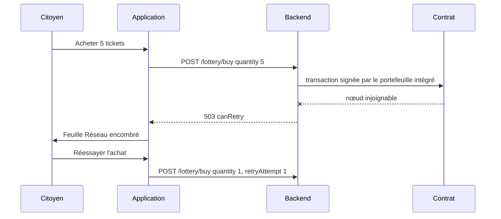

# Résilience réseau

Un téléphone perd souvent le réseau : passage en 4G, tunnel, Wi-Fi public, mise en veille. Cette page décrit ce que l'application mobile fait réellement face à ces coupures, ce qui existe dans le code sans être branché, et les écarts avec ce que l'ancien README annonce. Le comportement côté serveur (limitation de débit, idempotence, nœud de secours) est décrit dans [Protection des API](../securite/protection-api.md) et [Client RPC et compte opérateur](../integration-blockchain/client-rpc.md).

## Ce qui protège réellement l'utilisateur

| Mécanisme | Où | Effet |
|---|---|---|
| Boutons bloqués pendant l'envoi | `AppButton` avec `loading` (achat, cadeau, retrait, vérification) | Empêche un double appui pendant la requête |
| Feuille « Réseau encombré » | `useCitizenWallet` sur `503` ou `canRetry` à l'achat | Explique l'échec et propose « Réessayer l'achat » avec un compteur `retryAttempt` incrémenté |
| Feuille « File d'attente active » | `useCitizenWallet` sur `429` | Message d'affluence ; la position affichée (245) est fixe |
| Feuille d'information | `describeBlockchainError` sur `402`, `409`, ou `503` avec `circuitBreaker` | Message clair : solde insuffisant, tour fermé, contrat en pause |
| Message de discussion hors ligne | `sendChatMessage` sans connexion active | Le message est ajouté localement avec l'auteur « Vous (Citoyen) », sans renvoi ultérieur |
| Reconnexion Socket.IO | `socket.io-client`, réglages par défaut | Reconnexion automatique, sans limite de tentatives |
| Repli des textes | Écrans de charte, d'introduction | Texte codé en dur si l'API ne répond pas |

## Ce qui n'est pas branché

### Le client axios avec nouvelles tentatives

[`mobile-app/src/services/api.client.ts`](src:mobile-app/src/services/api.client.ts) définit un client axios complet : délai de 15 secondes, ajout du jeton, et un intercepteur de réponse qui relance les requêtes idempotentes.

| Règle de l'intercepteur | Valeur |
|---|---|
| Méthodes relancées | `GET`, `HEAD`, `OPTIONS` |
| Statuts relancés | 408, 429, 502, 503, 504, ou absence de réponse (coupure réseau) |
| Nombre maximal de nouvelles tentatives | 2 |
| Délai | En-tête `Retry-After` en secondes (10 s au plus), sinon tirage aléatoire jusqu'à `500 × 2^tentative` ms |

Ce client n'est utilisé par aucune requête. Toutes les données passent par RTK Query et `fetchBaseQuery` ([`baseApi.ts`](src:mobile-app/src/store/api/baseApi.ts)), qui n'a ni délai maximal, ni nouvelle tentative. Seule la constante `API_BASE_URL` du fichier est importée. Pour activer cette logique, il faudrait soit écrire un `baseQuery` RTK Query qui appelle `apiClient`, soit utiliser `retry` de RTK Query sur les requêtes de lecture.

> [!WARNING]
> Sans délai maximal, une requête vers un serveur qui ne répond pas reste en attente jusqu'au délai du système, souvent bien plus d'une minute. Pendant ce temps, le bouton concerné reste en état de chargement.

### Détection de l'état du réseau

L'application n'utilise pas `@react-native-community/netinfo` ni aucune autre détection. Il n'y a pas de bandeau « hors ligne ». Une coupure se manifeste par des erreurs `FETCH_ERROR` traduites en textes de repli propres à chaque écran.

### Rafraîchissement au retour au premier plan

RTK Query peut relancer les requêtes au retour de l'application au premier plan ou à la reconnexion, à condition d'appeler `setupListeners` et de les relier à `AppState` et à l'état du réseau. Ce n'est pas fait : après une longue mise en veille, l'accueil affiche les données du dernier chargement jusqu'à ce que l'utilisateur change d'écran ou fasse une action. Aucune requête n'utilise `pollingInterval`.

### Cache hors ligne

Le store Redux n'est pas persisté (pas de `redux-persist`). À chaque démarrage, l'application repart d'un cache vide et doit joindre le backend pour afficher quoi que ce soit, en plus de redemander la connexion (voir [Authentification et stockage sécurisé](authentification.md#session-au-demarrage)).

### Indicateurs d'état du réseau blockchain

| Indicateur | Champ lu par le mobile | Champ envoyé par le backend | Résultat |
|---|---|---|---|
| Relais RPC secondaire | `status.network.fallbackActive` (accueil) | `network.isFallback` | Le badge « Relais secondaire actif » ne s'affiche jamais |
| Contrat en pause | `status.guarantees.paused` (billetterie) | `guarantees.paused` en mode onchain seulement, `network.isPaused` dans les deux modes | En mode simulé, une pause n'est pas signalée et les boutons restent actifs |

Le web lit `isFallback` et `network.isPaused` et n'a pas ces défauts. Le statut renvoyé par `blockchainService.getNetworkStatus` est décrit dans [Client RPC et compte opérateur](../integration-blockchain/client-rpc.md).

### Maintenance et version minimale

Le backend expose `GET /api/config`, qui renvoie `minimumMobileVersion` (variable `MOBILE_MIN_VERSION`) et `maintenance` (variable `MAINTENANCE_MODE`). L'application ne l'appelle pas. En mode maintenance, chaque requête reçoit une erreur 503 avec `Retry-After: 300`, que l'application affiche comme une erreur réseau ordinaire ; à l'achat, elle propose même de réessayer.

## Achat interrompu

Le cas le plus sensible est l'achat de tickets, puisqu'il dépense des ethers fictifs du portefeuille.

Trois limites ressortent de ce parcours :

1. **Quantité perdue.** Le slice `ui` du mobile ne garde pas la quantité ; le bouton de la feuille relance un seul ticket. Le web conserve la quantité.
2. **Pas d'idempotence.** Le backend accepte un en-tête `Idempotency-Key` sur `POST /lottery/buy` et `POST /lottery/gift`, qui permettrait de rejouer une requête sans doublon. Le mobile ne l'envoie pas. Si la réponse est perdue alors que la transaction a réussi, un nouvel essai achète un ticket de plus.
3. **Cache non rafraîchi.** Après une erreur, le solde et le statut ne sont pas rechargés ; l'utilisateur ne voit pas qu'un ticket a peut-être été acheté.

En pratique, le citoyen peut vérifier dans l'historique (`TransactionHistory`), qui interroge `GET /lottery/my-tickets` à chaque ouverture.

## Temps réel

La connexion Socket.IO se reconnecte seule, mais l'application ne rejoint pas la salle du tour après une reconnexion et ne suit pas l'état de la connexion. Après une coupure, le compteur de présence se fige et l'annonce du gagnant reste reçue, puisqu'elle est diffusée à tous les clients. Les détails et le défaut d'écouteurs dupliqués sont dans [Temps réel et notifications](temps-reel-notifications.md).

## Améliorations recommandées

Par ordre de rapport effort et bénéfice :

1. Ajouter `timeout` à `fetchBaseQuery` (15 secondes, comme le web).
2. Envelopper `fetchBaseQuery` avec `retry` de RTK Query pour les lectures, ou remplacer le `baseQuery` par un appel à `apiClient`, puis supprimer le code inutilisé.
3. Générer un `Idempotency-Key` par intention d'achat ou de cadeau, et le réutiliser pour les nouvelles tentatives.
4. Conserver la quantité dans `retryModal`.
5. Appeler `setupListeners(store.dispatch)` avec `AppState` et ajouter un indicateur hors ligne.
6. Lire `network.isFallback` et `network.isPaused`, comme le web.
7. Appeler `GET /api/config` au démarrage pour gérer la maintenance et forcer la mise à jour.
