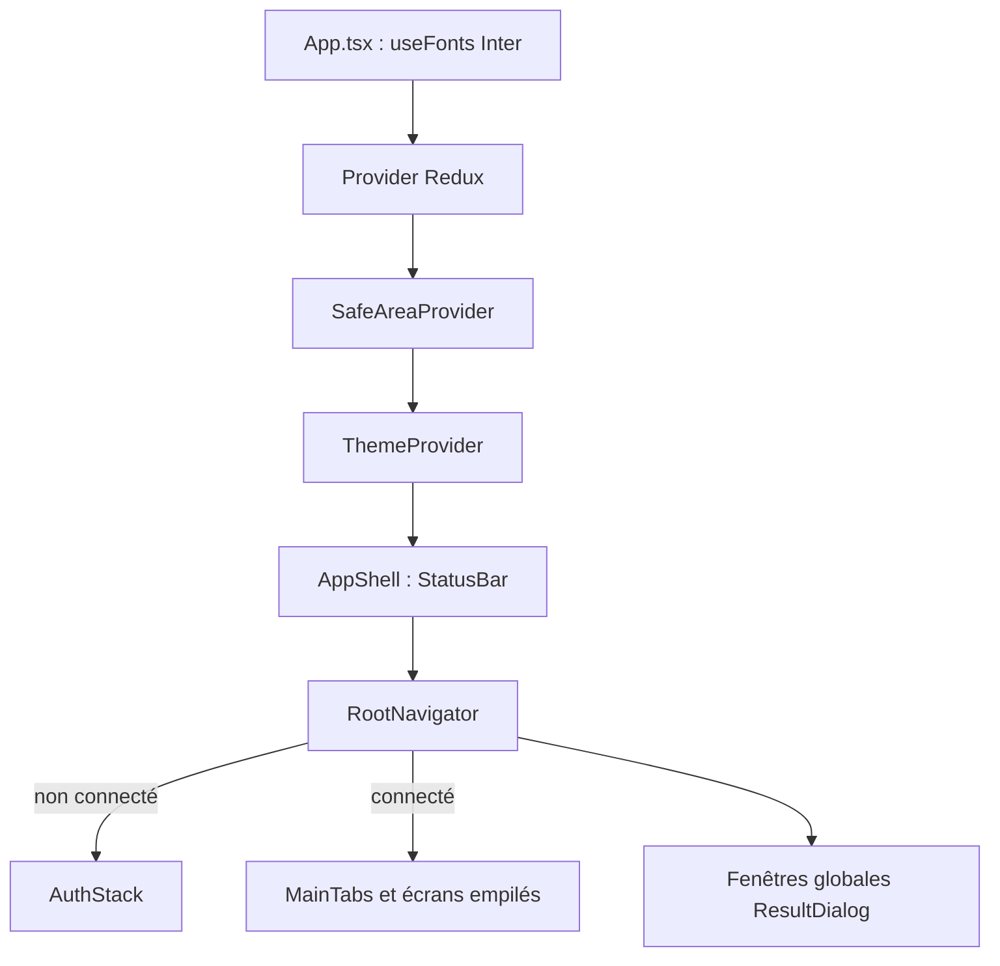

# Stack et structure

L'application mobile est l'interface citoyenne de BlockLucky sur iOS et Android. Elle couvre le parcours du citoyen : création de compte et connexion, vérification d'âge, achat et cadeau du ticket du grand tirage, salle d'attente et tirage en direct, tickets à gratter et boutique des commerçants, parrainage, profil, sécurité et RGPD. Elle n'a ni dashboard Mairie ni espace partenaire, qui n'existent que sur le [frontend web](../web/structure.md). Comme le web, elle ne gère aucune clé : le portefeuille de chaque citoyen est créé et utilisé par le backend (voir [Portefeuilles intégrés](../integration-blockchain/portefeuilles.md)).

Le code se trouve dans [`mobile-app/`](src:mobile-app). Il est écrit en TypeScript avec Expo et React Native. L'interface suit la maquette Figma de l'application : police Inter, palette jaune « soleil » et encre bleu nuit, cartes arrondies et icônes SVG (voir [Thème et composants](theme-composants.md)).

## Stack technique

Les versions viennent de [`mobile-app/package.json`](src:mobile-app/package.json). Contrairement au web, la plupart sont des plages (`^`, `~`) ; les versions exactes sont figées par `package-lock.json`.

| Rôle | Paquet | Version demandée |
|---|---|---|
| Plateforme | `expo` | ^58.0.22 |
| Moteur natif | `react-native` | 0.88.1 |
| Bibliothèque UI | `react` | 19.3.0 |
| Navigation | `@react-navigation/native`, `native-stack`, `bottom-tabs` | ^7.5.1, ^7.21.0, ^7.21.0 |
| État et appels API | `@reduxjs/toolkit`, `react-redux` | ^2.11.2, ^9.2.0 |
| Temps réel | `socket.io-client` | ^4.8.1 |
| Police Inter | `@expo-google-fonts/inter` | ^0.4.2 |
| Connexion Google | `expo-auth-session`, `expo-web-browser` | ~58.0.18, ~58.0.8 |
| Connexion Apple | `expo-apple-authentication` | ~58.0.3 |
| Photo de la pièce d'identité | `expo-image-picker` | ~58.0.10 |
| Stockage sécurisé | `expo-secure-store` | ~58.0.2 |
| Presse-papiers | `expo-clipboard` | ~58.0.4 |
| Zones sûres | `react-native-safe-area-context` | ~5.10.1 |
| Icônes SVG | `react-native-svg` | 15.16.0 |
| Cible web d'Expo | `react-dom`, `react-native-web` | 19.3.0, ^0.21.4 |
| Langage | `typescript` | ~6.0.3 |
| Lint | `eslint` 8, `eslint-config-universe` | ^8.57.1, ^12.1.0 |

Node.js 22.12 ou plus est requis. La CI utilise la version du fichier `.nvmrc` à la racine.

### Dépendances installées mais inutilisées

Plusieurs paquets figurent dans `package.json` sans être importés dans `src/` :

| Paquet | Situation |
|---|---|
| `axios` | [`api.client.ts`](src:mobile-app/src/services/api.client.ts) crée un client axios avec des nouvelles tentatives, mais seul `API_BASE_URL` est importé ailleurs ; toutes les requêtes passent par `fetch` via RTK Query (voir [Résilience réseau](resilience.md)) |
| `expo-notifications` | Aucun import : pas de notification push native (voir [Temps réel et notifications](temps-reel-notifications.md)) |
| `expo-crypto` | Aucun import |
| `lottie-react-native` | Aucun import ; les trois animations de `assets/animations` ne sont pas affichées, la roue du tirage est animée avec `Animated` de React Native |
| `react-native-gesture-handler` | Aucun import ; la carte à gratter utilise `PanResponder` de React Native |

Ces dépendances alourdissent le binaire sans rien apporter. Elles sont à retirer ou à brancher. Les fichiers `assets/fonts/Inter-*.ttf` ne sont plus lus non plus : la police vient du paquet `@expo-google-fonts/inter`.

## Arborescence

```text
mobile-app/
├── __tests__/               tests Jest (sans exécuteur installé)
├── assets/
│   ├── animations/          confetti, loading-spinner, roulette-spin (Lottie, inutilisés)
│   ├── fonts/               Inter Regular, Medium, Bold (non lues)
│   ├── icons/               42 icônes SVG de la maquette
│   └── images/              icon, adaptive-icon, splash, favicon
├── src/
│   ├── App.tsx              point d'entrée, chargement de la police Inter
│   ├── navigation/          RootNavigator, AuthStack, MainTabs, hooks typés
│   ├── screens/             27 écrans : auth, lottery, marketplace, settings, sponsors
│   ├── components/
│   │   ├── auth/            formulaires d'authentification, boutons Google et Apple
│   │   ├── draw/            roue, salle d'attente, discussion, résultats
│   │   ├── lottery/         carte d'échéance, paliers, offres à gratter, formats
│   │   ├── marketplace/     zone à gratter, cartes d'offres et de codes
│   │   ├── profile/         identité, parrainage, résumé, listes de réglages
│   │   ├── ui/              composants de base et icônes SVG
│   │   └── web3/            IntegratedWalletCard, IntegratedWalletButton, ExplorerLink (inutilisés)
│   ├── hooks/               useAuth, useCitizenWallet, useSocket, usePoints, usePushNotifications, useAppTheme
│   ├── services/            api.client, secureStorage, socket.client, sentry.client
│   ├── store/               store Redux, RTK Query (api/) et slices
│   ├── theme/               ThemeProvider, colors, spacing, typography
│   ├── types/               types de l'API, de la navigation et de l'utilisateur
│   └── utils/               date, formatters, validators
├── app.json                 configuration Expo
├── eas.json                 profils EAS Build
├── babel.config.js          preset babel-preset-expo
├── metro.config.js          configuration Metro par défaut d'Expo
└── .env.example
```

## Point d'entrée

`package.json` déclare `"main": "src/App.tsx"`. [`mobile-app/src/App.tsx`](src:mobile-app/src/App.tsx) appelle `registerRootComponent(App)`. Avant tout rendu, `App` charge cinq graisses d'Inter avec `useFonts` (`Inter_400Regular`, `Inter_500Medium`, `Inter_600SemiBold`, `Inter_700Bold`, `Inter_700Bold_Italic`). Tant qu'elles ne sont pas prêtes, il affiche une vue vide de couleur `#F6F7FA`. Il monte ensuite, dans cet ordre :

1. le `Provider` Redux avec le store unique de [`store/index.ts`](src:mobile-app/src/store/index.ts) ;
2. `SafeAreaProvider` ;
3. `ThemeProvider` (thème, langue, dimensions d'écran) ;
4. `AppShell`, qui choisit le style de la barre d'état selon le thème et rend `RootNavigator`.

Au montage, `App` appelle `sentryClient.init()`. Ce « client Sentry » ([`sentry.client.ts`](src:mobile-app/src/services/sentry.client.ts)) n'est pas le SDK Sentry : il garde en mémoire les 20 derniers rapports d'erreur et n'envoie rien à aucun serveur, même si `EXPO_PUBLIC_SENTRY_DSN` est renseigné.



## Organisation du code applicatif

| Dossier | Contenu | Page détaillée |
|---|---|---|
| `src/navigation` | Navigateurs, hooks de navigation typés et fenêtres globales | [Navigation et écrans](navigation-ecrans.md) |
| `src/store` | `baseApi` et trois fichiers d'endpoints, slices `auth`, `lottery`, `ui` | [État et appels API](etat-api.md) |
| `src/services` | Stockage sécurisé, client Socket.IO, client axios inutilisé, faux client Sentry | [Authentification](authentification.md), [Temps réel](temps-reel-notifications.md) |
| `src/hooks` | Hooks métier | [Portefeuille et loterie](portefeuille-loterie.md) |
| `src/theme`, `src/components/ui` | Jetons de couleur, espacements, typographie, composants de base et icônes | [Thème et composants](theme-composants.md) |

Les imports sont relatifs (`../../hooks/useAuth`) : il n'y a pas d'alias `@/` comme sur le web.

## Configuration

[`mobile-app/.env.example`](src:mobile-app/.env.example) liste quatre variables. Expo intègre au bundle toute variable préfixée `EXPO_PUBLIC_` au moment du démarrage de Metro ou du build.

| Variable | Valeur d'exemple | Lue par |
|---|---|---|
| `EXPO_PUBLIC_API_URL` | `http://localhost:2053/api` | [`api.client.ts`](src:mobile-app/src/services/api.client.ts), donc `baseApi` |
| `EXPO_PUBLIC_WS_URL` | `http://localhost:2053` | [`socket.client.ts`](src:mobile-app/src/services/socket.client.ts) |
| `EXPO_PUBLIC_SENTRY_DSN` | vide | `sentry.client.ts`, qui ne l'utilise que pour écrire une trace locale |
| `EXPO_PUBLIC_WEB3AUTH_CLIENT_ID` | `blocklucky-etherbay-client` | aucun fichier : vestige d'une intégration Web3Auth abandonnée |

Trois autres variables sont lues par [`SocialAuthButtons.tsx`](src:mobile-app/src/components/auth/SocialAuthButtons.tsx) sans figurer dans `.env.example` :

| Variable | Rôle |
|---|---|
| `EXPO_PUBLIC_GOOGLE_IOS_CLIENT_ID` | Identifiant client OAuth Google utilisé sur iOS |
| `EXPO_PUBLIC_GOOGLE_ANDROID_CLIENT_ID` | Identifiant client OAuth Google utilisé sur Android |
| `EXPO_PUBLIC_GOOGLE_WEB_CLIENT_ID` | Identifiant client OAuth Google utilisé sur la cible web |

Sans la variable de la plateforme courante, le bouton « Continuer avec Google » reste affiché mais désactivé, avec le message « Connexion Google non configurée sur cette application. ». Les identifiants doivent aussi figurer dans `GOOGLE_CLIENT_IDS` côté backend (voir [Authentification et stockage sécurisé](authentification.md#google-et-apple)).

> [!IMPORTANT]
> `localhost` désigne le téléphone lui-même. Sur un appareil physique ou un émulateur Android, l'URL doit pointer vers l'adresse IP de la machine qui fait tourner le backend. La procédure est dans [Tester sur un téléphone](telephone-physique.md).

L'ancien README mentionne `EXPO_PUBLIC_CHAIN_ID=11155111` : aucune ligne du code ne lit cette variable.

## Scripts npm

| Commande | Effet |
|---|---|
| `npm start` | `expo start` : serveur Metro et QR code |
| `npm run android` | `expo start --android` |
| `npm run ios` | `expo start --ios` |
| `npm run web` | `expo start --web` ; `react-dom` et `react-native-web` sont désormais installés, mais la cible web n'est vérifiée ni par la CI ni par un test, et la connexion Apple n'y est jamais proposée |
| `npm run typecheck` | `tsc --noEmit` |
| `npm run lint` | ESLint avec `universe/native` et `universe/shared/typescript-analysis` |

Il n'existe pas de script `test` et Jest n'est pas installé, bien que le dossier `__tests__` contienne trois fichiers et que l'ancien README cite `npm test` (voir [Builds et publication](builds-publication.md#tests)).

## Code mort à connaître

Le hook `useGaslessWeb3.ts`, qui présentait les achats comme sponsorisés par la plateforme, et le composant `WalletConnectButton.tsx`, qui invitait à « connecter » un portefeuille externe, ont été supprimés. La refonte de l'interface a aussi supprimé `LoginScreen.tsx`, `SettingsStack.tsx` et les composants `ChatBox`, `CountdownTimer`, `LeaderboardList`, `POAPBadge`, `RouletteAnimation`, `TicketCard` et `WinnerClaimCard`. Les citoyens ne connectent pas de portefeuille externe.

Il reste du code sans appelant :

| Élément | Situation |
|---|---|
| `IntegratedWalletCard`, `IntegratedWalletButton` | Plus aucun écran ne les importe ; `ExplorerLink` n'est plus utilisé que par `IntegratedWalletCard` |
| `generateDeterministicWallet` de `useCitizenWallet` | Plus appelée depuis la suppression de l'écran de connexion par email |
| `getOnboarding`, `setResponsibleLimit` de `authApi` | Déclarés, aucun écran ne les appelle |
| `triggerSimulatedOsPush` de `usePushNotifications` | Plus aucun écran ne l'appelle : le bandeau de notification simulé ne s'affiche plus |
| `notificationDrawerOpen` du slice `ui` | Le tiroir a été remplacé par l'écran `Notifications` |
| Composants `ScratchOfferCard` | Deux composants du même nom, l'un dans `components/lottery` (accueil), l'autre dans `components/marketplace` (choix du ticket à gratter) |
