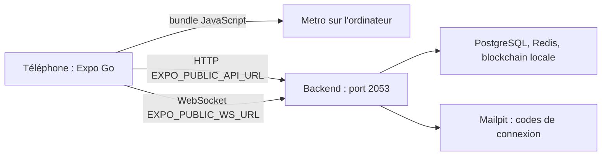

# Tester sur un téléphone

Cette page explique comment faire tourner l'application mobile sur un vrai téléphone ou un émulateur, contre un backend lancé sur la machine de développement. La difficulté principale est réseau : le téléphone doit joindre l'API et le serveur Socket.IO de l'ordinateur. Le lancement général des applications est décrit dans [Lancer les applications](../demarrage/lancer-les-applications.md).

## Prérequis

| Élément | Détail |
|---|---|
| Backend démarré | Base, Redis et blockchain locale prêts, API sur le port 2053 (voir [Infrastructure locale](../demarrage/infrastructure-locale.md)) |
| Dépendances mobiles | `npm ci` dans `mobile-app/` |
| Téléphone | Application Expo Go dans une version compatible avec le SDK Expo 58 du projet, ou émulateur Android, ou simulateur iOS sur macOS |
| Réseau | Ordinateur et téléphone sur le même réseau Wi-Fi, sans isolation des clients |

## Principe



Le téléphone télécharge le code JavaScript depuis Metro, puis appelle directement le backend. Dans `.env.example`, l'API est `http://localhost:2053/api` : sur un téléphone, `localhost` désigne le téléphone lui-même, et toutes les requêtes échouent. Il faut remplacer `localhost` par l'adresse de l'ordinateur sur le réseau local.

## Étape 1 : trouver l'adresse de l'ordinateur

Sous Windows :

```powershell
ipconfig
```

Relever l'« Adresse IPv4 » de la carte Wi-Fi, par exemple `192.168.1.42`.

Sous Linux :

```bash
ip -4 addr
```

Sous macOS, pour la carte Wi-Fi habituelle :

```bash
ipconfig getifaddr en0
```

L'adresse change d'un réseau à l'autre : à refaire après chaque changement de Wi-Fi.

## Étape 2 : configurer l'application

Créer `mobile-app/.env` à partir de `.env.example` :

```ini
EXPO_PUBLIC_API_URL=http://192.168.1.42:2053/api
EXPO_PUBLIC_WS_URL=http://192.168.1.42:2053
EXPO_PUBLIC_SENTRY_DSN=
EXPO_PUBLIC_WEB3AUTH_CLIENT_ID=blocklucky-etherbay-client
```

Seules les deux premières lignes comptent (voir [Stack et structure](structure.md#configuration)). Le fichier `.env` est ignoré par Git.

| Cible | Adresse à utiliser |
|---|---|
| Téléphone physique | Adresse IPv4 de l'ordinateur |
| Émulateur Android | `10.0.2.2`, alias de la machine hôte dans l'émulateur, ou l'adresse IPv4 |
| Simulateur iOS | `localhost` fonctionne, le simulateur partageant le réseau du Mac |

Les variables `EXPO_PUBLIC_*` sont lues au démarrage de Metro. Après une modification de `.env`, relancer Metro en vidant son cache :

```bash
npx expo start -c
```

## Étape 3 : rendre le backend joignable

Le serveur Express écoute sur toutes les interfaces (`httpServer.listen(env.PORT)` sans adresse, dans [`backend/src/server.ts`](src:backend/src/server.ts)). Dans [`docker-compose.yml`](src:docker-compose.yml), le service `backend` publie aussi `2053:2053` sur toutes les interfaces. Il reste deux obstacles possibles :

- **Pare-feu.** Le pare-feu de l'ordinateur doit accepter les connexions entrantes sur le port 2053 depuis le réseau local. Sous Windows, la première exécution de Node.js propose généralement d'autoriser l'accès aux réseaux privés.
- **Isolation du Wi-Fi.** Les réseaux publics ou d'entreprise empêchent souvent deux appareils de se voir. Utiliser un réseau domestique ou le partage de connexion du téléphone.

Vérification depuis le navigateur du téléphone : ouvrir `http://192.168.1.42:2053/health/live`. Une réponse JSON confirme que le réseau est bon.

La configuration CORS du backend (`CORS_ORIGINS`) ne concerne pas l'application : les requêtes d'une application native n'envoient pas d'en-tête `Origin` de navigateur.

## Étape 4 : lancer l'application

```bash
cd mobile-app
npm start
```

Metro affiche un QR code. Le scanner avec l'appareil photo (iOS) ou depuis Expo Go (Android). Pour un émulateur ou un simulateur déjà ouvert, utiliser `npm run android` ou `npm run ios`.

## Étape 5 : se connecter

> [!NOTE]
> La connexion se fait par code envoyé par email, comme sur le web : en local, le code arrive dans Mailpit sur `http://localhost:8025` du poste qui fait tourner le backend. Si l'application affiche « Impossible de vous connecter au serveur », vérifier l'adresse de l'API dans `mobile-app/.env` et le pare-feu du poste.

Avec ce réglage, l'email prérempli `citoyen@etherbay.fr`, après la case de majorité, ouvre directement les onglets. Les comptes de démonstration sont décrits dans [Comptes de démonstration et connexion](../demarrage/comptes-et-connexion.md). Une fois le défaut corrigé, le code de connexion se lira dans Mailpit, publié sur `http://127.0.0.1:8025` de l'ordinateur uniquement.

La session n'est pas conservée : après avoir fermé complètement l'application, il faut se reconnecter.

## Ce qui diffère d'un environnement réel

| Élément | En local |
|---|---|
| Liens vers l'explorateur | Absents : `EXPLORER_URL` est vide dans `backend/.env.example`, donc le backend ne renvoie aucune URL |
| Visuels POAP | Chargés depuis l'URI du badge ; si elle désigne `localhost`, le téléphone ne peut pas la joindre et l'écran affiche le repli textuel |
| Mode de la blockchain | `BLOCKCHAIN_MODE=onchain` sur la blockchain locale par défaut, ou `simulated` ; l'application affiche « Mode démonstration » dans le second cas |
| HTTP non chiffré | Accepté par Expo Go en développement ; un build de production devra utiliser HTTPS (voir [Builds et publication](builds-publication.md#variables-d-environnement-au-build)) |

## Dépannage

| Symptôme | Cause probable | Solution |
|---|---|---|
| « Impossible de vous connecter au serveur » dès la connexion | API injoignable depuis le téléphone | Vérifier l'adresse de l'API dans `mobile-app/.env`, puis ouvrir `/health/live` depuis le navigateur du téléphone |
| Écrans vides, chargement infini | `EXPO_PUBLIC_API_URL` contient `localhost` ou une ancienne adresse | Corriger `.env`, puis `npx expo start -c` |
| Le QR code ne s'ouvre pas | Téléphone et ordinateur sur des réseaux différents | Même Wi-Fi, ou partage de connexion |
| Expo Go refuse le projet | Version d'Expo Go incompatible avec le SDK 58 | Mettre à jour Expo Go, ou utiliser un émulateur |
| Discussion et salle d'attente inactives | `EXPO_PUBLIC_WS_URL` incorrecte | Même adresse que l'API, sans `/api` |
| Messages de discussion en double | Écouteurs Socket.IO dupliqués (défaut connu) | Voir [Temps réel et notifications](temps-reel-notifications.md) |
| Erreur 429 ou file d'attente | Limite de débit du backend atteinte après de nombreux essais | Attendre la fin de la fenêtre de limitation |

Les autres problèmes d'environnement sont traités dans [Dépannage](../demarrage/depannage.md).
