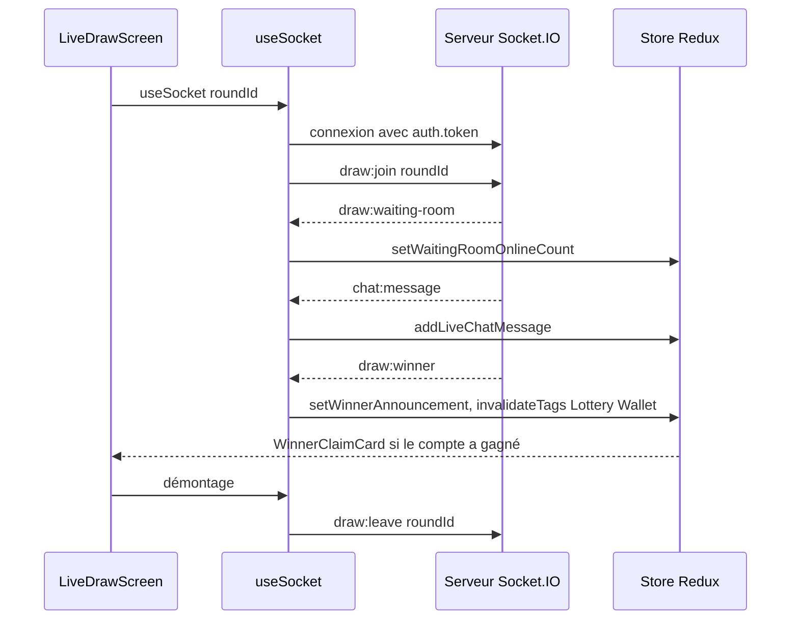

# Temps réel et notifications

L'application mobile reçoit les événements Socket.IO du backend sur un seul écran, le tirage en direct. Elle n'a pas de notifications push : la dépendance `expo-notifications` est installée mais jamais importée, aucun jeton d'appareil n'est enregistré et le backend n'envoie aucune notification vers Expo, Apple ou Google. Le « tiroir des notifications » affiche une liste lue par l'API, et le « test de notification » est un bandeau dessiné dans l'application.

Cette page sépare ce qui fonctionne de ce qui n'est pas branché. La liste des événements du serveur est dans [Temps réel Socket.IO](../backend/socket-io.md) ; le comportement équivalent du web est dans [Temps réel du web](../web/temps-reel.md).

## État des fonctionnalités

| Fonctionnalité | État | Détail |
|---|---|---|
| Connexion Socket.IO authentifiée | branchée | Jeton lu dans SecureStore et passé dans `auth.token` |
| Salle d'attente du tirage | branchée | `draw:join`, `draw:leave`, `draw:waiting-room` |
| Discussion en direct | branchée | `chat:send`, `chat:message` |
| Annonce du gagnant | branchée | `draw:winner`, invalidation de `Lottery` et `Wallet` |
| Points attribués en direct | branchée, avec défaut | `points:awarded`, filtré par `userId` dans l'application |
| Réactions rapides du serveur | non utilisée | `sendReaction` émet `chat:react`, mais aucun écran ne l'appelle ; `chat:reaction` n'est pas écouté |
| Compte à rebours serveur, début du tirage, file d'attente, bascule de nœud | non émis | `draw:countdown`, `draw:started`, `queue:position` et `network:fallback` sont déclarés côté serveur mais jamais envoyés |
| Notifications push natives | absente | `expo-notifications` non importé, pas de plugin dans `app.json`, pas de demande d'autorisation, pas de jeton |
| Liste des notifications | branchée sur des données fixes | `GET /user/notifications` renvoie trois notifications codées en dur dans le backend |
| Bandeau « notification » | simulé | `triggerSimulatedOsPush` affiche un bandeau interne pendant 4,5 s |
| Préférence `pushNotificationsEnabled` | sans effet | Acceptée par `PUT /user/preferences`, aucun écran ne la modifie et rien ne la lit |

## Le client Socket.IO

[`mobile-app/src/services/socket.client.ts`](src:mobile-app/src/services/socket.client.ts) expose un singleton :

```typescript
this.socket = io(WS_BASE_URL, {
  transports: ['websocket', 'polling'],
  autoConnect: true,
  auth: {
    token: token || undefined,
  },
});
```

| Méthode | Comportement |
|---|---|
| `connect()` | Asynchrone. Renvoie la connexion existante si elle est connectée ; sinon lit le jeton dans SecureStore et crée une nouvelle connexion |
| `getSocket()` | Connexion courante ou `null` |
| `disconnect()` | Ferme et oublie la connexion ; n'est appelé par aucun écran ni par la déconnexion |

`WS_BASE_URL` vient de `EXPO_PUBLIC_WS_URL` (`http://localhost:2053` par défaut). Sur un téléphone, il faut l'adresse IP de la machine du backend (voir [Tester sur un téléphone](telephone-physique.md)). Le nombre de tentatives de reconnexion n'est pas limité : c'est la valeur par défaut de `socket.io-client`.

Si une connexion existe mais n'est pas encore connectée (ou a été coupée), `connect()` en crée une seconde sans fermer la première. Le jeton n'est relu qu'à la création : après une reconnexion du compte, l'ancienne connexion garde l'ancien jeton.

Le serveur accepte une connexion sans jeton en invité et refuse un jeton invalide ou révoqué ([`socket.middleware.ts`](src:backend/src/socket/socket.middleware.ts)).

## Le hook useSocket

[`mobile-app/src/hooks/useSocket.ts`](src:mobile-app/src/hooks/useSocket.ts) est utilisé uniquement par `LiveDrawScreen`, avec l'identifiant du tour courant. À chaque exécution de l'effet, il :

1. attend `socketClient.connect()` ;
2. émet `draw:join` avec l'identifiant du tour, s'il est connu ;
3. ajoute quatre écouteurs : `draw:waiting-room`, `chat:message`, `draw:winner`, `points:awarded`.

Au démontage, il émet `draw:leave` mais ne retire pas les écouteurs.

| Événement reçu | Effet |
|---|---|
| `draw:waiting-room` | `setWaitingRoomOnlineCount(onlineUsers)` |
| `chat:message` | `addLiveChatMessage` (100 messages au plus) |
| `draw:winner` | `setWinnerAnnouncement`, puis invalidation des tags `Lottery` et `Wallet` |
| `points:awarded` | Feuille « Points crédités » si `userId` correspond au compte |

| Fonction exposée | Émission |
|---|---|
| `sendChatMessage(message, emoji)` | `chat:send` si la connexion est active, sinon ajout local avec l'auteur « Vous (Citoyen) » |
| `sendReaction(emoji)` | `chat:react`, jamais appelée |

> [!WARNING]
> Les écouteurs ne sont jamais retirés (`socket.on` sans `socket.off`). L'effet se relance quand `roundId` ou l'utilisateur change, et les deux enregistrements de `LiveDrawScreen` (onglet et écran empilé) peuvent le monter deux fois. Chaque relance ajoute un jeu d'écouteurs : les messages de discussion apparaissent alors en double (le slice mobile ne dédoublonne pas par identifiant, contrairement au web) et la feuille de points peut s'ouvrir plusieurs fois. Il faut retirer les écouteurs dans la fonction de nettoyage, comme le fait le web.

Autres écarts avec le web :

- `draw:join` n'est émis qu'une fois ; après une coupure et une reconnexion, l'application ne rejoint pas la salle, et le compteur de présence n'est plus mis à jour ;
- l'état de connexion n'est pas suivi (pas de `socketConnected`), donc `ChatBox` ne peut pas signaler une discussion hors ligne ;
- la connexion n'est pas fermée à la déconnexion du compte.

`points:awarded` est diffusé par le serveur à tous les clients avec l'identifiant interne du compte ; le filtrage se fait dans l'application. Ce point de confidentialité est commun au web et au mobile.

## Séquence sur l'écran du tirage



## Notifications

[`mobile-app/src/hooks/usePushNotifications.ts`](src:mobile-app/src/hooks/usePushNotifications.ts) porte un nom trompeur : il ne gère aucune notification push.

| Membre | Rôle |
|---|---|
| `notifications`, `unreadCount`, `isLoading`, `refetchNotifications` | Résultat de `GET /user/notifications`, demandé seulement si `isAuthenticated` |
| `drawerOpen`, `openDrawer`, `closeDrawer` | Tiroir `BottomSheet` rendu par `RootNavigator` |
| `osPushBanner`, `triggerSimulatedOsPush(title, body)` | Bandeau en haut de l'écran, masqué après 4,5 secondes |

L'accueil affiche un bouton d'alertes avec `unreadCount` et ouvre le tiroir. L'écran Charte et aide propose « Simuler une notification », qui affiche le bandeau « Nouveau partenaire à EtherBay ». Ce bandeau est une vue React Native : il n'apparaît pas si l'application est en arrière-plan et ne passe pas par le centre de notifications du système.

Le backend renvoie aujourd'hui une liste fixe de trois notifications, générée par `UserService.getPushNotificationsHistory` dans [`backend/src/api/user/user.services.ts`](src:backend/src/api/user/user.services.ts). La liste n'est pas rafraîchie automatiquement.

## Brancher de vraies notifications push

Les étapes, non réalisées dans le projet, seraient :

1. ajouter le plugin `expo-notifications` dans `app.json`, puis demander l'autorisation à l'utilisateur après la connexion ;
2. obtenir un jeton Expo Push (ce qui suppose un projet EAS, voir [Builds et publication](builds-publication.md)) et l'envoyer au backend par une nouvelle route ;
3. stocker ce jeton côté serveur et l'utiliser depuis un worker pour les événements utiles (tirage imminent, gain, cadeau reçu) ;
4. respecter la préférence `pushNotificationsEnabled` et l'opposition de l'utilisateur.

Pour un nouvel événement temps réel, suivre [Ajouter un événement temps réel](../guides/ajouter-evenement-socket.md).
