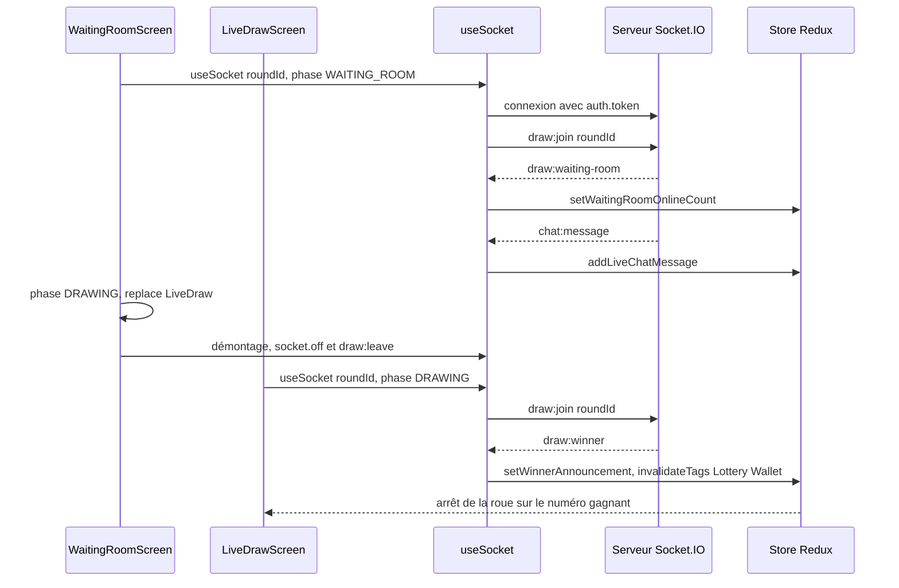

# Temps réel et notifications

L'application mobile reçoit les événements Socket.IO du backend sur deux écrans, la salle d'attente et le tirage en direct. Elle n'a pas de notifications push : la dépendance `expo-notifications` est installée mais jamais importée, aucun jeton d'appareil n'est enregistré et le backend n'envoie aucune notification vers Expo, Apple ou Google. L'écran « Notifications » affiche une liste lue par l'API.

Cette page sépare ce qui fonctionne de ce qui n'est pas branché. La liste des événements du serveur est dans [Temps réel Socket.IO](../backend/socket-io.md) ; le comportement équivalent du web est dans [Temps réel du web](../web/temps-reel.md).

## État des fonctionnalités

| Fonctionnalité | État | Détail |
|---|---|---|
| Connexion Socket.IO authentifiée | branchée | Jeton lu dans SecureStore et passé dans `auth.token` |
| Salle d'attente du tirage | branchée | `draw:join`, `draw:leave`, `draw:waiting-room` ; la salle est rejointe à nouveau après une reconnexion |
| Discussion en direct | branchée | `chat:send`, `chat:message` ; messages dédoublonnés par identifiant |
| Annonce du gagnant | branchée | `draw:winner`, invalidation de `Lottery` et `Wallet` |
| Points attribués en direct | branchée, avec défaut | `points:awarded`, filtré par `userId` dans l'application |
| Réactions rapides du serveur | non utilisée | `sendReaction` émet `chat:react`, mais aucun écran ne l'appelle ; `chat:reaction` n'est pas écouté |
| Compte à rebours serveur, début du tirage, file d'attente, bascule de nœud | non émis | `draw:countdown`, `draw:started`, `queue:position` et `network:fallback` sont déclarés côté serveur mais jamais envoyés ; les écrans interrogent `GET /lottery/status` à intervalle régulier |
| Notifications push natives | absente | `expo-notifications` non importé, pas de plugin dans `app.json`, pas de demande d'autorisation, pas de jeton |
| Liste des notifications | branchée sur des données fixes | `GET /user/notifications` renvoie trois notifications codées en dur dans le backend |
| Bandeau « notification » | sans déclencheur | `triggerSimulatedOsPush` existe toujours dans le hook et `RootNavigator` sait afficher le bandeau, mais plus aucun écran ne l'appelle |
| Préférence `pushNotificationsEnabled` | enregistrée, sans effet | Interrupteur « Notifications push » de l'écran Paramètres, envoyé par `PUT /user/preferences` ; rien ne la lit |

## Le client Socket.IO

[`mobile-app/src/services/socket.client.ts`](src:mobile-app/src/services/socket.client.ts) expose un singleton :

```typescript
this.socket = io(WS_BASE_URL, {
  transports: ['websocket', 'polling'],
  autoConnect: true,
  auth: {
    token: token || undefined,
  },
});
```

| Méthode | Comportement |
|---|---|
| `connect()` | Asynchrone. Renvoie la connexion existante si elle est connectée ; sinon lit le jeton dans SecureStore et crée une nouvelle connexion |
| `getSocket()` | Connexion courante ou `null` |
| `disconnect()` | Ferme et oublie la connexion ; n'est appelé par aucun écran ni par la déconnexion |

`WS_BASE_URL` vient de `EXPO_PUBLIC_WS_URL` (`http://localhost:2053` par défaut). Sur un téléphone, il faut l'adresse IP de la machine du backend (voir [Tester sur un téléphone](telephone-physique.md)). Le nombre de tentatives de reconnexion n'est pas limité : c'est la valeur par défaut de `socket.io-client`.

Si une connexion existe mais n'est pas encore connectée (ou a été coupée), `connect()` en crée une seconde sans fermer la première. Le jeton n'est relu qu'à la création : après une reconnexion du compte, l'ancienne connexion garde l'ancien jeton.

Le serveur accepte une connexion sans jeton en invité et refuse un jeton invalide ou révoqué ([`socket.middleware.ts`](src:backend/src/socket/socket.middleware.ts)).

## Le hook useSocket

[`mobile-app/src/hooks/useSocket.ts`](src:mobile-app/src/hooks/useSocket.ts) est utilisé par deux écrans, qui ne lui passent l'identifiant du tour que lorsqu'il est utile :

| Écran | Identifiant passé |
|---|---|
| `WaitingRoomScreen` | Seulement en phase `WAITING_ROOM` et si le citoyen a un ticket pour ce tour |
| `LiveDrawScreen` | Seulement en phase `DRAWING`, `COMPLETED` ou `CANCELLED` |

À chaque exécution de l'effet, le hook :

1. attend `socketClient.connect()` ;
2. émet `draw:join` avec l'identifiant du tour si la connexion est active, et le réémet à chaque événement `connect`, donc après une reconnexion ;
3. ajoute quatre écouteurs : `draw:waiting-room`, `chat:message`, `draw:winner`, `points:awarded`.

La fonction de nettoyage retire ces écouteurs et celui de `connect` (`socket.off`), puis émet `draw:leave`. Les messages ne sont donc plus reçus en double quand l'effet se relance, et `addLiveChatMessage` ignore de toute façon un identifiant déjà présent.

| Événement reçu | Effet |
|---|---|
| `draw:waiting-room` | `setWaitingRoomOnlineCount(onlineUsers)` |
| `chat:message` | `addLiveChatMessage` (100 messages au plus, sans doublon) |
| `draw:winner` | `setWinnerAnnouncement`, puis invalidation des tags `Lottery` et `Wallet` |
| `points:awarded` | Fenêtre « +n EtherPoints » si `userId` correspond au compte |

| Fonction exposée | Émission |
|---|---|
| `sendChatMessage(message, emoji)` | `chat:send` si la connexion est active ; renvoie `false` sinon, et `RoomChat` affiche « Connexion à la salle en cours. Réessayez dans un instant. » sans ajouter le message |
| `sendReaction(emoji)` | `chat:react`, jamais appelée |

Le slice `lottery` démarre avec une discussion vide et un compteur de présence à zéro : les messages d'accueil codés en dur ont été retirés.

Écarts restants avec le web :

- l'état de connexion n'est pas suivi (pas de `socketConnected`) : la discussion ne signale une coupure qu'au moment d'un envoi ;
- la connexion n'est pas fermée à la déconnexion du compte.

`points:awarded` est diffusé par le serveur à tous les clients avec l'identifiant interne du compte ; le filtrage se fait dans l'application. Ce point de confidentialité est commun au web et au mobile.

## Séquence de la salle d'attente au tirage



## Notifications

[`mobile-app/src/hooks/usePushNotifications.ts`](src:mobile-app/src/hooks/usePushNotifications.ts) porte un nom trompeur : il ne gère aucune notification push.

| Membre | Rôle |
|---|---|
| `notifications`, `isLoading`, `isFetching`, `isError`, `refetchNotifications` | Résultat de `GET /user/notifications`, demandé seulement si `isAuthenticated` |
| `unreadCount`, `markAllAsSeen` | Notifications non lues ; `markAllAsSeen` mémorise les identifiants vus dans une variable du module |
| `osPushBanner`, `triggerSimulatedOsPush(title, body)` | Bandeau en haut de l'écran, masqué après 4,5 secondes ; plus appelé |

L'accueil, « Mes tickets » et le titre des onglets Profil et Parrains affichent `HeaderActions` : la cloche `NotificationButton`, avec une pastille quand `unreadCount` est positif, à côté de la roue des paramètres. L'appui sur la cloche ouvre [`NotificationsScreen.tsx`](src:mobile-app/src/screens/settings/NotificationsScreen.tsx). Cet écran liste les notifications, permet de tirer pour rafraîchir et marque tout comme vu à sa fermeture. L'état « vu » n'est ni envoyé au backend ni enregistré sur l'appareil : il est perdu au redémarrage de l'application.

Le backend renvoie aujourd'hui une liste fixe de trois notifications, générée par `UserService.getPushNotificationsHistory` dans [`backend/src/api/user/user.services.ts`](src:backend/src/api/user/user.services.ts). Chaque notification porte une catégorie (`drawReminders`, `results`, `rewards` ou `referrals`) ; celles dont la catégorie est coupée dans Paramètres, puis Notifications ([`NotificationSettingsScreen.tsx`](src:mobile-app/src/screens/settings/NotificationSettingsScreen.tsx)) sont retirées de la réponse. L'interrupteur général `pushNotificationsEnabled` est enregistré mais ne filtre pas la liste. La liste est rechargée par le geste de rafraîchissement de l'accueil et de l'écran Notifications.

## Brancher de vraies notifications push

Les étapes, non réalisées dans le projet, seraient :

1. ajouter le plugin `expo-notifications` dans `app.json`, puis demander l'autorisation à l'utilisateur après la connexion ;
2. obtenir un jeton Expo Push (ce qui suppose un projet EAS, voir [Builds et publication](builds-publication.md)) et l'envoyer au backend par une nouvelle route ;
3. stocker ce jeton côté serveur et l'utiliser depuis un worker pour les événements utiles (ouverture de la salle d'attente, résultat, cadeau reçu, décision sur la vérification d'âge) ;
4. respecter la préférence `pushNotificationsEnabled`, les catégories de `preferences.notifications` et l'opposition de l'utilisateur.

Pour un nouvel événement temps réel, suivre [Ajouter un événement temps réel](../guides/ajouter-evenement-socket.md).
