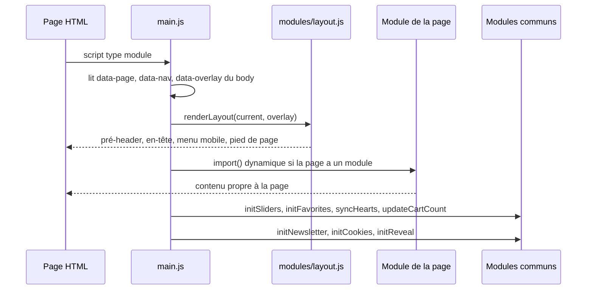

# Architecture JavaScript

Le site n'a ni framework, ni bundler, ni dépendance npm. Le navigateur charge directement des modules ES (`import` et `export`) depuis [`assets/js/`](src:frontend-office-tourisme/assets/js/). Le seul code tiers est le générateur de QR codes, copié dans `assets/js/vendor/`.

Ce choix a deux conséquences pratiques :

- le site doit être servi par un serveur HTTP : un navigateur refuse de charger des modules ES depuis `file://` ;
- un fichier modifié est visible au rechargement suivant, sans étape de construction.

## Arborescence

```text
assets/js/
├── main.js
├── data/
│   ├── site.js
│   ├── events.js
│   ├── places.js
│   └── content.js
├── modules/
│   ├── layout.js
│   ├── cards.js
│   ├── favorites.js
│   ├── cart.js
│   ├── slider.js
│   ├── cookies.js
│   ├── newsletter.js
│   ├── icons.js
│   └── utils.js
├── pages/
│   ├── home.js
│   ├── decouvrir.js
│   ├── sortir.js
│   ├── listing.js
│   ├── fiche.js
│   ├── article.js
│   ├── favoris.js
│   ├── billetterie.js
│   ├── commande.js
│   └── bientot.js
└── vendor/
    ├── qrcode.mjs
    └── LICENSE-qrcode-generator.txt
```

| Dossier | Rôle | Dépend de |
| --- | --- | --- |
| `data/` | Données fictives exportées en constantes (voir [Contenus](contenus.md)) | rien : aucun fichier de données n'importe d'autre module |
| `modules/` | Briques réutilisées par toutes les pages : gabarit, cartes, favoris, panier, carrousels, cookies, newsletter, icônes, utilitaires | `data/`, `utils.js`, `icons.js` |
| `pages/` | Logique propre à une page, chargée à la demande | `data/`, `modules/` |
| `vendor/` | Code tiers non modifié | rien |

## Démarrage d'une page

[`main.js`](src:frontend-office-tourisme/assets/js/main.js) est le seul script déclaré dans les pages HTML. Sa fonction `boot` exécute toujours la même séquence :



L'ordre compte. Le gabarit est posé avant le module de la page, parce que certaines pages remplissent des éléments qu'il crée. Les carrousels, les cœurs des favoris et le compteur du panier sont initialisés après le module de la page, parce que celle-ci génère des cartes et des carrousels qui doivent être pris en compte.

Le chargement des modules de page passe par `import()` dans l'objet `PAGES` :

```javascript
const PAGES = {
  home: () => import('./pages/home.js'),
  manger: () => import('./pages/listing.js'),
  dormir: () => import('./pages/listing.js'),
  commande: () => import('./pages/commande.js'),
};
```

Le navigateur ne télécharge donc que le code de la page affichée. Le générateur de QR codes (environ 48 Ko non minifiés) n'est chargé que sur `commande.html`, parce que seul `pages/commande.js` l'importe.

Chaque module de page exporte une fonction par défaut. `main.js` l'appelle avec le nom de la page, ce qui permet à [`pages/listing.js`](src:frontend-office-tourisme/assets/js/pages/listing.js) de servir Manger et Dormir avec deux configurations différentes.

## Modules communs

| Module | Exports principaux | Rôle |
| --- | --- | --- |
| [`layout.js`](src:frontend-office-tourisme/assets/js/modules/layout.js) | `renderLayout` | Génère le pré-header, l'en-tête, le menu mobile, la newsletter et le pied de page. Gère l'en-tête collant, le menu mobile (Échap, retour du focus), le sélecteur de langue et le bouton de retour en haut. |
| [`cards.js`](src:frontend-office-tourisme/assets/js/modules/cards.js) | `tileCard`, `eventCard`, `placeCard`, `postCard`, `sliderControls`, `btn` | Gabarits HTML des cartes, sous forme de fonctions qui renvoient une chaîne |
| [`favorites.js`](src:frontend-office-tourisme/assets/js/modules/favorites.js) | `getFavorites`, `toggleFavorite`, `syncHearts`, `initFavorites` | Favoris dans le `localStorage`, clic délégué sur tous les `[data-fav]` |
| [`cart.js`](src:frontend-office-tourisme/assets/js/modules/cart.js) | `getCart`, `setQuantity`, `addToCart`, `setDate`, `cartLines`, `cartTotals`, `saveOrder`, `createOrderNumber`, `euro` | Panier et commandes (voir [Billetterie et commande](billetterie.md)) |
| [`slider.js`](src:frontend-office-tourisme/assets/js/modules/slider.js) | `initSliders` | Carrousels à défilement natif, boutons précédent et suivant désactivés aux extrémités |
| [`cookies.js`](src:frontend-office-tourisme/assets/js/modules/cookies.js) | `initCookies` | Bandeau de consentement et bouton pour le rouvrir |
| [`newsletter.js`](src:frontend-office-tourisme/assets/js/modules/newsletter.js) | `initNewsletter` | Validation du formulaire du pied de page, inscription simulée |
| [`icons.js`](src:frontend-office-tourisme/assets/js/modules/icons.js) | `ICONS`, `BRAND_WAVE` | Icônes SVG en ligne, toutes marquées `aria-hidden="true"` |
| [`utils.js`](src:frontend-office-tourisme/assets/js/modules/utils.js) | `$`, `$$`, `escapeHtml`, `visualSrc`, `formatRange`, `formatLongDate`, `isOnDay`, `params`, `storage`, `toast`, `normalize` | Sélecteurs, échappement, dates, paramètres d'URL, stockage local sécurisé, notifications |

### Rendu par chaînes et échappement

Les pages construisent leur HTML par gabarits de chaînes puis l'insèrent avec `innerHTML`. Toute valeur textuelle passe par `escapeHtml`, qui remplace `&`, `<`, `>`, `"` et `'`. C'est indispensable pour les valeurs venant du visiteur : nom et email saisis dans la commande, recherche, paramètres d'URL. Les identifiants (`id` des données) sont insérés sans échappement dans les attributs : ils viennent des fichiers de données et ne doivent contenir que des minuscules, chiffres et tirets.

Un module qui ajoute un gabarit doit suivre la même règle :

```javascript
export const badge = (label) => `<span class="badge">${escapeHtml(label)}</span>`;
```

### Stockage local

`storage.get` et `storage.set` encapsulent `localStorage` dans des `try...catch`. En navigation privée ou si le stockage est plein ou bloqué, la lecture renvoie la valeur par défaut et l'écriture est ignorée : le site reste utilisable, sans persistance. Les clés utilisées sont listées dans [Accessibilité et vie privée](accessibilite.md#donnees-stockees-dans-le-navigateur).

### Communication entre modules

Les modules ne s'appellent pas en boucle : ils publient des événements DOM personnalisés.

| Événement | Émis par | Écouté par |
| --- | --- | --- |
| `favorites:change` | `favorites.js` à chaque ajout ou retrait | `pages/favoris.js`, qui redessine la liste |
| `cart:change` | `cart.js` à chaque modification du panier | aucun module à ce jour, disponible pour une extension |

Les compteurs de l'en-tête (`[data-cart-count]`, `[data-fav-count]`) sont mis à jour directement par `updateCartCount` et `updateFavoriteCount`.

### Animations d'apparition

`initReveal` de `main.js` ajoute la classe `is-visible` aux éléments `.reveal` quand ils entrent dans l'écran, avec un `IntersectionObserver`. Sans `IntersectionObserver`, tous les éléments sont rendus visibles immédiatement.

## Code tiers

[`vendor/qrcode.mjs`](src:frontend-office-tourisme/assets/js/vendor/qrcode.mjs) est la version ES module de qrcode-generator 2.0.4 de Kazuhiko Arase, sous licence MIT ([`LICENSE-qrcode-generator.txt`](src:frontend-office-tourisme/assets/js/vendor/LICENSE-qrcode-generator.txt)). Il est exclu de l'analyse CodeQL (`paths-ignore` de [`.github/workflows/codeql.yml`](src:.github/workflows/codeql.yml)). Pour le mettre à jour, remplacer le fichier par la nouvelle version du paquet `qrcode-generator` (fichier `dist/qrcode.mjs` du paquet npm) et mettre à jour le numéro de version dans le fichier de licence.

> [!NOTE]
> Le dossier du site n'a pas de `node_modules` : le `package.json` ne déclare qu'un script `dev`. Dependabot ne surveille donc pas ce code tiers. Une mise à jour de sécurité de qrcode-generator se fait à la main.

## Feuilles de style

Le CSS suit la même découpe, avec un point d'entrée unique [`assets/css/main.css`](src:frontend-office-tourisme/assets/css/main.css) qui importe les autres fichiers dans cet ordre :

| Fichier | Contenu |
| --- | --- |
| `fonts.css` | Déclarations `@font-face` des polices auto-hébergées |
| `tokens.css` | Variables CSS : couleurs, polices, tailles, espacements |
| `base.css` | Réinitialisation, typographie, conteneurs, focus visible, lien d'évitement, mouvement réduit |
| `layout.css` | Pré-header, en-tête, menu mobile, newsletter, pied de page |
| `components.css` | Boutons, cartes, carrousels, filtres, bandeau cookies, notifications |
| `pages.css` | Styles propres à certaines pages |
| `checkout.css` | Billetterie, tunnel de commande, billets électroniques et feuille d'impression |

Les détails de la charte sont dans [Charte graphique et médias](charte.md).

## Vérifications automatiques

Le job `tourisme` de la CI ne lance pas de tests fonctionnels. Il contrôle deux choses :

```bash
find assets/js \( -name '*.js' -o -name '*.mjs' \) -exec node --check {} \;
```

```bash
node ../.github/scripts/check-static-links.mjs .
```

La première commande vérifie la syntaxe de chaque module. La seconde parcourt les attributs `src` et `href` de toutes les pages HTML et échoue si une ressource locale n'existe pas (voir [Servir et déployer](deploiement.md#verifications-de-la-ci)). Les liens générés par le JavaScript (cartes, menus) ne sont pas vérifiés : un identifiant mal orthographé dans `data/` n'est détecté qu'en naviguant.

> [!TIP]
> `node --check` accepte un fichier `.js` contenant `import` parce que Node 22 détecte automatiquement la syntaxe des modules ES. La CI utilise la version majeure de [`.nvmrc`](src:.nvmrc) (22) ; avec une version plus ancienne de Node, la commande peut échouer sur les fichiers `.js`.
