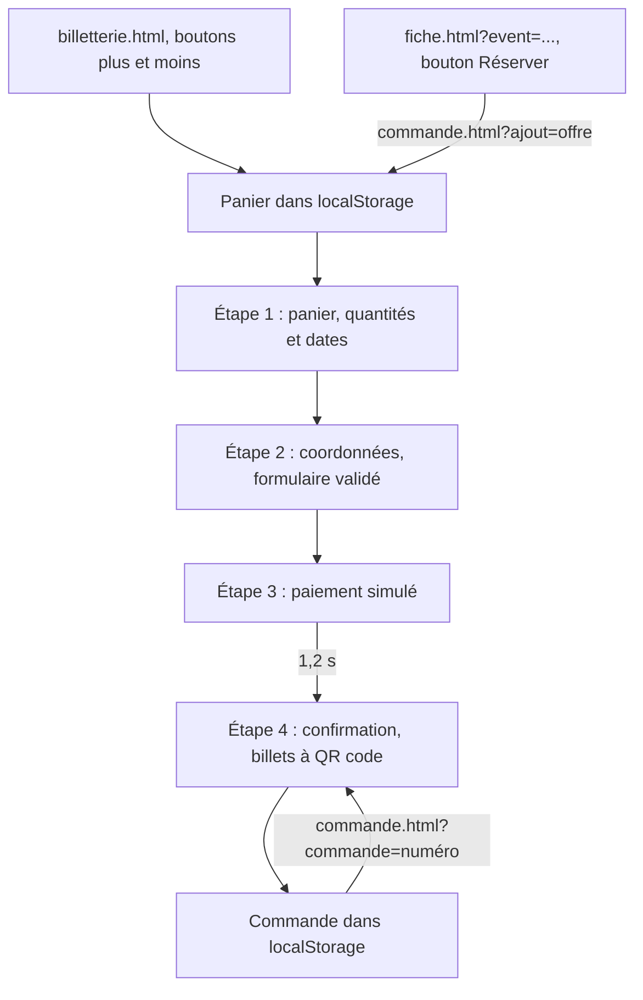

# Billetterie et commande

La billetterie de l'Office de Tourisme reproduit le parcours d'un vrai site de réservation : choix des billets, panier daté, coordonnées, paiement, confirmation avec billets électroniques à QR code. Tout est simulé dans le navigateur.

> [!IMPORTANT]
> Aucun paiement n'est demandé ni encaissé, aucune coordonnée bancaire n'est collectée, aucune donnée ne quitte le navigateur. L'étape de paiement l'annonce par un encart « Mode démonstration » et la seule méthode sélectionnable est « Paiement simulé ». La carte bancaire est affichée désactivée.

Cette billetterie en euros n'a aucun rapport avec les tickets de la loterie, achetés en ethers fictifs sur le smart contract depuis le frontend web ou l'application mobile.

## Fichiers concernés

| Fichier | Rôle |
| --- | --- |
| [`billetterie.html`](src:frontend-office-tourisme/billetterie.html), [`assets/js/pages/billetterie.js`](src:frontend-office-tourisme/assets/js/pages/billetterie.js) | Catalogue des offres et choix des quantités |
| [`commande.html`](src:frontend-office-tourisme/commande.html), [`assets/js/pages/commande.js`](src:frontend-office-tourisme/assets/js/pages/commande.js) | Tunnel de commande en quatre étapes, billets, impression |
| [`assets/js/modules/cart.js`](src:frontend-office-tourisme/assets/js/modules/cart.js) | Panier, dates de visite, totaux, commandes, numéros de commande |
| [`assets/js/data/content.js`](src:frontend-office-tourisme/assets/js/data/content.js) | Offres (`BILLETTERIE`) et groupes (`TICKET_GROUPS`) |
| [`assets/js/vendor/qrcode.mjs`](src:frontend-office-tourisme/assets/js/vendor/qrcode.mjs) | Générateur de QR codes |
| [`assets/css/checkout.css`](src:frontend-office-tourisme/assets/css/checkout.css) | Styles de la billetterie, du tunnel, des billets et de l'impression |

## Parcours



### Catalogue

La page Billetterie affiche les 11 offres par groupe : « Pass et croisières », « Visites guidées », « Événements ». Chaque carte montre la date limite (« Jusqu'au ... ») ou « Complet » si plus aucune date n'est disponible, et un sélecteur de quantité. Le bouton « plus » est désactivé pour une offre complète, le bouton « moins » quand la quantité est nulle. Dès que le panier contient un billet, un récapitulatif (« 3 billets · 57,00 € ») et le lien « Voir mon panier » apparaissent.

Une ancre portant l'identifiant d'une offre (`billetterie.html#pass-24`) fait défiler la page jusqu'à cette offre et la met en surbrillance pendant 2,4 secondes. Les groupes ont aussi une ancre (`#pass`, `#visites`, `#evenements`) : le lien « Pass EtherBay » du pied de page vise `billetterie.html#pass`, qui fait défiler jusqu'au groupe sans surbrillance.

### Étape 1 : panier

Chaque ligne affiche le prix unitaire, un champ date (`<input type="date">` borné par `min` et `max`), la quantité et le sous-total. Une date saisie hors des bornes est refusée et remplacée par la date précédente. Le récapitulatif de droite affiche le total et trois promesses commerciales (« Billets électroniques », « Annulation gratuite jusqu'à 48 h avant la date », « Aucun frais de réservation ») qui sont du texte : aucune annulation n'est implémentée.

### Étape 2 : coordonnées

Le formulaire est validé par `validateCustomer`, au moment de l'envoi :

| Champ | Obligatoire | Règle | Message |
| --- | --- | --- | --- |
| Prénom, Nom | oui | non vide | « Indiquez votre prénom. », « Indiquez votre nom. » |
| Email | oui | `^[^\s@]+@[^\s@]+\.[^\s@]{2,}$` | « Indiquez une adresse email valide. » |
| Confirmation de l'email | oui | identique à l'email | « Les deux adresses email ne correspondent pas. » |
| Téléphone | non | `^(\+33\s?\|0)[1-9](\s?\d{2}){4}$` | « Format attendu : 06 12 34 56 78 ou +33 6 12 34 56 78. » |
| Code postal | non | cinq chiffres | « Le code postal doit comporter 5 chiffres. » |
| Conditions générales de vente | oui | case cochée | « Vous devez accepter les conditions générales de vente. » |
| Newsletter | non | case à cocher | - |

En cas d'erreur, un message de synthèse `role="alert"` indique le nombre de champs à corriger, chaque champ fautif reçoit `aria-invalid="true"` et un message relié par `aria-describedby`, et le focus va au premier champ en erreur. La saisie est enregistrée à chaque frappe dans le brouillon `etherbay.checkout` du `localStorage` : un rechargement de la page ne la perd pas.

### Étape 3 : paiement

L'étape n'est accessible que si le brouillon de coordonnées est valide : sinon, `render` redirige vers `#coordonnees`. Le bouton « Confirmer la commande » se désactive, passe en `aria-busy="true"`, affiche « Validation en cours… » puis, après 1,2 seconde, appelle `placeOrder`.

### Étape 4 : confirmation

`placeOrder` :

1. tire un numéro de commande ;
2. crée un billet par unité commandée, numéroté `<numéro>-01`, `<numéro>-02`... ;
3. enregistre la commande (`saveOrder`) ;
4. ajoute l'email à la liste de la newsletter si la case était cochée ;
5. vide le panier et le brouillon.

L'URL devient `commande.html?commande=<numéro>#confirmation`. Elle reste valable sur ce navigateur : la page relit la commande dans `etherbay.orders` et réaffiche les billets.

## Navigation entre étapes

Les étapes sont des ancres (`#panier`, `#coordonnees`, `#paiement`, `#confirmation`) : les boutons « Retour » et le bouton précédent du navigateur fonctionnent sans code particulier. `render` est appelée à chaque `hashchange` et choisit la vue :

| Situation | Vue affichée |
| --- | --- |
| `#confirmation` et une commande chargée | Confirmation |
| Panier vide | Panier vide, lien vers la billetterie |
| `#coordonnees` | Formulaire |
| `#paiement` et brouillon valide | Paiement |
| `#paiement` et brouillon invalide | Redirection vers `#coordonnees` |
| Autre | Panier |

Après chaque rendu, le focus est placé sur le titre de l'étape (`#step-title`, `tabindex="-1"`), ce qui annonce le changement d'étape aux lecteurs d'écran. Le fil d'étapes (`<ol class="stepper">`) marque l'étape courante avec `aria-current="step"`.

## Modèle du panier

Le panier est un objet indexé par identifiant d'offre, stocké sous la clé `etherbay.cart` :

```json
{
  "visite-opera": { "qty": 2, "date": "2026-11-20" },
  "pass-24": { "qty": 1, "date": "2026-11-12" }
}
```

`getCart` relit et assainit ce contenu à chaque appel :

- une offre qui n'existe plus dans `BILLETTERIE` est ignorée ;
- une ancienne ligne enregistrée sous forme de nombre (`"pass-24": 2`) est acceptée ;
- la quantité est plafonnée à 20 (`MAX_QTY`) ;
- une date absente ou hors des bornes est remplacée par la première date disponible.

Les totaux sont recalculés depuis les prix de `BILLETTERIE`, jamais lus depuis le stockage : modifier le `localStorage` ne change pas le prix affiché.

### Dates de visite

`ticketDateRange(ticket)` calcule l'intervalle autorisé :

| Offre | Date minimale | Date maximale |
| --- | --- | --- |
| Liée à un événement (`event`) | la plus tardive entre aujourd'hui et le début de l'événement | la fin de l'événement |
| Sans événement (pass, croisière) | aujourd'hui | `validUntil` |

Si la date minimale dépasse la date maximale, l'offre est « Complet ». Les dates sont manipulées en chaînes `AAAA-MM-JJ` dans le fuseau horaire du navigateur (`isoDay`).

## Commandes et billets

Une commande enregistrée a cette forme :

```json
{
  "number": "EB-2026-K7QX2M",
  "date": "2026-11-11",
  "customer": { "firstName": "Camille", "lastName": "Martin", "email": "camille@example.fr" },
  "total": 19.5,
  "tickets": [
    { "code": "EB-2026-K7QX2M-01", "ticketId": "visite-opera", "title": "L'Opéra d'EtherBay en coulisses", "date": "2026-11-20", "amount": 6.5 }
  ]
}
```

| Élément | Règle |
| --- | --- |
| Numéro de commande | `EB-<année>-` suivi de 6 caractères tirés par `crypto.getRandomValues` dans un alphabet de 32 caractères sans `0`, `O`, `1` ni `I`, pour éviter les confusions à la lecture |
| Historique | `etherbay.orders`, les 20 commandes les plus récentes, la plus récente en tête |
| Billet | un par unité, code `<numéro>-NN` |
| Titulaire | prénom et nom de la commande, imprimés sur chaque billet |

### QR codes

Chaque billet porte un QR code généré côté client, sans appel réseau, par `qrSvg` :

```javascript
const qr = qrcode(0, 'M');
qr.addData(`ETHERBAY|${t.code}|${t.ticketId}|${t.date}`);
qr.make();
return qr.createSvgTag({ cellSize: 4, margin: 0, scalable: true });
```

| Paramètre | Valeur | Effet |
| --- | --- | --- |
| Version (`typeNumber`) | `0` | Taille choisie automatiquement selon la longueur du contenu |
| Correction d'erreur | `M` | Environ 15 % du code peut être abîmé sans perte |
| Contenu | `ETHERBAY\|<code billet>\|<offre>\|<date>` | Texte lisible par n'importe quel lecteur de QR code |
| Sortie | SVG en ligne, redimensionnable | Net à l'écran comme à l'impression |

Le conteneur du QR code porte `role="img"` et `aria-label="QR code du billet <code>"`.

> [!NOTE]
> Le QR code n'est ni signé ni vérifiable : son contenu est un texte en clair qu'il suffirait de recopier. Aucun système de contrôle à l'entrée n'existe. Pour une vraie billetterie, le contenu devrait être un jeton signé par un serveur et vérifié au contrôle.

### Impression

« Imprimer mes billets » appelle `window.print()`. La feuille `@media print` de [`checkout.css`](src:frontend-office-tourisme/assets/css/checkout.css) masque le pré-header, l'en-tête, le menu, le fil d'Ariane, le fil d'étapes, les boutons, le bandeau cookies et le pied de page : seuls les billets restent sur la page.

## Export agenda

Un événement gratuit, sans offre de billetterie et qui n'est pas la loterie, propose « Ajouter à mon agenda ». `downloadIcs` de [`pages/fiche.js`](src:frontend-office-tourisme/assets/js/pages/fiche.js) produit un fichier iCalendar `<id>.ics` :

```text
BEGIN:VCALENDAR
VERSION:2.0
PRODID:-//Destination EtherBay//Office de Tourisme//FR
BEGIN:VEVENT
UID:code-et-cite@tourisme-etherbay.fr
DTSTAMP:20261111T120000Z
DTSTART;VALUE=DATE:20261104
DTEND;VALUE=DATE:20261219
SUMMARY:Code & Cité : la blockchain expliquée
LOCATION:La Maison de la Blockchain\, EtherBay
DESCRIPTION:Une exposition interactive pour comprendre comment un registre public peut garantir un tirage au sort équitable.
END:VEVENT
END:VCALENDAR
```

L'événement est posé « sur la journée » (`VALUE=DATE`). `DTEND` est le lendemain de la date de fin, comme l'exige la norme pour une date exclusive. Les virgules, points-virgules et barres obliques inverses sont échappés (`icsText`). Le fichier est créé en mémoire (`Blob` et `URL.createObjectURL`), puis l'URL est révoquée après une seconde.

## Limites

| Limite | Conséquence |
| --- | --- |
| Tout est dans le navigateur | Une commande n'existe que sur l'appareil où elle a été passée ; vider les données du site la supprime |
| Aucune annulation | La promesse « annulation gratuite » du récapitulatif n'a pas de fonction associée |
| Aucun stock | Une offre n'est jamais épuisée par les commandes, seulement par ses dates |
| Aucun email | La confirmation le dit explicitement : « aucun email n'a été envoyé » |
| Données personnelles stockées en clair | Nom et email de chaque commande restent dans `etherbay.orders` (voir [Accessibilité et vie privée](accessibilite.md#donnees-stockees-dans-le-navigateur)) |
