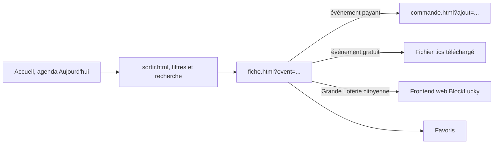

# Pages et parcours

Le site compte 14 pages HTML, toutes à la racine de [`frontend-office-tourisme/`](src:frontend-office-tourisme/). Chaque page est une coquille : elle contient le `<head>`, le lien d'évitement, les conteneurs vides de l'en-tête et du pied de page, et le contenu propre à la page. Le JavaScript remplit le reste au chargement (voir [Architecture JavaScript](architecture.md)).

## Gabarit commun

Toutes les pages partagent la même structure :

| Élément | Rôle |
| --- | --- |
| `<html lang="fr">`, `<meta name="viewport">`, `<title>`, `<meta name="description">` | Langue, affichage mobile, référencement |
| `<link rel="preload">` de `inter-latin-400-normal.woff2` et `jost-latin-600-normal.woff2` | Chargement anticipé des deux polices les plus utilisées |
| `<link rel="stylesheet" href="assets/css/main.css">` | Point d'entrée CSS unique, qui importe les autres feuilles |
| `<script type="module" src="assets/js/main.js">` | Point d'entrée JavaScript unique |
| `<a class="skip-link" href="#contenu">` | Lien d'évitement vers le contenu principal |
| `
`, `<header id="site-header">`, `<footer id="site-footer">` | Conteneurs remplis par [`modules/layout.js`](src:frontend-office-tourisme/assets/js/modules/layout.js) |
| `<body data-page="..." data-nav="..." data-overlay="true">` | Module de page à charger, entrée de menu à marquer active, en-tête transparent sur le hero |

L'attribut `data-page` sélectionne le module JavaScript de la page. `data-nav` force l'entrée de menu marquée `aria-current="page"` quand elle diffère de `data-page` : un article est rattaché à « Découvrir », la commande à « Billetterie ». `data-overlay="true"`, présent sur l'accueil seulement, pose l'en-tête en surimpression du hero.

## Les 14 pages

| Fichier | `data-page` | Module chargé | Paramètres d'URL | Contenu |
| --- | --- | --- | --- | --- |
| [`index.html`](src:frontend-office-tourisme/index.html) | `home` | `pages/home.js` | aucun | Accueil : hero, bandeau « Nouveauté » de la loterie, incontournables, agenda filtrable, « Planifiez votre séjour », groupes, thématiques, #visitetherbay, Greeters, espace partenaires |
| [`decouvrir.html`](src:frontend-office-tourisme/decouvrir.html) | `decouvrir` | `pages/decouvrir.js` | aucun | 12 thématiques en tuiles et carrousel des 8 lieux emblématiques |
| [`sortir.html`](src:frontend-office-tourisme/sortir.html) | `sortir` | `pages/sortir.js` | aucun | Agenda complet : filtre de date, catégories, recherche, puis salles de sortie |
| [`manger.html`](src:frontend-office-tourisme/manger.html) | `manger` | `pages/listing.js` | `filtre` | 14 restaurants : bons plans, filtres rapides, filtres multicritères, recherche, pagination |
| [`dormir.html`](src:frontend-office-tourisme/dormir.html) | `dormir` | `pages/listing.js` | `filtre` | 10 hébergements, même moteur que Manger |
| [`fiche.html`](src:frontend-office-tourisme/fiche.html) | `fiche` | `pages/fiche.js` | `id` ou `event` | Fiche d'un lieu ou d'un événement, suggestions, encart de localisation |
| [`article.html`](src:frontend-office-tourisme/article.html) | `article` | `pages/article.js` | `id` | Article du magazine et carrousel « À lire aussi » |
| [`billetterie.html`](src:frontend-office-tourisme/billetterie.html) | `billetterie` | `pages/billetterie.js` | ancre `#<billet>` | 11 offres en trois groupes, sélection des quantités |
| [`commande.html`](src:frontend-office-tourisme/commande.html) | `commande` | `pages/commande.js` | `ajout`, `commande`, ancre d'étape | Tunnel de commande simulé en quatre étapes |
| [`favoris.html`](src:frontend-office-tourisme/favoris.html) | `favoris` | `pages/favoris.js` | aucun | Lieux et événements mis en favoris |
| [`bientot.html`](src:frontend-office-tourisme/bientot.html) | `bientot` | `pages/bientot.js` | `reseau` | Page d'attente des réseaux sociaux |
| [`infos-pratiques.html`](src:frontend-office-tourisme/infos-pratiques.html) | `infos` | aucun | ancres | Office, venir, se déplacer, groupes, partenaires, congrès, presse, Greeters, contact, loterie |
| [`mentions-legales.html`](src:frontend-office-tourisme/mentions-legales.html) | `legal` | aucun | ancres | Éditeur, crédits, CGU, CGV, accessibilité, éco-responsabilité, données personnelles |
| [`404.html`](src:frontend-office-tourisme/404.html) | `404` | aucun | aucun | Page d'erreur servie par nginx |

Les trois dernières pages sont statiques : `main.js` ne trouve pas de module pour leur `data-page` et se contente de poser l'en-tête, le pied de page et les comportements communs.

## Paramètres d'URL

| URL | Effet | Comportement si la valeur est inconnue |
| --- | --- | --- |
| `fiche.html?id=boulangerie-du-port` | Fiche du lieu dont l'identifiant est donné (restaurant, hébergement ou lieu) | Message « Fiche introuvable » dans la page, code HTTP 200 |
| `fiche.html?event=jazz-a-la-baie` | Fiche de l'événement | Même message |
| `article.html?id=loterie-mode-emploi` | Article du magazine | Le premier article de la liste est affiché à la place |
| `manger.html?filtre=Crêperie#resultats` | Pré-coche la valeur dans le premier groupe de filtres qui la contient | Aucun filtre appliqué |
| `bientot.html?reseau=instagram` | Nom du réseau dans le titre et le texte | Texte générique de la page |
| `billetterie.html#pass-24` | Fait défiler jusqu'à l'offre et la met en surbrillance 2,4 s | Rien |
| `commande.html?ajout=visite-opera` | Ajoute un billet de l'offre au panier puis réécrit l'URL en `commande.html#panier` | Aucun ajout (offre inconnue ignorée) |
| `commande.html?commande=EB-2026-XXXXXX` | Réaffiche la confirmation et les billets d'une commande passée sur ce navigateur | Retour au panier |

Les paramètres sont lus par `params()` de [`modules/utils.js`](src:frontend-office-tourisme/assets/js/modules/utils.js) et ne sont jamais injectés tels quels dans le HTML : les identifiants servent de clé de recherche dans les tableaux de données, et les textes affichés passent par `escapeHtml`.

## Navigation

L'en-tête est construit à partir de trois tableaux de [`data/site.js`](src:frontend-office-tourisme/assets/js/data/site.js) :

| Zone | Tableau | Entrées |
| --- | --- | --- |
| Pré-header | `PRE_HEADER` | Pros, Presse, Groupes, Bureau des congrès, Accessibilité |
| Menu principal | `MAIN_NAV` | Découvrir, Sortir, Manger, Dormir, Infos pratiques |
| Actions | codées dans `layout.js` | bouton Billetterie, panier avec compteur, favoris avec compteur, menu mobile |

Le pied de page reprend `FOOTER_TOP`, `FOOTER_LINKS`, `FOOTER_BOTTOM`, `OPENING_HOURS`, `SOCIALS` et `LABELS` du même fichier. Modifier un lien du menu ou du pied de page se fait donc à un seul endroit, pour les 14 pages.

## Parcours types

### Préparer une sortie

L'agenda de l'accueil s'ouvre sur le filtre « Aujourd'hui ». S'il ne trouve aucun événement à la date du jour, il affiche tous les événements plutôt qu'une liste vide (fonction `renderAgenda` de [`pages/home.js`](src:frontend-office-tourisme/assets/js/pages/home.js)). La page Sortir, elle, affiche « Aucune sortie pour cette sélection » : les deux pages partagent la fonction `filterAgenda` mais pas ce repli.

Le bouton d'action d'une fiche événement dépend des données, dans cet ordre (fonction `eventAction` de [`pages/fiche.js`](src:frontend-office-tourisme/assets/js/pages/fiche.js)) :

1. l'événement porte `lottery: true` : lien « Accéder à la loterie » vers `SITE.lotteryAppUrl`, dans un nouvel onglet ;
2. une offre de la billetterie référence l'événement (`event`) : lien « Réserver » vers `commande.html?ajout=<offre>` ;
3. sinon : bouton « Ajouter à mon agenda », qui génère un fichier `.ics`.

### Trouver un restaurant ou un hébergement

Les pages Manger et Dormir partagent le module [`pages/listing.js`](src:frontend-office-tourisme/assets/js/pages/listing.js), configuré par l'objet `CONFIG` :

| Réglage | Manger | Dormir |
| --- | --- | --- |
| Données | `RESTAURANTS` (14) | `HEBERGEMENTS` (10) |
| Bons plans | `BONS_PLANS_FOOD` (6 tuiles) | `BONS_PLANS_DODO` (4 tuiles) |
| Groupes de filtres | Type, Accès, Jour d'ouverture, Heures d'ouverture, Public, Labels et offres spéciales | Type d'hébergement, Quartier, Accès, Public, Labels et offres spéciales |

Communs aux deux pages :

- trois filtres rapides : Best-sellers (`bestSeller`), Testé et approuvé (`tested`), Tourisme éco-responsable (`eco`) ;
- recherche plein texte sans accents (`normalize`) sur le nom, le type, le quartier et la description ;
- 9 résultats par page (`PAGE_SIZE`) ;
- au-delà de 8 options, un groupe de filtres se replie derrière « Voir N plus » (`VISIBLE_OPTIONS`) ;
- les valeurs et compteurs des filtres sont calculés à partir des données : ajouter un restaurant d'un nouveau type crée l'option sans toucher au code.

Les options d'un même groupe se combinent par « ou », les groupes entre eux par « et ».

### Réserver un billet

Le parcours billetterie, du choix des quantités jusqu'aux billets imprimables, est décrit dans [Billetterie et commande](billetterie.md).

### Garder des favoris

Chaque carte de lieu ou d'événement porte un bouton cœur (`data-fav="place:<id>"` ou `data-fav="event:<id>"`). Un seul écouteur délégué sur le document gère tous les cœurs du site ([`modules/favorites.js`](src:frontend-office-tourisme/assets/js/modules/favorites.js)). La page Favoris relit la liste et se met à jour à chaque événement `favorites:change`.

## Pages statiques

`infos-pratiques.html` et `mentions-legales.html` sont rédigées directement en HTML. Leurs sections portent des identifiants utilisés comme ancres par les menus :

| Page | Ancres |
| --- | --- |
| `infos-pratiques.html` | `office`, `venir`, `groupes`, `professionnels`, `congres`, `presse`, `greeters`, `contact` |
| `mentions-legales.html` | `cgu`, `cgv`, `accessibilite`, `eco` |

Les boutons de contact des infos pratiques ouvrent des liens `mailto:` vers des adresses fictives (`contact@`, `groupes@`, `partenaires@tourisme-etherbay.fr`). Aucun formulaire du site n'envoie de données.

La page `404.html` est servie par nginx pour toute ressource introuvable (`error_page 404 /404.html`, voir [Servir et déployer](deploiement.md)). Elle référence ses feuilles de style par des chemins relatifs (`assets/css/main.css`) : pour une URL inexistante située dans un sous-dossier, comme `/a/b`, le navigateur cherche alors `/a/assets/css/main.css` et la page s'affiche sans mise en forme. Les URL à la racine ne sont pas concernées.

## Ajouter une page

1. Copier une page statique existante, par exemple `favoris.html`, pour conserver le gabarit commun.
2. Changer `<title>`, `<meta name="description">` et `data-page`.
3. Si la page a de la logique, créer `assets/js/pages/<nom>.js` exportant une fonction par défaut, puis l'enregistrer dans l'objet `PAGES` de [`main.js`](src:frontend-office-tourisme/assets/js/main.js).
4. Ajouter le lien dans `MAIN_NAV`, `FOOTER_LINKS` ou le tableau voulu de `data/site.js`.
5. Copier le fichier dans l'image Docker : le `Dockerfile` copie déjà `*.html`, rien à faire.
6. Lancer la vérification des liens de la CI : `node ../.github/scripts/check-static-links.mjs .` depuis le dossier du site (voir [Servir et déployer](deploiement.md#verifications-de-la-ci)).
