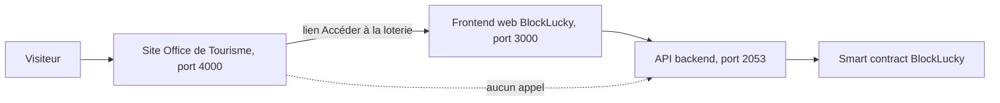

# Rôle dans le projet

Le dossier [`frontend-office-tourisme/`](src:frontend-office-tourisme/) contient le site vitrine « Destination EtherBay », celui de l'Office de Tourisme de la Ville d'EtherBay. C'est un livrable bonus : le sujet du rush ne le demande pas. Il prolonge le jeu de rôle du projet en donnant une existence à la ville fictive (quartiers, commerces, événements, institutions) et il sert de vitrine grand public à la Grande Loterie citoyenne.

Le site ne fait partie ni de la chaîne de confiance de la loterie, ni du parcours d'achat. Il ne parle à aucune API : HTML, CSS et JavaScript en modules ES, servis tels quels, sans étape de construction.

## Ce que le site apporte au projet

| Apport | Où le voir dans le code |
| --- | --- |
| Mise en scène de la ville d'EtherBay : quartiers (Le Port, Vieille Ville, Quartier des Docks, Colline du Phare...), lieux, adresses fictives en `29900 EtherBay` | [`assets/js/data/places.js`](src:frontend-office-tourisme/assets/js/data/places.js) |
| Promotion de la Grande Loterie citoyenne : bandeau « Nouveauté » de l'accueil, événement de l'agenda, article « mode d'emploi », section des infos pratiques | [`assets/js/data/content.js`](src:frontend-office-tourisme/assets/js/data/content.js), [`assets/js/data/events.js`](src:frontend-office-tourisme/assets/js/data/events.js), [`infos-pratiques.html`](src:frontend-office-tourisme/infos-pratiques.html) |
| Passerelle vers l'application de loterie : bouton « Accéder à la loterie » | `SITE.lotteryAppUrl` dans [`assets/js/data/site.js`](src:frontend-office-tourisme/assets/js/data/site.js) |
| Mise en avant des commerçants partenaires et de leur offre EtherPoints | champ `partnerOffer` des lieux, filtre « Partenaire EtherPoints » de la page Manger |
| Pédagogie : la Maison de la Blockchain, l'exposition « Code & Cité » et l'atelier « participer à la loterie pas à pas » avec Epitech Digital School | événements `code-et-cite` et `atelier-blockchain`, lieu `maison-blockchain` |
| Démonstration d'un site public conforme aux attentes d'une collectivité : accessibilité, bandeau cookies avec refus en un clic, mentions légales, aucune ressource tierce | [`mentions-legales.html`](src:frontend-office-tourisme/mentions-legales.html), [`assets/js/modules/cookies.js`](src:frontend-office-tourisme/assets/js/modules/cookies.js), [`assets/css/fonts.css`](src:frontend-office-tourisme/assets/css/fonts.css) |

Le volet marketing de la loterie est détaillé dans [Volet marketing](../presentation/marketing.md). Le site en est l'illustration la plus concrète : il montre comment la Ville présente la loterie à un public qui ne connaît rien à la blockchain (« ethers fictifs », « tirage public certifié », « pilote pédagogique », participation réservée aux majeurs).

## Place dans l'architecture

Le seul lien entre le site et le reste de BlockLucky est un lien hypertexte vers le frontend web. Le site n'appelle jamais l'API : aucun `fetch`, aucun `XMLHttpRequest`, aucun WebSocket dans [`assets/js/`](src:frontend-office-tourisme/assets/js/). La politique de sécurité de contenu le garantit en plus (`connect-src 'self'`, voir [Servir et déployer](deploiement.md#politique-de-securite-de-contenu)).

Conséquence directe : les informations affichées sur la loterie sont du texte codé en dur. Elles ne reflètent pas l'état réel du contrat (tour en cours, cagnotte, nombre de tickets). Les dates affichées (ouverture le 28 novembre, tirage public le 19 décembre) sont des éléments du scénario, pas des paramètres lus dans le contrat. La durée réelle d'un tour est fixée au déploiement du contrat (30 minutes en local, 48 heures par défaut sur Sepolia, voir [Cycle de vie d'un tour](../smart-contracts/cycle-tour.md)).

## Ce qui est réel et ce qui est simulé

| Élément | Statut |
| --- | --- |
| Navigation, filtres, recherche, pagination, favoris | Réels, entièrement côté navigateur |
| Commerces, lieux, événements, articles, horaires, labels | Fictifs, codés en dur dans `assets/js/data/` |
| Offres EtherPoints de la Boulangerie du Port et du Cinéma Le Phare | Textes recopiés des offres créées par le seed du backend, sans lien technique avec la base |
| Billetterie, panier, commande, billets à QR code | Simulés : aucun paiement, aucune donnée transmise, commandes gardées dans le `localStorage` (voir [Billetterie et commande](billetterie.md)) |
| Newsletter | Simulée : l'adresse est gardée dans le `localStorage`, aucun email n'est envoyé |
| Mesure d'audience proposée par le bandeau cookies | Non implémentée : le choix est enregistré mais aucun outil de mesure n'existe |
| Comptes des réseaux sociaux | Inexistants : les liens mènent à la page « Bientôt disponible » |
| Sélecteur de langue (anglais, breton) | Non implémenté : il affiche « traduction à venir » et revient au français |

Le détail de chaque jeu de données est dans [Contenus](contenus.md).

## Cohérence avec le reste du projet

Le site reprend les couleurs de l'application mobile et du frontend web (vert EtherBay `#253D2C`, terracotta `#C86D51`) et les noms de partenaires du backend. Ces correspondances sont maintenues à la main : aucun test ne vérifie qu'un partenaire mentionné sur le site existe dans la base.

| Donnée du site | Source de vérité dans le projet | Écart connu |
| --- | --- | --- |
| « La Boulangerie du Port d'EtherBay », -15 % contre 100 EtherPoints | [`backend/prisma/seed.ts`](src:backend/prisma/seed.ts) | Identique |
| « Cinéma Le Phare EtherBay », 1 place offerte contre 150 EtherPoints | [`backend/prisma/seed.ts`](src:backend/prisma/seed.ts) | Identique |
| « Le Hash Café », libellé « Partenaire EtherPoints » | aucune | Absent du seed : le libellé est purement décoratif |
| Prix du ticket « 0,01 ether fictif » (article `loterie-mode-emploi`) | `TICKET_PRICE_WEI` du déploiement, `10000000000000000` wei par défaut | Identique à la configuration par défaut |
| Lien vers la loterie `http://localhost:3000` | URL publique du frontend web | À changer avant toute mise en ligne |

> [!WARNING]
> `SITE.lotteryAppUrl` vaut `http://localhost:3000` en dur. Sur `tourisme.etherbay.tech`, le bouton « Accéder à la loterie » pointerait vers le poste du visiteur. La valeur doit être remplacée par l'URL publique du frontend web avant le déploiement (voir [Servir et déployer](deploiement.md#avant-une-mise-en-ligne)).

## Historique

Le site a été construit en une vingtaine de commits successifs, page par page, de l'accueil (agenda, moteurs de séjour, magazine) jusqu'à la billetterie, au tunnel de commande simulé et aux QR codes. Les derniers commits ont rendu le site autonome : polices auto-hébergées (« Polices auto-hébergées sur le site de l'Office de Tourisme »), image nginx et politique de sécurité de contenu stricte (« CSP stricte et image nginx à jour pour l'Office de Tourisme »).

## Pages de cette partie

| Page | Contenu |
| --- | --- |
| [Pages et parcours](pages.md) | Les 14 pages HTML, leurs paramètres d'URL et les parcours types |
| [Architecture JavaScript](architecture.md) | Démarrage, modules, chargement de la logique de chaque page |
| [Contenus](contenus.md) | Données fictives et procédure pour en ajouter |
| [Billetterie et commande](billetterie.md) | Panier, tunnel en quatre étapes, billets à QR code, export agenda |
| [Charte graphique et médias](charte.md) | Couleurs, typographies, photos et licences |
| [Accessibilité et vie privée](accessibilite.md) | Navigation clavier, ARIA, cookies, stockage local |
| [Servir et déployer](deploiement.md) | Serveur local, image Docker nginx, en-têtes, Compose |
