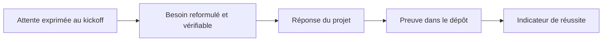

# Besoins des parties prenantes

Le kickoff exprime les attentes de trois décideurs en quelques mots chacun. Cette page reformule chaque attente en besoin vérifiable, indique la réponse apportée par le projet et désigne la preuve dans le dépôt. Elle reprend et met à jour la reformulation produite par l'équipe le 11 novembre 2026, ainsi que le tableau des décisions de son dossier de cadrage (livrable « Proposition de valeur »).

Les indicateurs qui permettront de mesurer la réussite sont dans [Objectifs et indicateurs](objectifs-indicateurs.md). Les limites actuelles des réponses sont dans [Réel, simulé ou à venir](reel-ou-simule.md).

## Le besoin en une phrase

La Ville d'EtherBay veut une loterie de fin d'année ouverte à toute la population adulte, numérique, transparente et pédagogique, dont le cœur est un smart contract solide et sécurisé : les citoyens achètent des tickets en ethers fictifs, un gagnant est tiré au hasard après un certain nombre de participants ou une certaine durée, et il remporte la cagnotte.

## Méthode de reformulation

Chaque ligne des tableaux suit le même chemin :

Une réponse n'est retenue que si elle existe dans le code. Les intentions non implémentées sont signalées comme telles.

## Madame la Maire

La Maire porte l'événement. Ses attentes sont politiques : un temps fort, une participation massive, de la visibilité et l'inclusion de tous les habitants.

| Attente exprimée | Besoin reformulé | Réponse du projet | Preuve dans le dépôt |
|---|---|---|---|
| Un événement mémorable | Un temps fort collectif, vécu en direct | Salle d'attente ouverte à la fermeture des achats, révélation du gagnant après un délai commun (`DRAW_REVEAL_DELAY_SECONDS`, 10 minutes par défaut), roue animée sur mobile, chat en direct, annonce du gagnant diffusée à tous les clients, badge POAP conservé sur la blockchain | [`backend/src/socket/events/live-draw.events.ts`](src:backend/src/socket/events/live-draw.events.ts), [`backend/src/socket/events/chat.events.ts`](src:backend/src/socket/events/chat.events.ts), [`smart-contract/contracts/BlockLuckyPOAP.sol`](src:smart-contract/contracts/BlockLuckyPOAP.sol) |
| Un succès auprès de la communauté | Atteindre 10 000 participants distincts | Inscription en quelques champs (code email sur le web, mot de passe et code email sur mobile), ticket offert à un proche par email, parrainage, quêtes, classement des ambassadeurs, EtherPoints échangeables chez les commerçants | Routes `gift` et `leaderboard` de [`backend/src/api/lottery/lottery.routes.ts`](src:backend/src/api/lottery/lottery.routes.ts), `referrals` et `quests` de [`backend/src/api/user/user.routes.ts`](src:backend/src/api/user/user.routes.ts), [`backend/src/api/marketplace/marketplace.routes.ts`](src:backend/src/api/marketplace/marketplace.routes.ts) |
| Faire parler de l'événement | Rendre la participation virale et visible | Ticket cadeau, lien d'invitation, boutons de partage, suivi des sources UTM, site de l'Office de Tourisme | [`frontend-web/src/app/invite/[code]/page.tsx`](src:frontend-web/src/app/invite/[code]/page.tsx), [`backend/src/api/analytics/analytics.routes.ts`](src:backend/src/api/analytics/analytics.routes.ts), dossier `frontend-office-tourisme/` |
| Qu'il soit inclusif | Aucun prérequis technique ni financier | Portefeuille Ethereum créé par le backend, dotation de bienvenue de la Mairie, ni MetaMask ni achat de crypto, web responsive et mobile, français et anglais, thème clair et sombre | [`backend/src/blockchain/wallet.service.ts`](src:backend/src/blockchain/wallet.service.ts), [ADR 0004](../architecture/adr/0004-smart-contract-portefeuille-integre.md), [Internationalisation](../web/i18n.md) |
| Image de ville innovante et pédagogique | Expliquer la blockchain au grand public | Charte de transparence vulgarisée, page publique des règles, liens vers l'explorateur, identifiant de la requête Chainlink VRF affiché | [`frontend-web/src/app/transparence/page.tsx`](src:frontend-web/src/app/transparence/page.tsx), route `transparency-charter` |

### Ce qui reste à faire pour la Maire

- Les paliers communautaires affichés par la jauge (coulisses dévoilées, offre spéciale, jeu bonus) sont des textes codés en dur dans [`backend/src/api/lottery/lottery.services.ts`](src:backend/src/api/lottery/lottery.services.ts) : aucune logique ne les applique.
- Les quêtes sociales (suivre la Mairie sur X, rejoindre Discord) sont validées sur simple déclaration, sans contrôle.
- La mesure de l'objectif de 10 000 participants doit être définie avec la Mairie : la jauge actuelle compare des portefeuilles, un par ticket, pas des personnes (voir [Objectifs et indicateurs](objectifs-indicateurs.md#engagement)).

## Le responsable événementiel

Il organise et anime l'événement. Il veut un système qu'il peut piloter sans compétence blockchain et qui ne bloque pas les participants.

| Attente exprimée | Besoin reformulé | Réponse du projet | Preuve dans le dépôt |
|---|---|---|---|
| Aspect pratique de l'événement | Piloter le jeu depuis un écran, sans outil blockchain | Dashboard Mairie : indicateurs, état du tour, tirage manuel, annulation avec remboursement, disjoncteur, reversement de la commission, gestion des partenaires, vérification des pièces d'identité, journal d'audit, exports | Dossier `frontend-web/src/app/mairie/`, [`backend/src/api/admin/admin.routes.ts`](src:backend/src/api/admin/admin.routes.ts) |
| Facilité d'utilisation | Acheter un ticket en un geste | Achat en un clic signé par le portefeuille intégré du citoyen, un seul ticket par participant et par grand tirage, numéro de ticket à cinq chiffres | `POST /api/v1/lottery/buy`, [`backend/src/blockchain/lottery.gateway.ts`](src:backend/src/blockchain/lottery.gateway.ts) |
| Fluidité de l'expérience | Pas d'attente inutile ni d'échec incompréhensible | Tirage déclenché automatiquement par le keeper, versement automatique de la cagnotte et des remboursements, file d'actions avec reprise, erreurs du contrat traduites en messages clairs (solde insuffisant, tour complet, tirage en cours, pause) | [`backend/src/blockchain/lottery.keeper.ts`](src:backend/src/blockchain/lottery.keeper.ts), [`backend/src/blockchain/chain-actions.ts`](src:backend/src/blockchain/chain-actions.ts) |
| Pic d'affluence au moment du tirage | Tenir la charge sans doublon | Files BullMQ, en-tête `Idempotency-Key` sur l'achat, le cadeau, l'échange de récompense et le ticket à gratter, limitation de débit partagée dans Redis, scénarios k6 dont un profil de pic | [`backend/src/middlewares/idempotency.middleware.ts`](src:backend/src/middlewares/idempotency.middleware.ts), [`load-tests/load.js`](src:load-tests/load.js) |
| Fonctionner en cas d'incident | Continuer à servir les citoyens | Mode maintenance (`MAINTENANCE_MODE`), nœud RPC de secours (`FALLBACK_RPC_URL`), Redis remplacé par une mémoire locale s'il est indisponible | [`backend/src/app.ts`](src:backend/src/app.ts), [`backend/src/config/redis.config.ts`](src:backend/src/config/redis.config.ts), [ADR 0002](../architecture/adr/0002-redis-files-et-repli-memoire.md) |

### Ce qui reste à faire pour le responsable événementiel

- Le tirage manuel (`POST /api/v1/lottery/draw`) n'aboutit que si le contrat l'autorise : le responsable ne peut pas avancer l'heure du tirage d'un tour qui n'est ni complet ni expiré.
- Aucune notification push n'est envoyée aux participants : l'historique des notifications est fictif (voir [Réel, simulé ou à venir](reel-ou-simule.md)).

## Le DSI

Le DSI évalue la solution sur des critères techniques : sécurité, fiabilité, efficacité. C'est aussi le premier lecteur de cette documentation.

| Attente exprimée | Besoin reformulé | Réponse du projet | Preuve dans le dépôt |
|---|---|---|---|
| Sécurité | Contrat et plateforme résistants aux attaques connues | Contrat : `ReentrancyGuard`, retraits en mode pull, rôles séparés, pause, erreurs typées, analyse Slither bloquante. Plateforme : clés et pièces d'identité chiffrées en AES-256-GCM, connexion par code email ou mot de passe haché par bcrypt, 2FA TOTP obligatoire pour les administrateurs, sessions révocables, CSP, limitation de débit, signature HMAC du webhook, gitleaks et CodeQL en CI | [Sécurité du contrat](../smart-contracts/securite.md), [Modèle de menaces](../securite/menaces.md), [`backend/src/utils/crypto.util.ts`](src:backend/src/utils/crypto.util.ts) |
| Fiabilité | Résultat juste et fonds jamais bloqués | Hasard Chainlink VRF vérifiable, `requestDraw` appelable par tous, relance du tirage après délai (`retryDraw`), remboursement intégral en cas d'annulation, indexeur idempotent avec curseur et confirmations | [`smart-contract/contracts/BlockLucky.sol`](src:smart-contract/contracts/BlockLucky.sol), [`backend/src/blockchain/lottery.indexer.ts`](src:backend/src/blockchain/lottery.indexer.ts) |
| Efficacité | Coût et performance maîtrisés | Optimiseur Solidity et rapport de gaz (`npm run test:gas`), cache Redis, worker séparé possible, pool PostgreSQL réglable, réseau de test sans coût réel | [`smart-contract/hardhat.config.ts`](src:smart-contract/hardhat.config.ts), [`docker-compose.yml`](src:docker-compose.yml) |
| Maintenabilité | Faire évoluer et exploiter sans l'équipe d'origine | CI par projet, 54 tests du contrat à 100 % de couverture des lignes, tests d'intégration sur un vrai nœud, ADR, runbooks, documentation générée depuis le code | [`.github/workflows/ci.yml`](src:.github/workflows/ci.yml), [Décisions d'architecture](../architecture/adr/index.md) |
| Données maîtrisées | Savoir quelles données sont traitées et où | Registre des traitements, export et anonymisation RGPD, effacement de la clé du portefeuille et de la pièce d'identité à la suppression, images d'identité effacées dès la décision de la Mairie, aucune donnée personnelle sur la chaîne | [Registre des traitements](../juridique/registre-traitements.md), [Blockchain et données personnelles](../juridique/blockchain-donnees.md) |

### Ce qui reste à faire pour le DSI

- Le modèle custodial concentre le risque sur la clé `ENCRYPTION_KEY` et sur le compte opérateur : leur garde en production n'est pas encore organisée (voir [Clés et garde des portefeuilles](../securite/cles-portefeuilles.md)).
- La trésorerie de la Mairie est une adresse simple, malgré le libellé « multi-signatures » de la route de retrait.
- Aucun audit de sécurité externe du contrat n'a été mené ; aucun déploiement Sepolia n'a été fait. Les scripts séparent déjà les rôles (multisig administrateur, trésorerie, opérateur) et transfèrent la propriété VRF, mais leur exécution demande les clés et les fonds de l'équipe.

## Les besoins ajoutés par l'équipe

Le dossier de cadrage de l'équipe ajoute deux parties prenantes absentes du kickoff mais indispensables au succès.

| Partie prenante | Besoin reformulé (livrable « Proposition de valeur ») | Réponse du projet |
|---|---|---|
| L'habitant | Comprendre ce qu'il engage et retrouver sa participation | Règles affichées avant confirmation, case de compréhension des ethers fictifs, reçu qui distingue « en attente » et « confirmé », historique des transactions avec liens vers l'explorateur |
| Le relais local (association, commerçant, agent d'accueil) | Un rôle simple et des demandes proportionnées | Espace partenaire limité à ses offres et à ses codes, validation des codes en caisse ; kit de communication prévu dans le [volet marketing](marketing.md) |

## Les contraintes implicites

Le kickoff ne les formule pas, mais elles découlent du contexte d'une loterie municipale.

| Contrainte | Traitement |
|---|---|
| Une loterie est un jeu d'argent réglementé | Ethers fictifs uniquement, sans valeur monétaire, aucune conversion possible ([Veille juridique](../juridique/veille-juridique.md)) |
| Les mineurs ne doivent pas jouer | Pièce d'identité examinée par un agent de la Mairie avant tout achat, cadeau ou échange (`AGE_VERIFICATION_REQUIRED`, obligatoire en production), envoyée depuis le web ou le mobile ; sur le web, la case « 18 ans et plus » reste exigée à la connexion |
| Le jeu doit rester responsable | Un seul ticket par participant et par grand tirage (`maxTicketsPerPlayer` à 1 par défaut, contrôle répété par le backend) ; la billetterie web n'achète qu'un ticket ; le plafond personnel de jeu responsable, devenu sans objet, a été retiré au profit d'un rappel de cette règle sur `/profil/securite` |
| Les données personnelles sont protégées | RGPD : export, suppression, consentement à la mesure d'audience |
| Le service public doit être accessible | Navigation clavier, contrastes, `prefers-reduced-motion` ([Accessibilité numérique](../juridique/accessibilite.md)) |

## Hors périmètre assumé

- Les mises en euros ou en ethers réels sont exclues pour des raisons juridiques.
- L'achat de crypto-monnaie par les citoyens n'est pas proposé.
- Le déploiement sur le réseau Ethereum principal n'est pas prévu.
- Les lots ayant une valeur réelle (au-delà des offres des commerçants contre des EtherPoints) demanderaient une analyse juridique distincte.
