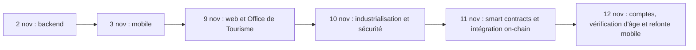

# Historique et feuille de route

Cette page retrace les grandes étapes du projet, reconstituées à partir de l'historique Git, puis liste ce qui reste à faire. Elle ne reprend pas la liste brute des commits : `git log --no-merges --reverse` la donne.

## Repères

| Indicateur | Valeur |
|---|---|
| Premier commit | 2 novembre 2026, 18 h 23 |
| Dernier commit | 12 novembre 2026, 18 h 31 |
| Commits sur la branche `marceau` | 427, dont 227 hors fusions |
| Pull requests fusionnées | 200, numérotées jusqu'à la n° 218 |
| Jours actifs | 2, 3, 9, 10, 11 et 12 novembre |

Le travail s'est fait sur une branche d'intégration (`marceau`), fusionnée dans `main` par pull request à chaque étape, presque toujours après un seul commit. Les livrables UX, marketing et budget de l'équipe, hors dépôt, sont datés du 6 novembre, pendant la pause du code.

## Les étapes

### 2 novembre : le backend en une soirée

La première soirée pose l'infrastructure locale (PostgreSQL, Redis puis Mailpit en Docker), Prisma 7 et la première migration, puis le serveur Express 5 en TypeScript. Tous les modules métier arrivent ensuite en deux heures : authentification avec vérification de majorité et 2FA, loterie, boutique et carte à gratter, partenaires, utilisateur et RGPD, analytique, administration Mairie, webhooks. Les files BullMQ, Socket.IO (salle d'attente et chat), les templates d'email, le seed et une première série de tests complètent le socle.

À ce stade, la blockchain est entièrement simulée : les commits parlent d'authentification « Web3Auth » et d'achat « gasless » relayé par la Mairie. Les hash de transaction sont aléatoires. Cette première architecture a été abandonnée le 11 novembre.

### 3 novembre : l'application mobile

L'application Expo (SDK 58) est construite dans la journée : design system et thème adaptatif, internationalisation français et anglais, stockage sécurisé, client HTTP, Socket.IO, store Redux Toolkit et RTK Query, puis les composants (compte à rebours, roulette, tickets, badges, chat, carte à gratter) et les 16 écrans, assemblés dans la navigation par onglets. Les tests Jest et le README mobile ferment la journée.

### 4 au 8 novembre : pas de code

Aucun commit. Le 6 novembre, l'équipe produit ses dossiers de cadrage, de recherche utilisateurs, de stratégie marketing et de budget, utilisés dans la [partie 1](contexte.md) de cette documentation.

### 9 novembre : le frontend web et l'Office de Tourisme

En journée, le frontend web Next.js 16 reprend le design system du mobile et le dépasse : espace citoyen à parité avec le mobile, pages publiques (page municipale, transparence, confidentialité, conditions), instrumentation du parcours en six étapes, puis le dashboard Mairie (pilotage, analytique et exports, partenaires, disjoncteur, trésorerie, audit) et l'espace partenaire (offres, import de codes, validation en caisse). Les tests Vitest et le README web suivent.

Le soir, le site vitrine de l'Office de Tourisme est construit page par page : accueil, découverte, agenda, restaurants, hébergements, fiches, magazine, favoris, infos pratiques, billetterie, panier, tunnel de commande simulé et QR codes sur les billets.

### 10 novembre : industrialisation puis sécurité

Entre minuit et 1 h 30, une série de commits transforme le prototype en service exploitable :

| Thème | Changements |
|---|---|
| Configuration | Validation centralisée au démarrage, refus des secrets de développement en production |
| Observabilité | Journaux JSON avec identifiant de corrélation, sondes séparées, métriques Prometheus, compteurs métier |
| Robustesse | Délais sur SMTP, S3 et RPC, pool PostgreSQL, préfixe et verrous Redis, limitation de débit partagée, idempotence, reprises des files BullMQ, arrêt propre et worker séparé, préfixe `/api/v1` |
| Base | Index, dates `timestamptz` et contraintes CHECK |
| Livraison | Dockerfile multi-étapes, stack complète dans Docker Compose, CI GitHub Actions, Dependabot, CODEOWNERS, scénarios k6 |
| Documentation | Architecture, ADR, runbooks, README racine, guide de contribution |

En journée, un second bloc renforce la sécurité : chiffrement AES-256-GCM, durcissement du TOTP, échappement des emails et alertes de sécurité, vérification stricte des JWT et révocation des sessions, connexion obligatoire par code email, jetons RGPD hachés, 2FA obligatoire pour les administrateurs, contrôle d'appartenance des établissements partenaires, signature HMAC du webhook, neutralisation des formules CSV, sondes sans fuite d'informations, déconnexion serveur sur le web et le mobile, Content-Security-Policy du web.

### 11 novembre : le smart contract et le passage au réel

En début d'après-midi, les derniers durcissements : polices auto-hébergées et CSP stricte pour l'Office de Tourisme, conteneurs Docker Compose en lecture seule et sans privilèges, analyses de sécurité en CI (Trivy, `npm audit`), politique de sécurité, registre RGPD et plan de réponse aux incidents.

De 16 h 19 à 17 h 35, le livrable central du rush est écrit :

1. projet Hardhat 3, contrat `BlockLucky` (tickets, tirage Chainlink VRF, cagnotte) et badge POAP non transférable ;
2. tests de fuzzing, couverture à 100 % et analyse Slither ;
3. déploiement local avec oracle VRF simulé, image Docker de la blockchain locale, script Sepolia, export des ABI ;
4. côté backend : configuration blockchain et schéma on-chain, portefeuille intégré par citoyen, indexeur, keeper et file d'actions, loterie branchée sur le contrat, disjoncteur et commission on-chain, tests sur une vraie chaîne.

Le soir, l'intégration se termine : effacement de la clé du portefeuille à la suppression RGPD, blockchain locale dans Docker Compose, portefeuille intégré et annonce du gagnant sur le web et le mobile, CI des contrats et de l'intégration, puis la documentation des contrats, du backend on-chain, l'ADR 0004, la veille juridique, la reformulation des besoins et le registre des risques.

### 12 novembre : comptes, vérification d'âge et refonte mobile

La migration `20261112090000_password_accounts_identity_verification` marque l'étape suivante :

1. comptes avec mot de passe, réinitialisation par code et connexion Google et Apple ;
2. vérification d'âge par pièce d'identité chiffrée, examinée depuis la page Mairie `/mairie/identites`, et refus des achats tant que l'âge n'est pas vérifié ;
3. un seul ticket par participant et par grand tirage, numéros de ticket à cinq chiffres, phases du tour et délai de révélation géré par le keeper ;
4. ticket à gratter acheté en EtherPoints et nouveaux paliers de la jauge ;
5. refonte complète de l'application mobile sur la maquette Figma : police Inter, nouveaux jetons de couleur, quatre onglets et douze nouveaux écrans ;
6. alignement du frontend web sur cette charte : mêmes couleurs, police et icônes, pages restylées sur les écrans mobiles ;
7. espace Paramètres du mobile ouvert par une roue dentée dans l'en-tête (affichage, notifications par catégorie, prénom et nom, changement d'email et de mot de passe, message au support), avec la migration `20261112150000_user_names` ;
8. dernière série de corrections : ticket de connexion (`loginTicket`) exigé pour le code de l'application d'authentification, retrait de la connexion Apple, cases d'acceptation des conditions et de majorité à l'inscription, page `/mairie/comptes` pour créer les comptes Mairie et partenaires, séparation des rôles du contrat et scripts Sepolia (VRF, Automation, vérification), retrait du plafond de jeu responsable, sons du tirage, pages légales et bandeau de consentement aux traceurs, licence MIT.

## Ce que l'historique explique

Le contrat est arrivé en dernier, alors que c'est le livrable central du brief. Cela explique plusieurs traces visibles dans le code :

- le vocabulaire « gasless » et « Web3Auth » de la première architecture a été retiré du code et des résumés OpenAPI ; il ne subsiste que dans le champ de réponse `gaslessSponsored` ([Réel, simulé ou à venir](reel-ou-simule.md)) ;
- le mode `BLOCKCHAIN_MODE=simulated` est l'ancien fonctionnement du backend, conservé pour les tests unitaires ;
- certaines fonctions d'animation écrites le 2 novembre (paliers de la jauge, notifications, quêtes) n'ont pas été reprises lors du passage au réel.

## Feuille de route

Les actions sont classées par priorité. La dette technique détaillée est dans [Dette technique et limites](../annexes/dette-technique.md).

### Avant toute ouverture au public

| Action | Pourquoi | Référence |
|---|---|---|
| Déployer les contrats sur Sepolia et publier leur code sur Etherscan, avec les scripts `vrf:sepolia`, `deploy:sepolia`, `automation:sepolia` et `verify:sepolia` ; l'équipe doit fournir les clés (déployeur, multisig de la Mairie, opérateur) et les fonds de test | Rendre le tirage vérifiable par tous | [Déploiement sur Sepolia](../smart-contracts/sepolia.md) |
| Mettre l'application en ligne sur etherbay.tech | Ouvrir le pilote | [Déploiement sur etherbay.tech](../infrastructure/deploiement-etherbay.md) |
| Confier `ENCRYPTION_KEY` et `RELAYER_PRIVATE_KEY` à un coffre de secrets | Le modèle custodial en dépend | [Clés et garde des portefeuilles](../securite/cles-portefeuilles.md) |
| Corriger ou retirer les éléments fictifs du dashboard et de la jauge | Ne pas présenter de fausses données | [Réel, simulé ou à venir](reel-ou-simule.md#ce-qui-est-encore-fictif) |
| Faire valider les points juridiques ouverts | Qualification du dispositif, statut des EtherPoints, règlement du jeu | [Points à valider](../juridique/points-a-valider.md) |
| Réaliser les entretiens et tests utilisateurs | Seuils de décision du pilote | [Profils et parcours](profils-parcours.md) |

### Nettoyage du code

| Action | Référence |
|---|---|
| Corriger les résumés OpenAPI (Web3Auth, multi-signatures) et retirer `EXPO_PUBLIC_WEB3AUTH_CLIENT_ID` | [Référence de l'API](../backend/reference-api.md) |
| Donner un exécuteur aux tests mobiles et les ajouter à la CI | [Tests et qualité](../contribuer/tests-qualite.md) |
| Émettre ou retirer les événements Socket.IO déclarés mais inutilisés | [Temps réel Socket.IO](../backend/socket-io.md) |
| Stocker en base les codes promo et la date d'expiration des offres | [Boutique et récompenses](../backend/modules/boutique.md) |

### Évolutions possibles

| Évolution | Condition |
|---|---|
| Enregistrer la tâche Chainlink Automation (`npm run automation:sepolia`) en complément du keeper | Déploiement Sepolia fait, LINK de test disponible |
| Trésorerie réellement multi-signatures (par exemple un Safe) | Décision de la Mairie |
| Notifications push réelles via `expo-notifications`, déjà installé | Service d'envoi côté serveur |
| Remontée d'erreurs réelle (Sentry ou équivalent) | Choix d'un fournisseur et analyse RGPD |
| Mesure de l'entonnoir dans le dashboard | Les événements sont déjà collectés ([Objectifs et indicateurs](objectifs-indicateurs.md)) |

### Dépendances en attente

Au 11 novembre, des branches Dependabot attendent d'être revues : passage de PostgreSQL 15 à 16 et de Redis 7.4 à 8, nouvelles versions de Mailpit, de l'image nginx de l'Office de Tourisme, des actions GitHub, de TypeScript 7 et de dépendances mobiles. Voir [Dépendances](../contribuer/dependances.md).
