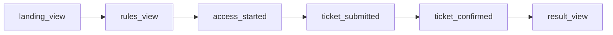

# Objectifs et indicateurs

Le kickoff fixe cinq attentes à la Ville d'EtherBay. Cette page les transforme en indicateurs mesurables, indique où la donnée existe déjà dans le code, et signale les mesures qui restent à construire. Elle s'appuie sur la reformulation des besoins de l'équipe et sur deux de ses livrables : le dossier de cadrage (« Proposition de valeur ») et le dossier « Budget, acquisition et indicateurs ».

## Des attentes aux indicateurs

| Attente du kickoff | Indicateur principal | Cible | Donnée disponible aujourd'hui |
|---|---|---|---|
| Éducatif : sensibiliser à la blockchain | Part des participants qui reformulent correctement le caractère fictif des ethers et le principe du tirage | 4 personnes testées sur 5 | Aucune dans le code : mesure par tests utilisateurs |
| Engagement : au moins 10 000 participants | Participants confirmés distincts | 10 000 | `progression.distinctParticipants` de `GET /api/v1/lottery/status` |
| Innovation : positionner EtherBay | Badges POAP frappés, retombées presse et réseaux | À fixer avec la Mairie | Événements `BadgeMinted` du contrat POAP |
| Transparence : confiance totale | Part des tickets et tirages vérifiables sur la chaîne, écart entre la chaîne et la base | 100 % et zéro écart | Hash de transaction et index de ticket stockés pour chaque ticket |
| Collaboration Mairie et Epitech | Livrables remis, soutenance, démonstration | Livrables complets | Dépôt, documentation, démonstration locale |

Les sections suivantes détaillent chaque attente.

## Éducatif

Le but est que les habitants comprennent ce qu'ils engagent et comment le gagnant est choisi. Le dossier de cadrage retient deux seuils, présentés comme des critères de décision de l'équipe (hypothèse H03) et non comme des objectifs garantis :

| Critère | Seuil | Mesure prévue |
|---|---|---|
| Compréhension | 4 personnes sur 5 comprennent les règles | Question de reformulation en fin de test |
| Éthique | Le caractère fictif de l'argent est compris | Question dédiée avant la validation du ticket |

Le code contribue à cet objectif sans le mesurer :

- la page publique `/transparence` ([`frontend-web/src/app/transparence/page.tsx`](src:frontend-web/src/app/transparence/page.tsx)) et la route `GET /api/v1/lottery/transparency-charter` exposent une charte vulgarisée ;
- la billetterie web impose de cocher « Je comprends que j'engage des ethers fictifs, sans valeur monétaire, dans un tirage pédagogique » avant de confirmer ;
- la quête `READ_TRANSPARENCY_CHARTER` rapporte 20 EtherPoints, mais elle est validée sur simple déclaration.

> [!NOTE]
> Les entretiens et tests utilisateurs décrits dans le livrable « Recherche utilisateurs et parcours » restent à réaliser. Aucun résultat de compréhension ne peut donc être annoncé à ce stade.

## Engagement

### L'objectif de 10 000 participants

C'est le seul objectif chiffré du kickoff. Il représente environ un quart de la cible principale (42 000 habitants de 18 à 35 ans) et 8 % de la population.

Le livrable « Budget, acquisition et indicateurs » définit le participant confirmé comme une personne éligible distincte ayant au moins un ticket confirmé sur le réseau. Il précise qu'une personne peut détenir plusieurs adresses : compter des comptes n'est pas compter des personnes. Le projet associe un compte à un email vérifié par code et à un portefeuille unique, ce qui limite les doublons sans les empêcher.

### Ce que mesure le code

| Mesure | Source | Définition exacte |
|---|---|---|
| Participants distincts d'un tour | `progression.distinctParticipants` dans `GET /api/v1/lottery/status` | Nombre d'utilisateurs distincts ayant au moins un ticket indexé dans le tour (`countDistinctParticipants` de [`backend/src/api/lottery/lottery.repo.ts`](src:backend/src/api/lottery/lottery.repo.ts)) |
| Tickets vendus | `progression.ticketsSold` | `ticketCount` du tour, lu sur le contrat |
| Pourcentage de la jauge | `progression.percentage` | `ticketsSold / maxTickets` ; `maxTickets` vaut 10 000 par défaut |
| Comptes inscrits et taux d'atteinte | `kpis.totalUsers` et `kpis.completionRatePercent` de `GET /api/v1/analytics/dashboard` | Nombre total de comptes divisé par 10 000 |

> [!WARNING]
> La jauge affichée aux citoyens compare des tickets à la capacité du tour, et le taux d'atteinte du dashboard compare des comptes à 10 000. Aucun des deux ne mesure des participants distincts. Pour piloter l'objectif, utiliser `distinctParticipants`, ou la requête SQL ci-dessous, et documenter la règle de décompte avec la Mairie.

Requête de contrôle sur la base, tous tours confondus :

```sql
SELECT COUNT(DISTINCT "userId") AS participants_confirmes
FROM "Ticket";
```

Un ticket n'est écrit en base que par l'indexeur, après lecture de l'événement `TicketsPurchased` du contrat : c'est donc bien un ticket confirmé sur la chaîne.

### Les scénarios de participation de l'équipe

Le livrable budget calcule le nombre de participants selon le nombre de visiteurs uniques éligibles et un taux de conversion supposé (hypothèse H04). Ces chiffres sont des hypothèses de travail sans référence locale.

| Scénario | Visiteurs uniques | Conversion supposée | Participants calculés |
|---|---|---|---|
| Prudent | 20 000 | 12 à 18 % | 2 400 à 3 600 |
| Central | 30 000 | 18 à 25 % | 5 400 à 7 500 |
| Ambitieux | 40 000 | 25 à 30 % | 10 000 à 12 000 |

L'objectif n'est atteint que dans le scénario ambitieux. Le livrable en conclut que l'ambition dépend surtout de la mobilisation des relais locaux, détaillée dans le [volet marketing](marketing.md).

## Innovation

L'indicateur technique est le nombre de badges POAP frappés. Chaque frappe émet `BadgeMinted` et un `Transfer` depuis l'adresse zéro sur [`smart-contract/contracts/BlockLuckyPOAP.sol`](src:smart-contract/contracts/BlockLuckyPOAP.sol). Le backend frappe un badge par participant et par tour, via la file d'actions on-chain ([`backend/src/blockchain/chain-actions.ts`](src:backend/src/blockchain/chain-actions.ts)). Le nombre de badges d'un tour est donc égal au nombre de participants distincts une fois la file vidée.

Les retombées presse et réseaux ne sont pas mesurées par le code. Le suivi des sources d'acquisition (`utm_source`) en donne une approximation par canal.

## Transparence

| Indicateur | Comment le vérifier |
|---|---|
| Chaque ticket est relié à une transaction | La table `Ticket` stocke `transactionHash`, `blockNumber` et `ticketIndex` ; le couple tour et index est unique |
| Chaque tirage est prouvé | L'identifiant de requête VRF (`vrfRequestId`) est stocké et affiché ; l'événement `WinnerPicked` porte le ticket gagnant |
| Zéro écart entre la chaîne et la base | La base est une projection reconstruite par l'indexeur depuis les événements du contrat ([Reconstruire depuis la chaîne](../base-de-donnees/reconstruction.md)) |
| Contrat vérifiable publiquement | Publication du code source sur Etherscan prévue au déploiement Sepolia, pas encore réalisée |

Les liens vers l'explorateur ne s'affichent que si `EXPLORER_URL` est défini (vide en local, `https://sepolia.etherscan.io` prévu sur Sepolia).

## Collaboration

L'indicateur est la remise des livrables : code, documentation, livrables marketing et UX, soutenance. Le [catalogue des fonctionnalités](fonctionnalites.md) et la [grille de compétences](competences.md) servent de pièces justificatives.

## Indicateurs de pilotage de la campagne

Le livrable budget propose un dictionnaire d'indicateurs. Le tableau précise pour chacun si le code fournit déjà la donnée.

| Indicateur | Définition (livrable de l'équipe) | Donnée dans le code |
|---|---|---|
| Participant confirmé | Personne éligible distincte avec au moins un ticket confirmé | Oui : `Ticket.userId` distincts |
| Tickets confirmés | Achats validés sur le réseau | Oui : table `Ticket`, compteur Prometheus `business_events_total{event="ticket_indexed"}` |
| Conversion | Participants attribuables divisés par visiteurs éligibles mesurables | Partielle : événements `landing_view` et `ticket_confirmed` de la table `Analytics` |
| Coût par participant | Dépenses de campagne divisées par participants distincts | Non : dépend des factures |
| Compréhension | Reformulations correctes divisées par personnes testées | Non : tests utilisateurs |
| Réussite de parcours | Tests terminés sans aide critique divisés par tests effectués | Non : tests utilisateurs |
| Incident | Erreur affectant une participation, classée par gravité | Partielle : journaux structurés et métriques ([Observabilité](../backend/observabilite.md)) |

### Le parcours instrumenté

Le frontend web envoie six événements de parcours à `POST /api/v1/analytics/track`, définis dans [`frontend-web/src/lib/analytics.ts`](src:frontend-web/src/lib/analytics.ts). Ils correspondent aux six étapes du parcours conçu par l'équipe (voir [Profils et parcours](profils-parcours.md)).



Ces événements sont enregistrés dans la table `Analytics` avec la source d'acquisition. Le citoyen peut refuser la mesure d'audience depuis `/confidentialite` ; aucun événement n'est alors envoyé. Le dashboard ne présente pas encore d'entonnoir : la requête suivante le calcule.

```sql
SELECT "eventType", COUNT(*) AS evenements, COUNT(DISTINCT "userId") AS comptes
FROM "Analytics"
WHERE "eventType" IN ('landing_view', 'rules_view', 'access_started', 'ticket_submitted', 'ticket_confirmed', 'result_view')
GROUP BY "eventType";
```

Les étapes antérieures à la connexion sont anonymes (`userId` nul) : le nombre de comptes distincts n'a de sens qu'à partir de `ticket_submitted`.

### Indicateurs techniques

Le backend expose sur `/metrics` le compteur Prometheus `business_events_total`, dont l'étiquette `event` distingue `ticket_purchased`, `ticket_indexed`, `reward_claimed` et les crédits et débits d'EtherPoints, en plus des latences par route ([`backend/src/observability/metrics.ts`](src:backend/src/observability/metrics.ts)). Les objectifs de service associés sont dans [Objectifs de service et métriques](../infrastructure/slo-metriques.md).

## Limites des chiffres du dashboard

> [!CAUTION]
> Plusieurs valeurs du dashboard Mairie ne doivent pas être présentées comme des mesures.
>
> - Quand aucun événement ne porte de tranche d'âge, [`backend/src/api/analytics/analytics.services.ts`](src:backend/src/api/analytics/analytics.services.ts) affiche une répartition codée en dur (42 %, 33 %, 17 %, 8 %) et `target18_35Validated` vaut toujours `true`.
> - La répartition par âge porte sur les 500 derniers événements, pas sur des personnes.
> - La part de la Mairie est calculée à 10 % de la somme des cagnottes en base, et non lue sur le contrat (`accruedFees`).
> - La tranche d'âge est déclarative, choisie à la connexion.
