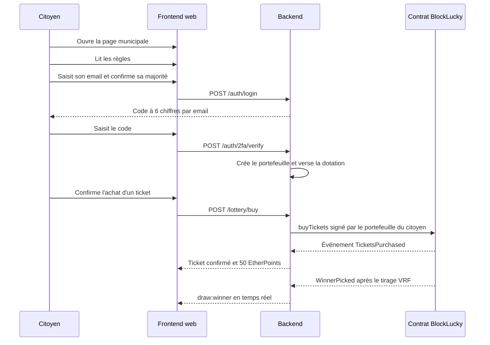
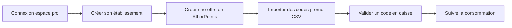

# Profils et parcours

Cette page décrit qui utilise BlockLucky et comment. Elle croise deux sources : les profils de travail et le parcours conçus par l'équipe dans son livrable « Recherche utilisateurs et parcours » (dossier 03, daté du 6 novembre 2026), et les rôles et écrans réellement implémentés dans le code.

## Les profils de travail

Le livrable de recherche définit quatre profils hypothétiques. Ce ne sont pas des personas validés : l'équipe précise qu'ils gardent le statut d'hypothèses tant que les entretiens et les tests n'ont pas eu lieu. Ils servent au recrutement des testeurs et à la conception des écrans.

| Profil | Besoin supposé | Question à vérifier | Réponse prévue dans le produit |
|---|---|---|---|
| Personne de 18 à 35 ans à l'aise sur téléphone | Participer rapidement et retrouver son ticket | Le vocabulaire et la connexion provoquent-ils un abandon ? | Connexion par code email sur le web, par mot de passe ou Google sur mobile, achat en un geste, historique des tickets |
| Adulte curieux, peu familier de la blockchain | Comprendre le montant engagé et le gain | Peut-il expliquer le caractère fictif des ethers ? | Mention « ETH fictif » sur chaque montant, case de compréhension avant l'achat, charte de transparence |
| Personne ayant besoin d'un accompagnement | Obtenir de l'aide et lire facilement les écrans | Peut-elle participer avec le dispositif proposé ? | Page d'aide (`/profil/aide`), thème clair ou sombre, navigation clavier, textes en français et en anglais |
| Agent ou relais local | Aider sans accéder aux secrets du compte | Les réponses de la FAQ suffisent-elles ? | Aucun secret à transmettre : pas de phrase de récupération, la clé du portefeuille reste chiffrée côté serveur ; un mot de passe oublié se réinitialise par un code reçu par email |

La cible principale reste celle du kickoff : les 18 à 35 ans, soit 35 % des 120 000 habitants. Le livrable marketing ouvre le dispositif à tous les adultes pour répondre à l'objectif d'inclusion.

### Le protocole de recherche prévu

| Étape | Effectif (hypothèse H02) | Contenu |
|---|---|---|
| Entretiens courts | 6 à 8 personnes | Questionnaire de neuf questions : tranche d'âge, pratique des événements locaux, connaissance de la blockchain, freins, confiance dans le tirage, aide souhaitée |
| Tests de parcours modérés | 5 à 8 personnes | Découvrir l'événement, lire les règles, participer avec des unités de test, retrouver son ticket et le résultat |

Le seuil de décision pour envisager un pilote (hypothèse H03) est d'au moins 4 parcours réussis sans aide critique et 4 reformulations correctes sur 5. Une double confirmation ou un montant mal compris est un incident critique à corriger avant toute ouverture. Ces tests restent à réaliser.

## Les rôles dans le code

Le modèle de données connaît trois rôles (énumération `Role` de [`backend/prisma/schema.prisma`](src:backend/prisma/schema.prisma)). Les visiteurs non connectés forment un quatrième profil.

| Profil | Rôle | Espaces accessibles | Page d'arrivée après connexion |
|---|---|---|---|
| Visiteur | aucun | Page municipale publique, transparence, confidentialité, mentions légales, invitation, site de l'Office de Tourisme | - |
| Citoyen | `USER` | Espace citoyen web et application mobile | `/accueil` |
| Commerçant partenaire | `PARTNER` | Espace partenaire web | `/partenaire` |
| Mairie (administrateur) | `ADMIN` | Dashboard Mairie et espace partenaire | `/mairie` |

La redirection après connexion est faite par `homeForRole` dans [`frontend-web/src/hooks/useAuth.ts`](src:frontend-web/src/hooks/useAuth.ts). Le contrôle réel des droits est fait par le backend : `requireRoles` de [`backend/src/middlewares/rbac.middleware.ts`](src:backend/src/middlewares/rbac.middleware.ts) relit le rôle en base à chaque requête et refuse un administrateur qui n'a pas activé la double authentification. La matrice complète est dans [Autorisations et matrice des droits](../securite/autorisations.md).

> [!NOTE]
> Un compte qui s'inscrit lui-même est toujours un citoyen (`USER`). Les comptes partenaire et Mairie sont créés, ou reçoivent leur rôle, depuis la page `/mairie/comptes`, qui envoie une invitation par email ; le premier compte Mairie vient du seed en démonstration, ou d'une promotion en base en production ([Comptes de démonstration et connexion](../demarrage/comptes-et-connexion.md)).

## Le parcours principal du citoyen

L'équipe a conçu un parcours en six étapes, chacune instrumentée par un événement analytique. Le tableau reprend la conception du livrable et indique ce que fait le code.

| Étape | Attente du citoyen | Réponse de l'interface | Événement |
|---|---|---|---|
| Découvrir | Savoir qui organise | Page municipale publique `/` qui identifie la Mairie et l'objet pédagogique | `landing_view` |
| Comprendre | Connaître les règles et la valeur engagée | Règles et charte de transparence sur `/transparence` | `rules_view` |
| Accéder | Comprendre le compte et les données | Onboarding en quatre écrans, déclaration de majorité, acceptation des conditions générales et du règlement, saisie de l'email puis du code ; sur mobile, compte avec mot de passe confirmé par un code ; puis envoi de la pièce d'identité, sur `/profil/identite` ou depuis l'application | `access_started` |
| Participer | Confirmer une seule action | Billetterie : un seul ticket par grand tirage, total en ETH fictif, case de compréhension sur le web, bouton bloqué pendant l'envoi ; sur le web, achat désactivé avec un lien vers la vérification d'identité tant que l'âge n'est pas vérifié, refus 403 côté backend | `ticket_submitted` |
| Recevoir | Retrouver une confirmation | Ticket affiché comme confirmé une fois la transaction minée et indexée, historique avec lien vers l'explorateur | `ticket_confirmed` |
| Vérifier | Comprendre le résultat | Salle d'attente puis salle de tirage : identifiant de la requête VRF, annonce du gagnant en direct, numéro du ticket gagnant | `result_view` |

Ce diagramme suit le web. Sur le web, un compte dont l'âge n'est pas vérifié voit à la billetterie une alerte qui mène à `/profil/identite`, où il envoie le recto et le verso de sa pièce. Sur mobile, la connexion passe par `POST /auth/signup` ou `POST /auth/signin`, puis l'application ouvre d'elle-même l'écran de vérification d'âge tant que la pièce n'a pas été envoyée ou a été refusée (voir [Navigation et écrans](../mobile/navigation-ecrans.md#ouverture-automatique-de-la-verification-d-age)). L'achat n'est possible qu'après la décision de la Mairie.

Les étapes antérieures à la connexion envoient des événements anonymes. Le livrable demande aussi qu'un nouvel appui après une erreur reprenne l'état existant pour éviter les doublons : c'est le rôle de l'en-tête `Idempotency-Key` accepté par `POST /api/v1/lottery/buy`.

### Les états à couvrir

Le livrable liste six états à tester. Le code les traite ainsi :

| État | Traitement |
|---|---|
| Chargement | Composants `Loader` sur le web et le mobile |
| Absence de ticket | État vide de l'historique |
| Refus réseau | Erreur traduite par [`backend/src/blockchain/lottery.gateway.ts`](src:backend/src/blockchain/lottery.gateway.ts), réessai proposé quand `canRetry` est vrai |
| Transaction en attente | Bouton désactivé pendant l'envoi, reçu « en attente » jusqu'à la confirmation |
| Participation fermée | Tour en salle d'attente ou en tirage, contrat en pause, ticket déjà acheté : achat refusé avec un message explicite (409 pour le ticket déjà acheté), bouton désactivé |
| Accès refusé | Écran 403 côté web, réponse 403 du backend |

## Les parcours secondaires du citoyen

| Parcours | Web | Mobile | Détail |
|---|---|---|---|
| Vérifier son âge | - | `VerifyAgeScreen` | Photo du recto et du verso de la pièce d'identité, chiffrées à réception, examinées par la Mairie puis effacées ; email de décision ; nouvel envoi possible après un refus |
| Offrir un ticket à un proche | `/billetterie` | `GiftTicketScreen` | Le ticket est acheté par le portefeuille de l'expéditeur au nom du destinataire (`buyTicketsFor`) ; un compte et un portefeuille sont créés pour le destinataire s'il n'existe pas ; refusé si le destinataire a déjà son ticket ou si c'est l'expéditeur ; 75 EtherPoints pour l'expéditeur |
| Parrainer | `/profil`, `/invite/[code]` | `SponsorsScreen` | Lien unique ; 100 EtherPoints pour le parrain et 50 pour le filleul à l'inscription |
| Suivre le tirage en direct | `/tirage` | `WaitingRoomScreen`, `LiveDrawScreen` | Salle d'attente avec compte à rebours jusqu'à la révélation, chat, roue animée, annonce du gagnant ; sons de la roue et du chronomètre des 8 dernières secondes, désactivables |
| Échanger des EtherPoints | `/boutique`, `/boutique/[rewardId]`, `/boutique/carte`, `/boutique/mes-codes` | `RewardsCatalogScreen`, `RewardDetailScreen`, `ScratchCardScreen`, `MyCodesScreen` | Carte à gratter virtuelle, code promo et QR code à présenter en caisse ; sur mobile, ticket à gratter acheté 50 ou 100 EtherPoints qui tire une offre au hasard |
| Retirer ses gains | `/accueil` | `LiveDrawScreen` | La cagnotte est versée automatiquement ; un bouton permet de la réclamer si besoin |
| Gérer sa sécurité | `/profil/securite`, `/profil/securite/2fa` | `SecurityScreen`, `ChangeEmailScreen`, `ChangePasswordScreen`, `Setup2FAScreen` | 2FA par application TOTP ou par email ; sur le web, déconnexion de tous les appareils et rappel de la règle d'un ticket par tirage ; sur le mobile, changement d'adresse email et de mot de passe |
| Exercer ses droits RGPD | `/profil/rgpd` | `PersonalDataScreen` | Export JSON, demande de suppression confirmée par email ; sur le mobile, rectification du prénom et du nom |
| Contacter la Mairie | - | `HelpSupportScreen` | Formulaire transmis par email à un administrateur, qui répond directement au citoyen |

## Le parcours du commerçant partenaire

Le commerçant se connecte depuis `/connexion?espace=pro`. Il crée son établissement, actif dès sa création (la Mairie peut ensuite le suspendre), puis des offres (titre, coût en EtherPoints, stock, date d'expiration facultative). La date d'expiration est enregistrée dans Redis mais n'est vérifiée nulle part : une offre expirée reste échangeable. Il importe des codes promo par fichier `.csv` ou `.txt` d'au plus 1 Mo, valide en caisse le code présenté par le citoyen et suit le taux de consommation. Chaque action est vérifiée contre la propriété de l'établissement (`ownerId`). Voir [Partenaires](../backend/modules/partenaires.md).

## Le parcours de la Mairie

L'administrateur se connecte depuis `/connexion?espace=pro`. Tant qu'il n'a pas activé la double authentification, le backend refuse toutes les routes d'administration avec une réponse 403 : la première étape est donc `/profil/securite/2fa`.

| Écran | Actions |
|---|---|
| `/mairie` | Indicateurs, état du tour, tirage manuel, annulation avec remboursement, export de rapport |
| `/mairie/analytique` | Répartition par âge, acquisition par source UTM, exports CSV et PDF |
| `/mairie/partenaires` | Approbation ou suspension des commerces |
| `/mairie/identites` | File des pièces d'identité en attente, consultation du recto et du verso (journalisée), validation ou refus motivé |
| `/mairie/comptes` | Comptes Mairie et partenaires : recherche, création avec invitation par email et rattachement facultatif d'un établissement, changement ou retrait de rôle (sessions du compte fermées, action journalisée) |
| `/mairie/securite` | Disjoncteur (pause du contrat), reversement de la commission à la trésorerie |
| `/mairie/audit` | Journal chronologique des actions d'administration, filtrable et exportable |

Le détail est dans [Administration Mairie](../backend/modules/administration.md) et [Disjoncteur](../architecture/flux/disjoncteur.md).

## Les parcours hors application

| Profil | Parcours |
|---|---|
| Visiteur de la ville | Site de l'Office de Tourisme : découverte, agenda, restaurants, hébergements, billetterie et commande simulées ([Pages et parcours](../office-tourisme/pages.md)) |
| Relais local | Kit de communication et fiche de rôle prévus par le [volet marketing](marketing.md), sans accès technique |
| Développeur de la Ville | Cette documentation, à partir du [démarrage rapide](../demarrage/prerequis.md) |
