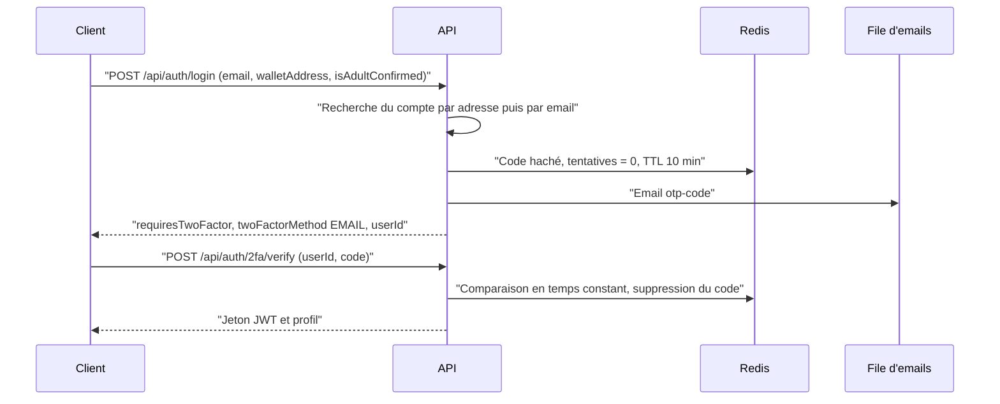

# Authentification et 2FA

BlockLucky n'a pas de mot de passe. Un citoyen se connecte avec son adresse email, prouvée par un code à usage unique, ou avec un code TOTP s'il a activé une application d'authentification. Cette page décrit les mécanismes et leurs paramètres tels qu'ils sont codés. Le fonctionnement fonctionnel du module (routes, réponses) est décrit dans [le module Authentification](../backend/modules/auth.md).

Fichiers principaux :

| Fichier | Rôle |
|---|---|
| [`backend/src/api/auth/auth.services.ts`](src:backend/src/api/auth/auth.services.ts) | Logique de connexion, d'inscription, d'activation et de désactivation de la 2FA |
| [`backend/src/services/otp-challenge.service.ts`](src:backend/src/services/otp-challenge.service.ts) | Codes email : émission, vérification, compteurs d'échecs, anti-rejeu TOTP |
| [`backend/src/services/totp.service.ts`](src:backend/src/services/totp.service.ts) | Implémentation TOTP (RFC 6238) et génération des codes de secours |
| [`backend/src/utils/crypto.util.ts`](src:backend/src/utils/crypto.util.ts) | Aléa, HMAC, comparaison en temps constant, chiffrement |
| [`backend/src/middlewares/rbac.middleware.ts`](src:backend/src/middlewares/rbac.middleware.ts) | 2FA obligatoire pour les administrateurs |
| [`backend/__tests__/api/auth-security.test.ts`](src:backend/__tests__/api/auth-security.test.ts) | Tests de sécurité de l'authentification |

## Connexion par code email

### Déroulé

`POST /api/auth/login` ne délivre jamais de jeton quand `LOGIN_EMAIL_CODE_REQUIRED` vaut `true`, ce qui est la valeur par défaut et la seule acceptée en production. Le jeton n'est délivré qu'après `POST /api/auth/2fa/verify`.

Le champ `walletAddress` envoyé par le client sert uniquement à retrouver un compte existant. Il n'est jamais utilisé comme portefeuille : le backend crée le sien (voir [Portefeuilles intégrés](../integration-blockchain/portefeuilles.md)). Comme une adresse de portefeuille est publique sur la chaîne, elle ne prouve rien ; la preuve vient du code reçu par email.

### Paramètres du code

| Paramètre | Valeur | Source |
|---|---|---|
| Longueur | 6 chiffres, chacun tiré par `crypto.randomInt(0, 10)` | `generateOtpCode` |
| Stockage | `HMAC-SHA-256(clé dérivée de ENCRYPTION_KEY, "subjectId:code")` dans la clé Redis `auth:otp:<subjectId>` | `hashCode` |
| Durée de validité | 10 minutes | `CODE_TTL_SECONDS` |
| Essais par code | 5, puis le code est supprimé | `MAX_ATTEMPTS_PER_CODE` |
| Blocage du compte | 10 échecs en une heure bloquent toute vérification pour ce compte pendant une heure (réponse 429) | `MAX_FAILURES_PER_ACCOUNT`, `FAILURE_WINDOW_SECONDS` |
| Limite par adresse IP | 30 requêtes en 10 minutes sur `/login`, `/2fa/verify` et `/2fa/disable` | `authRateLimiter` |
| Comparaison | `crypto.timingSafeEqual` sur les empreintes | `safeEqual` |
| Usage | Unique : le code est supprimé dès qu'il est accepté | `consume` |

Le compteur d'échecs est indexé par compte, pas par adresse IP. Un attaquant qui change d'adresse IP ne contourne donc pas le blocage. En contrepartie, un tiers peut bloquer la connexion d'un compte pendant une heure en saisissant dix codes faux : le blocage est temporaire et ne demande aucune intervention humaine.

### Inscription

Un compte n'existe qu'une fois l'email prouvé. Pour une adresse inconnue, le backend :

1. génère un identifiant de défi aléatoire (`randomUUID`) ;
2. stocke dans le défi les données d'inscription (email, code de parrainage résolu, tranche d'âge, source UTM) ;
3. envoie le code.

À la vérification, `createVerifiedUser` crée le compte avec `isEmailVerified: true`, son portefeuille chiffré, les 25 EtherPoints de bienvenue et, le cas échéant, le bonus de parrainage. Aucun point n'est donc attribué à une adresse non prouvée. Le test `exige le code envoyé par email avant de créer le compte et de délivrer un jeton` couvre ce comportement.

La case `isAdultConfirmed` doit valoir `true` : le schéma Zod la refuse sinon. Il s'agit d'une déclaration, pas d'une vérification d'âge.

### Code visible en développement

Quand `NODE_ENV` vaut `development`, les réponses de `/login` et de `/2fa/setup` contiennent `devOtpPreview`, la valeur du code. Ce champ n'existe ni en test ni en production.

## Double authentification TOTP

### Activation

1. `POST /api/auth/2fa/setup` avec `{ "method": "APP" }` (route authentifiée).
2. Le backend génère un secret de 32 caractères base32, soit 160 bits, à partir de `crypto.randomBytes(32)`. Comme 256 est un multiple de 32, l'opération `octet % 32` n'introduit pas de biais.
3. Il enregistre le secret chiffré (`encryptText`, format `v2:`) et dix codes de secours hachés, avec `isTwoFactorEnabled: false`.
4. Il renvoie une seule fois le secret, l'URL `otpauth://`, le QR code et les codes de secours en clair.
5. Le citoyen saisit un premier code TOTP dans `POST /api/auth/2fa/verify`. Ce n'est qu'alors que `isTwoFactorEnabled` passe à `true`.
6. Toutes les sessions existantes sont révoquées (`revokeAllForUser`), un email d'alerte est envoyé et une nouvelle session est délivrée.

Une 2FA déjà active ne peut pas être reconfigurée directement : `setup` répond 409 et il faut d'abord la désactiver.

### Vérification

| Paramètre | Valeur |
|---|---|
| Algorithme | HOTP sur HMAC-SHA-1, compteur `floor(t / 30)` |
| Longueur | 6 chiffres |
| Fenêtre | ±1 pas de 30 secondes, soit trois codes acceptés à un instant donné |
| Comparaison | `safeEqual` sur chaque candidat |
| Anti-rejeu | La clé Redis `auth:totp-used:<userId>:<compteur>` est posée par `setIfAbsent` pendant 120 secondes : un code déjà accepté est refusé dans sa fenêtre |

Le test `refuse le rejeu d'un code TOTP déjà utilisé` vérifie l'anti-rejeu.

### Codes de secours

| Propriété | Valeur |
|---|---|
| Nombre | 10 |
| Format | 10 caractères tirés dans `ABCDEFGHJKLMNPQRSTUVWXYZ23456789` (32 symboles), présentés `XXXXX-XXXXX` |
| Entropie | 50 bits par code |
| Stockage | `SHA-256("backup:" + code normalisé)`, dans le tableau `User.twoFactorBackupCodes` |
| Usage | Unique : le code utilisé est retiré du tableau |
| Alerte | Email `security-alert` indiquant le nombre de codes restants |
| Diffusion | Affichés une seule fois dans la réponse de `setup`, jamais envoyés par email |

La normalisation (`normalizeBackupCode`) met en majuscules et retire tout caractère non alphanumérique : `abcde-fghij` et `ABCDEFGHIJ` désignent le même code. Le hachage n'est pas salé ; avec 50 bits d'entropie par code, une attaque par dictionnaire sur une base volée reste coûteuse, mais un hachage lent (bcrypt, déjà disponible via `hashValue`) serait plus robuste.

## Double authentification par email

Avec `{ "method": "EMAIL" }`, `setup` envoie un code de type `SETUP`. Sa vérification active la 2FA par email, révoque les sessions existantes et envoie une alerte. Ensuite, chaque connexion passe par le même code email que la connexion standard.

## Connexion d'un compte protégé par TOTP

Pour un compte dont `twoFactorMethod` vaut `APP` et `isTwoFactorEnabled` vaut `true`, `POST /api/auth/login` ne génère pas de code email. Il renvoie directement `twoFactorMethod: "APP"` et l'identifiant du compte. Le client envoie ensuite un code TOTP ou un code de secours à `/2fa/verify`.

## Désactivation

`POST /api/auth/2fa/disable` exige l'une de ces preuves :

- un code TOTP ou un code de secours valide ;
- une session de moins de 15 minutes (`sessionService.isRecent`).

Sans preuve, la réponse est 401 et un échec est compté. Quand la 2FA était active, un email d'alerte est envoyé. Le test `exige une authentification récente pour désactiver la 2FA` couvre ce cas.

## 2FA obligatoire pour les administrateurs

`requireRoles` refuse avec 403 toute route ADMIN si le compte n'a pas `isTwoFactorEnabled`, tant que `ADMIN_MFA_REQUIRED` vaut `true`. Cette variable est forcée en production : le schéma de [`backend/src/config/env.config.ts`](src:backend/src/config/env.config.ts) refuse de démarrer avec `false`. Le contrôle lit la base à chaque requête, pas le jeton : un administrateur qui désactive sa 2FA perd l'accès aux routes ADMIN immédiatement.

## Notifications de sécurité

Le modèle [`backend/src/templates/emails/security-alert.html`](src:backend/src/templates/emails/security-alert.html) est envoyé lors des événements suivants :

| Événement | Message |
|---|---|
| Activation de la 2FA par application | « Double authentification par application activée » |
| Activation de la 2FA par email | « Double authentification par email activée » |
| Désactivation de la 2FA | « Double authentification désactivée » |
| Utilisation d'un code de secours | Nombre de codes restants |

## Limites connues

> [!WARNING]
> Le terme « double authentification » est trompeur dans l'implémentation actuelle. Il n'existe pas de premier facteur secret (pas de mot de passe). Avec la méthode `APP`, le code TOTP **remplace** le code email au lieu de s'y ajouter. Avec la méthode `EMAIL`, la connexion est identique à celle d'un compte sans 2FA. Chaque connexion repose donc sur un seul facteur : la possession de la boîte mail, ou celle de l'application TOTP.

Autres limites relevées dans le code :

| Limite | Détail |
|---|---|
| Revendication `twoFactorVerified` | Elle est toujours écrite à `true` dans le jeton et n'est lue nulle part. Elle ne doit pas servir de contrôle. |
| Énumération | La réponse de `/login` diffère selon que le compte existe avec TOTP (`twoFactorMethod: "APP"`) ou non. Pour un compte existant, `userId` est l'identifiant réel ; pour une adresse inconnue, c'est un identifiant de défi aléatoire. |
| Défi non atomique | `consume` lit puis réécrit le défi dans Redis. Deux requêtes simultanées peuvent chacune consommer un essai sans que le compteur reflète les deux. La limite par IP et le blocage par compte bornent l'effet. |
| Pas de facteur résistant au hameçonnage | WebAuthn et les clés d'accès (passkeys) ne sont pas implémentés. |
| Mode sans code | Avec `LOGIN_EMAIL_CODE_REQUIRED=false`, possible uniquement hors production, `/login` délivre un jeton sur la seule adresse de portefeuille ou email fournie. Ce mode ne doit servir qu'en développement. |
| Dépendance `otplib` | Elle figure dans [`backend/package.json`](src:backend/package.json) mais le code ne l'importe pas : le TOTP est implémenté à la main dans `totp.service.ts`. |

Ces points sont repris dans [Points à valider](../juridique/points-a-valider.md) et dans la synthèse des [audits](audits.md).
