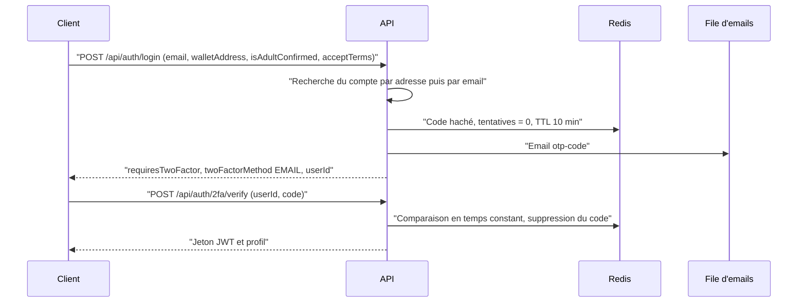

# Authentification et 2FA

Un compte BlockLucky s'ouvre de trois façons : avec une adresse email et un mot de passe, avec un compte Google, ou, sur le web, avec un code à usage unique reçu par email. Une fois connecté, le citoyen peut ajouter une double authentification par application TOTP ou par email. Cette page décrit les mécanismes et leurs paramètres tels qu'ils sont codés. Le fonctionnement fonctionnel du module (routes, réponses) est décrit dans [le module Authentification](../backend/modules/auth.md).

Fichiers principaux :

| Fichier | Rôle |
|---|---|
| [`backend/src/api/auth/auth.services.ts`](src:backend/src/api/auth/auth.services.ts) | Logique de connexion, d'inscription, de réinitialisation, d'activation et de désactivation de la 2FA |
| [`backend/src/api/auth/auth.validators.ts`](src:backend/src/api/auth/auth.validators.ts) | Politique de mot de passe et schémas des routes |
| [`backend/src/services/oauth-verifier.service.ts`](src:backend/src/services/oauth-verifier.service.ts) | Vérification des jetons d'identité Google |
| [`backend/src/services/otp-challenge.service.ts`](src:backend/src/services/otp-challenge.service.ts) | Codes email : émission, vérification, compteurs d'échecs, anti-rejeu TOTP, tickets de connexion |
| [`backend/src/services/totp.service.ts`](src:backend/src/services/totp.service.ts) | Implémentation TOTP (RFC 6238) et génération des codes de secours |
| [`backend/src/utils/crypto.util.ts`](src:backend/src/utils/crypto.util.ts) | Aléa, bcrypt, HMAC, comparaison en temps constant, chiffrement |
| [`backend/src/middlewares/rbac.middleware.ts`](src:backend/src/middlewares/rbac.middleware.ts) | 2FA obligatoire pour les administrateurs |
| [`backend/__tests__/api/auth-security.test.ts`](src:backend/__tests__/api/auth-security.test.ts), [`auth-password.test.ts`](src:backend/__tests__/api/auth-password.test.ts), [`auth-oauth.test.ts`](src:backend/__tests__/api/auth-oauth.test.ts) | Tests de sécurité de l'authentification |

## Vue d'ensemble

| Route | Client | Preuve demandée | Résultat sans 2FA |
|---|---|---|---|
| `POST /api/auth/signup` | Mobile | Mot de passe conforme, conditions et règlement acceptés, majorité déclarée, puis code email | Compte créé et session délivrée par `/2fa/verify` |
| `POST /api/auth/signin` | Mobile | Email et mot de passe | Session immédiate |
| `POST /api/auth/password/forgot`, `/password/reset` | Mobile | Code email à 6 chiffres | Nouveau mot de passe, toutes les sessions révoquées |
| `POST /api/auth/oauth/google` | Mobile | Jeton d'identité signé par le fournisseur | Session immédiate, compte créé au besoin |
| `POST /api/auth/login` | Web | Code email, avec déclaration de majorité et, facultativement, acceptation des conditions dans la requête | Session délivrée par `/2fa/verify` |
| `POST /api/auth/password/change` | Mobile, compte connecté | Jeton de session, plus le mot de passe actuel s'il en existe un | Nouveau mot de passe, toutes les sessions révoquées, nouvelle session délivrée |
| `POST /api/auth/email/change`, `/email/confirm` | Mobile, compte connecté | Jeton de session, mot de passe actuel s'il en existe un, puis code envoyé à la nouvelle adresse | Adresse remplacée, sessions conservées |

Quelle que soit la route de connexion, un compte vérifié dont la 2FA est active doit encore fournir son code TOTP ou son code email à `/2fa/verify` avant de recevoir un jeton (`completePrimaryLogin`). Pour la 2FA par application, le code n'est accepté qu'avec le ticket de connexion délivré après le premier facteur (voir [Connexion d'un compte protégé par TOTP](#connexion-d-un-compte-protege-par-totp)). `/password/change` fait exception : l'appelant a déjà une session, et le jeton de remplacement est délivré sans nouveau code. Toutes ces routes passent par `authRateLimiter` : 30 requêtes par adresse IP en 10 minutes.

## Mot de passe

### Politique et stockage

| Règle | Valeur | Source |
|---|---|---|
| Longueur | 10 à 128 caractères | `passwordPolicy` |
| Composition | Au moins une lettre (`\p{L}`, accents compris) et un chiffre | `passwordPolicy` |
| Hachage | bcrypt, coût 12, sel intégré | `hashValue` |
| Colonne | `User.passwordHash`, `NULL` pour un compte sans mot de passe | [`backend/prisma/schema.prisma`](src:backend/prisma/schema.prisma) |
| Conditions | `acceptTerms` (conditions générales d'utilisation et règlement de participation) et `isAdultConfirmed` (18 ans ou plus) doivent valoir `true` à l'inscription ; ni l'un ni l'autre n'est enregistré en base | `signupSchema` |

La politique ne vérifie ni les mots de passe compromis (aucune consultation d'une liste de fuites) ni la ressemblance avec l'email. Le mobile affiche les mêmes règles avant l'envoi ([`PasswordRules.tsx`](src:mobile-app/src/components/auth/PasswordRules.tsx)).

### Inscription

`POST /api/auth/signup` ne crée pas le compte. Il hache le mot de passe, place l'empreinte, l'email, le parrain éventuel et la source dans un défi `SIGNUP` stocké dans Redis, puis envoie un code à 6 chiffres. Le compte n'est créé qu'à la vérification de ce code par `POST /api/auth/2fa/verify` : un mot de passe ne peut donc pas être attaché à une adresse que son auteur ne contrôle pas.

Si l'adresse appartient à un compte non vérifié, par exemple créé pour le bénéficiaire d'un ticket offert, la vérification active ce compte et lui donne le mot de passe au lieu d'en créer un second (`activateExistingAccount`). Si elle appartient à un compte vérifié ou anonymisé, la route répond 409 « Un compte existe déjà avec cette adresse email. ».

### Connexion

`POST /api/auth/signin` applique trois protections :

| Protection | Mise en œuvre |
|---|---|
| Message unique | « Email ou mot de passe incorrect. » (401), que l'adresse soit inconnue, anonymisée ou sans mot de passe, ou que le mot de passe soit faux |
| Temps de réponse égalisé | Sans empreinte enregistrée, le mot de passe est comparé à une empreinte bcrypt factice calculée une seule fois (`dummyHash`), pour que la réponse prenne le même temps |
| Blocage | 10 échecs en une heure bloquent le sujet pendant une heure (429). Le sujet est l'identifiant du compte ou, pour une adresse inconnue, `signin:<HMAC de l'adresse>` |

Pour un compte existant, le compteur d'échecs est celui des codes email : des échecs de mot de passe et des codes faux s'additionnent. Comme pour les codes, un tiers peut bloquer la connexion d'un compte pendant une heure. Le test `bloque le compte après 10 échecs, y compris pour une adresse inconnue` couvre ce comportement.

### Réinitialisation

| Étape | Comportement |
|---|---|
| `POST /api/auth/password/forgot` | Réponse identique (`{ "sent": true }`, 200) que le compte existe ou non. Pour un compte actif, un code `PASSWORD_RESET` est émis sous le sujet `password-reset:<userId>` et envoyé par email, sans attendre la fin de l'envoi |
| `POST /api/auth/password/reset` | Email, code et nouveau mot de passe conforme. Code faux ou adresse inconnue : 400 « Code invalide ou expiré. » et un échec compté (sujet anonyme `password-reset:<HMAC>` pour une adresse inconnue) |
| Effet | Nouveau `passwordHash`, `isEmailVerified` à `true`, révocation de toutes les sessions du compte (`revokeAllForUser`), email `security-alert` |

Le code suit les paramètres décrits dans [Paramètres du code](#parametres-du-code). La même route permet à un compte créé sans mot de passe d'en définir un ; l'alerte indique alors « Mot de passe défini sur votre compte ».

### Changement depuis un compte connecté

`POST /api/auth/password/change` exige un jeton de session valide. Si le compte a un mot de passe, `currentPassword` est obligatoire et comparé par bcrypt ; un échec renvoie 401 « Mot de passe actuel incorrect. » et s'ajoute au compteur d'échecs du compte, celui de `/signin` (10 échecs en une heure bloquent le compte pendant une heure). Un compte créé par code email ou Google peut définir un premier mot de passe sans en fournir d'ancien : la possession de la session suffit.

| Étape | Comportement |
|---|---|
| Nouveau mot de passe | Même `passwordPolicy` que l'inscription, haché par bcrypt |
| Sessions | `revokeAllForUser` : tous les jetons émis plus d'une seconde avant sont refusés, y compris celui qui a servi à la requête |
| Nouvelle session | Un jeton est émis aussitôt et renvoyé avec le profil, comme après `/signin` ; le mobile le range à la place de l'ancien (`applyRenewedSession`) |
| Alerte | Email `security-alert` « Mot de passe modifié » ou « Mot de passe défini sur votre compte » |

Un vol de session suffit donc à définir un mot de passe sur un compte qui n'en a pas, et à déconnecter le propriétaire légitime ; l'alerte par email est alors le seul signal. Pour un compte qui a déjà un mot de passe, le voleur doit aussi le connaître.

## Changement d'adresse email

Le changement se fait en deux requêtes authentifiées :

| Étape | Route | Contrôles | Effet |
|---|---|---|---|
| Demande | `POST /api/auth/email/change` | Nouvelle adresse différente de l'actuelle et libre (sinon 400 ou 409) ; mot de passe actuel si le compte en a un (401 « Mot de passe incorrect. », échec compté sur le compte) | Code `EMAIL_CHANGE` de 6 chiffres sous le sujet `email-change:<userId>`, envoyé à la **nouvelle** adresse ; adresse en attente dans Redis (`auth:email-change:<userId>`, 10 minutes) |
| Confirmation | `POST /api/auth/email/confirm` | Code valide et adresse en attente présente (sinon 400 « Code invalide ou expiré. », échec compté sur `email-change:<userId>`) ; adresse toujours libre (409) | `email` remplacé, `isEmailVerified` à `true`, alerte `security-alert` envoyée à l'**ancienne** adresse avec la nouvelle adresse masquée |

Le code envoyé à la nouvelle adresse prouve qu'elle appartient au demandeur ; l'alerte à l'ancienne adresse prévient le titulaire si la demande ne vient pas de lui. Les sessions ne sont pas révoquées par un changement d'adresse. Pour un compte sans mot de passe, la session seule suffit à demander le changement.

## Google

Le mobile obtient un jeton d'identité auprès de Google et l'envoie au backend, qui le vérifie lui-même avant toute création de compte. La connexion avec Apple a été retirée : il n'existe plus de route `/oauth/apple` ni de variable `APPLE_CLIENT_IDS`.

| Contrôle | Google (`/oauth/google`) |
|---|---|
| Bibliothèque | `google-auth-library`, `verifyIdToken` |
| Clés | Clés publiques de Google, gérées par la bibliothèque |
| Algorithme et émetteur | Contrôlés par la bibliothèque |
| Audience | `GOOGLE_CLIENT_IDS` |
| Email | Obligatoire, `email_verified` doit être vrai |
| Fournisseur non configuré | 503 « Connexion Google non configurée. » |
| Jeton refusé | 401 |

La liste d'identifiants est vide par défaut : la connexion Google reste donc désactivée tant qu'elle n'est pas renseignée (voir [Variables d'environnement](../backend/variables-environnement.md)).

### Rattachement par adresse email

`oauthLogin` cherche le compte par l'adresse email du jeton, sans enregistrer l'identifiant `sub` du fournisseur.

| Situation | Effet |
|---|---|
| Aucun compte | Création du compte, du portefeuille et des 25 EtherPoints de bienvenue, session immédiate |
| Compte non vérifié (bénéficiaire d'un cadeau) | Activation du compte et session immédiate |
| Compte vérifié | Connexion à ce compte, avec l'étape 2FA si elle est active |
| Compte anonymisé | Création d'un nouveau compte |

> [!WARNING]
> Le rattachement repose entièrement sur l'adresse email garantie par le fournisseur. Quiconque contrôle chez Google l'adresse d'un compte BlockLucky existant ouvre une session sur ce compte sans connaître son mot de passe. Le niveau de preuve équivaut à celui du code email (la possession de l'adresse), mais la sécurité du compte dépend aussi de celle du compte Google. Un changement d'adresse chez le fournisseur crée un nouveau compte, puisque `sub` n'est pas conservé.

## Connexion par code email

Ce parcours est celui du web (`POST /api/auth/login`). Il reste ouvert à tous les comptes, y compris à ceux qui ont un mot de passe.

### Déroulé

`POST /api/auth/login` ne délivre jamais de jeton quand `LOGIN_EMAIL_CODE_REQUIRED` vaut `true`, ce qui est la valeur par défaut et la seule acceptée en production. Le jeton n'est délivré qu'après `POST /api/auth/2fa/verify`. Un compte dont la 2FA est active reçoit toujours ce code email d'abord, quel que soit `LOGIN_EMAIL_CODE_REQUIRED` ; si sa 2FA est par application, la vérification du code email ne délivre pas encore de session mais un ticket de connexion (voir [Connexion d'un compte protégé par TOTP](#connexion-d-un-compte-protege-par-totp)).

Le champ `walletAddress` envoyé par le client sert uniquement à retrouver un compte existant. Il n'est jamais utilisé comme portefeuille : le backend crée le sien (voir [Portefeuilles intégrés](../integration-blockchain/portefeuilles.md)). Comme une adresse de portefeuille est publique sur la chaîne, elle ne prouve rien ; la preuve vient du code reçu par email.

### Paramètres du code

| Paramètre | Valeur | Source |
|---|---|---|
| Longueur | 6 chiffres, chacun tiré par `crypto.randomInt(0, 10)` | `generateOtpCode` |
| Stockage | `HMAC-SHA-256(clé dérivée de ENCRYPTION_KEY, "subjectId:code")` dans la clé Redis `auth:otp:<subjectId>` | `hashCode` |
| Durée de validité | 10 minutes | `CODE_TTL_SECONDS` |
| Essais par code | 5, puis le code est supprimé | `MAX_ATTEMPTS_PER_CODE` |
| Blocage du compte | 10 échecs en une heure bloquent toute vérification pour ce compte pendant une heure (réponse 429) | `MAX_FAILURES_PER_ACCOUNT`, `FAILURE_WINDOW_SECONDS` |
| Limite par adresse IP | 30 requêtes en 10 minutes sur chaque route d'authentification (`/login`, `/signup`, `/signin`, `/password/*`, `/oauth/google`, `/2fa/verify`, `/2fa/disable`) | `authRateLimiter` |
| Comparaison | `crypto.timingSafeEqual` sur les empreintes | `safeEqual` |
| Usage | Unique : le code est supprimé dès qu'il est accepté | `consume` |

Le compteur d'échecs est indexé par compte, pas par adresse IP. Un attaquant qui change d'adresse IP ne contourne donc pas le blocage. En contrepartie, un tiers peut bloquer la connexion d'un compte pendant une heure en saisissant dix codes faux : le blocage est temporaire et ne demande aucune intervention humaine.

### Inscription par code

Un compte n'existe qu'une fois l'email prouvé. Pour une adresse inconnue, le backend :

1. génère un identifiant de défi aléatoire (`randomUUID`) ;
2. stocke dans le défi les données d'inscription (email, code de parrainage résolu, tranche d'âge, source UTM) ;
3. envoie le code.

À la vérification, `createVerifiedUser` crée le compte avec `isEmailVerified: true`, son portefeuille chiffré, les 25 EtherPoints de bienvenue et, le cas échéant, le bonus de parrainage. Aucun point n'est donc attribué à une adresse non prouvée. Le test `exige le code envoyé par email avant de créer le compte et de délivrer un jeton` couvre ce comportement.

La case `isAdultConfirmed` doit valoir `true` : le schéma Zod la refuse sinon. Il s'agit d'une déclaration ; la vérification d'âge effective passe par la pièce d'identité (voir [Vérification d'âge](autorisations.md#verification-d-age)). `/signup` exige la même déclaration, avec `acceptTerms`. `/login` accepte `acceptTerms`, facultatif, qui doit alors valoir `true` ; le web l'envoie toujours, après la case obligatoire « J'accepte les conditions générales d'utilisation et le règlement de participation ». Aucune de ces déclarations n'est enregistrée en base ; seule `isAdultConfirmed` figure dans les métadonnées analytiques. `/signin` et `/oauth/google` ne les demandent pas.

### Code visible en développement

Quand `NODE_ENV` vaut `development`, les réponses qui déclenchent un code email (`/login`, `/signup`, `/signin` avec 2FA par email, `/password/forgot`, `/2fa/setup`) contiennent `devOtpPreview`, la valeur du code. Ce champ n'existe ni en test ni en production.

## Double authentification TOTP

### Activation

1. `POST /api/auth/2fa/setup` avec `{ "method": "APP" }` (route authentifiée).
2. Le backend génère un secret de 32 caractères base32, soit 160 bits, à partir de `crypto.randomBytes(32)`. Comme 256 est un multiple de 32, l'opération `octet % 32` n'introduit pas de biais.
3. Il enregistre le secret chiffré (`encryptText`, format `v2:`) et dix codes de secours hachés, avec `isTwoFactorEnabled: false`.
4. Il renvoie une seule fois le secret, l'URL `otpauth://`, le QR code et les codes de secours en clair.
5. Le citoyen saisit un premier code TOTP dans `POST /api/auth/2fa/verify`, avec sa session (jeton `Bearer`). Ce n'est qu'alors que `isTwoFactorEnabled` passe à `true`. Sans session, un code présenté pour un compte dont la 2FA n'est pas encore active est refusé en 401.
6. Toutes les sessions existantes sont révoquées (`revokeAllForUser`), un email d'alerte est envoyé et une nouvelle session est délivrée.

Une 2FA déjà active ne peut pas être reconfigurée directement : `setup` répond 409 et il faut d'abord la désactiver.

### Vérification

| Paramètre | Valeur |
|---|---|
| Algorithme | HOTP sur HMAC-SHA-1, compteur `floor(t / 30)` |
| Longueur | 6 chiffres |
| Fenêtre | ±1 pas de 30 secondes, soit trois codes acceptés à un instant donné |
| Comparaison | `safeEqual` sur chaque candidat |
| Anti-rejeu | La clé Redis `auth:totp-used:<userId>:<compteur>` est posée par `setIfAbsent` pendant 120 secondes : un code déjà accepté est refusé dans sa fenêtre |

Le test `refuse le rejeu d'un code TOTP déjà utilisé` vérifie l'anti-rejeu.

### Codes de secours

| Propriété | Valeur |
|---|---|
| Nombre | 10 |
| Format | 10 caractères tirés dans `ABCDEFGHJKLMNPQRSTUVWXYZ23456789` (32 symboles), présentés `XXXXX-XXXXX` |
| Entropie | 50 bits par code |
| Stockage | `SHA-256("backup:" + code normalisé)`, dans le tableau `User.twoFactorBackupCodes` |
| Usage | Unique : le code utilisé est retiré du tableau |
| Alerte | Email `security-alert` indiquant le nombre de codes restants |
| Diffusion | Affichés une seule fois dans la réponse de `setup`, jamais envoyés par email |

La normalisation (`normalizeBackupCode`) met en majuscules et retire tout caractère non alphanumérique : `abcde-fghij` et `ABCDEFGHIJ` désignent le même code. Le hachage n'est pas salé ; avec 50 bits d'entropie par code, une attaque par dictionnaire sur une base volée reste coûteuse, mais un hachage lent (bcrypt, déjà disponible via `hashValue`) serait plus robuste.

## Double authentification par email

Avec `{ "method": "EMAIL" }`, `setup` envoie un code de type `SETUP`. Sa vérification active la 2FA par email, révoque les sessions existantes et envoie une alerte. Ensuite, chaque connexion passe par le même code email que la connexion standard.

## Connexion d'un compte protégé par TOTP

Pour un compte dont `twoFactorMethod` vaut `APP` et `isTwoFactorEnabled` vaut `true`, le code de l'application n'est accepté qu'une fois le premier facteur franchi.

| Premier facteur | Réponse |
|---|---|
| `POST /api/auth/signin` (mot de passe correct) ou `POST /api/auth/oauth/google` (jeton valide) | `{ requiresTwoFactor: true, twoFactorMethod: "APP", userId, loginTicket }`, sans session |
| `POST /api/auth/login` | Code email envoyé d'abord (`twoFactorMethod: "EMAIL"`), puis, à sa vérification par `/2fa/verify`, `{ verified: true, requiresTwoFactor: true, twoFactorMethod: "APP", userId, loginTicket }` |

Le client envoie ensuite le code TOTP ou un code de secours à `POST /api/auth/2fa/verify` avec le corps `{ code, userId?, loginTicket? }`.

| Paramètre du ticket | Valeur | Source |
|---|---|---|
| Valeur | 32 octets aléatoires (256 bits), encodés en base64url | `issueLoginTicket` |
| Stockage | Clé Redis `auth:login-ticket:<HMAC du ticket>`, qui contient l'identifiant du compte ; le ticket en clair n'est pas stocké | `loginTicketKey` |
| Durée de validité | 10 minutes | `LOGIN_TICKET_TTL_SECONDS` |
| Usage | Unique : supprimé dès que le code est accepté (`revokeLoginTicket`) ; un code faux le laisse valide mais compte un échec sur le compte | `verify2FA` |
| Format accepté | 32 à 128 caractères parmi `A-Z`, `a-z`, `0-9`, `_` et `-` | `verify2FASchema` |

Un code d'application n'est accepté que dans deux cas : le ticket est valide et appartient au compte visé, ou la requête porte une session (`Bearer`) de ce compte, ce qui sert à l'activation de la 2FA. Un ticket inconnu ou expiré, un ticket d'un autre compte que le `userId` envoyé, ou un code d'application présenté avec le seul `userId` reçoivent 401 « Connexion expirée ou incomplète : reconnectez-vous avant de saisir le code de votre application. ». Quand un ticket est fourni, un éventuel code email en attente pour le compte est ignoré. Les tests `refuse un code de l'application présenté avec le seul identifiant du compte`, `refuse d'activer la 2FA par application sans session authentifiée` et `demande le code de l'application après le mot de passe, avec un ticket de connexion` couvrent ces règles.

Le mobile transmet le ticket à l'écran `Verify2FA` (paramètre `loginTicket`) ; le web le garde dans `pendingLoginTicket` du slice `auth`.

## Désactivation

`POST /api/auth/2fa/disable` exige l'une de ces preuves :

- un code TOTP ou un code de secours valide ;
- une session de moins de 15 minutes (`sessionService.isRecent`).

Sans preuve, la réponse est 401 et un échec est compté. Quand la 2FA était active, un email d'alerte est envoyé. Le test `exige une authentification récente pour désactiver la 2FA` couvre ce cas.

## 2FA obligatoire pour les administrateurs

`requireRoles` refuse avec 403 toute route ADMIN si le compte n'a pas `isTwoFactorEnabled`, tant que `ADMIN_MFA_REQUIRED` vaut `true`. Cette variable est forcée en production : le schéma de [`backend/src/config/env.config.ts`](src:backend/src/config/env.config.ts) refuse de démarrer avec `false`. Le contrôle lit la base à chaque requête, pas le jeton : un administrateur qui désactive sa 2FA perd l'accès aux routes ADMIN immédiatement.

## Notifications de sécurité

Le modèle [`backend/src/templates/emails/security-alert.html`](src:backend/src/templates/emails/security-alert.html) est envoyé lors des événements suivants :

| Événement | Message |
|---|---|
| Activation de la 2FA par application | « Double authentification par application activée » |
| Activation de la 2FA par email | « Double authentification par email activée » |
| Désactivation de la 2FA | « Double authentification désactivée » |
| Utilisation d'un code de secours | Nombre de codes restants |
| Réinitialisation du mot de passe | « Mot de passe réinitialisé » ou « Mot de passe défini sur votre compte » |
| Changement du mot de passe depuis un compte connecté | « Mot de passe modifié » ou « Mot de passe défini sur votre compte » |
| Changement d'adresse email, envoyé à l'ancienne adresse | « Adresse email du compte remplacée par » suivi de la nouvelle adresse masquée |

## Limites connues

> [!WARNING]
> Le mot de passe n'est pas un facteur imposé. `POST /api/auth/login` et la route Google restent ouverts à tous les comptes : la possession de la boîte mail, ou du compte Google de même adresse, suffit à ouvrir une session sans mot de passe sur un compte sans 2FA. Avec la méthode `APP`, le code TOTP s'ajoute toujours à un premier facteur (mot de passe, jeton Google ou code email), grâce au ticket de connexion. Avec la méthode `EMAIL` sur `/login`, la connexion reste identique à celle d'un compte sans 2FA : un seul code email est demandé.

Autres limites relevées dans le code :

| Limite | Détail |
|---|---|
| Revendication `twoFactorVerified` | Elle est toujours écrite à `true` dans le jeton et n'est lue nulle part. Elle ne doit pas servir de contrôle. |
| Énumération | La réponse de `/login` vaut toujours `twoFactorMethod: "EMAIL"`, mais pour un compte existant, `userId` est l'identifiant réel ; pour une adresse inconnue, c'est un identifiant de défi aléatoire. `/signup` répond 409 pour une adresse déjà vérifiée. `/signin` et `/password/forgot` ne révèlent rien par leur réponse. |
| Pas de contrôle des mots de passe compromis | La politique se limite à la longueur et à la composition. |
| Défi non atomique | `consume` lit puis réécrit le défi dans Redis. Deux requêtes simultanées peuvent chacune consommer un essai sans que le compteur reflète les deux. La limite par IP et le blocage par compte bornent l'effet. |
| Pas de facteur résistant au hameçonnage | WebAuthn et les clés d'accès (passkeys) ne sont pas implémentés. |
| Mode sans code | Avec `LOGIN_EMAIL_CODE_REQUIRED=false`, possible uniquement hors production, `/login` délivre un jeton sur la seule adresse de portefeuille ou email fournie. Ce mode ne doit servir qu'en développement. |
| Dépendance `otplib` | Elle figure dans [`backend/package.json`](src:backend/package.json) mais le code ne l'importe pas : le TOTP est implémenté à la main dans `totp.service.ts`. |

Ces points sont repris dans [Points à valider](../juridique/points-a-valider.md) et dans la synthèse des [audits](audits.md).
