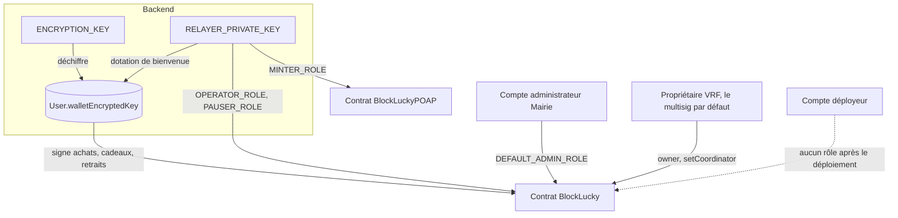

# Clés et garde des portefeuilles

BlockLucky manipule trois familles de clés Ethereum : les portefeuilles des citoyens, conservés par le backend ; le compte opérateur, qui signe les opérations de service ; et les comptes de la Mairie qui administrent le contrat. Cette page décrit qui détient quoi, quels pouvoirs chaque clé confère sur la chaîne, et comment réagir à une compromission. Le fonctionnement technique des portefeuilles est détaillé dans [Portefeuilles intégrés](../integration-blockchain/portefeuilles.md) et celui du client RPC dans [Client RPC et compte opérateur](../integration-blockchain/client-rpc.md).

## Vue d'ensemble

## Portefeuilles custodial des citoyens

| Propriété | Valeur |
|---|---|
| Création | `Wallet.createRandom()` d'ethers à l'inscription, au premier cadeau reçu ou au premier achat d'un compte ancien (`ensureWallet`) |
| Stockage | `User.walletEncryptedKey`, chiffré en AES-256-GCM au format `v2:` |
| Déchiffrement | À la volée, uniquement pour signer (`walletService.signerFor`) |
| Exposition | Jamais renvoyée au client, jamais journalisée, absente de l'export RGPD |
| Export par le citoyen | Non prévu |
| Suppression | Mise à `null` lors de l'anonymisation RGPD |

Le backend signe à la place du citoyen les opérations suivantes, toutes déclenchées par une requête authentifiée du citoyen lui-même :

| Opération | Fonction du contrat | Fichier |
|---|---|---|
| Achat de tickets | `buyTickets` | [`backend/src/blockchain/lottery.gateway.ts`](src:backend/src/blockchain/lottery.gateway.ts) |
| Cadeau d'un ticket | `buyTicketsFor(bénéficiaire, 1)` | idem |
| Retrait de la cagnotte | `claimPrize` | idem et [`backend/src/blockchain/chain-actions.ts`](src:backend/src/blockchain/chain-actions.ts) |
| Remboursement d'un tour annulé | `claimRefund` | [`backend/src/blockchain/chain-actions.ts`](src:backend/src/blockchain/chain-actions.ts) |

Ce modèle retire au citoyen toute manipulation de clé, mais fait de la Ville le dépositaire des fonds. Ses conséquences juridiques sont traitées dans [Crypto-actifs et MiCA](../juridique/crypto-actifs.md). Ses conséquences de sécurité sont les suivantes :

- le backend en fonctionnement peut signer pour n'importe quel citoyen ; une prise de contrôle du serveur équivaut à celle de tous les portefeuilles ;
- une copie de la base seule ne suffit pas : il faut aussi `ENCRYPTION_KEY` ;
- la perte de `ENCRYPTION_KEY` rend tous les portefeuilles inutilisables, sans recours (voir [Rotation](cryptographie-secrets.md#rotation)).

## Compte opérateur

`RELAYER_PRIVATE_KEY` est chargée par `chainClient.operator`, un `NonceManager` d'ethers, dans [`backend/src/blockchain/chain.client.ts`](src:backend/src/blockchain/chain.client.ts). Le backend s'en sert pour :

| Usage | Fonction | Rôle requis sur la chaîne |
|---|---|---|
| Dotation de bienvenue (`WELCOME_GRANT_WEI`, 0,5 ETH par défaut) | Transfert simple | Aucun, mais un solde suffisant |
| Demande de tirage (route ADMIN et keeper) | `requestDraw` | Aucun (fonction publique) |
| Clôture d'un tour expiré (keeper) | `closeExpiredRound` | Aucun (fonction publique) |
| Annulation et remboursement (route ADMIN `/api/lottery/refund`) | `cancelRound` | `OPERATOR_ROLE` |
| Disjoncteur (route ADMIN `/api/admin/circuit-breaker`) | `pause`, `unpause` | `PAUSER_ROLE` |
| Reversement de la commission | `withdrawFees` | `OPERATOR_ROLE` |
| Changement de trésorerie avant le reversement | `setTreasury` | `DEFAULT_ADMIN_ROLE` |
| Émission des badges POAP | `mintBadge` | `MINTER_ROLE` sur `BlockLuckyPOAP` |

> [!WARNING]
> `withdrawFees` du gateway appelle `setTreasury` quand l'adresse `multisigWallet` envoyée par l'administrateur diffère de la trésorerie enregistrée. Cela suppose que l'opérateur détienne `DEFAULT_ADMIN_ROLE`. Sur Sepolia, [`deploy-sepolia.ts`](src:smart-contract/scripts/deploy-sepolia.ts) ne le lui donne pas : le reversement ne fonctionne que vers `MAIRIE_TREASURY_ADDRESS`, et un changement de trésorerie passe par le multisig. En local, [`deploy-local.ts`](src:smart-contract/scripts/deploy-local.ts) le lui laisse en administrateur additionnel (sauf `LOCAL_STRICT_ROLES=true`) : un compte ADMIN de l'application peut alors rediriger la commission vers n'importe quelle adresse, ce qui est sans enjeu sur une chaîne jetable mais contredit l'objectif de rôles limités du [registre des risques](../juridique/registre-risques.md) (risque K1).

## Rôles sur la chaîne

Les rôles sont gérés par `AccessControl` d'OpenZeppelin dans [`smart-contract/contracts/BlockLucky.sol`](src:smart-contract/contracts/BlockLucky.sol) et [`smart-contract/contracts/BlockLuckyPOAP.sol`](src:smart-contract/contracts/BlockLuckyPOAP.sol).

| Rôle | Contrat | Fonctions | Attribué au déploiement à |
|---|---|---|---|
| `DEFAULT_ADMIN_ROLE` | Les deux | `setTreasury`, `setRoundConfig`, `setVrfConfig`, `setBaseUri`, `grantRole`, `revokeRole` | `MAIRIE_ADMIN_ADDRESS` |
| `OPERATOR_ROLE` | BlockLucky | `retryDraw`, `cancelRound`, `withdrawFees` | `OPERATOR_ADDRESS` |
| `PAUSER_ROLE` | BlockLucky | `pause`, `unpause` | `PAUSER_ADDRESS`, l'opérateur par défaut |
| `MINTER_ROLE` | BlockLuckyPOAP | `mintBadge` | `OPERATOR_ADDRESS` |
| Propriétaire (`owner`) | BlockLucky, via `ConfirmedOwner` hérité de `VRFConsumerBaseV2Plus` | `setCoordinator`, `transferOwnership` | `VRF_OWNER_ADDRESS` (l'administrateur par défaut), après `acceptOwnership` |

Les contrats sont construits avec le déployeur comme administrateur provisoire. Les deux scripts de déploiement répartissent ensuite les rôles avec la même bibliothèque, [`smart-contract/scripts/lib/roles.ts`](src:smart-contract/scripts/lib/roles.ts) : `planRoles` refuse une adresse absente, invalide ou nulle et un administrateur confondu avec l'opérateur (sauf `ALLOW_SHARED_ROLES=true`), `applyRoles` accorde les rôles, positionne la trésorerie, propose la propriété VRF, retire au déployeur ses rôles d'exploitation et le fait renoncer à `DEFAULT_ADMIN_ROLE`, et `roleProblems` arrête le script si un titulaire manque. Ce comportement est couvert par [`smart-contract/test/roles.test.ts`](src:smart-contract/test/roles.test.ts).

### Selon l'environnement

| Environnement | Administrateur | Opérateur | Propriétaire VRF |
|---|---|---|---|
| Blockchain locale ([`smart-contract/scripts/deploy-local.ts`](src:smart-contract/scripts/deploy-local.ts)) | Compte n°2 de Hardhat, plus l'opérateur en administrateur additionnel (sauf `LOCAL_STRICT_ROLES=true`) | Compte n°0 par défaut (`RELAYER_PRIVATE_KEY` de développement), ou `OPERATOR_PRIVATE_KEY` s'il est fourni ; trésorerie au compte n°1 | Compte n°2, qui accepte la propriété dans le script |
| Sepolia ([`smart-contract/scripts/deploy-sepolia.ts`](src:smart-contract/scripts/deploy-sepolia.ts)) | `MAIRIE_ADMIN_ADDRESS` (multisig), obligatoire ; le déployeur renonce à `DEFAULT_ADMIN_ROLE` | `OPERATOR_ADDRESS`, obligatoire ; trésorerie `MAIRIE_TREASURY_ADDRESS`, obligatoire | `VRF_OWNER_ADDRESS`, une fois qu'il a appelé `acceptOwnership` ; le déployeur jusque-là |

En local, la séparation est appliquée comme sur Sepolia, à une exception près : l'opérateur garde `DEFAULT_ADMIN_ROLE` pour que le reversement de commission puisse appeler `setTreasury`. Avec la clé de développement par défaut, l'opérateur est aussi le déployeur, qui garde alors ses rôles ; les clés locales sont de toute façon publiques. `LOCAL_STRICT_ROLES=true` reproduit exactement la configuration de Sepolia.

> [!IMPORTANT]
> Le propriétaire hérité de Chainlink peut remplacer le coordinateur VRF par une adresse de son choix, qui fournirait alors l'« aléa » et désignerait le gagnant. Les scripts de déploiement appellent `transferOwnership(VRF_OWNER_ADDRESS)` ; sur Sepolia, le multisig doit encore appeler `acceptOwnership()`, sans quoi le déployeur reste propriétaire. Il faut ensuite surveiller l'événement `CoordinatorSet`. Voir le [modèle de menaces](menaces.md#oracle-chainlink-vrf).

### Séparation recommandée

| Compte | Détenteur | Rôles |
|---|---|---|
| Multisignature de la Mairie | Élus et DSI | `DEFAULT_ADMIN_ROLE`, propriétaire VRF |
| Trésorerie | Multisignature distincte | Aucun rôle ; reçoit la commission |
| Opérateur backend | Serveur | `OPERATOR_ROLE`, `PAUSER_ROLE`, `MINTER_ROLE`, rien d'autre |

C'est la séparation que met en place `npm run deploy:sepolia` (variables `MAIRIE_ADMIN_ADDRESS`, `MAIRIE_TREASURY_ADDRESS`, `OPERATOR_ADDRESS`, `PAUSER_ADDRESS`, `VRF_OWNER_ADDRESS`). La route de trésorerie doit alors envoyer l'adresse de trésorerie déjà enregistrée ; tout changement de trésorerie passe par le multisig. Le multisig lui-même n'est pas créé par les scripts, qui ne vérifient pas non plus que l'adresse fournie en est un.

## Compromission et révocation

### Clé opérateur compromise

1. Mettre le contrat en pause depuis un autre compte détenant `PAUSER_ROLE` (l'administrateur), si l'attaquant n'a pas déjà agi.
2. Depuis le compte administrateur, appeler `revokeRole(OPERATOR_ROLE, ancien)`, `revokeRole(PAUSER_ROLE, ancien)` et, sur le contrat POAP, `revokeRole(MINTER_ROLE, ancien)`. Si l'ancien opérateur détenait `DEFAULT_ADMIN_ROLE`, le révoquer en dernier, depuis un autre administrateur.
3. Générer une nouvelle clé, accorder les trois rôles à la nouvelle adresse, la financer.
4. Remplacer `RELAYER_PRIVATE_KEY` dans l'environnement du backend et du worker, redémarrer.
5. Transférer les ETH restants de l'ancien compte s'ils sont encore accessibles.

Ce que l'attaquant peut faire avant la révocation : pauser le contrat, annuler le tour en cours (les participants restent remboursables), vider le solde de l'opérateur, émettre de faux badges POAP. Il ne peut ni désigner un gagnant ni retirer la cagnotte, sauf s'il détient aussi `DEFAULT_ADMIN_ROLE` ou la propriété VRF.

### `ENCRYPTION_KEY` ou base de données compromise

Avec la base **et** la clé, l'attaquant peut signer pour chaque citoyen, donc acheter des tickets avec leurs fonds ou retirer leurs gains vers leur propre portefeuille, qu'il contrôle alors. Il faut :

1. mettre le contrat en pause (achats bloqués ; `claimPrize` et `claimRefund` restent possibles, car ils ne sont pas soumis à `whenNotPaused`) ;
2. arrêter le backend ;
3. générer pour chaque citoyen un nouveau portefeuille, puis transférer les fonds de l'ancien au nouveau avant l'attaquant, ce qui suppose un script qui n'existe pas dans le dépôt ;
4. remplacer `ENCRYPTION_KEY` après re-chiffrement.

Sur un réseau de test, la réponse raisonnable est de redéployer et de redistribuer des ethers fictifs. Le [plan de réponse aux incidents](../infrastructure/incidents.md) et les [runbooks blockchain](../infrastructure/runbooks-blockchain.md) donnent les procédures d'exploitation.

### Clé administrateur ou déployeur compromise

C'est le scénario le plus grave : l'attaquant peut changer la configuration des tours, la trésorerie, les rôles et, avec la propriété VRF, le coordinateur. Une fois le déploiement terminé et `acceptOwnership` signé par le multisig, la clé du déployeur ne détient plus aucun de ces pouvoirs : sa fuite n'a d'effet qu'avant ce moment. Le contrat n'étant pas modifiable, la seule réponse est de le mettre en pause s'il en est encore temps, d'informer les participants et de redéployer. D'où l'importance d'un multisig pour ces deux comptes.

## Limites connues

| Limite | Détail |
|---|---|
| Pas d'export de clé | Le citoyen ne peut pas récupérer sa clé pour passer à un portefeuille non custodial. |
| Pas de surveillance on-chain | Aucun composant n'alerte sur `RoleGranted`, `RoleRevoked`, `CoordinatorSet` ou `OwnershipTransferred`. |
| Compte unique pour la dotation | L'épuisement du solde opérateur bloque l'inscription avec dotation ; voir les [runbooks blockchain](../infrastructure/runbooks-blockchain.md). |
