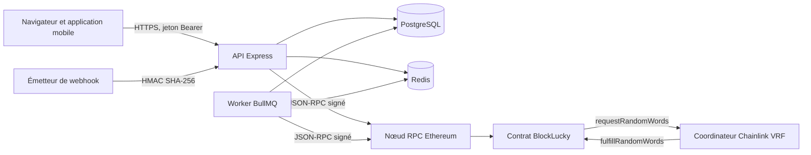

# Modèle de menaces

Cette page recense les menaces qui pèsent sur BlockLucky, classées selon la méthode STRIDE (usurpation, altération, répudiation, divulgation, déni de service, élévation de privilèges). Pour chaque menace, elle indique la protection en place dans le dépôt, le fichier qui la met en œuvre et le risque qui reste. Les pages suivantes de cette partie détaillent chaque protection. Les notes de probabilité et d'impact sont tenues dans le [registre des risques](../juridique/registre-risques.md).

Le modèle décrit le dépôt tel qu'il est : un pilote sur réseau de test (Hardhat local ou Sepolia), avec des ethers sans valeur. Plusieurs risques acceptés ici deviendraient bloquants avec des fonds réels. La page [Crypto-actifs et MiCA](../juridique/crypto-actifs.md) en tire les conséquences.

## Périmètre et actifs

| Actif | Où il vit | Pourquoi il compte |
|---|---|---|
| Clés privées des portefeuilles citoyens | Colonne `User.walletEncryptedKey`, chiffrée en AES-256-GCM | Elles signent les achats, les cadeaux et les retraits de gains |
| Clé du compte opérateur `RELAYER_PRIVATE_KEY` | Variable d'environnement du backend et du worker | Elle verse la dotation de bienvenue et porte des rôles du contrat |
| Clé de chiffrement `ENCRYPTION_KEY` | Variable d'environnement | Elle protège toutes les clés citoyennes, les secrets TOTP et les pièces d'identité |
| Secret de signature `JWT_SECRET` | Variable d'environnement | Il permet de fabriquer n'importe quelle session |
| Secret `WEBHOOK_SECRET` | Variable d'environnement | Il authentifie les événements blockchain entrants |
| Cagnotte et commission | Solde du contrat `BlockLucky` | Ce sont les seuls fonds en jeu |
| Équité du tirage | Contrat et oracle Chainlink VRF | C'est la promesse centrale du projet |
| Données personnelles | PostgreSQL (email, historique) et Redis (préférences, codes) | Elles relèvent du RGPD |
| Pièces d'identité en attente | Table `IdentityDocument`, recto et verso chiffrés en AES-256-GCM jusqu'à la décision | Donnée la plus sensible du système : une fuite expose l'identité civile du citoyen |
| Mots de passe | Colonne `User.passwordHash`, empreinte bcrypt | Souvent réutilisés par les citoyens sur d'autres services |
| Comptes ADMIN et PARTNER | Table `User`, colonne `role` | Ils donnent accès au tirage, à la trésorerie et aux codes promo |

## Frontières de confiance

Quatre frontières concentrent les contrôles :

1. **Client vers API.** Tout ce qui vient du client est non fiable. Le backend valide chaque corps par Zod, authentifie par JWT et relit le rôle en base.
2. **API vers stockage.** PostgreSQL et Redis ne sont exposés que sur `127.0.0.1` dans [`docker-compose.yml`](src:docker-compose.yml). Les secrets sensibles stockés en base sont chiffrés ou hachés.
3. **Backend vers chaîne.** Le backend signe avec la clé du citoyen ou avec la clé opérateur. La chaîne fait foi : la base n'est qu'une projection reconstruite par l'indexeur.
4. **Contrat vers oracle.** Seul le coordinateur VRF enregistré peut fournir l'aléa du tirage.

## Menaces sur l'application

| STRIDE | Menace | Protection en place | Risque résiduel |
|---|---|---|---|
| Usurpation | Connexion au compte d'un autre citoyen | Mot de passe haché par bcrypt, code à 6 chiffres envoyé par email, haché en HMAC, valide 10 minutes, 5 essais par code, blocage du compte après 10 échecs par heure ([Authentification](authentification.md)) | La connexion par code email et la connexion Google ou Apple restent ouvertes à tous les comptes : l'adresse email reste un facteur suffisant |
| Usurpation | Jeton Google ou Apple forgé ou destiné à une autre application | Signature, émetteur, audience (`GOOGLE_CLIENT_IDS`, `APPLE_CLIENT_IDS`) et `email_verified` vérifiés côté serveur | Rattachement au compte par l'adresse email seule ; la sécurité du compte dépend de celle du compte du fournisseur |
| Usurpation | Mineur qui joue avec le compte ou la pièce d'un adulte | Pièce d'identité examinée par un agent de la Mairie ([Autorisations](autorisations.md#verification-d-age)) | Aucun contrôle de correspondance entre la personne et la pièce (pas de selfie ni de vérification du document) ; achat direct sur le contrat sans contrôle |
| Usurpation | Jeton JWT forgé ou rejoué | Algorithme HS256 imposé, `iss`, `aud`, `exp` et `jti` vérifiés, liste de révocation dans Redis ([Sessions](sessions.md)) | Révocation perdue si Redis tombe (repli mémoire par processus) |
| Usurpation | Webhook blockchain forgé | Signature HMAC-SHA-256 sur `t.corps`, fenêtre de 5 minutes, rejeu refusé pendant 7 jours ([Protection des API](protection-api.md)) | Aucun |
| Altération | Injection SQL | Requêtes Prisma paramétrées, aucun SQL brut construit à partir d'une entrée | Aucun connu |
| Altération | Modification du rôle ou de champs protégés par affectation de masse | Schémas Zod explicites, champs non listés ignorés ([Validation](validation.md)) | Aucun connu |
| Altération | Partenaire qui agit sur l'entreprise d'un autre | `assertPartnerAccess` compare `Partner.ownerId` au compte appelant ([Autorisations](autorisations.md)) | Aucun connu |
| Répudiation | Administrateur qui nie une action | Journal `ADMIN_AUDIT:*` pour le disjoncteur, la trésorerie, le statut des partenaires, les exports, la consultation des pièces d'identité et les décisions sur l'âge | Le tirage et le remboursement manuels ne sont pas journalisés dans ce journal ; la chaîne garde en revanche une trace publique |
| Divulgation | Fuite de la base | Clés de portefeuille, secrets TOTP et pièces d'identité chiffrés, mots de passe, codes de secours et jetons RGPD hachés ([Cryptographie](cryptographie-secrets.md)) | Les emails sont en clair en base ; les pièces en attente sont lisibles avec `ENCRYPTION_KEY` |
| Divulgation | Consultation abusive des pièces d'identité | Routes réservées aux ADMIN avec 2FA, images effacées dès la décision, chaque consultation journalisée, `Cache-Control: no-store` | Tout ADMIN peut consulter toutes les pièces en attente ; une pièce jamais traitée reste stockée sans limite de durée |
| Divulgation | Secrets dans les logs ou le dépôt | Emails masqués dans les logs, gitleaks sur tout l'historique ([Chaîne logicielle](chaine-logicielle.md)) | Aucun connu |
| Divulgation | Énumération des comptes | Message d'erreur unique sur un code invalide et sur un mot de passe faux, réponse identique de `/password/forgot`, temps de réponse égalisé par une empreinte factice | La réponse de `POST /api/auth/login` diffère pour un compte protégé par TOTP ; `/signup` répond 409 pour une adresse déjà inscrite |
| Déni de service | Saturation de l'API ou force brute | Limites de débit partagées dans Redis, corps limité à 1 Mo (12 Mo et 10 envois par heure pour les pièces d'identité) | `passOnStoreError: true` : sans Redis, chaque instance retombe sur une limite locale |
| Déni de service | Calcul bcrypt provoqué en masse sur `/signin` | 30 requêtes en 10 minutes par adresse IP | `bcryptjs` est en JavaScript pur : une attaque distribuée consomme le processeur de l'API |
| Déni de service | Chat temps réel abusé | Messages tronqués à 280 caractères | Pas de limite de débit ni d'authentification pour `chat:send` |
| Élévation | Utilisateur qui appelle une route ADMIN | `requireRoles('ADMIN')`, rôle relu en base, 2FA exigée pour l'ADMIN | Voir la limite sur la 2FA dans [Authentification](authentification.md#limites-connues) |
| Élévation | Jeton conservé après une rétrogradation | Rôle du jeton comparé au rôle en base à chaque route protégée par `requireRoles` | Les routes sans `requireRoles` (profil, achat) acceptent le jeton jusqu'à sa révocation ou son expiration |

## Menaces propres à la blockchain

### Clé opérateur

Le compte opérateur (`RELAYER_PRIVATE_KEY`) signe la dotation de bienvenue, la pause du contrat, l'annulation d'un tour et le reversement de la commission. Son code est dans [`backend/src/blockchain/chain.client.ts`](src:backend/src/blockchain/chain.client.ts). Le détail des rôles est sur la page [Clés et garde des portefeuilles](cles-portefeuilles.md).

| Scénario | Conséquence | Protection | Limite |
|---|---|---|---|
| Fuite de la clé | L'attaquant peut mettre le contrat en pause, annuler le tour en cours et vider les ETH de l'opérateur | Valeur de développement refusée en production par [`backend/src/config/env.config.ts`](src:backend/src/config/env.config.ts), gitleaks, révocation des rôles par l'administrateur | En local, l'opérateur est aussi l'administrateur et le propriétaire VRF du contrat |
| Annulation abusive | Un tour en cours est annulé, tous les participants doivent réclamer leur remboursement | `claimRefund` rend la totalité des contributions | Aucune perte, mais le tirage n'a pas lieu |
| Épuisement du solde | Plus de dotation de bienvenue | Dotation versée une seule fois par compte (verrou Redis et `welcomeGrantTxHash`) | Réapprovisionnement manuel |

### Garde des clés citoyennes

Le portefeuille est custodial : le backend crée la clé, la chiffre et signe à la place du citoyen. Quiconque obtient à la fois la base et `ENCRYPTION_KEY` peut signer pour tous les citoyens. Le backend en fonctionnement dispose par construction de ce pouvoir : une compromission du serveur équivaut à la compromission de tous les portefeuilles. Cette concentration est acceptable sur un réseau de test. Elle ne l'est pas avec des fonds réels.

### Oracle Chainlink VRF

Le gagnant est `randomWords[0] % ticketCount`, calculé dans `fulfillRandomWords` du contrat [`smart-contract/contracts/BlockLucky.sol`](src:smart-contract/contracts/BlockLucky.sol). Le hasard ne passe jamais par le backend. Trois risques demeurent :

| Risque | Situation dans le code |
|---|---|
| L'oracle ne répond pas | `retryDraw` (rôle opérateur) relance la demande après `drawTimeout` ; `closeExpiredRound` permet ensuite l'annulation avec remboursement |
| Nouvelle demande d'aléa | `retryDraw` émet une nouvelle demande et ignore la réponse de l'ancienne. Si l'opérateur et le fournisseur de l'aléa s'entendaient pour retenir une réponse défavorable, ils pourraient « relancer les dés ». La documentation de Chainlink déconseille de redemander de l'aléa pour cette raison. Le délai `drawTimeout` limite ce scénario sans l'exclure. |
| Remplacement du coordinateur | Le contrat hérite de `VRFConsumerBaseV2Plus`, donc de `ConfirmedOwner`. Le **propriétaire** (le compte qui a déployé le contrat) peut appeler `setCoordinator` et désigner une autre adresse comme source d'aléa, qui choisirait alors le gagnant. Ce propriétaire est distinct des rôles `AccessControl`. Les scripts de déploiement ne transfèrent pas la propriété. |

> [!WARNING]
> Le pouvoir de `setCoordinator` donne au déployeur la possibilité théorique de truquer un tirage. L'appel émet un événement `CoordinatorSet` public, donc détectable. Avant toute exploitation sérieuse, il faut transférer la propriété à un compte multisignature de la Mairie (`transferOwnership` puis `acceptOwnership`) et surveiller cet événement.

### Contrat

Les protections du contrat (garde de réentrance, retraits à l'initiative du bénéficiaire, commission plafonnée à 20 %, disjoncteur) sont décrites sur la page [Sécurité du contrat](../smart-contracts/securite.md). Le contrat n'est pas modifiable : une faille découverte après déploiement impose une pause puis un redéploiement.

### Front-running et ordre des transactions

| Scénario | Analyse |
|---|---|
| Acheter un ticket après avoir vu l'aléa | Impossible : dès `requestDraw`, le tour passe à l'état `Drawing` et `_buyTickets` refuse tout achat (`RoundNotOpen`). |
| Prévoir le gagnant avant la demande | Impossible : l'aléa VRF n'existe pas encore quand les achats sont fermés. |
| Annuler le tour en voyant la réponse VRF | **Possible pour un porteur du rôle opérateur.** `cancelRound` n'impose aucune condition d'état ni de délai. Un opérateur qui observe dans le mempool la transaction `fulfillRandomWords` peut en déduire le gagnant et la devancer avec `cancelRound`. Les participants sont remboursés intégralement, mais le tirage est censuré. |
| Déclencher le tirage au moment choisi | `requestDraw` est public dès que `isDrawReady()` est vrai. N'importe qui peut le déclencher ; cela ne donne aucun avantage, car l'aléa vient de l'oracle. |
| Devancer un retrait | `claimPrize` et `claimRefund` vérifient l'appelant (`msg.sender`) : une autre adresse ne peut pas retirer à sa place. |

> [!IMPORTANT]
> Restreindre `cancelRound` à l'état `Open`, ou exiger que `drawTimeout` soit écoulé quand le tour est en `Drawing`, supprimerait la possibilité de censure. Ce changement demande un redéploiement du contrat (voir [Modifier le contrat](../guides/modifier-contrat.md)).

## Menaces hors périmètre

- Déni de service volumétrique contre l'hébergement : il relève de l'hébergeur et d'un service de protection en amont, non configuré dans le dépôt.
- Compromission du poste d'un développeur ou d'un administrateur.
- Attaque sur le réseau Ethereum lui-même ou sur l'infrastructure Chainlink.
- Ingénierie sociale des équipes de la Ville, exclue par [la politique de signalement](signalement.md).

## Mettre à jour le modèle

Le modèle est à revoir à chaque nouvelle version du contrat, à chaque nouvelle route d'API et après chaque incident traité selon le [plan de réponse aux incidents](../infrastructure/incidents.md). Toute nouvelle menace notable entre aussi dans le [registre des risques](../juridique/registre-risques.md).
