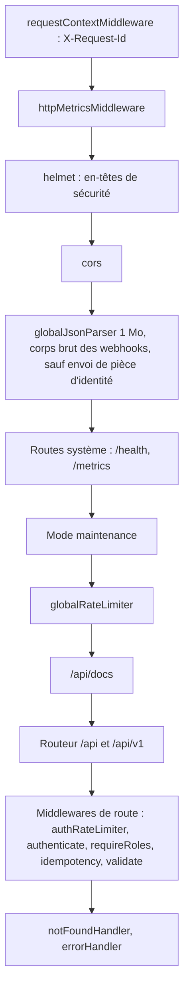

# Protection des API

Cette page décrit les protections transverses de l'API Express : limitation de débit, idempotence des opérations sensibles, authentification des webhooks, politique CORS, confiance accordée aux proxys et en-têtes de réponse. L'ordre des middlewares est fixé dans [`backend/src/app.ts`](src:backend/src/app.ts).

## Ordre de la chaîne de middlewares



Deux conséquences de cet ordre :

- les routes de santé et `/metrics` ne sont pas soumises à la limite globale, pour que les sondes ne soient jamais bloquées ;
- en mode maintenance (`MAINTENANCE_MODE=true`), toutes les routes `/api/*` sauf `/api/admin/*` répondent 503 avec `Retry-After: 300`, avant même la limitation de débit.

## Limitation de débit

[`backend/src/middlewares/rateLimiter.middleware.ts`](src:backend/src/middlewares/rateLimiter.middleware.ts) utilise `express-rate-limit` avec un stockage partagé `rate-limit-redis`.

| Limiteur | Fenêtre | Requêtes par adresse IP | Portée |
|---|---|---|---|
| `globalRateLimiter` | 15 minutes | 300 | Toute l'API sous `/api` |
| `authRateLimiter` | 10 minutes | 30 | `POST /api/auth/signup`, `/signin`, `/password/forgot`, `/password/reset`, `/password/change`, `/email/change`, `/email/confirm`, `/oauth/google`, `/login`, `/2fa/verify`, `/2fa/disable` |
| `identityUploadRateLimiter` | 1 heure | 10 | `POST /api/user/identity` |
| `supportRateLimiter` | 1 heure | 5, comptées par compte (`user:<id>`) et non par adresse IP, sauf requête sans utilisateur | `POST /api/user/support` |

En environnement `test`, les quatre limites passent à 10 000 pour ne pas gêner les suites de tests.

| Paramètre | Valeur | Effet |
|---|---|---|
| `standardHeaders: 'draft-7'` | En-têtes `RateLimit` et `RateLimit-Policy` | Le client connaît son quota restant |
| `legacyHeaders: false` | Pas de `X-RateLimit-*` | |
| Préfixe Redis | `<REDIS_KEY_PREFIX>:<NODE_ENV>:ratelimit:<global, auth, identity ou support>:` | Compteurs partagés entre toutes les instances de l'API |
| `passOnStoreError: true` | Si Redis échoue, la requête passe | L'API reste disponible pendant une panne de Redis |

Le limiteur des pièces d'identité est placé avant `authenticate` et avant l'analyse du corps de 12 Mo : un client qui dépasse son quota est refusé sans que le serveur lise le corps. À l'inverse, `supportRateLimiter` est placé après `authenticate`, pour compter les messages par compte : plusieurs citoyens derrière la même adresse IP ne se partagent pas le quota. Le compteur d'échecs de code et de mot de passe par compte, décrit dans [Authentification](authentification.md#parametres-du-code), complète la limite par IP : il ne dépend pas de l'adresse de l'attaquant.

> [!NOTE]
> Le choix `passOnStoreError: true` privilégie la disponibilité. Pendant une panne de Redis, la seule limite restante sur les codes est le blocage par compte, lui-même tenu dans le repli mémoire propre à chaque processus. Voir l'[ADR 0002](../architecture/adr/0002-redis-files-et-repli-memoire.md).

## Adresse IP du client et `TRUST_PROXY`

La limitation par IP n'a de sens que si `req.ip` est la vraie adresse du client. Derrière un proxy inverse, Express voit l'adresse du proxy, à moins qu'on ne l'autorise à lire `X-Forwarded-For`. Le réglage est `TRUST_PROXY`, interprété par `trustProxy` de [`backend/src/config/env.config.ts`](src:backend/src/config/env.config.ts) puis passé à `app.set('trust proxy', ...)`.

| Valeur | Interprétation | Usage |
|---|---|---|
| `false` (défaut) | Aucun proxy de confiance | API exposée directement |
| `true` | Toute la chaîne `X-Forwarded-For` est crue | **À éviter** : un client peut forger l'en-tête et choisir son adresse, donc contourner la limite |
| Un entier, par exemple `1` | Nombre de proxys de confiance devant l'API | Cas normal derrière un seul proxy (Caddy, nginx) |
| Une autre chaîne, par exemple `loopback` ou une liste de sous-réseaux | Transmise telle quelle à Express | Proxys identifiés par leur adresse |

Avec `false` derrière un proxy, toutes les requêtes semblent venir de la même adresse : la limite globale de 300 requêtes s'applique alors à l'ensemble des utilisateurs. La configuration de déploiement est décrite dans [Déploiement sur etherbay.tech](../infrastructure/deploiement-etherbay.md).

## Idempotence

[`backend/src/middlewares/idempotency.middleware.ts`](src:backend/src/middlewares/idempotency.middleware.ts) est placé sur les routes qui déplacent de la valeur :

| Route | Risque couvert |
|---|---|
| `POST /api/lottery/buy` | Double achat après une nouvelle tentative réseau |
| `POST /api/lottery/gift` | Double cadeau |
| `POST /api/lottery/claim-prize` | Double demande de retrait |
| `POST /api/marketplace/claim` | Double dépense d'EtherPoints |
| `POST /api/marketplace/scratch` | Double achat d'un ticket à gratter |

Fonctionnement :

| Étape | Comportement |
|---|---|
| En-tête absent | La requête est traitée normalement, sans protection |
| En-tête invalide | 400 si `Idempotency-Key` ne respecte pas `^[A-Za-z0-9_-]{8,128}$` |
| Première requête | Verrou `__pending__` posé par `setIfAbsent` pendant 60 secondes |
| Requête identique pendant le traitement | 409 avec `Retry-After: 1` |
| Requête identique après une réponse inférieure à 500 | Réponse rejouée telle quelle, avec `Idempotent-Replayed: true`, pendant 24 heures |
| Réponse 500 ou plus | Le verrou est supprimé : une nouvelle tentative est possible |

La clé de stockage combine l'utilisateur, la méthode, le chemin et la clé fournie : `idempotency:<userId>:<méthode>:<chemin>:<clé>`. Deux utilisateurs qui choisiraient la même clé ne se gênent donc pas. Le comportement est testé dans [`backend/__tests__/api/idempotency.test.ts`](src:backend/__tests__/api/idempotency.test.ts).

L'idempotence HTTP s'ajoute aux garanties de la base (`@@unique([lotteryId, ticketIndex])` sur `Ticket`) et des files BullMQ (identifiants de tâche uniques), décrites dans [Files et workers](../backend/files-workers.md).

## Webhook signé

`POST /api/webhooks/blockchain` reçoit des événements d'un indexeur externe. Il n'utilise pas de jeton utilisateur mais une signature, vérifiée par [`backend/src/api/webhooks/webhook-signature.ts`](src:backend/src/api/webhooks/webhook-signature.ts).

### Format

```http
POST /api/webhooks/blockchain
Content-Type: application/json
x-webhook-signature: t=1762867200,v1=5f0c...64 caractères hexadécimaux

{"eventType":"WINNER_PICKED","payload":{"contractRoundId":3,"winnerWallet":"0x..."}}
```

`v1` vaut `HMAC-SHA-256(WEBHOOK_SECRET, "<t>.<corps brut>")` en hexadécimal. Le corps brut est capturé par l'option `verify` du `globalJsonParser`, uniquement pour les chemins `/api/webhooks/` et `/api/v1/webhooks/`, afin que la signature porte sur les octets reçus et non sur un JSON reformaté.

### Contrôles

| Contrôle | Résultat en cas d'échec |
|---|---|
| En-tête et corps brut présents | 401 |
| `t` entier, `v1` de 64 caractères hexadécimaux | 401 |
| Écart entre `t` et l'horloge du serveur inférieur ou égal à 5 minutes | 401 |
| HMAC égal, comparé par `safeEqual` | 401 |
| Signature jamais vue (clé Redis `webhook:seen:<signature>` posée pour 7 jours) | 200 `{ "duplicate": true }`, sans traitement |
| Corps conforme à `blockchainWebhookSchema` | 400 |

Le rejeu d'un événement déjà reçu répond 200 pour que l'émetteur ne réessaie pas indéfiniment. La fonction `signWebhookPayload` du même fichier produit l'en-tête attendu et sert aux tests. Le module est décrit dans [Webhooks et système](../backend/modules/webhooks-systeme.md).

## CORS

```typescript
cors({
  origin: (origin, callback) => {
    callback(null, !origin || corsOrigins.includes(origin));
  },
  credentials: true,
  exposedHeaders: ['X-Request-Id', 'RateLimit', 'RateLimit-Policy', 'Retry-After'],
})
```

| Élément | Valeur |
|---|---|
| Origines autorisées | `FRONTEND_URL` plus la liste `CORS_ORIGINS` (séparée par des virgules), dédoublonnées |
| Requête sans en-tête `Origin` | Acceptée : applications mobiles, outils en ligne de commande, appels serveur à serveur |
| Origine non listée | Pas d'en-tête `Access-Control-Allow-Origin` : le navigateur bloque la lecture de la réponse |
| `credentials: true` | Autorise les cookies, que l'API n'utilise pas ; l'authentification passe par l'en-tête `Authorization` |
| Socket.IO | Même liste `corsOrigins` dans [`backend/src/socket/socket.handler.ts`](src:backend/src/socket/socket.handler.ts) |

CORS protège les utilisateurs d'un navigateur contre un site tiers ; il ne protège pas l'API contre un client qui n'est pas un navigateur. Comme le jeton n'est jamais envoyé automatiquement par le navigateur, l'API n'est pas exposée aux attaques CSRF.

## En-têtes de réponse

`helmet()` est appliqué avec sa configuration par défaut. Il pose notamment `Content-Security-Policy` (politique par défaut de helmet), `Strict-Transport-Security`, `X-Content-Type-Options: nosniff`, `X-Frame-Options: SAMEORIGIN`, `Referrer-Policy: no-referrer`, `Cross-Origin-Opener-Policy` et `Cross-Origin-Resource-Policy`, et retire `X-Powered-By`. L'API ne renvoyant que du JSON (hors Swagger UI et images POAP), ces en-têtes servent surtout de défense en profondeur. Les en-têtes des frontends sont décrits dans [Navigateur et mobile](navigateur-mobile.md).

Chaque réponse porte `X-Request-Id`, repris de l'en-tête entrant s'il est valide, sinon de `traceparent`, sinon généré. Il permet de retrouver la requête dans les journaux sans exposer de détail technique au client.

## Délais et taille

| Paramètre | Valeur par défaut | Variable |
|---|---|---|
| Durée maximale d'une requête | 30 secondes | `HTTP_REQUEST_TIMEOUT_MS` |
| Keep-alive | 65 secondes, en-têtes à 66 secondes | `HTTP_KEEP_ALIVE_TIMEOUT_MS` |
| Délai d'une requête SQL | 15 secondes, réponse 503 au-delà | `DB_STATEMENT_TIMEOUT_MS` |
| Commande Redis de cache | 500 millisecondes, puis repli mémoire | Constante de [`backend/src/config/redis.config.ts`](src:backend/src/config/redis.config.ts) |
| Corps de requête | 1 Mo, 12 Mo pour l'envoi d'une pièce d'identité | [`body-parser.middleware.ts`](src:backend/src/middlewares/body-parser.middleware.ts) |

Ces délais limitent l'effet des clients lents (attaque de type Slowloris) et des dépendances qui ne répondent plus. Ils sont fixés dans [`backend/src/server.ts`](src:backend/src/server.ts).

## Limites connues

| Limite | Détail |
|---|---|
| Pas de WAF ni de protection DDoS | À fournir par l'hébergement ou un service en amont. |
| Socket.IO sans limite de débit | Un client, même anonyme, peut diffuser des messages de chat à tous les connectés sans quota. |
| Idempotence facultative et inutilisée par les clients | Une requête sans `Idempotency-Key` n'est pas protégée et le serveur ne l'exige pas. Ni le web ni le mobile n'envoient cet en-tête aujourd'hui : la protection ne joue que pour un client qui la demande explicitement. Sur mobile, une nouvelle tentative d'achat de ticket à gratter peut ainsi débiter deux fois les EtherPoints. |
| Swagger UI public | Voir [Autorisations](autorisations.md#limites-connues). |
