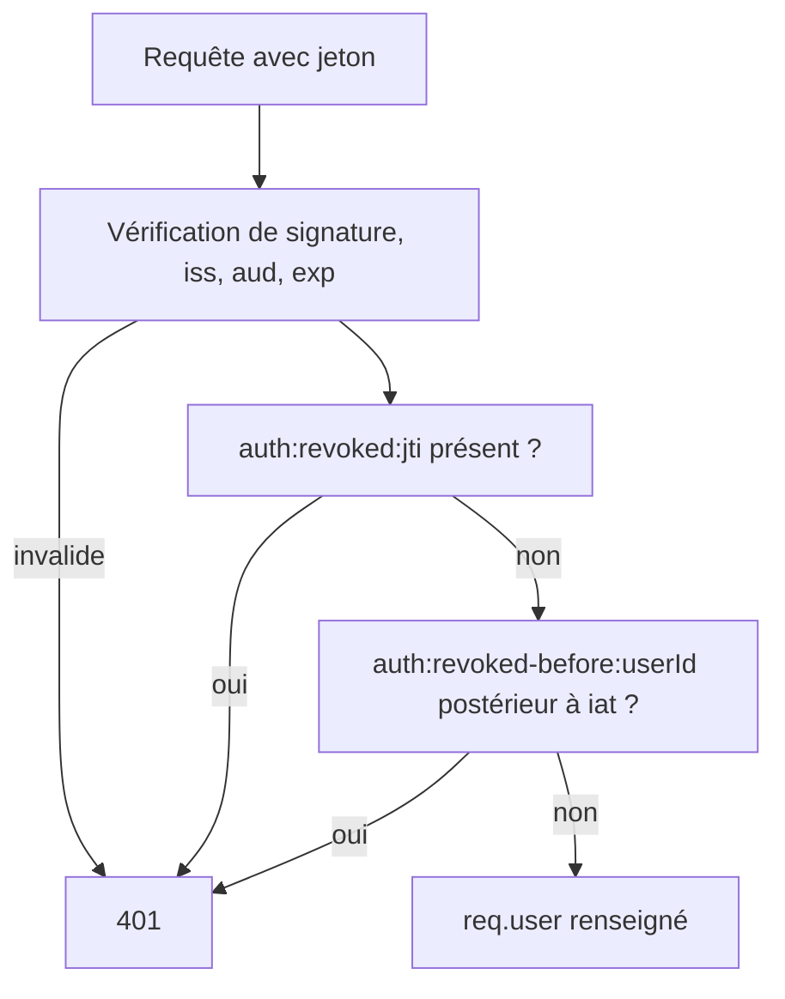

# Sessions

Une session BlockLucky est un jeton JWT signé par le backend, transmis par le client dans l'en-tête `Authorization: Bearer <jeton>`. Aucun cookie de session n'est utilisé. La révocation repose sur deux listes tenues dans Redis. Le code est concentré dans [`backend/src/services/session.service.ts`](src:backend/src/services/session.service.ts) et [`backend/src/middlewares/auth.middleware.ts`](src:backend/src/middlewares/auth.middleware.ts).

## Contenu du jeton

| Revendication | Valeur |
|---|---|
| `userId` | Identifiant du compte (UUID v7) |
| `walletAddress` | Adresse du portefeuille intégré |
| `role` | `USER`, `PARTNER` ou `ADMIN` au moment de la connexion |
| `twoFactorVerified` | Toujours `true` ; non utilisé par les contrôles |
| `iss` | `blocklucky-api` |
| `aud` | `blocklucky-clients` |
| `jti` | UUID aléatoire propre à la session |
| `iat`, `exp` | Date d'émission et d'expiration |

Le jeton ne contient ni email ni secret. Il est signé mais pas chiffré : son contenu est lisible par quiconque le détient.

## Signature et vérification

| Contrôle | Valeur dans le code |
|---|---|
| Algorithme | `HS256` uniquement (`algorithms: ['HS256']`) : un jeton `none` ou RS256 est refusé |
| Secret | `JWT_SECRET`, au moins 16 caractères, valeur de développement refusée en production |
| Émetteur et audience | Vérifiés ; un jeton sans `iss` est refusé |
| Tolérance d'horloge | 30 secondes |
| Champs obligatoires | `jti` et `userId` ; sinon `Jeton invalide` |
| Révocation | Consultée à chaque requête authentifiée |

Le test `refuse un jeton signé avec un autre algorithme ou sans émetteur` de [`backend/__tests__/api/auth-security.test.ts`](src:backend/__tests__/api/auth-security.test.ts) vérifie ces règles.

## Durée

La durée vient de `JWT_EXPIRES_IN`, au format `<nombre><s|m|h|d>`, par défaut `12h`. Il n'y a pas de jeton de rafraîchissement : à l'expiration, l'utilisateur se reconnecte avec son mot de passe, un compte Google ou Apple, ou un nouveau code. Ce choix simplifie le modèle (pas de rotation de jetons à gérer) au prix d'une reconnexion deux fois par jour au plus.

## Révocation



Deux mécanismes complémentaires :

| Mécanisme | Clé Redis | Effet | Durée de conservation |
|---|---|---|---|
| Révocation d'une session | `auth:revoked:<jti>` | Ce jeton précis est refusé | Durée restante du jeton multipliée par 1,2, plus 30 secondes |
| Révocation de toutes les sessions d'un compte | `auth:revoked-before:<userId>` contenant un horodatage | Tout jeton dont `iat` est antérieur est refusé | 30 jours |

Les clés Redis sont préfixées par `REDIS_KEY_PREFIX` et l'environnement (par exemple `blocklucky:production:auth:revoked:...`). Leur liste complète est sur la page [Données Redis](../base-de-donnees/redis.md).

L'horodatage de révocation globale vaut l'instant de la révocation moins une seconde. Un jeton émis dans la seconde qui précède la révocation peut donc survivre ; c'est ce qui permet au jeton délivré juste après l'activation de la 2FA de rester valide.

### Quand les sessions sont révoquées

| Événement | Portée | Code |
|---|---|---|
| `POST /api/auth/logout` | Session courante | `sessionService.revoke` |
| `POST /api/auth/logout` avec `{ "allDevices": true }` | Toutes les sessions du compte | `sessionService.revokeAllForUser` |
| Activation de la 2FA (application ou email) | Toutes les sessions | `verify2FA` dans [`backend/src/api/auth/auth.services.ts`](src:backend/src/api/auth/auth.services.ts) |
| Réinitialisation ou définition du mot de passe (`/password/reset`) | Toutes les sessions | `resetPassword`, même fichier |
| Changement ou définition du mot de passe depuis un compte connecté (`/password/change`) | Toutes les sessions, puis une nouvelle session est délivrée à l'appareil qui a fait la demande | `changePassword`, même fichier |
| Confirmation d'une suppression RGPD | Toutes les sessions | `confirmGdprAccountDeletion` dans [`backend/src/api/user/user.services.ts`](src:backend/src/api/user/user.services.ts) |
| Changement de rôle ou suppression du compte en base | Accès aux routes protégées par `requireRoles` | Comparaison du rôle du jeton au rôle en base |

La désactivation de la 2FA et le changement d'adresse email (`/email/confirm`) ne révoquent pas les sessions existantes.

## Déconnexion

```http
POST /api/auth/logout
Authorization: Bearer <jeton>
Content-Type: application/json

{ "allDevices": true }
```

La réponse contient `{ "loggedOut": true, "allDevices": true }` et l'en-tête `Clear-Site-Data: "cache", "cookies", "storage"`, qui demande au navigateur d'effacer les données du site. Le web appelle cette route depuis `useAuth` ([`frontend-web/src/hooks/useAuth.ts`](src:frontend-web/src/hooks/useAuth.ts)) avant de vider son état ; le mobile fait de même dans [`mobile-app/src/hooks/useAuth.ts`](src:mobile-app/src/hooks/useAuth.ts). Le bouton « Déconnecter tous mes appareils » du profil web envoie `allDevices: true`. Le mobile n'a plus de bouton équivalent depuis la refonte des paramètres : `signOutEverywhere` reste dans `useAuth` sans être appelé, et un changement de mot de passe est le moyen de déconnecter les autres appareils.

Côté web, une réponse 401 alors qu'un jeton était présent déclenche la déconnexion locale ([`frontend-web/src/store/api/baseApi.ts`](src:frontend-web/src/store/api/baseApi.ts)). Le mobile n'a pas cette garde : une session révoquée y reste affichée jusqu'à la déconnexion manuelle.

## Droits relus à chaque requête

`requireRoles` ne fait pas confiance au rôle du jeton. Il relit `role`, `deletedAt` et `isTwoFactorEnabled` en base et répond 403 « Droits révoqués ou modifiés : reconnectez-vous » si le compte a été supprimé ou si son rôle a changé. Le test `refuse un jeton dont le rôle ne correspond plus au compte` le vérifie. Les routes qui n'utilisent que `authenticate` (profil, achat de ticket) ne font pas cette relecture : un compte rétrogradé conserve l'accès à ces routes, qui ne demandent de toute façon aucun rôle particulier.

## Stockage du jeton par les clients

| Client | Emplacement | Détail |
|---|---|---|
| Web | `localStorage`, clé `bl.auth.token` ([`frontend-web/src/lib/storage.ts`](src:frontend-web/src/lib/storage.ts)) | Lisible par tout script exécuté sur l'origine : une faille XSS permettrait de voler le jeton |
| Mobile | Keychain iOS ou Keystore Android via `expo-secure-store`, option `WHEN_UNLOCKED_THIS_DEVICE_ONLY` ([`mobile-app/src/services/secureStorage.ts`](src:mobile-app/src/services/secureStorage.ts)) | Accessible seulement appareil déverrouillé, non sauvegardé vers un autre appareil |
| Temps réel | Envoyé dans `handshake.auth.token` de Socket.IO et vérifié par le même `sessionService.verify` | Voir [Temps réel Socket.IO](../backend/socket-io.md) |

Le choix du `localStorage` évite toute attaque CSRF, puisque le navigateur n'envoie pas le jeton automatiquement. Il expose en revanche le jeton en cas de XSS ; la politique CSP du web, décrite dans [Navigateur et mobile](navigateur-mobile.md), est la principale protection. Un cookie `HttpOnly`, `Secure`, `SameSite=Strict` avec préfixe `__Host-` serait plus sûr et demanderait d'ajouter une protection CSRF.

## Limites connues

| Limite | Conséquence |
|---|---|
| Repli mémoire de Redis | Quand Redis est indisponible, [`backend/src/config/redis.config.ts`](src:backend/src/config/redis.config.ts) bascule sur une table en mémoire propre à chaque processus ([ADR 0002](../architecture/adr/0002-redis-files-et-repli-memoire.md)). Les révocations déjà inscrites dans Redis ne sont plus lues, et une révocation faite pendant la panne n'est connue que du processus qui l'a reçue. |
| Pas de liste des sessions actives | L'utilisateur ne peut pas voir ni révoquer un appareil précis ; seule la révocation globale existe. |
| Clé de signature unique | Pas d'identifiant de clé (`kid`) : changer `JWT_SECRET` invalide toutes les sessions d'un coup. C'est d'ailleurs le moyen de dernier recours prévu par le [plan de réponse aux incidents](../infrastructure/incidents.md). |
| Révocation globale bornée à 30 jours | Sans effet tant que `JWT_EXPIRES_IN` reste inférieur à 30 jours. |
