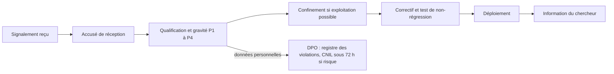

# Signaler une vulnérabilité

Cette page reprend la politique de divulgation responsable du projet, publiée à la racine du dépôt dans [`SECURITY.md`](src:SECURITY.md). Elle s'adresse aux chercheurs en sécurité, aux citoyens et aux agents de la Ville qui découvrent une faille.

## Comment signaler

Écrire à **securite@etherbay.fr** en décrivant :

- la vulnérabilité et le composant concerné ;
- son impact estimé ;
- les étapes pour la reproduire, avec les requêtes ou captures utiles ;
- le cas échéant, l'adresse de contrat, le hash de transaction ou l'identifiant de requête (`X-Request-Id`) observé.

Ne pas ouvrir d'issue publique sur GitHub : une faille décrite publiquement avant correction expose tous les utilisateurs.

Le même contact est publié au format RFC 9116 dans deux fichiers `security.txt` :

| Site | Fichier | Chemin public |
|---|---|---|
| Frontend web | [`frontend-web/public/.well-known/security.txt`](src:frontend-web/public/.well-known/security.txt) | `/.well-known/security.txt` |
| Office de Tourisme | [`frontend-office-tourisme/.well-known/security.txt`](src:frontend-office-tourisme/.well-known/security.txt) | `/.well-known/security.txt` |

```text
Contact: mailto:securite@etherbay.fr
Expires: 2027-11-10T00:00:00.000Z
Preferred-Languages: fr, en
Policy: https://github.com/MarceauTDML/BlockLucky/blob/main/SECURITY.md
```

> [!NOTE]
> La date `Expires` doit être repoussée avant le 10 novembre 2027. Un fichier `security.txt` expiré est considéré comme non fiable par les outils qui le lisent.

## Engagements

| Étape | Délai |
|---|---|
| Accusé de réception | 3 jours ouvrés |
| Première analyse et niveau de gravité communiqués | 10 jours ouvrés |
| Correction d'une faille critique | 7 jours |
| Correction d'une faille élevée | 30 jours |

La Ville s'engage à ne pas poursuivre un chercheur de bonne foi qui respecte le périmètre ci-dessous, ne consulte pas plus de données que nécessaire et ne dégrade pas le service. La portée juridique de cet engagement est à confirmer par un juriste (voir [Points à valider](../juridique/points-a-valider.md)).

## Périmètre

| Inclus | Exclus |
|---|---|
| API `backend/` : authentification, autorisations, webhooks, EtherPoints | Attaques par déni de service volumétrique |
| Frontend web `frontend-web/` | Ingénierie sociale des équipes de la Ville d'EtherBay |
| Application mobile `mobile-app/` | Valeurs de développement documentées dans les fichiers `.env.example`, refusées en production |
| Site `frontend-office-tourisme/` | Paiement de démonstration du site de l'Office de Tourisme, qui ne collecte aucune donnée bancaire |

Les contrats `smart-contract/` ne figurent pas dans la liste du fichier `SECURITY.md`. Une faille dans `BlockLucky.sol` ou `BlockLuckyPOAP.sol` est néanmoins à signaler par le même canal : ce sont les composants les plus sensibles du projet. Les constats déjà connus sont listés dans [Audits et checklists](audits.md#constats-ouverts) et [Limites connues](../smart-contracts/limites.md) ; les signaler à nouveau n'est pas nécessaire.

## Versions maintenues

Seule la dernière version de la branche `main` reçoit des correctifs. Une faille signalée sur une branche de travail est corrigée sur `main`.

## Traitement interne

À réception d'un signalement, l'équipe suit le [plan de réponse aux incidents](../infrastructure/incidents.md) :



Les mesures de confinement disponibles sont la révocation des sessions, le mode maintenance (`MAINTENANCE_MODE=true`), le disjoncteur du contrat (`POST /api/admin/circuit-breaker`) et la rotation des secrets décrite dans [Cryptographie et secrets](cryptographie-secrets.md#rotation). Chaque correction s'accompagne d'un test qui reproduit la faille, ajouté à la suite du composant concerné.

Pour un contrat déjà déployé, le correctif ne peut pas être appliqué en place : le code d'un contrat n'est pas modifiable. La procédure consiste à pauser le contrat, laisser les participants récupérer leurs fonds, puis redéployer une version corrigée (voir [Modifier le contrat](../guides/modifier-contrat.md) et [Redéployer sur Sepolia](../guides/redeployer-sepolia.md)).

## Ce qui est attendu d'un chercheur

- Tester sur une instance locale ou de test plutôt que sur un service en production.
- Utiliser uniquement ses propres comptes, ou des comptes de démonstration (voir [Comptes de démonstration et connexion](../demarrage/comptes-et-connexion.md)).
- Ne pas extraire, modifier ni supprimer les données d'autres personnes.
- Accorder un délai raisonnable de correction avant toute publication.
