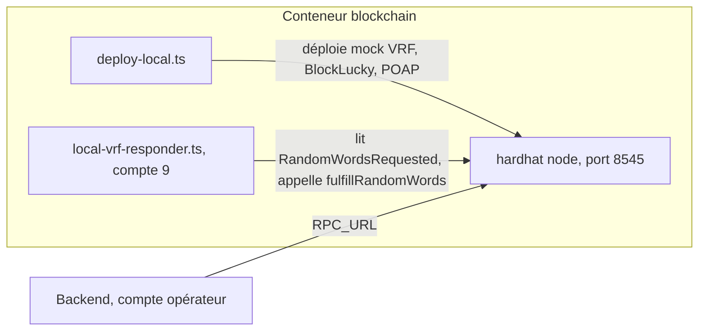

# Blockchain locale

En développement et en CI, les contrats tournent sur un nœud Hardhat local, avec un coordinateur Chainlink VRF simulé et un petit oracle qui répond aux demandes de tirage. Le backend s'y connecte sans aucune configuration : les adresses des contrats sont déterministes et correspondent à ses valeurs par défaut. Cette page décrit le nœud, le script de déploiement, l'oracle, l'image Docker et les variables. Le démarrage de toute l'infrastructure locale est décrit dans [Infrastructure locale](../demarrage/infrastructure-locale.md).

## Vue d'ensemble



## Démarrer

### Avec Docker

Le service `blockchain` de [`docker-compose.yml`](src:docker-compose.yml) construit l'image de [`smart-contract/Dockerfile`](src:smart-contract/Dockerfile) et publie le port sur `127.0.0.1:8545` uniquement.

```bash
docker compose up -d --wait blockchain
```

`--wait` attend que le conteneur soit sain, c'est-à-dire que les contrats soient déployés.

### Sans Docker

Dans un premier terminal, depuis `smart-contract/` :

```bash
npm run node
```

Dans un second terminal, une fois le nœud prêt :

```bash
npm run deploy:local && npx hardhat run scripts/local-vrf-responder.ts --network localhost
```

L'oracle tourne au premier plan tant que le terminal reste ouvert. Sans lui, les tours restent en `Drawing` après la demande de tirage.

## Le nœud Hardhat

`hardhat node` lance un réseau Ethereum en mémoire, au chain ID 31337, avec 20 comptes dérivés de la phrase mnémonique publique de développement de Hardhat, chacun approvisionné en ethers fictifs. Un bloc est produit à chaque transaction.

| Index | Adresse | Rôle dans BlockLucky |
|---|---|---|
| 0 | `0xf39Fd6e51aad88F6F4ce6aB8827279cffFb92266` | Mairie : déployeur, administrateur, opérateur, pauseur, frappeur, propriétaire `ConfirmedOwner` ; opérateur par défaut du backend |
| 1 | `0x70997970C51812dc3A010C7d01b50e0d17dc79C8` | Trésorerie |
| 9 | `0xa0Ee7A142d267C1f36714E4a8F75612F20a79720` | Signataire de l'oracle VRF local |

La clé privée du compte 0 est la valeur par défaut de `RELAYER_PRIVATE_KEY` dans [`backend/src/config/env.config.ts`](src:backend/src/config/env.config.ts). Ces clés sont publiques : elles ne doivent jamais recevoir de vrais fonds ni servir hors de la chaîne locale.

> [!WARNING]
> Le nœud ne conserve aucun état. À chaque redémarrage du conteneur, la chaîne repart du bloc 0 et les contrats sont redéployés aux mêmes adresses, mais vides. La base du backend, elle, garde les tours et tickets de la chaîne précédente, et l'indexeur détecte un curseur en avance sur la tête de chaîne. Il faut alors réinitialiser aussi la base : `docker compose down -v`, puis relancer les migrations et le seed.

## Le script deploy-local.ts

[`scripts/deploy-local.ts`](src:smart-contract/scripts/deploy-local.ts) enchaîne, avec le compte 0 :

| Nonce | Transaction | Résultat |
|---|---|---|
| 0 | Déploiement de `VRFCoordinatorV2_5Mock(0.1 ether, 1 gwei, 4e15)` | `0x5FbDB2315678afecb367f032d93F642f64180aa3` |
| 1 | `createSubscription()` | Identifiant lu dans l'événement `SubscriptionCreated` |
| 2 | `fundSubscription(subId, 10000 ether)` | Abonnement financé |
| 3 | Déploiement de `BlockLucky` | `0xCf7Ed3AccA5a467e9e704C703E8D87F634fB0Fc9` |
| 4 | `addConsumer(subId, lottery)` | `BlockLucky` autorisé à demander de l'aléa |
| 5 | Déploiement de `BlockLuckyPOAP` | `0x5FC8d32690cc91D4c39d9d3abcBD16989F875707` |
| 6 et suivants | Rôles et approvisionnement de l'opérateur, si configuré | Voir plus bas |

### Pourquoi les adresses sont déterministes

L'adresse d'un contrat créé par un compte ne dépend que de l'adresse de ce compte et de son nonce. Le nœud démarre toujours avec les mêmes comptes, et le script envoie toujours les mêmes transactions dans le même ordre : le coordinateur naît au nonce 0, `BlockLucky` au nonce 3 et `BlockLuckyPOAP` au nonce 5. Ces adresses sont les valeurs par défaut de `LOTTERY_CONTRACT_ADDRESS` et `POAP_CONTRACT_ADDRESS` dans le backend et dans [`docker-compose.yml`](src:docker-compose.yml).

Conséquence : toute transaction ajoutée avant le nonce 5 dans le script, ou toute transaction envoyée par le compte 0 avant le déploiement, décale les adresses et casse la configuration par défaut du backend. L'identifiant d'abonnement, en revanche, change à chaque démarrage, car le mock le dérive notamment du hash du bloc précédent.

### Configuration déployée

Le tour est configuré par `roundConfigFromEnv` avec une durée par défaut de 30 minutes. La configuration VRF est fixe :

| Champ | Valeur locale |
|---|---|
| `keyHash` | `0x787d74caea10b2b357790d5b5247c2f63d1d91572a9846f780606e4d953677ae` |
| `callbackGasLimit` | 500 000 |
| `requestConfirmations` | 1 |
| `nativePayment` | `false` |
| `drawTimeout` | 600 secondes |

### L'opérateur du backend

Si `OPERATOR_ADDRESS` ou `OPERATOR_PRIVATE_KEY` désigne un compte différent du compte 0, le script lui accorde `OPERATOR_ROLE` et `PAUSER_ROLE` sur `BlockLucky`, `MINTER_ROLE` sur `BlockLuckyPOAP`, et lui envoie `OPERATOR_FUNDING_ETH` ethers (1 000 par défaut). L'opérateur paie en effet le gaz du keeper, des frappes de badges et les dotations de bienvenue.

Dans `docker-compose.yml`, `OPERATOR_PRIVATE_KEY` reçoit `RELAYER_PRIVATE_KEY`. Si cette variable est vide, le backend utilise le compte 0, qui a déjà tous les rôles, et le script n'a rien à faire.

### Fichier de déploiement

Le script écrit `smart-contract/deployments/localhost.json` (ou dans `DEPLOYMENTS_DIR`), ignoré par Git. Il contient le réseau, le chain ID, la date, le bloc de déploiement, l'administrateur, l'opérateur éventuel, la trésorerie, les trois adresses, la key hash, l'identifiant d'abonnement et la configuration des tours. L'oracle local le relit au démarrage.

## L'oracle local

[`scripts/local-vrf-responder.ts`](src:smart-contract/scripts/local-vrf-responder.ts) joue le rôle du réseau Chainlink :

1. il lit `deployments/localhost.json` ;
2. toutes les `VRF_POLL_INTERVAL_MS` millisecondes (2 000 par défaut), il récupère les événements `RandomWordsRequested` du mock depuis le dernier bloc lu ;
3. pour chaque requête qu'il n'a pas encore servie, il appelle `fulfillRandomWords(requestId, consumer)` sur le mock et attend la confirmation ;
4. il journalise chaque réponse et continue en cas d'erreur.

Il signe avec le compte d'index `VRF_ORACLE_ACCOUNT_INDEX`, 9 par défaut. Le compte est distinct de l'opérateur pour que deux processus n'envoient jamais de transactions avec le même compte : leurs nonces entreraient en conflit. Si l'index demandé n'existe pas, il se rabat sur le compte 0.

L'aléa fourni par le mock est `keccak256(abi.encode(requestId, 0))` : déterministe, prévisible, et donc uniquement acceptable en développement. Voir [Tirage Chainlink VRF](chainlink-vrf.md#en-local-le-mock-et-l-oracle-simule).

## L'image Docker

Étapes du [`Dockerfile`](src:smart-contract/Dockerfile) :

| Étape | Effet |
|---|---|
| Base `node:22-bookworm-slim` | Modifiable par l'argument `NODE_IMAGE` |
| `npm ci` avec cache | Dépendances figées par `package-lock.json` |
| Copie de `hardhat.config.ts`, `tsconfig.json`, `contracts/`, `scripts/`, `docker/start-local-chain.sh` | Les tests et les artefacts locaux sont exclus par `.dockerignore` |
| `npx hardhat build` | Contrats compilés dans l'image |
| `USER node` | Le conteneur ne tourne pas en root |
| `EXPOSE 8545` | Port RPC |
| `HEALTHCHECK` | Sain quand `/tmp/blockchain-ready` existe, vérifié toutes les 5 secondes, 60 secondes de grâce, 20 essais |

Le script de démarrage [`docker/start-local-chain.sh`](src:smart-contract/docker/start-local-chain.sh) :

1. lance `hardhat node --hostname 0.0.0.0 --port 8545` en arrière-plan ;
2. interroge `eth_chainId` chaque seconde jusqu'à ce que le nœud réponde ;
3. lance `deploy-local.ts`, puis crée `/tmp/blockchain-ready`, ce qui rend le conteneur sain ;
4. lance l'oracle local en arrière-plan ;
5. attend la fin du nœud et arrête l'oracle à la réception de `INT` ou `TERM`.

Le service compose ajoute `cap_drop: [ALL]`, `no-new-privileges` et `restart: unless-stopped`. Cette image sert au développement et à la CI ; elle n'est jamais déployée en production (voir [Images Docker](../infrastructure/images.md)).

## Variables

| Variable | Lue par | Défaut | Effet |
|---|---|---|---|
| `LOCAL_RPC_URL` | `hardhat.config.ts` | `http://127.0.0.1:8545` | URL du réseau `localhost` |
| `OPERATOR_ADDRESS` | `deploy-local.ts` | vide | Opérateur à habiliter et approvisionner |
| `OPERATOR_PRIVATE_KEY` | `deploy-local.ts` | vide | Alternative : l'adresse est dérivée de la clé |
| `OPERATOR_FUNDING_ETH` | `deploy-local.ts` | `1000` | Ethers envoyés à l'opérateur |
| `POAP_BASE_URI` | `deploy-local.ts` | `http://localhost:2053/api/v1/lottery/poap/` | Préfixe des métadonnées des badges |
| `TICKET_PRICE_WEI` | `lib/deployment.ts` | `10000000000000000` | Prix du ticket |
| `MAX_TICKETS` | `lib/deployment.ts` | `10000` | Plafond de tickets par tour |
| `MIN_TICKETS_TO_DRAW` | `lib/deployment.ts` | `2` | Minimum pour tirer |
| `MAX_TICKETS_PER_PLAYER` | `lib/deployment.ts` | `1` | Plafond par participant ; le backend refuse aussi un second ticket |
| `ROUND_DURATION_SECONDS` | `lib/deployment.ts` | `1800` en local | Durée d'un tour |
| `MUNICIPALITY_FEE_BPS` | `lib/deployment.ts` | `1000` | Commission en points de base |
| `DEPLOYMENTS_DIR` | `lib/deployment.ts` | `smart-contract/deployments` | Dossier des fichiers de déploiement |
| `VRF_ORACLE_ACCOUNT_INDEX` | `local-vrf-responder.ts` | `9` | Compte signataire de l'oracle |
| `VRF_POLL_INTERVAL_MS` | `local-vrf-responder.ts` | `2000` | Période de scrutation |

Les variables numériques de `lib/deployment.ts`, sauf `TICKET_PRICE_WEI`, doivent être des entiers strictement positifs, sinon le script s'arrête.

Exemple : un tour de 5 minutes à 2 tickets minimum, pour une démonstration.

```bash
ROUND_DURATION_SECONDS=300 MIN_TICKETS_TO_DRAW=2 npm run deploy:local
```

## Brancher le backend

Le backend lit `RPC_URL`, `CHAIN_ID`, `LOTTERY_CONTRACT_ADDRESS`, `POAP_CONTRACT_ADDRESS` et `RELAYER_PRIVATE_KEY`. Leurs valeurs par défaut correspondent exactement à cette chaîne locale : `http://127.0.0.1:8545`, `31337`, les deux adresses ci-dessus et la clé du compte 0. Dans Docker Compose, `RPC_URL` vaut `http://blockchain:8545`. Voir [Variables d'environnement](../backend/variables-environnement.md) et [Mode onchain ou simulé](../integration-blockchain/modes.md).

## Vérifier que tout fonctionne

Depuis `smart-contract/`, la console Hardhat interroge directement le contrat déployé :

```bash
npx hardhat console --network localhost
```

```javascript
const { ethers } = await network.create();
const lottery = await ethers.getContractAt("BlockLucky", "0xCf7Ed3AccA5a467e9e704C703E8D87F634fB0Fc9");
await lottery.currentRoundId();
await lottery.getRound(await lottery.currentRoundId());
```

Les journaux du conteneur indiquent les adresses déployées et chaque réponse de l'oracle :

```bash
docker compose logs -f blockchain
```
