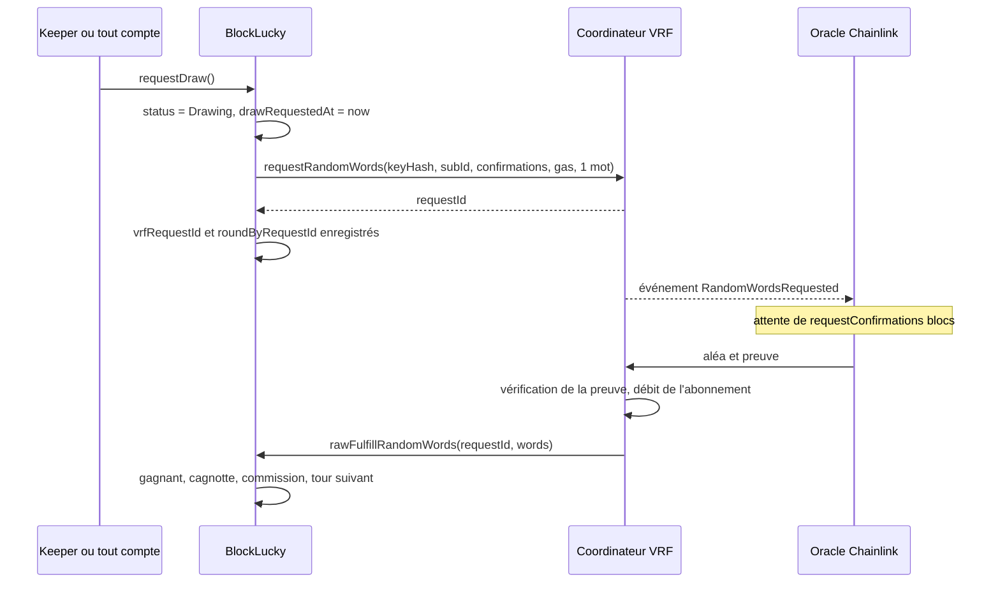

# Tirage Chainlink VRF

Le gagnant de chaque tour est désigné à partir d'un mot aléatoire fourni par Chainlink VRF v2.5 (Verifiable Random Function). Cette page décrit la requête, la réponse, la configuration, le financement et la gestion d'un oracle qui ne répond pas. Le choix de VRF face à `block.prevrandao` est justifié dans [Pourquoi Ethereum, Hardhat et Chainlink](choix.md#chainlink-vrf-plutot-que-prevrandao).

## Principe

Un oracle Chainlink détient une clé privée de VRF. Pour chaque requête, il calcule un nombre aléatoire à partir de cette clé et d'une graine dérivée de la requête, et produit une preuve. Le contrat coordinateur, déployé par Chainlink sur chaque réseau, vérifie la preuve on-chain avant de transmettre le nombre au consommateur. L'oracle ne peut donc ni choisir la valeur, ni en livrer une autre que celle déterminée par la requête. Il peut seulement ne pas répondre, cas traité plus bas.

`BlockLucky` hérite de `VRFConsumerBaseV2Plus`, la base de consommateur de Chainlink. Elle stocke l'adresse du coordinateur dans `s_vrfCoordinator` et expose `rawFulfillRandomWords`, qui refuse tout appelant autre que ce coordinateur (`OnlyCoordinatorCanFulfill`).

## Séquence complète



## La requête

Elle est construite dans `_requestRandomness`, appelée par `requestDraw` et `retryDraw` :

```solidity
requestId = s_vrfCoordinator.requestRandomWords(
    VRFV2PlusClient.RandomWordsRequest({
        keyHash: config.keyHash,
        subId: config.subscriptionId,
        requestConfirmations: config.requestConfirmations,
        callbackGasLimit: config.callbackGasLimit,
        numWords: 1,
        extraArgs: VRFV2PlusClient._argsToBytes(
            VRFV2PlusClient.ExtraArgsV1({nativePayment: config.nativePayment})
        )
    })
);
```

| Champ | Source | Signification |
|---|---|---|
| `keyHash` | `vrfConfig.keyHash` | Clé de l'oracle et voie de prix du gaz utilisées |
| `subId` | `vrfConfig.subscriptionId` | Abonnement débité |
| `requestConfirmations` | `vrfConfig.requestConfirmations` | Blocs attendus avant la réponse ; plus la valeur est haute, plus une réorganisation de chaîne est improbable |
| `callbackGasLimit` | `vrfConfig.callbackGasLimit` | Gaz alloué à `rawFulfillRandomWords` |
| `numWords` | Constante 1 | Un seul mot suffit pour un seul gagnant |
| `nativePayment` | `vrfConfig.nativePayment` | `true` : paiement en ETH ; `false` : paiement en LINK |

Le statut du tour passe à `Drawing` avant l'appel au coordinateur. L'identifiant renvoyé n'est connu qu'après l'appel, d'où l'écriture de `vrfRequestId` et `roundByRequestId` ensuite. Slither signale cet ordre comme une réentrance potentielle ; le constat est accepté et justifié dans [Sécurité du contrat](securite.md#triage-slither).

## La réponse

```solidity
function fulfillRandomWords(uint256 requestId, uint256[] calldata randomWords) internal override {
    uint256 roundId = roundByRequestId[requestId];
    Round storage round = rounds[roundId];
    if (roundId == 0 || round.status != RoundStatus.Drawing || round.vrfRequestId != requestId) return;

    delete roundByRequestId[requestId];

    uint32 winningTicket = uint32(randomWords[0] % round.ticketCount);
    address winner = ticketOwners[roundId][winningTicket];
```

Trois gardes protègent le callback :

| Garde | Cas couvert |
|---|---|
| `roundId == 0` | Requête inconnue, déjà servie, effacée par `retryDraw` ou par `cancelRound` |
| `status != Drawing` | Tour déjà terminé ou annulé |
| `vrfRequestId != requestId` | Réponse à une ancienne requête après une relance |

Une réponse qui échoue à l'une de ces gardes est ignorée sans revert. Les tests « ignore une réponse VRF inconnue sans bloquer le tour » et « autorise une nouvelle demande VRF après le délai d'attente et ignore l'ancienne réponse » couvrent les deux scénarios.

Le callback fait ensuite le calcul décrit dans [Contrat BlockLucky](blocklucky.md#tirage-du-gagnant), émet `WinnerPicked` et ouvre le tour suivant. Il n'envoie aucun ether : la cagnotte sera retirée par `claimPrize`.

## Budget de gaz du callback

`callbackGasLimit` vaut 500 000 dans les deux scripts de déploiement, et le contrat refuse toute valeur inférieure à 100 000. Le callback fait un nombre fixe d'écritures : effacement de la requête, résultat du tour, `accruedFees`, puis ouverture du tour suivant (une dizaine de champs). Il ne contient aucune boucle et aucun appel externe. Son coût ne dépend donc pas du nombre de tickets vendus.

Si le gaz alloué était insuffisant, l'appel au consommateur échouerait, le coordinateur marquerait quand même la requête comme servie et facturerait l'abonnement, et le tour resterait en `Drawing`. Le remède est alors `retryDraw` après avoir relevé `callbackGasLimit` par `setVrfConfig`.

## Configuration par réseau

| Paramètre | Local ([`deploy-local.ts`](src:smart-contract/scripts/deploy-local.ts)) | Sepolia ([`deploy-sepolia.ts`](src:smart-contract/scripts/deploy-sepolia.ts)) |
|---|---|---|
| Coordinateur | `VRFCoordinatorV2_5Mock` déployé par le script | `0x9DdfaCa8183c41ad55329BdeeD9F6A8d53168B1B`, remplaçable par `SEPOLIA_VRF_COORDINATOR` |
| Key hash | `0x787d74caea10b2b357790d5b5247c2f63d1d91572a9846f780606e4d953677ae` | Même valeur par défaut, remplaçable par `SEPOLIA_VRF_KEY_HASH` ; vérifiée par `s_provingKeys` |
| Abonnement | Créé par `createSubscription`, financé de 10 000 unités simulées | Créé par `npm run vrf:sepolia` et enregistré dans `deployments/sepolia-vrf.json`, ou fourni par `SEPOLIA_VRF_SUBSCRIPTION_ID` |
| `requestConfirmations` | 1 | 3 |
| `callbackGasLimit` | 500 000 | 500 000 |
| `nativePayment` | `false` | `true` si l'abonnement a un solde en ETH, `false` sinon ; forçable par `VRF_NATIVE_PAYMENT` |
| `drawTimeout` | 10 minutes | 24 heures |

Le mock est construit avec trois paramètres de tarification : frais de base de 0,1 unité, prix du gaz de 1 gwei, et 4 × 10¹⁵ wei par LINK. Le mock ne vérifie pas la key hash.

## Abonnement et financement

VRF v2.5 fonctionne par abonnement : un compte crée un abonnement, le finance, puis y ajoute les contrats autorisés à consommer de l'aléa. Chaque réponse est facturée à l'abonnement, en LINK ou en ETH selon `nativePayment`.

| Étape | En local | Sur Sepolia |
|---|---|---|
| Création | `coordinator.createSubscription()` dans le script | `createSubscription()` par [`setup-vrf-sepolia.ts`](src:smart-contract/scripts/setup-vrf-sepolia.ts) (`npm run vrf:sepolia`), ou à la main sur le gestionnaire d'abonnements Chainlink |
| Financement | `fundSubscription(subId, 10000 ether)` | `fundSubscriptionWithNative` de `VRF_FUND_ETH` ETH Sepolia (0,5 par défaut), ou LINK de test à la main ; le script de déploiement refuse un abonnement sans aucun solde |
| Ajout du consommateur | `coordinator.addConsumer(subId, lottery)` | Par le script si le déployeur est le propriétaire de l'abonnement, sinon à la main |

Un contrat non ajouté comme consommateur fait échouer `requestDraw` : la transaction est annulée et le tour reste `Open`. Un abonnement vidé laisse les requêtes en attente jusqu'à son réapprovisionnement ; si l'attente dépasse `drawTimeout`, l'opérateur peut relancer. Le pas à pas est sur la page [Déploiement sur Sepolia](sepolia.md).

## Oracle muet

L'oracle peut ne jamais répondre : abonnement vide, réseau congestionné, incident Chainlink, ou oracle local arrêté. Sans parade, le tour resterait en `Drawing` pour toujours, avec les mises bloquées. Le contrat en prévoit deux.

| Parade | Qui | Condition | Effet |
|---|---|---|---|
| `retryDraw()` | `OPERATOR_ROLE` | Statut `Drawing` et `block.timestamp >= drawRequestedAt + drawTimeout` | Nouvelle requête ; l'ancienne est oubliée et sa réponse éventuelle sera ignorée |
| `cancelRound()` | `OPERATOR_ROLE` | Aucune | Tour annulé, mises remboursables, tour suivant ouvert |

Le délai d'attente empêche l'opérateur de relancer un tirage à volonté pour en changer l'issue : la relance n'est possible qu'après 24 heures sur Sepolia, bien après la réponse normale de l'oracle. Les procédures sont dans [Exploitation du contrat](exploitation.md) et [Runbooks blockchain](../infrastructure/runbooks-blockchain.md).

## En local : le mock et l'oracle simulé

Sur le nœud Hardhat, aucun oracle Chainlink n'existe. Deux pièces le remplacent :

- **`VRFCoordinatorV2_5Mock`**, le coordinateur de test fourni par `@chainlink/contracts`. Il enregistre les requêtes et expose `fulfillRandomWords(requestId, consumer)` et `fulfillRandomWordsWithOverride(requestId, consumer, words)`, qui appellent le consommateur.
- **[`scripts/local-vrf-responder.ts`](src:smart-contract/scripts/local-vrf-responder.ts)**, qui interroge le nœud toutes les `VRF_POLL_INTERVAL_MS` millisecondes (2 000 par défaut), lit les événements `RandomWordsRequested` du mock depuis le bloc de déploiement et appelle `fulfillRandomWords` pour chacun. Il signe avec le compte Hardhat d'index `VRF_ORACLE_ACCOUNT_INDEX` (9 par défaut).

Sans mots fournis, le mock calcule l'aléa comme `uint256(keccak256(abi.encode(requestId, i)))`. Cette valeur est entièrement prévisible et `fulfillRandomWordsWithOverride` est appelable par tous : en local, n'importe qui peut choisir le gagnant. C'est sans conséquence sur une chaîne de développement, mais cela interdit de présenter un tirage local comme équitable (voir [Limites connues](limites.md)).

Les tests utilisent `fulfillRandomWordsWithOverride` pour imposer un mot précis, par exemple `5` pour faire gagner le sixième ticket, ou `ethers.MaxUint256` pour vérifier le modulo.
