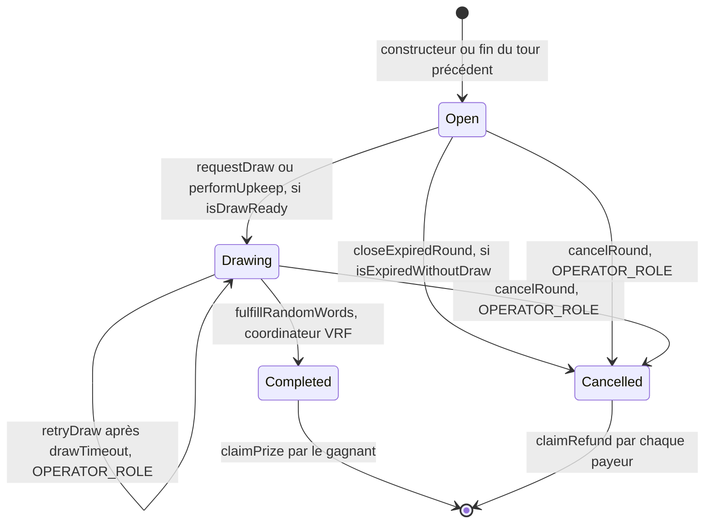
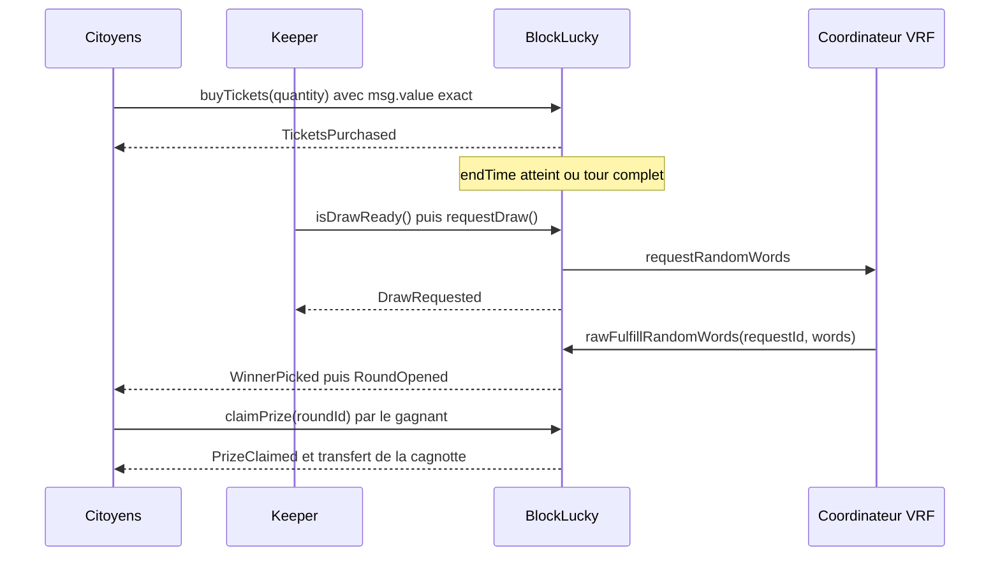

# Cycle de vie d'un tour

Un tour de `BlockLucky` passe par quatre états : `Open`, `Drawing`, `Completed` et `Cancelled`. Il n'existe à tout instant qu'un seul tour en cours, désigné par `currentRoundId`, et il est toujours `Open` ou `Drawing` : dès qu'un tour se termine ou s'annule, le suivant s'ouvre dans la même transaction.

Toutes les conditions de cette page sont lues dans [`smart-contract/contracts/BlockLucky.sol`](src:smart-contract/contracts/BlockLucky.sol). Les structures citées sont décrites dans [Contrat BlockLucky](blocklucky.md).

## Diagramme d'états



`Completed` et `Cancelled` sont terminaux : aucune fonction ne fait sortir un tour de ces états. `claimPrize` et `claimRefund` ne changent pas le statut ; ils vident les droits inscrits.

## Les deux prédicats

Deux fonctions de lecture publiques décident des transitions automatiques. Elles portent toujours sur le tour en cours.

```solidity
function isDrawReady() public view returns (bool) {
    Round storage round = rounds[currentRoundId];
    if (round.status != RoundStatus.Open) return false;
    if (round.ticketCount < round.minTicketsToDraw) return false;
    return round.ticketCount == round.maxTickets || block.timestamp >= round.endTime;
}

function isExpiredWithoutDraw() public view returns (bool) {
    Round storage round = rounds[currentRoundId];
    return
        round.status == RoundStatus.Open &&
        block.timestamp >= round.endTime &&
        round.ticketCount < round.minTicketsToDraw;
}
```

Les deux prédicats sont exclusifs : l'un exige `ticketCount >= minTicketsToDraw`, l'autre `ticketCount < minTicketsToDraw`. Ils traduisent la règle du kickoff, « après un certain nombre de participants ou une certaine durée » :

| Situation du tour `Open` | `isDrawReady` | `isExpiredWithoutDraw` | Issue |
|---|---|---|---|
| Durée en cours, pas complet | faux | faux | Les achats continuent |
| Complet avant la fin de la durée | vrai | faux | Tirage anticipé possible |
| Durée écoulée, au moins `minTicketsToDraw` tickets | vrai | faux | Tirage |
| Durée écoulée, moins de `minTicketsToDraw` tickets, y compris zéro | faux | vrai | Annulation et remboursement |

## Transitions

### Ouverture d'un tour

`_openRound` est privée. Elle est appelée par le constructeur, par `fulfillRandomWords` après le tirage et par `_cancelRound` après une annulation.

| Élément | Valeur |
|---|---|
| Effets | `currentRoundId` incrémenté ; le nouveau tour copie `ticketPrice`, `maxTickets`, `minTicketsToDraw`, `maxTicketsPerPlayer` et `feeBps` de `roundConfig` ; `startTime` = maintenant ; `endTime` = maintenant + `duration` ; statut `Open` |
| Événement | `RoundOpened(roundId, ticketPrice, maxTickets, endTime)` |
| Erreurs | Aucune |

### Open vers Drawing : requestDraw

| Élément | Valeur |
|---|---|
| Appelant | N'importe qui ; dans le projet, le [keeper du backend](../integration-blockchain/keeper.md) |
| Modificateurs | `whenNotPaused`, `nonReentrant` |
| Condition | `isDrawReady()` |
| Effets | Statut `Drawing`, `drawRequestedAt` = maintenant, appel de `requestRandomWords` sur le coordinateur, `vrfRequestId` et `roundByRequestId[requestId]` enregistrés |
| Événement | `DrawRequested(roundId, requestId, ticketCount)` |
| Erreurs | `DrawNotReady(roundId)` si la condition est fausse, `EnforcedPause()` si le contrat est en pause, et toute erreur du coordinateur (par exemple un contrat non ajouté comme consommateur de l'abonnement), qui annule la transaction et laisse le tour `Open` |

Dès que le statut passe à `Drawing`, plus aucun achat n'est accepté (`RoundNotOpen`). Personne ne peut donc acheter un ticket en connaissant déjà la requête d'aléa.

`performUpkeep` mène à la même transition quand le contrat n'est pas en pause et que `isDrawReady()` est vrai (voir [Chainlink Automation](automation.md)).

### Open vers Cancelled : closeExpiredRound

| Élément | Valeur |
|---|---|
| Appelant | N'importe qui ; dans le projet, le keeper du backend |
| Modificateurs | `nonReentrant` ; pas de `whenNotPaused` |
| Condition | `isExpiredWithoutDraw()` |
| Effets | Statut `Cancelled`, ouverture du tour suivant |
| Événements | `RoundCancelled(roundId, ticketCount, totalCollected)` puis `RoundOpened` |
| Erreurs | `RoundNotCancellable(roundId)` si la condition est fausse |

La clôture d'un tour expiré reste possible en pause : elle ne fait que rendre les mises remboursables.

### Open ou Drawing vers Cancelled : cancelRound

| Élément | Valeur |
|---|---|
| Appelant | `OPERATOR_ROLE` |
| Modificateurs | `onlyRole(OPERATOR_ROLE)`, `nonReentrant` ; pas de `whenNotPaused` |
| Condition | Aucune : le tour en cours est toujours `Open` ou `Drawing` |
| Effets | Si une requête VRF existe, `roundByRequestId[vrfRequestId]` est effacé ; statut `Cancelled` ; ouverture du tour suivant |
| Événements | `RoundCancelled` puis `RoundOpened` |
| Erreurs | `AccessControlUnauthorizedAccount(account, role)` |

L'effacement de `roundByRequestId` rend inoffensive une réponse VRF tardive : elle sera ignorée. Le test « ignore une réponse VRF inconnue sans bloquer le tour » annule un tour en `Drawing` puis livre l'aléa ; le tour reste `Cancelled` et sans gagnant.

### Drawing vers Drawing : retryDraw

| Élément | Valeur |
|---|---|
| Appelant | `OPERATOR_ROLE` |
| Modificateurs | `onlyRole(OPERATOR_ROLE)`, `nonReentrant` ; pas de `whenNotPaused` |
| Conditions | Statut `Drawing`, et `block.timestamp >= drawRequestedAt + vrfConfig.drawTimeout` |
| Effets | L'ancienne requête est effacée de `roundByRequestId` ; une nouvelle requête est envoyée ; `drawRequestedAt` et `vrfRequestId` sont mis à jour |
| Événement | `DrawRequested` avec le nouveau `requestId` |
| Erreurs | `DrawNotReady(roundId)` si aucun tirage n'est en cours, `DrawNotStale(roundId)` si le délai n'est pas écoulé, `AccessControlUnauthorizedAccount` |

Le délai est lu dans la configuration VRF courante, pas dans une copie propre au tour : un `setVrfConfig` qui raccourcit `drawTimeout` s'applique aussi au tirage en attente.

### Drawing vers Completed : fulfillRandomWords

| Élément | Valeur |
|---|---|
| Appelant | Le coordinateur VRF, par `rawFulfillRandomWords` |
| Contrôle d'accès | `msg.sender == s_vrfCoordinator`, sinon `OnlyCoordinatorCanFulfill(have, want)` |
| Conditions | `roundByRequestId[requestId]` non nul, statut `Drawing`, et `vrfRequestId == requestId` |
| Effets | Requête effacée ; `winningTicket = randomWords[0] % ticketCount` ; `winner`, `prize` et `status = Completed` enregistrés ; commission ajoutée à `accruedFees` ; ouverture du tour suivant |
| Événements | `WinnerPicked(roundId, winner, winningTicket, prize, fee, requestId)` puis `RoundOpened` |
| Erreurs | Aucune : une réponse qui ne remplit pas les conditions est ignorée sans revert |

Ignorer plutôt que rejeter est volontaire. Un revert dans le callback ne serait pas rejoué par Chainlink : la requête serait consommée sans effet. En ignorant silencieusement une réponse obsolète (après `retryDraw` ou `cancelRound`), le contrat garde la seule requête valide en attente.

Le tirage aboutit même en pause : `fulfillRandomWords` ne dépend pas de `paused()`.

### Retraits

| Fonction | Statut exigé | Autres conditions | Erreurs |
|---|---|---|---|
| `claimPrize(roundId)` | `Completed` | `msg.sender == winner`, `prizeClaimed == false` | `RoundNotCompleted`, `NotWinner`, `PrizeAlreadyClaimed`, `TransferFailed` |
| `claimRefund(roundId)` | `Cancelled` | `contributionOf(roundId, msg.sender) > 0` | `RoundNotCancelled`, `NothingToRefund`, `TransferFailed` |

Ces deux fonctions sont `nonReentrant` et ne dépendent pas de la pause. Elles portent sur n'importe quel tour passé, pas seulement le dernier.

## Déroulé d'un tour type



Les mêmes flux, vus du backend, sont décrits dans [Tirage et versement de la cagnotte](../architecture/flux/tirage.md) et [Annulation et remboursement](../architecture/flux/annulation.md).

## Chronologie avec les paramètres Sepolia

Avec les valeurs du script [`deploy-sepolia.ts`](src:smart-contract/scripts/deploy-sepolia.ts) :

| Instant | Événement |
|---|---|
| T | Ouverture du tour, `endTime` = T + 48 h |
| Avant T + 48 h | Achats ; tirage anticipé possible si les 10 000 tickets sont vendus |
| T + 48 h | Plus d'achat (`RoundExpired`). Avec au moins 2 tickets, `requestDraw` ; sinon `closeExpiredRound` |
| Quelques blocs après la demande | Réponse VRF après 3 confirmations, gagnant désigné, tour suivant ouvert |
| Demande + 24 h sans réponse | `retryDraw` devient possible pour l'opérateur |

En local, la durée est de 30 minutes, une seule confirmation est demandée, et `retryDraw` est possible après 10 minutes.

## Cas particuliers

- **Tour expiré mais tirable, que personne ne tire.** Il reste `Open` indéfiniment, sans achat possible. N'importe qui peut appeler `requestDraw` à tout moment ; il n'y a pas de date limite de tirage.
- **Pause pendant un tour tirable.** `requestDraw` est refusé tant que dure la pause, et `checkUpkeep` renvoie faux. Le tirage reprend après `unpause`.
- **Tour vide.** Un tour sans aucun ticket est annulé par `closeExpiredRound` à son expiration et le suivant s'ouvre. Avec la durée locale de 30 minutes, le keeper enchaîne ainsi des tours vides tant que personne ne joue.
- **Plafond atteint.** Quand `ticketCount == maxTickets`, tout achat échoue avec `RoundSoldOut(roundId, 0)`, et le tour est immédiatement tirable.
