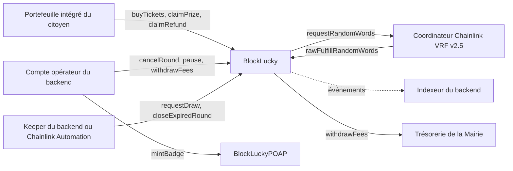

# Vue d'ensemble

Le cœur de BlockLucky est un vrai smart contract Solidity. Il reçoit les mises des citoyens, tire le gagnant avec Chainlink VRF et garde la cagnotte jusqu'à son retrait. Un second contrat délivre un badge de participation non transférable. Le backend ne fait qu'appeler ces contrats et indexer leurs événements : il ne choisit jamais le gagnant et ne détient jamais la cagnotte.

Le projet Hardhat se trouve dans [`smart-contract/`](src:smart-contract/). Il a été écrit pour répondre au brief du kickoff : « créer un smart contract pour une loterie simple », avec des tickets achetés en ethers fictifs et un gagnant tiré au hasard après un certain nombre de participants ou une certaine durée. La décision et ses alternatives sont tracées dans l'[ADR 0004](../architecture/adr/0004-smart-contract-portefeuille-integre.md).

## Les deux contrats

| Contrat | Fichier | Rôle | Hérite de |
|---|---|---|---|
| `BlockLucky` | [`smart-contract/contracts/BlockLucky.sol`](src:smart-contract/contracts/BlockLucky.sol) | Loterie par tours successifs : achat et cadeau de tickets en ethers, tirage Chainlink VRF, cagnotte et remboursements en retrait, commission de la Mairie, disjoncteur | `VRFConsumerBaseV2Plus`, `AccessControl`, `Pausable`, `ReentrancyGuard`, `AutomationCompatibleInterface` |
| `BlockLuckyPOAP` | [`smart-contract/contracts/BlockLuckyPOAP.sol`](src:smart-contract/contracts/BlockLuckyPOAP.sol) | Badge ERC-721 non transférable (« soulbound »), un par participant et par tour, frappé par l'opérateur | `ERC721`, `AccessControl` |

Deux contrats supplémentaires, [`ReentrantPlayer.sol`](src:smart-contract/contracts/test/ReentrantPlayer.sol) et [`RejectingPlayer.sol`](src:smart-contract/contracts/test/RejectingPlayer.sol), ne servent qu'aux tests : le premier tente une réentrance, le second refuse tout paiement. Ils ne sont jamais déployés hors des tests.

Les deux contrats de production sont indépendants : `BlockLucky` ne connaît pas `BlockLuckyPOAP`. C'est le backend qui frappe un badge après un achat, par sa [file d'actions on-chain](../integration-blockchain/actions.md).

## Place dans l'architecture

Les achats sont signés par le portefeuille Ethereum que le backend crée pour chaque citoyen (voir [les portefeuilles intégrés](../integration-blockchain/portefeuilles.md)). Les actions d'exploitation sont signées par le compte opérateur (`RELAYER_PRIVATE_KEY`, voir [le client RPC](../integration-blockchain/client-rpc.md)). Le [keeper](../integration-blockchain/keeper.md) du backend surveille `isDrawReady` et `isExpiredWithoutDraw` et déclenche le tirage ou l'annulation. L'[indexeur](../integration-blockchain/indexeur.md) reconstruit la base à partir des événements.

## Ce que garantit le contrat

| Garantie | Mécanisme | Page |
|---|---|---|
| Le gagnant n'est choisi ni par la Mairie ni par le backend | Mot aléatoire Chainlink VRF v2.5, `randomWords[0] % ticketCount` | [Tirage Chainlink VRF](chainlink-vrf.md) |
| Le tirage ne peut pas être bloqué par le backend | `requestDraw` et `closeExpiredRound` sont appelables par tous dès que les conditions sont remplies | [Cycle de vie d'un tour](cycle-tour.md) |
| Les fonds ne restent jamais bloqués | Retrait de la cagnotte et des remboursements à l'initiative du bénéficiaire, annulation avec remboursement intégral | [Contrat BlockLucky](blocklucky.md) |
| La commission de la Mairie est bornée | 10 % par défaut, refus au-delà de 20 % (`MAX_FEE_BPS = 2000`) | [Contrat BlockLucky](blocklucky.md) |
| La réentrance est impossible | Checks-effects-interactions et `nonReentrant` sur chaque fonction qui déplace des fonds | [Sécurité du contrat](securite.md) |
| Les droits sont séparés | `DEFAULT_ADMIN_ROLE`, `OPERATOR_ROLE`, `PAUSER_ROLE` | [Exploitation du contrat](exploitation.md) |
| Un oracle muet ne fige pas un tour | `retryDraw` après `drawTimeout`, ou `cancelRound` | [Tirage Chainlink VRF](chainlink-vrf.md) |

## Chiffres clés

Valeurs relevées dans le code et en lançant les commandes du projet.

| Indicateur | Valeur |
|---|---|
| Compilateur | Solidity 0.8.34, cible EVM `prague`, optimiseur activé à 200 exécutions |
| Dépendances | `@openzeppelin/contracts` 5.6.1 et `@chainlink/contracts` 1.5.0 |
| Taille de `BlockLucky.sol` | 415 lignes, 11 événements et 18 erreurs personnalisées propres |
| Taille du bytecode | 12 474 octets pour `BlockLucky`, 5 909 pour `BlockLuckyPOAP` (limite EIP-170 : 24 576) |
| Tests | 54 : 50 en TypeScript (Mocha et ethers), dont 7 sur la répartition des rôles au déploiement, et 4 tests de fuzzing Solidity de 256 exécutions |
| Couverture | 100 % des lignes des deux contrats (171 sur 171 et 19 sur 19) |
| Analyse statique | solhint sans avertissement, Slither bloquant dès le niveau Medium |
| Paramètres par défaut d'un tour | 0,01 ETH le ticket, 10 000 tickets, 2 tickets minimum, 100 par participant, 10 % de commission |

## Réseaux

| Réseau | Coordinateur VRF | Usage | Page |
|---|---|---|---|
| Nœud Hardhat local (chain ID 31337) | `VRFCoordinatorV2_5Mock` et un oracle local | Développement, CI, démonstration hors ligne | [Blockchain locale](blockchain-locale.md) |
| Sepolia (chain ID 11155111) | Coordinateur officiel `0x9DdfaCa8183c41ad55329BdeeD9F6A8d53168B1B` | Démonstration publique | [Déploiement sur Sepolia](sepolia.md) |
| Remix | Mock déployé à la main | Lecture et démonstration interactive | [Utiliser Remix](remix.md) |

> [!IMPORTANT]
> À la date de rédaction, aucun déploiement Sepolia n'est enregistré dans le dépôt : aucun fichier `smart-contract/deployments/sepolia.json` n'est versionné. Les scripts Sepolia (abonnement VRF, déploiement avec séparation des rôles, upkeep Automation, vérification Etherscan) existent et sont documentés, mais ils demandent les clés et les fonds de test de l'équipe : portefeuille de déploiement, multisig de la Mairie, ETH et LINK de test, accès RPC, clé Etherscan.

## Commandes du projet

Toutes se lancent depuis `smart-contract/` après `npm ci` (Node.js 22.12 ou plus récent, voir `engines` dans [`package.json`](src:smart-contract/package.json)).

| Commande | Effet |
|---|---|
| `npm run build` | Compile les contrats (`hardhat build`) |
| `npm run typecheck` | Compile puis vérifie le TypeScript des scripts et des tests |
| `npm run lint` | solhint sur `contracts/*.sol`, zéro avertissement toléré |
| `npm test` | Lance les tests Solidity puis Mocha |
| `npm run test:coverage` puis `npm run coverage:check` | Mesure la couverture et échoue sous 100 % des lignes |
| `npm run test:gas` | Coût en gaz de chaque fonction appelée par les tests |
| `npm run slither` | Slither 0.11.6 dans Docker |
| `npm run node` | Démarre un nœud Hardhat local |
| `npm run deploy:local` | Déploie sur le nœud local |
| `npm run vrf:sepolia` | Crée ou recharge l'abonnement VRF Sepolia, financé en ETH ([`setup-vrf-sepolia.ts`](src:smart-contract/scripts/setup-vrf-sepolia.ts)) |
| `npm run deploy:sepolia` | Déploie sur Sepolia et répartit les rôles ([`deploy-sepolia.ts`](src:smart-contract/scripts/deploy-sepolia.ts)) |
| `npm run automation:sepolia` | Inscrit l'upkeep Chainlink Automation ([`register-automation-sepolia.ts`](src:smart-contract/scripts/register-automation-sepolia.ts)) |
| `npm run verify:sepolia` | Publie le code des deux contrats sur Etherscan ([`verify-sepolia.ts`](src:smart-contract/scripts/verify-sepolia.ts)) |
| `npm run export:abi` | Copie les ABI dans `backend/src/blockchain/abi/` |

## Plan de cette partie

1. [Pourquoi Ethereum, Hardhat et Chainlink](choix.md) : les choix de plateforme et d'outillage.
2. [Contrat BlockLucky](blocklucky.md) puis [Cycle de vie d'un tour](cycle-tour.md) : le fonctionnement en profondeur.
3. [Référence de BlockLucky](reference-blocklucky.md) et [Référence de BlockLuckyPOAP](reference-poap.md) : chaque fonction, événement et erreur, générés depuis l'ABI.
4. [Tirage Chainlink VRF](chainlink-vrf.md), [Chainlink Automation](automation.md) et [Badge POAP](poap.md).
5. [Sécurité du contrat](securite.md) et [Tests, fuzzing et couverture](tests.md).
6. [Blockchain locale](blockchain-locale.md), [Déploiement sur Sepolia](sepolia.md) et [Utiliser Remix](remix.md).
7. [Exploitation du contrat](exploitation.md) et [Limites connues](limites.md).
