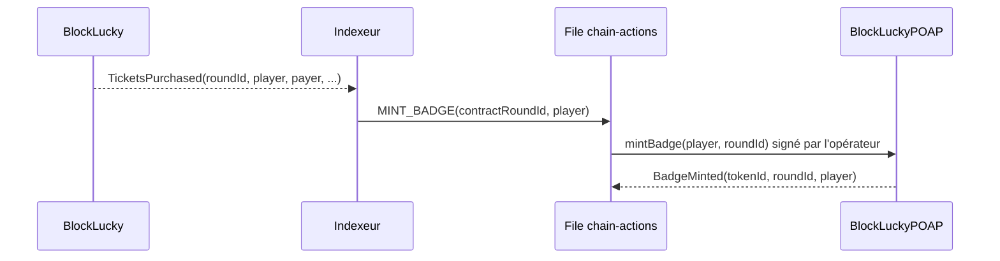

# Badge POAP

`BlockLuckyPOAP` délivre à chaque participant un badge de participation (POAP, « Proof of Attendance Protocol » au sens large) pour chaque tour auquel il a pris part. C'est un jeton ERC-721 non transférable : il atteste une participation, il ne se revend pas. Source : [`smart-contract/contracts/BlockLuckyPOAP.sol`](src:smart-contract/contracts/BlockLuckyPOAP.sol), 64 lignes.

Le badge sert la fidélisation voulue par la Mairie : il reste visible dans le portefeuille du citoyen et sur les explorateurs de blocs, et ses métadonnées sont servies par le backend. La référence complète des fonctions est dans [Référence de BlockLuckyPOAP](reference-poap.md).

## Identité de la collection

| Propriété | Valeur |
|---|---|
| Nom (`name`) | `BlockLucky EtherBay POAP` |
| Symbole (`symbol`) | `BLPOAP` |
| Standard | ERC-721 d'OpenZeppelin 5.6.1, avec `AccessControl` |
| Numérotation | `tokenId` à partir de 1, incrémenté à chaque frappe |
| Transferts | Interdits |
| Destruction | Aucune fonction publique ne détruit un badge |

## État stocké

| Variable | Visibilité | Contenu |
|---|---|---|
| `MINTER_ROLE` | constante publique | `keccak256("MINTER_ROLE")` |
| `totalMinted` | publique | Nombre de badges frappés, égal au dernier `tokenId` |
| `baseTokenUri` | privée | Préfixe des métadonnées, lu par `tokenURI` |
| `roundOfToken` | publique | `tokenId` vers numéro de tour |
| `badgeOf` | publique | Tour et participant vers `tokenId`, 0 si aucun badge |

`badgeOf` sert à la fois de garde contre les doublons et d'index de recherche : `badgeOf(roundId, adresse)` indique sans parcours si un citoyen a son badge pour un tour.

## Frappe

```solidity
function mintBadge(address participant, uint256 roundId) external onlyRole(MINTER_ROLE) returns (uint256 tokenId) {
    if (participant == address(0)) revert ZeroAddressNotAllowed();
    if (badgeOf[roundId][participant] != 0) revert BadgeAlreadyMinted(roundId, participant);

    tokenId = ++totalMinted;
    roundOfToken[tokenId] = roundId;
    badgeOf[roundId][participant] = tokenId;
    _safeMint(participant, tokenId);

    emit BadgeMinted(tokenId, roundId, participant);
}
```

- Seul `MINTER_ROLE` peut frapper. Le constructeur le donne à `admin` ; les scripts de déploiement le donnent aussi à l'opérateur du backend.
- Un participant ne reçoit qu'un badge par tour (`BadgeAlreadyMinted`), mais un badge par tour auquel il participe.
- L'état est écrit avant `_safeMint`, qui peut appeler `onERC721Received` sur un contrat destinataire : une réentrance éventuelle trouverait déjà `badgeOf` renseigné.
- `_safeMint` refuse un contrat destinataire qui n'implémente pas `onERC721Received` (`ERC721InvalidReceiver`). Les portefeuilles intégrés des citoyens sont des comptes externes : la question ne se pose pas pour eux.

Le contrat ne vérifie pas que le participant a réellement acheté un ticket : `BlockLuckyPOAP` ne connaît pas `BlockLucky`. Cette vérification est faite par le backend, qui ne frappe qu'à partir d'un événement `TicketsPurchased` indexé.

### Qui déclenche la frappe

L'[indexeur](../integration-blockchain/indexeur.md) traite chaque `TicketsPurchased`. Pour un achat ou un cadeau dont le bénéficiaire est un citoyen connu, il met en file une action `MINT_BADGE` pour l'adresse du bénéficiaire (`player`), pas du payeur. La [file d'actions on-chain](../integration-blockchain/actions.md) appelle ensuite `mintBadge` avec le compte opérateur. Si le citoyen achète plusieurs fois dans le même tour, les frappes suivantes échouent avec `BadgeAlreadyMinted`, erreur que la file traite comme une action déjà faite.



## Non-transférabilité

```solidity
function _update(address to, uint256 tokenId, address auth) internal override returns (address) {
    address from = _ownerOf(tokenId);
    if (from != address(0) && to != address(0)) revert SoulboundToken(tokenId);
    return super._update(to, tokenId, auth);
}
```

Dans OpenZeppelin 5, toute création, tout transfert et toute destruction passent par `_update`. La surcharge laisse passer les deux cas où une extrémité est nulle (frappe et destruction) et refuse le reste :

| Opération | `from` | `to` | Résultat |
|---|---|---|---|
| Frappe par `mintBadge` | nul | participant | Acceptée |
| `transferFrom` ou `safeTransferFrom` | détenteur | autre adresse | `SoulboundToken(tokenId)`, quel que soit l'appelant |
| Destruction | détenteur | nul | Autorisée par `_update`, mais aucune fonction publique ne l'appelle |

`approve` et `setApprovalForAll` restent appelables, car ils ne passent pas par `_update`, mais ils n'ont aucun effet utile. Le contrat n'implémente pas l'interface ERC-5192 (« minimal soulbound ») : les places de marché ne savent pas d'avance que le jeton est bloqué, elles constatent l'échec du transfert.

## Métadonnées

```solidity
function tokenURI(uint256 tokenId) public view override returns (string memory) {
    _requireOwned(tokenId);
    return string.concat(baseTokenUri, roundOfToken[tokenId].toString(), ".json");
}
```

L'URL dépend du **tour**, pas du badge : tous les badges d'un même tour partagent un fichier de métadonnées. Avec le préfixe local, le badge du tour 3 pointe vers `http://localhost:2053/api/v1/lottery/poap/3.json`.

| Réseau | Préfixe | Source |
|---|---|---|
| Local | `http://localhost:2053/api/v1/lottery/poap/` | `POAP_BASE_URI` dans `docker-compose.yml`, même valeur par défaut dans `deploy-local.ts` |
| Sepolia | Valeur obligatoire `POAP_BASE_URI`, par exemple `https://api.etherbay.tech/api/v1/lottery/poap/` | `deploy-sepolia.ts` |
| Tests | `https://poap.etherbay.fr/rounds/` | `deployPoapFixture` |

Le backend sert le JSON et une image SVG générée pour chaque tour, depuis [`backend/src/blockchain/poap.metadata.ts`](src:backend/src/blockchain/poap.metadata.ts) : voir [Métadonnées POAP](../integration-blockchain/metadonnees-poap.md). Le JSON déclare notamment un attribut « Transférable : Non ».

`setBaseUri`, réservé à `DEFAULT_ADMIN_ROLE`, change le préfixe pour tous les badges existants et futurs, et émet `BaseUriUpdated`. Il sert à migrer les métadonnées vers un autre domaine ou vers IPFS. Les métadonnées ne sont donc pas figées : l'administrateur peut les modifier.

## Rôles

| Rôle | Titulaire | Fonctions |
|---|---|---|
| `DEFAULT_ADMIN_ROLE` | Mairie | `setBaseUri`, `grantRole`, `revokeRole` |
| `MINTER_ROLE` | Mairie et opérateur du backend | `mintBadge` |

Contrairement à `BlockLucky`, ce contrat n'a ni propriétaire `ConfirmedOwner`, ni pause, ni fonds : il ne détient aucun ether.

## Tests

Cinq tests dans [`test/BlockLuckyPOAP.test.ts`](src:smart-contract/test/BlockLuckyPOAP.test.ts), qui couvrent 100 % des lignes (19 sur 19) :

| Test | Vérifie |
|---|---|
| « délivre un badge par participant et par tour » | Frappe, `BadgeMinted`, `ownerOf`, `badgeOf`, `tokenURI`, refus du doublon, second badge pour un autre tour |
| « réserve la création de badges au rôle MINTER » | `AccessControlUnauthorizedAccount` pour un tiers |
| « rend les badges non transférables » | `SoulboundToken` sur `transferFrom` par le détenteur |
| « refuse l'adresse nulle et un badge inexistant » | `ZeroAddressNotAllowed` au constructeur et à la frappe, `ERC721NonexistentToken` sur `tokenURI` |
| « permet à la Mairie de changer l'adresse des métadonnées » | `setBaseUri` réservé à l'administrateur, nouvelle URL, interface ERC-721 `0x80ac58cd` |

Coût mesuré : `mintBadge` de 108 864 à 143 064 gaz, déploiement 1 487 605 gaz, bytecode de 5 909 octets.
