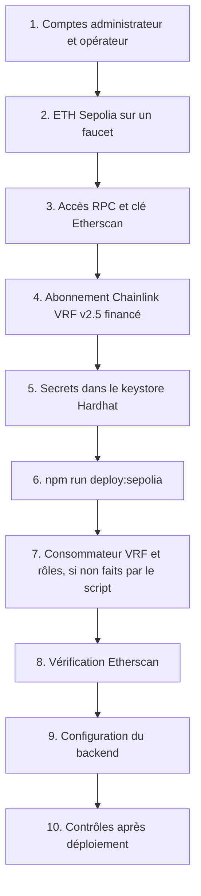

# Déploiement sur Sepolia

Sepolia est le réseau de test public d'Ethereum (chain ID 11155111). Y déployer BlockLucky permet une démonstration publique avec le vrai coordinateur Chainlink VRF et un code source vérifiable sur Etherscan. Cette page donne la procédure complète, de la création des comptes à la configuration du backend.

> [!IMPORTANT]
> Ces étapes demandent des comptes personnels (portefeuille, faucet, Chainlink, fournisseur RPC, Etherscan) et sont à réaliser par l'équipe. À la date de rédaction, aucun déploiement Sepolia n'est consigné dans le dépôt : il n'existe pas de `smart-contract/deployments/sepolia.json`.

## Vue d'ensemble



## 1. Comptes

Créer deux comptes Ethereum distincts, par exemple dans MetaMask :

| Compte | Usage | Variable |
|---|---|---|
| Administrateur de la Mairie | Déploie les contrats, détient `DEFAULT_ADMIN_ROLE` et la propriété `ConfirmedOwner`, possède l'abonnement VRF | `SEPOLIA_PRIVATE_KEY` |
| Opérateur du backend | Tirage automatique, frappe des badges, dotations de bienvenue, annulation et pause | `RELAYER_PRIVATE_KEY` côté backend, `OPERATOR_ADDRESS` au déploiement |

Les séparer limite l'impact d'une fuite : la clé de l'opérateur vit sur le serveur, celle de l'administrateur n'a pas à y être. L'administrateur et la trésorerie peuvent aussi être séparés du compte qui déploie par `MAIRIE_ADMIN_ADDRESS` et `MAIRIE_TREASURY_ADDRESS` ; dans ce cas, le script ne peut pas accorder lui-même les rôles (voir l'étape 7).

## 2. ETH de test

Obtenir de l'ETH Sepolia sur un faucet public, par exemple ceux de Google Cloud ou d'Alchemy, pour les deux comptes. Les besoins :

- l'administrateur paie le déploiement des deux contrats (environ 3,2 millions et 1,5 million de gaz, d'après le [rapport de gaz](tests.md#rapport-de-gaz)) et les transactions de configuration ;
- l'opérateur paie le gaz du keeper (environ 213 000 gaz par tirage), des frappes de badges (jusqu'à 143 000 gaz chacune) et la dotation de bienvenue de chaque citoyen, 0,1 ETH par défaut (`WELCOME_GRANT_WEI`). C'est le poste dominant.

## 3. Accès RPC et clé Etherscan

- Créer un accès RPC Sepolia chez un fournisseur (Alchemy, Infura) ou utiliser un nœud public. Noter l'URL HTTPS.
- Créer une clé d'API sur Etherscan, pour la vérification du code source.

## 4. Abonnement Chainlink VRF

1. Sur [vrf.chain.link](https://vrf.chain.link), réseau Sepolia, connecter le compte administrateur et créer un abonnement VRF v2.5.
2. Le financer en LINK de test (faucet Chainlink) ou en ETH Sepolia.
3. Noter son identifiant : c'est un grand entier.

Le choix du financement détermine le mode de paiement : le script règle `nativePayment` à `true` si l'abonnement n'a aucun LINK, à `false` sinon. Si l'abonnement est financé dans les deux monnaies, le LINK est utilisé.

Il est préférable que l'abonnement appartienne au compte qui déploie : le script peut alors ajouter le contrat comme consommateur lui-même.

## 5. Secrets dans le keystore Hardhat

[`hardhat.config.ts`](src:smart-contract/hardhat.config.ts) lit trois secrets par `configVariable`, qui cherche d'abord dans le keystore chiffré de Hardhat, puis dans les variables d'environnement. Depuis `smart-contract/`, saisir chacun ; Hardhat demande la valeur et un mot de passe de keystore, sans écho à l'écran :

```bash
npx hardhat keystore set SEPOLIA_RPC_URL
```

```bash
npx hardhat keystore set SEPOLIA_PRIVATE_KEY
```

```bash
npx hardhat keystore set ETHERSCAN_API_KEY
```

`npx hardhat keystore list` affiche les clés enregistrées, sans leurs valeurs. Le keystore est stocké hors du dépôt (`npx hardhat keystore path` en donne l'emplacement) : aucun secret ne passe par Git ni par l'historique du shell.

## 6. Déploiement

Variables lues par [`scripts/deploy-sepolia.ts`](src:smart-contract/scripts/deploy-sepolia.ts) :

| Variable | Obligatoire | Effet |
|---|---|---|
| `SEPOLIA_VRF_SUBSCRIPTION_ID` | Oui | Identifiant de l'abonnement VRF |
| `POAP_BASE_URI` | Oui | Préfixe des métadonnées des badges, par exemple `https://api.etherbay.tech/api/v1/lottery/poap/` |
| `OPERATOR_ADDRESS` | Non | Opérateur à habiliter |
| `MAIRIE_ADMIN_ADDRESS` | Non | Administrateur, par défaut le déployeur |
| `MAIRIE_TREASURY_ADDRESS` | Non | Trésorerie, par défaut le déployeur |
| `SEPOLIA_VRF_COORDINATOR` | Non | Coordinateur, par défaut `0x9DdfaCa8183c41ad55329BdeeD9F6A8d53168B1B` |
| `SEPOLIA_VRF_KEY_HASH` | Non | Key hash, par défaut `0x787d74caea10b2b357790d5b5247c2f63d1d91572a9846f780606e4d953677ae` |
| `TICKET_PRICE_WEI`, `MAX_TICKETS`, `MIN_TICKETS_TO_DRAW`, `MAX_TICKETS_PER_PLAYER`, `ROUND_DURATION_SECONDS`, `MUNICIPALITY_FEE_BPS` | Non | Configuration des tours ; durée de 48 heures par défaut |

Lancer, en adaptant l'identifiant, l'adresse et l'URL :

```bash
SEPOLIA_VRF_SUBSCRIPTION_ID=123 OPERATOR_ADDRESS=0x... POAP_BASE_URI=https://api.etherbay.tech/api/v1/lottery/poap/ npm run deploy:sepolia
```

Sous PowerShell :

```powershell
$env:SEPOLIA_VRF_SUBSCRIPTION_ID = "123"; $env:OPERATOR_ADDRESS = "0x..."; $env:POAP_BASE_URI = "https://api.etherbay.tech/api/v1/lottery/poap/"; npm run deploy:sepolia
```

### Vérifications faites par le script

Avant toute dépense, le script s'arrête si :

| Vérification | Message |
|---|---|
| Le chain ID n'est pas 11155111 | « Réseau inattendu (chainId …), ce script cible Sepolia » |
| `SEPOLIA_VRF_SUBSCRIPTION_ID` est absent | « Variable SEPOLIA_VRF_SUBSCRIPTION_ID manquante » |
| La key hash n'est pas enregistrée sur le coordinateur (`s_provingKeys`) | « La key hash … n'est pas enregistrée sur le coordinateur … » |
| L'abonnement n'a ni LINK ni ETH (`getSubscription`) | « L'abonnement VRF … n'est pas financé (LINK ou ETH Sepolia) » |

`POAP_BASE_URI` n'est vérifié qu'après le déploiement de `BlockLucky` : s'il manque, `BlockLucky` est déjà déployé et le script s'arrête avant `BlockLuckyPOAP`. Mieux vaut donc toujours le fournir.

### Ce que fait le script

1. Déploie `BlockLucky` avec la configuration VRF suivante : `callbackGasLimit` 500 000, `requestConfirmations` 3, `drawTimeout` 24 heures, `nativePayment` selon le financement.
2. Déploie `BlockLuckyPOAP(admin, POAP_BASE_URI)`.
3. Si le déployeur possède l'abonnement, appelle `addConsumer(subId, lottery)` ; sinon, affiche l'action à faire.
4. Si `OPERATOR_ADDRESS` est fourni et différent de l'administrateur, et si l'administrateur est le déployeur, accorde `OPERATOR_ROLE` et `PAUSER_ROLE` sur `BlockLucky` et `MINTER_ROLE` sur `BlockLuckyPOAP` ; sinon, affiche l'action à faire.
5. Écrit `deployments/sepolia.json` (même format que `localhost.json`, avec `mock: false`) et `deployments/sepolia-blocklucky-args.ts`, qui exporte les arguments du constructeur pour la vérification.
6. Affiche les adresses et les deux commandes de vérification Etherscan prêtes à copier.

## 7. Consommateur VRF et rôles, si nécessaire

Si le script a affiché « À faire par … », terminer à la main :

- **Consommateur VRF** : le propriétaire de l'abonnement l'ajoute sur [vrf.chain.link](https://vrf.chain.link), dans la page de l'abonnement, avec l'adresse de `BlockLucky`. Sans cela, tout `requestDraw` échoue.
- **Rôles** : l'administrateur appelle `grantRole(OPERATOR_ROLE, opérateur)` et `grantRole(PAUSER_ROLE, opérateur)` sur `BlockLucky`, et `grantRole(MINTER_ROLE, opérateur)` sur `BlockLuckyPOAP`. Une fois le code vérifié, cela se fait dans l'onglet « Write Contract » d'Etherscan avec MetaMask, ou dans la console Hardhat (voir [Exploitation du contrat](exploitation.md#roles)).

Le propriétaire `ConfirmedOwner` de `BlockLucky` reste le compte qui a déployé, même si `MAIRIE_ADMIN_ADDRESS` est différent. Il peut changer le coordinateur VRF : le transférer à l'administrateur est recommandé (voir [Sécurité du contrat](securite.md#abus-de-l-administrateur)).

## 8. Vérification sur Etherscan

Publier le code source permet à quiconque de relire le contrat et d'interagir avec lui depuis Etherscan. Utiliser les commandes affichées par le script ; elles ont cette forme :

```bash
npx hardhat verify --network sepolia --constructor-args-path deployments/sepolia-blocklucky-args.ts <adresse BlockLucky>
```

```bash
npx hardhat verify --network sepolia <adresse BlockLuckyPOAP> <adresse administrateur> "https://api.etherbay.tech/api/v1/lottery/poap/"
```

`verify` de Hardhat 3 tente la vérification sur tous les explorateurs pris en charge (Etherscan, Blockscout, Sourcify) et lit `ETHERSCAN_API_KEY` dans le keystore. Le compilateur et ses réglages (0.8.34, `prague`, optimiseur à 200) sont repris de la configuration.

## 9. Configuration du backend

Renseigner dans l'environnement du backend (voir [Variables d'environnement](../backend/variables-environnement.md)) :

| Variable | Valeur |
|---|---|
| `BLOCKCHAIN_MODE` | `onchain` |
| `RPC_URL` | Accès RPC Sepolia |
| `CHAIN_ID` | `11155111` |
| `CHAIN_START_BLOCK` | `deploymentBlock` de `deployments/sepolia.json` |
| `CHAIN_CONFIRMATIONS` | `2` |
| `EXPLORER_URL` | `https://sepolia.etherscan.io` |
| `LOTTERY_CONTRACT_ADDRESS` | `contracts.lottery` de `deployments/sepolia.json` |
| `POAP_CONTRACT_ADDRESS` | `contracts.poap` de `deployments/sepolia.json` |
| `RELAYER_PRIVATE_KEY` | Clé privée de l'opérateur |

> [!WARNING]
> `deploymentBlock` est lu juste après le déploiement de `BlockLucky`. Si un bloc a été produit entre-temps, il est postérieur au bloc qui contient l'événement `RoundOpened` du tour 1. Vérifier sur Etherscan le bloc de la transaction de création de `BlockLucky` et prendre la plus petite des deux valeurs pour `CHAIN_START_BLOCK`.

Le fonctionnement du backend en mode on-chain est détaillé dans [Intégration blockchain du backend](../integration-blockchain/index.md), le déploiement du serveur dans [Déploiement sur etherbay.tech](../infrastructure/deploiement-etherbay.md).

## 10. Contrôles après déploiement

| Contrôle | Comment | Attendu |
|---|---|---|
| Tour 1 ouvert | `currentRoundId()` puis `getRound(1)` | 1, statut 0, `endTime` à T + 48 h |
| Consommateur VRF | Page de l'abonnement sur vrf.chain.link | Adresse de `BlockLucky` listée |
| Rôles de l'opérateur | `hasRole(OPERATOR_ROLE, opérateur)`, `hasRole(PAUSER_ROLE, opérateur)`, `hasRole(MINTER_ROLE, opérateur)` sur le POAP | `true` |
| Trésorerie | `treasury()` | Adresse prévue |
| Code vérifié | Onglet « Contract » d'Etherscan | Coche de vérification |
| Tirage de bout en bout | Deux achats, puis `requestDraw` à l'expiration, puis attente | `WinnerPicked` quelques blocs après `DrawRequested` |

Pour un premier essai rapide, déployer avec une durée courte (`ROUND_DURATION_SECONDS=600`), puis remettre la durée normale par `setRoundConfig`, qui s'appliquera au tour suivant.

## Redéployer

Un contrat déployé ne se modifie pas. Corriger un bug ou changer une règle impose de redéployer et de reconfigurer : voir [Exploitation du contrat](exploitation.md#redeploiement).
