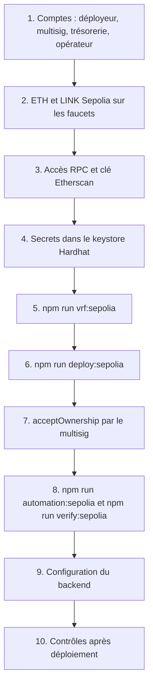

# Déploiement sur Sepolia

Sepolia est le réseau de test public d'Ethereum (chain ID 11155111). Y déployer BlockLucky permet une démonstration publique avec le vrai coordinateur Chainlink VRF, un upkeep Chainlink Automation et un code source vérifiable sur Etherscan. Cette page donne la procédure complète, de la création des comptes à la configuration du backend. Elle reprend le pas à pas de [`smart-contract/README.md`](src:smart-contract/README.md).

> [!IMPORTANT]
> Les scripts sont prêts, mais ces étapes demandent des comptes et des fonds de test personnels (portefeuilles, faucets, fournisseur RPC, Etherscan, multisig de la Mairie) : elles sont à réaliser par l'équipe. À la date de rédaction, aucun déploiement Sepolia n'a eu lieu : il n'existe ni `smart-contract/deployments/sepolia.json`, ni `smart-contract/deployments/sepolia-vrf.json`.

## Vue d'ensemble



## 1. Comptes

Chaque rôle du contrat a son propre compte. La répartition est calculée par `planRoles` de [`scripts/lib/roles.ts`](src:smart-contract/scripts/lib/roles.ts) et appliquée par `applyRoles` :

| Compte | Usage | Variable |
|---|---|---|
| Déployeur | Clé jetable dédiée : déploie, crée l'abonnement VRF, inscrit l'upkeep, puis perd tout rôle d'administration | `SEPOLIA_PRIVATE_KEY` (keystore) |
| Administrateur de la Mairie | Multisig (Safe par exemple) : `DEFAULT_ADMIN_ROLE` sur les deux contrats, administrateur de l'upkeep | `MAIRIE_ADMIN_ADDRESS` |
| Trésorerie | Reçoit la commission | `MAIRIE_TREASURY_ADDRESS` |
| Opérateur du backend | `OPERATOR_ROLE` et `MINTER_ROLE` : tirage automatique, frappe des badges, dotations de bienvenue, annulation | `OPERATOR_ADDRESS` au déploiement, `RELAYER_PRIVATE_KEY` côté backend |
| Pauseur | `PAUSER_ROLE` (disjoncteur) | `PAUSER_ADDRESS`, l'opérateur par défaut |
| Propriétaire VRF | Propriété `ConfirmedOwner` (`setCoordinator`) | `VRF_OWNER_ADDRESS`, l'administrateur par défaut |

Le script refuse une adresse absente, invalide ou nulle, et un administrateur identique à l'opérateur. `ALLOW_SHARED_ROLES=true` lève ce dernier refus ; il n'est pas recommandé, puisque la clé de l'opérateur vit sur le serveur.

## 2. Fonds de test

| Monnaie | Pour qui | Usage | Quantité conseillée |
|---|---|---|---|
| ETH Sepolia | Déployeur | Gaz des deux déploiements (environ 3,2 millions et 1,5 million de gaz, d'après le [rapport de gaz](tests.md#rapport-de-gaz)) et des transactions de rôles, financement de l'abonnement VRF | au moins 1 ETH |
| LINK Sepolia | Déployeur | Financement de l'upkeep Chainlink Automation | au moins 5 LINK |
| ETH Sepolia | Opérateur | Gaz du keeper (environ 213 000 gaz par tirage), des frappes de badges (jusqu'à 143 000 gaz chacune) et dotation de bienvenue de chaque citoyen, 0,5 ETH par défaut (`WELCOME_GRANT_WEI`) | selon le nombre de citoyens |

Faucets possibles : sepoliafaucet.com, le faucet Web3 de Google Cloud et faucets.chain.link (ETH et LINK). La dotation de bienvenue est le poste dominant : la réduire sur Sepolia, où l'ETH de test se distribue au compte-gouttes, en gardant de quoi payer un ticket et ses frais.

## 3. Accès RPC et clé Etherscan

- Créer un accès RPC Sepolia chez un fournisseur (Alchemy, Infura) ou utiliser un nœud public. Noter l'URL HTTPS.
- Créer une clé d'API sur Etherscan, pour la vérification du code source.

## 4. Secrets dans le keystore Hardhat

[`hardhat.config.ts`](src:smart-contract/hardhat.config.ts) lit trois secrets par `configVariable`, qui cherche d'abord dans le keystore chiffré de Hardhat, puis dans les variables d'environnement. Depuis `smart-contract/`, saisir chacun ; Hardhat demande la valeur et un mot de passe de keystore, sans écho à l'écran :

```bash
npx hardhat keystore set SEPOLIA_PRIVATE_KEY
```

```bash
npx hardhat keystore set SEPOLIA_RPC_URL
```

```bash
npx hardhat keystore set ETHERSCAN_API_KEY
```

`npx hardhat keystore list` affiche les clés enregistrées, sans leurs valeurs. Le keystore est stocké hors du dépôt (`npx hardhat keystore path` en donne l'emplacement) : aucun secret ne passe par Git ni par l'historique du shell.

## 5. Abonnement Chainlink VRF

[`scripts/setup-vrf-sepolia.ts`](src:smart-contract/scripts/setup-vrf-sepolia.ts) crée et finance l'abonnement VRF v2.5 :

```bash
npm run vrf:sepolia
```

1. Il vérifie le réseau et que le solde du déployeur dépasse le montant à verser.
2. Il réutilise l'abonnement de `SEPOLIA_VRF_SUBSCRIPTION_ID` ou de `deployments/sepolia-vrf.json` s'il existe (rechargement seulement) ; sinon, ou avec `VRF_NEW_SUBSCRIPTION=true`, il appelle `createSubscription` sur le coordinateur.
3. Il verse `VRF_FUND_ETH` ETH Sepolia (0,5 par défaut) par `fundSubscriptionWithNative`.
4. Il écrit `deployments/sepolia-vrf.json` (coordinateur, identifiant, propriétaire, soldes ETH et LINK, date) et affiche `SEPOLIA_VRF_SUBSCRIPTION_ID=<identifiant>`.

Le coordinateur est `0x9DdfaCa8183c41ad55329BdeeD9F6A8d53168B1B`, modifiable par `SEPOLIA_VRF_COORDINATOR`. Un abonnement créé à la main sur [vrf.chain.link](https://vrf.chain.link) et financé en LINK reste possible : passer alors son identifiant par `SEPOLIA_VRF_SUBSCRIPTION_ID`.

## 6. Déploiement

Variables lues par [`scripts/deploy-sepolia.ts`](src:smart-contract/scripts/deploy-sepolia.ts) :

| Variable | Obligatoire | Effet |
|---|---|---|
| `MAIRIE_ADMIN_ADDRESS` | Oui | Multisig administrateur des deux contrats |
| `MAIRIE_TREASURY_ADDRESS` | Oui | Trésorerie |
| `OPERATOR_ADDRESS` | Oui | Opérateur du backend |
| `POAP_BASE_URI` | Oui | Préfixe des métadonnées des badges, par exemple `https://api.etherbay.tech/api/v1/lottery/poap/` |
| `PAUSER_ADDRESS` | Non | Pauseur, par défaut l'opérateur |
| `VRF_OWNER_ADDRESS` | Non | Propriétaire VRF, par défaut l'administrateur |
| `ALLOW_SHARED_ROLES` | Non | `true` pour accepter administrateur = opérateur |
| `SEPOLIA_VRF_SUBSCRIPTION_ID` | Non | Abonnement VRF, par défaut celui de `deployments/sepolia-vrf.json` |
| `VRF_NATIVE_PAYMENT` | Non | Force `nativePayment` à `true` ou `false` |
| `SEPOLIA_VRF_COORDINATOR` | Non | Coordinateur, par défaut `0x9DdfaCa8183c41ad55329BdeeD9F6A8d53168B1B` |
| `SEPOLIA_VRF_KEY_HASH` | Non | Key hash, par défaut `0x787d74caea10b2b357790d5b5247c2f63d1d91572a9846f780606e4d953677ae` |
| `TICKET_PRICE_WEI`, `MAX_TICKETS`, `MIN_TICKETS_TO_DRAW`, `MAX_TICKETS_PER_PLAYER`, `ROUND_DURATION_SECONDS`, `MUNICIPALITY_FEE_BPS` | Non | Configuration des tours ; durée de 48 heures par défaut |

Sous PowerShell, en adaptant les adresses :

```powershell
$env:MAIRIE_ADMIN_ADDRESS = "0x..."; $env:MAIRIE_TREASURY_ADDRESS = "0x..."; $env:OPERATOR_ADDRESS = "0x..."; $env:POAP_BASE_URI = "https://api.etherbay.tech/api/v1/lottery/poap/"; npm run deploy:sepolia
```

En Bash :

```bash
MAIRIE_ADMIN_ADDRESS=0x... MAIRIE_TREASURY_ADDRESS=0x... OPERATOR_ADDRESS=0x... POAP_BASE_URI=https://api.etherbay.tech/api/v1/lottery/poap/ npm run deploy:sepolia
```

### Vérifications faites par le script

Avant toute dépense, le script s'arrête si :

| Vérification | Message |
|---|---|
| Le chain ID n'est pas 11155111 | « Réseau inattendu (chainId …), ce script cible Sepolia » |
| Une adresse de rôle obligatoire manque, est invalide ou nulle | « Adresse MAIRIE_ADMIN_ADDRESS manquante » (ou invalide, ou nulle refusée) |
| L'administrateur est l'opérateur, sans `ALLOW_SHARED_ROLES=true` | « L'administrateur et l'opérateur doivent être distincts … » |
| Aucun abonnement VRF n'est trouvé | « Abonnement VRF introuvable : lancer npm run vrf:sepolia ou renseigner SEPOLIA_VRF_SUBSCRIPTION_ID » |
| `POAP_BASE_URI` est absent | « Variable POAP_BASE_URI manquante » |
| La key hash n'est pas enregistrée sur le coordinateur (`s_provingKeys`) | « La key hash … n'est pas enregistrée sur le coordinateur … » |
| L'abonnement n'a ni LINK ni ETH (`getSubscription`) | « L'abonnement VRF … n'est pas financé (LINK ou ETH Sepolia) » |

### Ce que fait le script

1. Déploie `BlockLucky` avec le déployeur comme administrateur provisoire, la trésorerie prévue et la configuration VRF : `callbackGasLimit` 500 000, `requestConfirmations` 3, `drawTimeout` 24 heures, `nativePayment` à `true` si l'abonnement a un solde en ETH (cas de `npm run vrf:sepolia`), sauf `VRF_NATIVE_PAYMENT`.
2. Déploie `BlockLuckyPOAP(déployeur, POAP_BASE_URI)`.
3. Si le déployeur possède l'abonnement, appelle `addConsumer(subId, lottery)` ; sinon, l'affiche dans les actions restantes.
4. Accorde `DEFAULT_ADMIN_ROLE` à l'administrateur sur les deux contrats, `OPERATOR_ROLE` à l'opérateur et `PAUSER_ROLE` au pauseur sur `BlockLucky`, `MINTER_ROLE` à l'opérateur sur `BlockLuckyPOAP`, positionne la trésorerie si besoin (`setTreasury`) et propose la propriété VRF (`transferOwnership(VRF_OWNER_ADDRESS)`).
5. Retire au déployeur `OPERATOR_ROLE`, `PAUSER_ROLE` et `MINTER_ROLE`, puis le fait renoncer à `DEFAULT_ADMIN_ROLE` (`renounceRole`) : aucune clé chaude ne garde le pouvoir d'administration.
6. Relit les titulaires (`readRoleHolders`) et s'arrête sur « Rôles incohérents » si l'un manque ou si le déployeur a gardé un rôle (`roleProblems`).
7. Écrit `deployments/sepolia.json` : réseau, bloc de déploiement, adresses, configuration VRF (`nativePayment`, propriétaire de l'abonnement, `consumerAdded`), plan de rôles appliqué (`roles`, avec `deployerRenouncedAdmin` et `vrfOwnershipPending`), arguments des constructeurs (`constructorArgs`) et configuration des tours.
8. Affiche le tableau des titulaires, le bloc de déploiement et les actions restantes.

La répartition des rôles est couverte par [`test/roles.test.ts`](src:smart-contract/test/roles.test.ts) sur le réseau Hardhat (voir [Tests](tests.md)) ; le script lui-même n'est exécuté par aucun test.

## 7. Actions du multisig

La propriété `ConfirmedOwner` de Chainlink se transfère en deux temps : le script a appelé `transferOwnership(VRF_OWNER_ADDRESS)`, et le nouveau propriétaire doit appeler `acceptOwnership()` sur `BlockLucky`, depuis l'onglet « Write Contract » d'Etherscan ou le Transaction Builder du Safe. Tant que ce n'est pas fait, le déployeur reste propriétaire et peut changer le coordinateur VRF. Le script rappelle cette action en fin d'exécution.

Si l'abonnement VRF n'appartient pas au déployeur, son propriétaire ajoute aussi `BlockLucky` comme consommateur sur [vrf.chain.link](https://vrf.chain.link). Sans cela, tout `requestDraw` échoue.

## 8. Automation et vérification sur Etherscan

```bash
npm run automation:sepolia
```

Cette commande inscrit l'upkeep Chainlink Automation et l'ajoute à `deployments/sepolia.json` (voir [Chainlink Automation](automation.md#basculer-vers-chainlink-automation)).

```bash
npm run verify:sepolia
```

[`scripts/verify-sepolia.ts`](src:smart-contract/scripts/verify-sepolia.ts) publie le code source des deux contrats sur Etherscan par `verifyContract` de `@nomicfoundation/hardhat-verify`, avec les arguments de constructeur enregistrés dans `deployments/sepolia.json`, et affiche le lien `https://sepolia.etherscan.io/address/<adresse>#code`. Il lit `ETHERSCAN_API_KEY` dans le keystore. Le compilateur et ses réglages (0.8.34, `prague`, optimiseur à 200) sont repris de la configuration.

## 9. Configuration du backend

Renseigner dans l'environnement du backend (voir [Variables d'environnement](../backend/variables-environnement.md)) :

| Variable | Valeur |
|---|---|
| `BLOCKCHAIN_MODE` | `onchain` |
| `RPC_URL` | Accès RPC Sepolia |
| `CHAIN_ID` | `11155111` |
| `CHAIN_START_BLOCK` | `deploymentBlock` de `deployments/sepolia.json` |
| `CHAIN_CONFIRMATIONS` | `2` |
| `EXPLORER_URL` | `https://sepolia.etherscan.io` |
| `LOTTERY_CONTRACT_ADDRESS` | `contracts.lottery` de `deployments/sepolia.json` |
| `POAP_CONTRACT_ADDRESS` | `contracts.poap` de `deployments/sepolia.json` |
| `RELAYER_PRIVATE_KEY` | Clé privée de `OPERATOR_ADDRESS` |

> [!WARNING]
> `deploymentBlock` est lu juste après le déploiement de `BlockLucky`. Si un bloc a été produit entre-temps, il est postérieur au bloc qui contient l'événement `RoundOpened` du tour 1. Vérifier sur Etherscan le bloc de la transaction de création de `BlockLucky` et prendre la plus petite des deux valeurs pour `CHAIN_START_BLOCK`.

> [!NOTE]
> Le reversement de commission depuis l'espace Mairie appelle `setTreasury`, réservé à `DEFAULT_ADMIN_ROLE`, quand l'adresse saisie diffère de la trésorerie enregistrée. Sur Sepolia, l'opérateur n'a pas ce rôle : saisir l'adresse `MAIRIE_TREASURY_ADDRESS` ; changer de trésorerie passe par le multisig.

Le fonctionnement du backend en mode on-chain est détaillé dans [Intégration blockchain du backend](../integration-blockchain/index.md), le déploiement du serveur dans [Déploiement sur etherbay.tech](../infrastructure/deploiement-etherbay.md).

## 10. Contrôles après déploiement

| Contrôle | Comment | Attendu |
|---|---|---|
| Tour 1 ouvert | `currentRoundId()` puis `getRound(1)` | 1, statut 0, `endTime` à T + 48 h |
| Consommateur VRF | Page de l'abonnement sur vrf.chain.link | Adresse de `BlockLucky` listée |
| Rôles | `hasRole(DEFAULT_ADMIN_ROLE, multisig)` sur les deux contrats, `hasRole(OPERATOR_ROLE, opérateur)`, `hasRole(PAUSER_ROLE, pauseur)`, `hasRole(MINTER_ROLE, opérateur)` sur le POAP | `true` |
| Déployeur sans pouvoir | `hasRole(DEFAULT_ADMIN_ROLE, déployeur)` sur les deux contrats | `false` |
| Propriété VRF | `owner()` après `acceptOwnership` | `VRF_OWNER_ADDRESS` |
| Upkeep | Page `automation.chain.link/sepolia/<identifiant>` | Upkeep actif et financé |
| Trésorerie | `treasury()` | Adresse prévue |
| Code vérifié | Onglet « Contract » d'Etherscan | Coche de vérification |
| Tirage de bout en bout | Deux achats, puis `requestDraw` à l'expiration, puis attente | `WinnerPicked` quelques blocs après `DrawRequested` |

Pour un premier essai rapide, déployer avec une durée courte (`ROUND_DURATION_SECONDS=600`), puis faire remettre la durée normale par le multisig (`setRoundConfig`), qui s'appliquera au tour suivant.

## Redéployer

Un contrat déployé ne se modifie pas. Corriger un bug ou changer une règle impose de redéployer et de reconfigurer : voir [Exploitation du contrat](exploitation.md#redeploiement).
