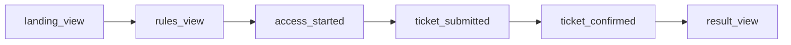

# Analytique et consentement

Le kickoff demande de mesurer le parcours des citoyens et l'efficacité des canaux d'acquisition, avec un public cible de 18 à 35 ans. Le frontend web y répond par une mesure d'audience maison : il envoie lui-même des événements à l'API BlockLucky, sans outil tiers, sans cookie et sans traceur publicitaire. Cette mesure ne fonctionne qu'avec l'accord du visiteur, demandé par un bandeau au premier accès et modifiable à tout moment par « Gérer mes traceurs ». L'application mobile n'envoie aucun de ces événements.

Fichiers concernés :

| Fichier | Rôle |
|---|---|
| [`frontend-web/src/lib/analytics.ts`](src:frontend-web/src/lib/analytics.ts) | `trackEvent`, capture et mémorisation de la source UTM |
| [`frontend-web/src/lib/consent.ts`](src:frontend-web/src/lib/consent.ts) | Enregistrement, lecture et expiration du choix de mesure d'audience |
| [`frontend-web/src/components/layout/ConsentBanner.tsx`](src:frontend-web/src/components/layout/ConsentBanner.tsx) | Bandeau `ConsentBanner` et boutons `ConsentControls` |
| [`frontend-web/src/app/traceurs/page.tsx`](src:frontend-web/src/app/traceurs/page.tsx), [`confidentialite/page.tsx`](src:frontend-web/src/app/confidentialite/page.tsx) | Politiques relative aux traceurs et de confidentialité, avec les boutons de choix |
| [`frontend-web/src/content/legal.ts`](src:frontend-web/src/content/legal.ts) | Textes des documents légaux |
| [`frontend-web/src/app/mairie/analytique/page.tsx`](src:frontend-web/src/app/mairie/analytique/page.tsx) | Restitution pour la Mairie |
| [`backend/src/api/analytics/analytics.routes.ts`](src:backend/src/api/analytics/analytics.routes.ts) | `POST /analytics/track` et `GET /analytics/dashboard` |

## Le parcours instrumenté

Six événements suivent le parcours de démonstration, dans l'ordre où un citoyen les rencontre :

| Événement | Déclenché par | Métadonnées |
|---|---|---|
| `landing_view` | Affichage de `/` | aucune |
| `rules_view` | Affichage de `/transparence` | aucune |
| `access_started` | Premier focus ou premier clic dans le formulaire de `/connexion` (une seule fois par affichage) | `ageGroup` |
| `ticket_submitted` | `purchaseTicket` avant l'appel à `POST /lottery/buy` | `quantity`, `retryAttempt` |
| `ticket_confirmed` | Réponse positive de l'achat | `quantity`, `tickets` |
| `result_view` | Un gagnant est connu sur `/` ou sur `/tirage` | `source` : `landing` ou `live_draw` |

Trois événements complémentaires existent :

| Événement | Déclenché par | Métadonnées |
|---|---|---|
| `LOGIN_2FA_REQUIRED` | Réponse de `POST /auth/login` qui exige un code | `ageGroup`, `provider` |
| `LOGIN_SUCCESS` | Réponse de `POST /auth/login` qui ouvre directement la session | `ageGroup`, `provider` |
| `REFERRAL_LINK_OPENED` | Ouverture d'un lien `/invite/[code]` valide | aucune |

Avec le code de connexion obligatoire par défaut, `LOGIN_SUCCESS` n'est presque jamais émis : la réussite de la vérification n'envoie pas d'événement côté client. Le backend enregistre lui-même `USER_SIGNUP` et `USER_LOGIN`, que le client n'a pas le droit d'envoyer.

Chaque envoi ajoute aux métadonnées `platform: 'WEB'` et `path` (le chemin de la page, sans paramètres).



## Envoi d'un événement

`trackEvent(eventType, metadata)` ne fait rien côté serveur (rendu Next.js) ni tant que le visiteur n'a pas accepté la mesure (`hasAudienceConsent()` faux). Sinon il envoie :

```http
POST /api/analytics/track
Content-Type: application/json
Authorization: Bearer <jeton, si connecté>

{"eventType":"ticket_submitted","utmSource":"instagram","metadata":{"quantity":1,"retryAttempt":0,"platform":"WEB","path":"/billetterie"}}
```

L'appel utilise `fetch` avec `keepalive: true`, pour qu'un événement parte même si la page est quittée juste après. Les erreurs sont ignorées : la mesure ne bloque jamais l'interface.

Côté backend, la route applique `optionalAuthenticate` puis `trackEventSchema` ([`analytics.validators.ts`](src:backend/src/api/analytics/analytics.validators.ts)) :

| Règle | Valeur |
|---|---|
| `eventType` | 2 à 64 caractères parmi lettres, chiffres, `_ : . -` |
| Préfixes réservés | `ADMIN_AUDIT`, `USER_SIGNUP`, `USER_LOGIN` refusés |
| `utmSource` | 100 caractères au plus |
| `metadata` | 20 clés au plus, valeurs chaîne (200 caractères), nombre, booléen ou `null` |

L'événement est stocké dans la table `Analytics` avec l'identifiant du compte si un jeton valide accompagne la requête (voir [Modèle de données](../base-de-donnees/modele.md)). La route n'a pas de limite de débit propre ; seule la limite globale de l'API s'applique.

> [!NOTE]
> Pour un visiteur connecté, le jeton est envoyé et le backend rattache l'événement à son compte : les événements sont pseudonymes, pas anonymes. La politique de confidentialité et la politique relative aux traceurs le disent désormais (événements « reliés à votre compte si vous êtes connecté »). Le cadre applicable est décrit dans [RGPD](../juridique/rgpd.md).

## Attribution de la source

`captureUtmSource(window.location.search)` est appelée à chaque chargement par `SessionBootstrap`, juste après `discardAudienceDataWithoutConsent()`, qui efface `bl.utm.source` si la mesure n'est pas acceptée. Si l'URL contient `utm_source` et que la valeur respecte `^[a-z0-9_\-.]{1,40}$` (insensible à la casse), `rememberUtmSource` la met en minuscules. Avec l'accord du visiteur, elle est stockée dans `bl.utm.source` ; sans accord, elle est seulement gardée en mémoire (`pendingUtm`) et écrite si le visiteur accepte pendant la même visite. Une valeur suspecte est ignorée.

| Situation | Source envoyée |
|---|---|
| Arrivée par `?utm_source=instagram`, mesure acceptée | `instagram`, conservée pour les visites suivantes |
| Arrivée par `/invite/<code>` sans source déjà connue | `referral` (`rememberUtmSource('referral', true)`), sous la même condition d'accord |
| Mesure refusée ou pas encore choisie | `web_direct`, quelle que soit l'URL |
| Aucune source connue | `web_direct` |

La source accompagne chaque événement et la requête de connexion (`utmSource` de `POST /auth/login`), ce qui permet au backend de l'attacher à l'inscription ; `getUtmSource()` renvoie `web_direct` sans accord. Une nouvelle URL avec `utm_source` remplace l'ancienne valeur : l'attribution est au dernier clic. Le test `attribution UTM` de [`frontend-web/__tests__/lib.test.ts`](src:frontend-web/__tests__/lib.test.ts) couvre la capture, après acceptation, et le rejet des valeurs suspectes ; [`consent.test.tsx`](src:frontend-web/__tests__/consent.test.tsx) couvre le comportement avant et après le choix.

## Consentement

### Le choix enregistré

[`consent.ts`](src:frontend-web/src/lib/consent.ts) range le choix dans `localStorage` sous la clé `bl.consent.choice` :

| Champ | Valeur |
|---|---|
| `audience` | `granted` (accepté) ou `denied` (refusé) |
| `date` | Date du choix, au format ISO |
| `version` | `CONSENT_VERSION`, 1 ; un choix d'une autre version est ignoré |

Un choix est valable 182 jours (`CONSENT_VALIDITY_MS`, environ 6 mois). Au-delà, ou si l'enregistrement est mal formé, l'état redevient `unknown` et le bandeau réapparaît. L'ancienne clé `bl.tracking.optout = 1`, écrite par la version précédente du bouton d'opposition, est lue comme un refus tant qu'aucun nouveau choix n'existe ; elle est supprimée au premier choix.

| État | Mesure d'audience | Source UTM |
|---|---|---|
| `unknown` (aucun choix valable) | aucun événement envoyé | gardée en mémoire seulement, effacée du stockage au chargement |
| `denied` | aucun événement envoyé | `bl.utm.source` supprimée |
| `granted` | événements envoyés | stockée dans `bl.utm.source` |

`setAudienceConsent(granted)` écrit le choix, prévient les abonnés (`onConsentChoice`, `subscribeConsent`) et ferme le gestionnaire. Les anciennes fonctions `isTrackingOptedOut` et `setTrackingOptOut` de `analytics.ts` sont conservées et s'appuient maintenant sur ce consentement.

### Bandeau et gestion des choix

`ConsentBanner` est monté dans [`providers.tsx`](src:frontend-web/src/app/providers.tsx), après `GlobalOverlays`, sur toutes les pages. Il s'affiche en bas de l'écran (région « Vos choix de traceurs ») tant que l'état vaut `unknown`, ou quand le gestionnaire est rouvert par `openConsentManager()`.

| Élément | Contenu |
|---|---|
| Texte | Ce qui est mesuré avec l'accord, ce qui reste actif sans accord (session, langue, thème, code de parrainage), et le fait que refuser ne bloque ni la navigation ni la participation |
| Boutons | « Tout refuser » et « Tout accepter », de même niveau ; lien « Politique relative aux traceurs » vers `/traceurs` |
| Réouverture | Bouton « Fermer sans modifier » et rappel du choix actuel |

« Gérer mes traceurs » rouvre le bandeau depuis le pied de page de `PublicShell` et la ligne légale de `AppShell`. `ConsentControls`, inséré dans `/traceurs` (section « Gérer mes traceurs ») et dans `/confidentialite` (section « Mon choix de mesure d'audience »), affiche l'état courant en `role="status"` et les mêmes boutons, avec `aria-pressed` sur le choix actif.

Le choix est propre au navigateur et à l'appareil ; il survit à la déconnexion mais pas à l'effacement des données du site. Le refus ne concerne que la mesure d'audience : il n'empêche ni les traitements nécessaires au service (tickets, points, journaux de sécurité) ni les événements que le backend enregistre lui-même (`USER_SIGNUP`, `USER_LOGIN`).

Les tests de [`consent.test.tsx`](src:frontend-web/__tests__/consent.test.tsx) vérifient l'absence de mesure et de stockage de la source avant un choix, l'écriture de la source en attente après acceptation, l'effacement au refus, l'expiration du choix, la conservation du code de parrainage sans accord, la lecture de l'ancienne opposition comme un refus, l'égalité des deux boutons au premier accès et la réouverture depuis « Gérer mes traceurs ».

Le frontend web ne dépose toujours aucun cookie et ne charge aucun script tiers. Le passage d'une simple opposition à un consentement préalable aligne la mesure sur le régime général des traceurs ; l'analyse juridique est dans [Cookies, mentions et CGU](../juridique/cookies-mentions.md) et les questions ouvertes dans [Points à valider](../juridique/points-a-valider.md).

## Restitution à la Mairie

`/mairie/analytique` appelle `GET /analytics/dashboard` (rôle `ADMIN`) et affiche :

| Bloc | Calcul côté backend | Limite |
|---|---|---|
| Indicateurs (inscrits, tickets, cagnotte, part Mairie, récompenses) | Comptages en base ; part Mairie = 10 % de la somme des cagnottes | Calculs de la base, pas du contrat |
| Répartition par tranche d'âge et part des 18-35 ans | Comptage de `metadata.ageGroup` sur les 500 derniers événements | Valeurs fixes 42, 33, 17 et 8 renvoyées si aucun événement ne porte de tranche ; une même personne compte autant de fois qu'elle a d'événements |
| Événements par source | Nombre d'événements groupés par `utmSource`, la source interne `admin-dashboard` étant masquée | Ce sont des événements, pas des conversions, malgré le nom du champ `conversions` |

La page rappelle elle-même que les visiteurs ayant refusé la mesure d'audience, comme ceux qui n'ont pas encore choisi, ne sont pas comptés et qu'une personne peut posséder plusieurs comptes. Le drapeau `target18_35Validated` renvoyé par le backend vaut toujours `true` : il n'est pas calculé. Ces approximations sont à garder en tête avant de présenter les chiffres à un jury ou à un élu ; les objectifs chiffrés du projet sont dans [Objectifs et indicateurs](../presentation/objectifs-indicateurs.md).

L'export CSV vient de `GET /admin/reports/export?format=CSV`. Le format PDF ouvre un rapport HTML imprimable généré dans le navigateur par `openPrintableReport` ([`download.ts`](src:frontend-web/src/lib/download.ts)), dont les valeurs sont échappées.
