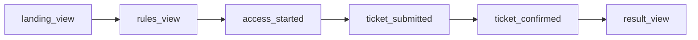

# Analytique et consentement

Le kickoff demande de mesurer le parcours des citoyens et l'efficacité des canaux d'acquisition, avec un public cible de 18 à 35 ans. Le frontend web y répond par une mesure d'audience maison : il envoie lui-même des événements à l'API BlockLucky, sans outil tiers, sans cookie et sans traceur publicitaire. Le visiteur peut s'y opposer depuis la politique de confidentialité. L'application mobile n'envoie aucun de ces événements.

Fichiers concernés :

| Fichier | Rôle |
|---|---|
| [`frontend-web/src/lib/analytics.ts`](src:frontend-web/src/lib/analytics.ts) | `trackEvent`, capture UTM, opposition |
| [`frontend-web/src/app/confidentialite/page.tsx`](src:frontend-web/src/app/confidentialite/page.tsx) | Texte d'information et bouton d'opposition |
| [`frontend-web/src/app/mairie/analytique/page.tsx`](src:frontend-web/src/app/mairie/analytique/page.tsx) | Restitution pour la Mairie |
| [`backend/src/api/analytics/analytics.routes.ts`](src:backend/src/api/analytics/analytics.routes.ts) | `POST /analytics/track` et `GET /analytics/dashboard` |

## Le parcours instrumenté

Six événements suivent le parcours de démonstration, dans l'ordre où un citoyen les rencontre :

| Événement | Déclenché par | Métadonnées |
|---|---|---|
| `landing_view` | Affichage de `/` | aucune |
| `rules_view` | Affichage de `/transparence` | aucune |
| `access_started` | Premier focus ou premier clic dans le formulaire de `/connexion` (une seule fois par affichage) | `ageGroup` |
| `ticket_submitted` | `purchaseTicket` avant l'appel à `POST /lottery/buy` | `quantity`, `retryAttempt` |
| `ticket_confirmed` | Réponse positive de l'achat | `quantity`, `tickets` |
| `result_view` | Un gagnant est connu sur `/` ou sur `/tirage` | `source` : `landing` ou `live_draw` |

Trois événements complémentaires existent :

| Événement | Déclenché par | Métadonnées |
|---|---|---|
| `LOGIN_2FA_REQUIRED` | Réponse de `POST /auth/login` qui exige un code | `ageGroup`, `provider` |
| `LOGIN_SUCCESS` | Réponse de `POST /auth/login` qui ouvre directement la session | `ageGroup`, `provider` |
| `REFERRAL_LINK_OPENED` | Ouverture d'un lien `/invite/[code]` valide | aucune |

Avec le code de connexion obligatoire par défaut, `LOGIN_SUCCESS` n'est presque jamais émis : la réussite de la vérification n'envoie pas d'événement côté client. Le backend enregistre lui-même `USER_SIGNUP` et `USER_LOGIN`, que le client n'a pas le droit d'envoyer.

Chaque envoi ajoute aux métadonnées `platform: 'WEB'` et `path` (le chemin de la page, sans paramètres).



## Envoi d'un événement

`trackEvent(eventType, metadata)` ne fait rien côté serveur (rendu Next.js) ni si l'opposition est active. Sinon il envoie :

```http
POST /api/analytics/track
Content-Type: application/json
Authorization: Bearer <jeton, si connecté>

{"eventType":"ticket_submitted","utmSource":"instagram","metadata":{"quantity":1,"retryAttempt":0,"platform":"WEB","path":"/billetterie"}}
```

L'appel utilise `fetch` avec `keepalive: true`, pour qu'un événement parte même si la page est quittée juste après. Les erreurs sont ignorées : la mesure ne bloque jamais l'interface.

Côté backend, la route applique `optionalAuthenticate` puis `trackEventSchema` ([`analytics.validators.ts`](src:backend/src/api/analytics/analytics.validators.ts)) :

| Règle | Valeur |
|---|---|
| `eventType` | 2 à 64 caractères parmi lettres, chiffres, `_ : . -` |
| Préfixes réservés | `ADMIN_AUDIT`, `USER_SIGNUP`, `USER_LOGIN` refusés |
| `utmSource` | 100 caractères au plus |
| `metadata` | 20 clés au plus, valeurs chaîne (200 caractères), nombre, booléen ou `null` |

L'événement est stocké dans la table `Analytics` avec l'identifiant du compte si un jeton valide accompagne la requête (voir [Modèle de données](../base-de-donnees/modele.md)). La route n'a pas de limite de débit propre ; seule la limite globale de l'API s'applique.

> [!IMPORTANT]
> La politique de confidentialité parle d'« événements de parcours anonymisés ». C'est inexact pour un visiteur connecté : le jeton est envoyé et le backend rattache l'événement à son compte. Les événements sont pseudonymes, pas anonymes. Il faut aligner le texte ou le code (par exemple ne pas joindre le jeton à `trackEvent`). Le cadre applicable est décrit dans [RGPD](../juridique/rgpd.md).

## Attribution de la source

`captureUtmSource(window.location.search)` est appelée à chaque chargement par `SessionBootstrap`. Si l'URL contient `utm_source` et que la valeur respecte `^[a-z0-9_\-.]{1,40}$` (insensible à la casse), elle est mise en minuscules et stockée dans `bl.utm.source`. Une valeur suspecte est ignorée.

| Situation | Source envoyée |
|---|---|
| Arrivée par `?utm_source=instagram` | `instagram`, conservée pour les visites suivantes |
| Arrivée par `/invite/<code>` sans source déjà connue | `referral` |
| Aucune source connue | `web_direct` |

La source accompagne chaque événement et la requête de connexion (`utmSource` de `POST /auth/login`), ce qui permet au backend de l'attacher à l'inscription. Une nouvelle URL avec `utm_source` remplace l'ancienne valeur : l'attribution est au dernier clic. Le test `attribution UTM` de [`frontend-web/__tests__/lib.test.ts`](src:frontend-web/__tests__/lib.test.ts) couvre la capture et le rejet des valeurs suspectes.

## Opposition

La section « Mesure d'audience » de `/confidentialite` explique ce qui est mesuré et propose un bouton (`aria-pressed`) :

| État | Libellé | Effet |
|---|---|---|
| Mesure active | « M'opposer à la mesure d'audience » | `setTrackingOptOut(true)` : écrit `bl.tracking.optout = 1` |
| Opposition active | « Mesure désactivée, la réactiver » | `setTrackingOptOut(false)` : supprime la clé |

Dès que la clé existe, `trackEvent` sort sans rien envoyer. Le choix est propre au navigateur et à l'appareil ; il survit à la déconnexion mais pas à l'effacement des données du site.

L'opposition ne concerne que les événements de parcours. Elle n'empêche pas l'envoi de `utmSource` lors de la connexion, ni les traitements nécessaires au service (tickets, points, journaux de sécurité).

## Pourquoi il n'y a pas de bandeau de consentement

Le frontend web ne dépose aucun cookie et ne charge aucun script tiers. Les seules données conservées dans le navigateur sont des clés `localStorage` nécessaires au service (session, préférences, parrainage) et la source UTM. La mesure est exercée par le responsable de traitement lui-même, sur ses propres serveurs, avec une opposition simple : le choix retenu est celui d'une information plus un droit d'opposition, et non d'un consentement préalable.

Ce choix repose sur l'exemption de consentement prévue pour la mesure d'audience strictement limitée. Il reste à valider par le DPO de la Ville, en particulier parce que les événements sont rattachés au compte quand l'utilisateur est connecté. L'analyse juridique est dans [Cookies, mentions et CGU](../juridique/cookies-mentions.md) et la liste des questions ouvertes dans [Points à valider](../juridique/points-a-valider.md).

## Restitution à la Mairie

`/mairie/analytique` appelle `GET /analytics/dashboard` (rôle `ADMIN`) et affiche :

| Bloc | Calcul côté backend | Limite |
|---|---|---|
| Indicateurs (inscrits, tickets, cagnotte, part Mairie, récompenses) | Comptages en base ; part Mairie = 10 % de la somme des cagnottes | Calculs de la base, pas du contrat |
| Répartition par tranche d'âge et part des 18-35 ans | Comptage de `metadata.ageGroup` sur les 500 derniers événements | Valeurs fixes 42, 33, 17 et 8 renvoyées si aucun événement ne porte de tranche ; une même personne compte autant de fois qu'elle a d'événements |
| Événements par source | Nombre d'événements groupés par `utmSource`, la source interne `admin-dashboard` étant masquée | Ce sont des événements, pas des conversions, malgré le nom du champ `conversions` |

La page rappelle elle-même que les visiteurs opposés à la mesure ne sont pas comptés et qu'une personne peut posséder plusieurs comptes. Le drapeau `target18_35Validated` renvoyé par le backend vaut toujours `true` : il n'est pas calculé. Ces approximations sont à garder en tête avant de présenter les chiffres à un jury ou à un élu ; les objectifs chiffrés du projet sont dans [Objectifs et indicateurs](../presentation/objectifs-indicateurs.md).

L'export CSV vient de `GET /admin/reports/export?format=CSV`. Le format PDF ouvre un rapport HTML imprimable généré dans le navigateur par `openPrintableReport` ([`download.ts`](src:frontend-web/src/lib/download.ts)), dont les valeurs sont échappées.
