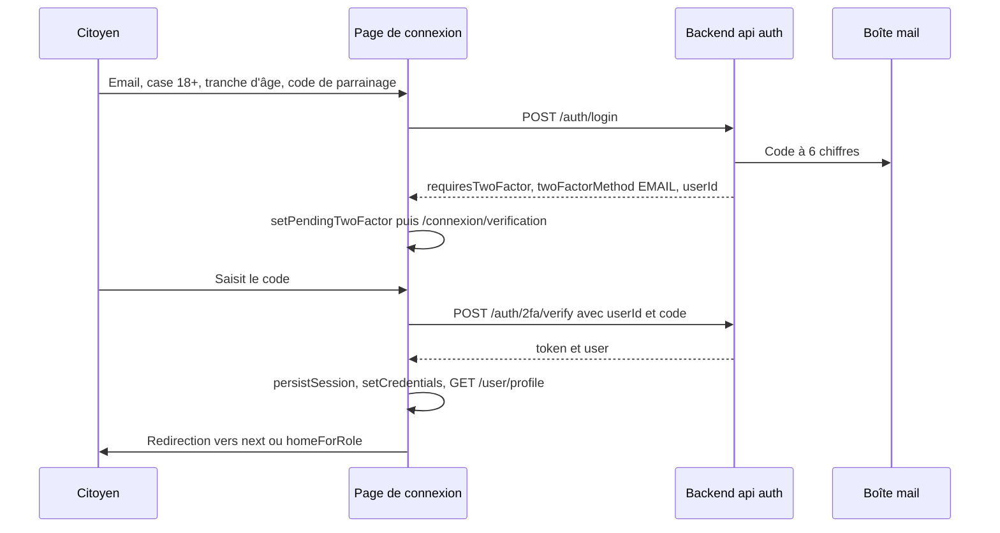

# Authentification et routes protégées

Le frontend web ne gère ni mot de passe ni portefeuille. Il n'utilise pas les routes de compte avec mot de passe ni la connexion Google ou Apple, réservées à l'application mobile (voir [Authentification mobile](../mobile/authentification.md)). Il envoie l'email saisi au backend, qui décide s'il faut un code de vérification, crée le compte et son portefeuille intégré si besoin, puis délivre un jeton de session (JWT). Cette page décrit la partie navigateur du parcours. Les règles côté serveur (expiration, verrouillage, révocation) sont dans [Authentification et 2FA](../securite/authentification.md) et [Sessions](../securite/sessions.md).

Fichiers principaux :

| Fichier | Rôle |
|---|---|
| [`frontend-web/src/app/connexion/page.tsx`](src:frontend-web/src/app/connexion/page.tsx) | Formulaire de connexion, majorité, parrainage |
| [`frontend-web/src/app/connexion/verification/page.tsx`](src:frontend-web/src/app/connexion/verification/page.tsx) | Saisie du code à 6 chiffres |
| [`frontend-web/src/hooks/useAuth.ts`](src:frontend-web/src/hooks/useAuth.ts) | Connexion, vérification, persistance, déconnexion |
| [`frontend-web/src/store/slices/authSlice.ts`](src:frontend-web/src/store/slices/authSlice.ts) | État `auth` du store |
| [`frontend-web/src/components/layout/RequireRole.tsx`](src:frontend-web/src/components/layout/RequireRole.tsx) | Garde des espaces |
| [`frontend-web/src/lib/storage.ts`](src:frontend-web/src/lib/storage.ts) | Clés `localStorage` |

## Connexion par code

Le parcours par défaut est une connexion sans mot de passe en deux temps. Le backend lit `LOGIN_EMAIL_CODE_REQUIRED` (vrai par défaut, impossible à désactiver en production) : chaque connexion par email déclenche l'envoi d'un code à 6 chiffres valable 10 minutes.



### Formulaire de connexion

La page `/connexion` collecte :

| Champ | Contrôle côté client | Envoyé comme |
|---|---|---|
| Majorité | Case `CheckboxCard` et feuille modale « Vérification de majorité » ouverte d'office pour l'espace citoyen. Le bouton « J'ai moins de 18 ans » renvoie vers `/`. | `isAdultConfirmed: true` |
| Tranche d'âge | `ChoicePills` : `18-25`, `26-35`, `36-50`, `50+` (masqué pour `?espace=pro`) | `ageGroup` |
| Email | `isValidEmail`, puis passage en minuscules | `email` |
| Parrainage | Optionnel, prérempli par `/invite/[code]` | `referralCode` |
| Source | Lue dans `bl.utm.source`, `web_direct` par défaut | `utmSource` |
| Fournisseur | Bouton cliqué | `provider`: `GOOGLE` ou `EMAIL` |

Le payload complet est typé `SocialLoginPayload` dans [`frontend-web/src/types/api.types.ts`](src:frontend-web/src/types/api.types.ts) et validé côté serveur par `socialLoginSchema` dans [`backend/src/api/auth/auth.validators.ts`](src:backend/src/api/auth/auth.validators.ts).

> [!WARNING]
> Le bouton « Continuer avec Google » n'ouvre aucune fenêtre Google : il envoie le même email avec `provider: 'GOOGLE'`. Il n'y a pas d'OAuth dans le projet. La preuve de possession de l'adresse vient uniquement du code envoyé par email.

Le carrousel d'introduction (`OnboardingCarousel`) s'affiche avant le formulaire sur mobile tant que `bl.onboarding.done` ne vaut pas `1`, et en colonne gauche sur grand écran. Le premier focus ou le premier clic envoie l'événement `access_started` (voir [Analytique et consentement](analytique-consentement.md)).

Pour l'espace professionnel (`/connexion?espace=pro`), la feuille de majorité n'est pas ouverte d'office, mais la case reste obligatoire. Le backend refuse la requête si `isAdultConfirmed` est faux.

> [!IMPORTANT]
> Cette déclaration ne suffit plus pour jouer. L'achat, le cadeau, l'échange de récompense et le ticket à gratter exigent un âge vérifié par la Mairie à partir d'une pièce d'identité. Le citoyen l'envoie depuis `/profil/identite` (voir [Portefeuille et loterie](portefeuille-loterie.md#verification-d-identite)) ou depuis l'application mobile. Tant que le statut n'est pas `VERIFIED`, la billetterie désactive l'achat et le cadeau ; les autres actions de jeu reçoivent `403 Vérifiez votre âge pour jouer.`, affiché dans la feuille d'information générique. Les comptes du seed sont déjà vérifiés.

### Adresse calculée côté client

La page de connexion appelle encore `generateDeterministicWallet(email)` de [`frontend-web/src/lib/wallet.ts`](src:frontend-web/src/lib/wallet.ts) et envoie le résultat dans `walletAddress`. Cette fonction n'est pas cryptographique : elle produit 40 caractères hexadécimaux à partir des codes des caractères de l'email. Elle ne correspond à aucune clé privée.

Le backend n'utilise pas cette adresse comme portefeuille :

- le champ est obligatoire dans `socialLoginSchema` (format `0x` suivi de 40 caractères hexadécimaux), ce qui explique qu'il soit toujours envoyé ;
- `AuthService.socialLogin` dans [`backend/src/api/auth/auth.services.ts`](src:backend/src/api/auth/auth.services.ts) s'en sert seulement comme première clé de recherche (`findByWallet`) avant de chercher par email ;
- à la création du compte, `createVerifiedUser` appelle `walletService.createCustodialWallet()` et enregistre l'adresse réelle et la clé chiffrée ; l'adresse envoyée par le client est ignorée.

L'adresse affichée ensuite partout (en-tête, profil, `WalletCard`) est celle renvoyée par l'API dans `user.walletAddress` et `GET /lottery/wallet`. Les détails de la création et du chiffrement sont dans [Portefeuilles intégrés](../integration-blockchain/portefeuilles.md).

> [!NOTE]
> Le texte de l'ancien README (« l'adresse de portefeuille est dérivée de l'email avec le même algorithme que l'app mobile ») n'est plus vrai depuis l'arrivée des portefeuilles intégrés. Le test `wallet déterministe` de [`frontend-web/__tests__/lib.test.ts`](src:frontend-web/__tests__/lib.test.ts) vérifie seulement que la fonction reste identique à celle du mobile.

### Page de vérification

`/connexion/verification` lit `pendingTwoFactorUserId`, `pendingTwoFactorMethod` et `pendingTwoFactorEmail` dans le store. Si l'état est hydraté et qu'aucune vérification n'est en attente, la page renvoie vers `/connexion`. Ces trois valeurs ne sont pas persistées : un rechargement de la page oblige à recommencer la connexion.

Le champ ne garde que les chiffres (6 au maximum, `autoComplete="one-time-code"`) et `isValidOtpCode` exige exactement 6 chiffres. Le texte s'adapte à la méthode : code reçu par email ou code de l'application d'authentification.

En développement (`NODE_ENV=development`), le backend ajoute `devOtpPreview` à la réponse de login, mais cette page ne l'affiche pas : le code se lit dans Mailpit (voir [Comptes de démonstration et connexion](../demarrage/comptes-et-connexion.md)).

## 2FA par application ou par email

Un compte peut activer un second facteur depuis `/profil/securite/2fa` ([`page.tsx`](src:frontend-web/src/app/(citoyen)/profil/securite/2fa/page.tsx)) :

1. `POST /auth/2fa/setup` avec `method: 'APP'` renvoie un QR code (`qrCodeDataUrl`), la clé TOTP en clair et des codes de secours, affichés une seule fois ; avec `method: 'EMAIL'`, le backend envoie un code par email.
2. L'utilisateur saisit le code et la page appelle `verifyOtpCode(user.id, code)`, donc `POST /auth/2fa/verify`.
3. Le backend active la 2FA, révoque toutes les sessions du compte et renvoie un nouveau jeton, que `verifyOtpCode` enregistre.

Avec une 2FA `APP` active, `POST /auth/login` répond `requiresTwoFactor: true` et `twoFactorMethod: 'APP'` sans envoyer d'email ; la page de vérification attend alors le code TOTP.

La désactivation se fait depuis `/profil/securite`, après une feuille de confirmation. Le client appelle `disable2FA({})` sans code : le backend n'accepte que si la session a moins de 15 minutes. Au-delà, il répond 401 et le message invite à se reconnecter.

> [!WARNING]
> Le backend accepte un code de secours (jusqu'à 16 caractères alphanumériques) à la place du code TOTP, mais les champs du web filtrent tout ce qui n'est pas un chiffre et exigent 6 chiffres. Un utilisateur qui a perdu son application ne peut donc pas utiliser ses codes de secours depuis le navigateur.

Pour un compte `ADMIN`, la 2FA est obligatoire tant que `ADMIN_MFA_REQUIRED` est vrai : sans elle, toutes les routes `/admin` répondent 403.

## Stockage de la session

Une session réussie passe par `persistSession` puis `setCredentials` :

| Clé `localStorage` | Contenu | Écrite par |
|---|---|---|
| `bl.auth.token` | JWT signé par le backend (12 h par défaut, `JWT_EXPIRES_IN`) | `persistSession` |
| `bl.auth.user` | Profil JSON (`UserProfile`) fusionné avec `GET /user/profile` | `persistSession`, `refreshProfile`, pages de sécurité |

Au chargement, `SessionBootstrap` ([`providers.tsx`](src:frontend-web/src/app/providers.tsx)) relit ces deux clés et dispatche `hydrateSession`. L'état passe à `hydrated: true` et `isAuthenticated` vaut vrai seulement si le jeton et le profil sont présents. Le jeton n'est pas vérifié à ce moment : le premier appel qui répond 401 le fera tomber.

`prepareHeaders` dans [`baseApi.ts`](src:frontend-web/src/store/api/baseApi.ts) ajoute `Authorization: Bearer <token>` à chaque requête. Si une réponse est 401 alors qu'un jeton existait, et que l'URL ne commence pas par `/auth/2fa`, le client efface le jeton et le profil puis dispatche `logout`. La garde de l'espace redirige alors vers la connexion.

> [!IMPORTANT]
> Le jeton est lisible par tout script de la page, puisqu'il est dans `localStorage`. La protection repose sur l'absence de XSS et sur la CSP décrite dans [Sécurité du navigateur](securite-navigateur.md). Les choix et leurs limites sont discutés dans [Navigateur et mobile](../securite/navigateur-mobile.md).

## Garde des routes

`RequireRole` enveloppe le contenu de chaque layout protégé :

```typescript
<RequireRole roles={['PARTNER', 'ADMIN']}>
  <PartnerSelectionProvider>
    <AppShell navItems={nav} spaceLabel={t('Espace Partenaires', 'Partner area')}>
      {children}
    </AppShell>
  </PartnerSelectionProvider>
</RequireRole>
```

Son comportement :

| État du store | Affichage |
|---|---|
| `hydrated` faux | Loader « Vérification de la session… » |
| hydraté, non authentifié | Loader, puis `router.replace('/connexion?next=<chemin courant>')` |
| authentifié, rôle absent de `roles` | Écran `AccessDenied` (403) avec un lien vers l'espace du rôle |
| authentifié, rôle autorisé ou `roles` absent | Contenu |

Le rôle lu est celui du profil stocké. Modifier `bl.auth.user` à la main donne accès aux écrans, pas aux données : chaque route sensible du backend applique `requireRoles`, qui relit le rôle en base. La garde client n'est donc qu'une aide d'interface. Le test `RequireRole` de [`frontend-web/__tests__/components.test.tsx`](src:frontend-web/__tests__/components.test.tsx) vérifie l'écran 403 pour un citoyen et l'accès pour un administrateur.

### Redirections après connexion

Le paramètre `next` est filtré par `safeInternalPath` ([`navigation.ts`](src:frontend-web/src/lib/navigation.ts)) : il doit commencer par `/`, ne pas commencer par `//` ou `/\`, et ne pas viser `/connexion` ni `/invite`. Sinon il est ignoré et `homeForRole` choisit `/mairie` pour `ADMIN`, `/partenaire` pour `PARTNER` et `/accueil` pour les autres. Une page déjà connectée qui ouvre `/connexion` est redirigée de la même façon.

## Déconnexion serveur

`useAuth` expose `signOut` (cet appareil) et `signOutEverywhere` (tous les appareils), qui appellent `endSession(allDevices)` :

1. `POST /auth/logout` avec le jeton explicitement passé en en-tête et `{ allDevices }` ; l'erreur éventuelle est ignorée ;
2. suppression de `bl.auth.token`, `bl.auth.user` et `bl.marketplace.lastClaim` ;
3. déconnexion du client Socket.IO ;
4. `logout` dans le slice `auth`, puis `baseApi.util.resetApiState()` pour vider le cache RTK Query.

Côté backend, la session courante ou toutes les sessions du compte sont révoquées dans Redis. La réponse porte `Clear-Site-Data: "cache", "cookies", "storage"`, mais cet en-tête ne s'applique qu'à l'origine de l'API ; c'est le nettoyage de l'étape 2 qui vide le stockage du site web.

| Déclencheur | Fonction |
|---|---|
| Bouton « Quitter » de la barre latérale, bouton du profil | `signOut` |
| « Déconnecter tous mes appareils » dans `/profil/securite` | `signOutEverywhere` |
| Confirmation de suppression RGPD | `signOut` |
| Réponse 401 avec jeton | nettoyage local seulement, sans appel au backend |

Les autres clés (`bl.pref.*`, `bl.utm.source`, `bl.tracking.optout`, `bl.partner.selected`, `bl.onboarding.done`) survivent volontairement à la déconnexion.
