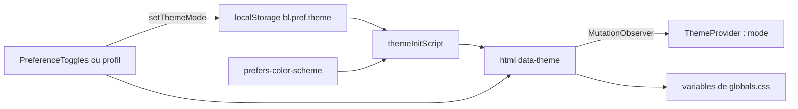

# Design system

Le design system du web tient en deux endroits : les variables CSS et les utilitaires de [`frontend-web/src/app/globals.css`](src:frontend-web/src/app/globals.css), et une dizaine de composants dans [`frontend-web/src/components/ui`](src:frontend-web/src/components/ui). Il reprend la palette, les rayons et l'échelle typographique de l'application mobile ([`mobile-app/src/theme/colors.ts`](src:mobile-app/src/theme/colors.ts)), pour que les deux supports se ressemblent. Il n'existe pas de maquette Figma de référence dans le dépôt : `globals.css` fait foi.

Tailwind CSS 4 est chargé par `@import 'tailwindcss'` et le plugin PostCSS `@tailwindcss/postcss` ([`postcss.config.mjs`](src:frontend-web/postcss.config.mjs)). Il n'y a pas de fichier `tailwind.config` : la configuration passe par le bloc `@theme inline` du CSS.

## Tokens de couleur

Les couleurs sont définies deux fois : sur `:root` pour le thème clair et sur `[data-theme='dark']` pour le thème sombre. Le bloc `@theme inline` les expose ensuite comme couleurs Tailwind, ce qui permet d'écrire `bg-surface` ou `text-fg-muted`.

| Variable CSS | Classe Tailwind | Clair | Sombre | Usage |
|---|---|---|---|---|
| `--bg` | `bg-background` | `#f7f6f2` | `#141413` | Fond de page |
| `--surface` | `bg-surface` | `#ffffff` | `#1e1e1c` | Cartes, barre latérale, feuilles |
| `--surface-elevated` | `bg-surface-elevated` | `#efece6` | `#282826` | Zones en retrait, état actif, badges |
| `--primary` | `bg-primary`, `text-primary` | `#253d2c` | `#4e7a5b` | Vert EtherBay : actions principales, liens |
| `--primary-light` | `bg-primary-light` | `#3b5e46` | `#6b9b79` | Survol du bouton principal |
| `--secondary` | `text-secondary`, `bg-secondary` | `#c86d51` | `#c86d51` | Terracotta : surtitres, points, bouton secondaire, contour de focus |
| `--text` | `text-fg` | `#18181b` | `#f5f4f0` | Texte principal |
| `--text-secondary` | `text-fg-secondary` | `#52525b` | `#a1a09a` | Texte courant atténué |
| `--text-muted` | `text-fg-muted` | `#8e8e93` | `#6e6d68` | Mentions, horodatages |
| `--border` | `border-line` | `#e4e2dd` | `#2e2e2b` | Bordures |
| `--success` | `bg-success` | `#2e6f40` | `#4e7a5b` | Pastilles d'état |
| `--warning` | `text-warning` | `#b45309` | `#d97706` | Mode démonstration, pause |
| `--error` | `text-error`, `bg-error` | `#b91c1c` | `#dc2626` | Erreurs, actions destructrices |
| `--on-primary` | `text-on-primary` | `#f7f6f2` | `#f7f6f2` | Texte sur fond coloré |
| `--overlay` | `bg-[var(--overlay)]` | noir à 48 % | noir à 60 % | Fond des feuilles modales |

Chaque thème déclare aussi `color-scheme`, ce qui adapte les contrôles natifs (barres de défilement, champs) au mode courant.

Le layout racine déclare les mêmes fonds dans `viewport.themeColor` (`#F7F6F2` en clair, `#141413` en sombre) pour colorer la barre du navigateur mobile.

## Rayons, typographie et polices

| Token | Valeur | Classe |
|---|---|---|
| `--radius-sm` | 6 px | `rounded-sm` |
| `--radius-md` | 10 px | `rounded-md` |
| `--radius-lg` | 14 px | `rounded-lg` |
| `--radius-xl` | 18 px | `rounded-xl` |

| Token | Taille et interligne | Classe | Usage typique |
|---|---|---|---|
| `--text-caption` | 12 / 16 px | `text-caption` | Libellés, mentions, badges |
| `--text-small` | 13 / 18 px | `text-small` | Navigation latérale |
| `--text-body` | 15 / 22 px | `text-body` | Texte courant (taille du `body`) |
| `--text-subtitle` | 17 / 24 px | `text-subtitle` | Titres de carte |
| `--text-heading` | 20 / 28 px | `text-heading` | Chiffres mis en avant |
| `--text-title` | 24 / 32 px | `text-title` | Titre de page sur mobile |
| `--text-hero` | 30 / 38 px | `text-hero` | Titre de page à partir de `md` |
| `--text-display` | 44 / 52 px | `text-display` | Accroche de la page publique |

Les polices sont celles du système (`ui-sans-serif, system-ui, -apple-system, 'Segoe UI', Roboto...`) et `ui-monospace` pour les adresses et les hash. Aucune police web n'est chargée, ce qui évite toute requête vers un service tiers.

## Utilitaires et animations

`globals.css` définit trois utilitaires Tailwind (`@utility`) :

| Utilitaire | Effet |
|---|---|
| `card` | Fond `--surface`, bordure `--border`, rayon 14 px |
| `eyebrow-caps` | Majuscules et espacement de 0,6 px pour les surtitres |
| `tabular` | Chiffres à chasse fixe pour les montants et les compteurs |

Et cinq animations préfixées `bl-` : `animate-bl-spin` (indicateur de chargement), `animate-bl-shimmer` (squelettes, reçu en attente), `animate-bl-slide-up` (ouverture des feuilles), `animate-bl-fade-in` (fond des feuilles), `animate-bl-drop-in` (bandeau de notification). Toutes sont réduites à 0,01 ms quand `prefers-reduced-motion: reduce` est actif (voir [Accessibilité et responsive](accessibilite.md)).

La couche `base` fixe le fond et la couleur du `body`, la couleur de sélection, le contour `:focus-visible` (2 px, couleur `--secondary`, décalé de 2 px) et le curseur des boutons. La classe `no-print` masque un élément à l'impression.

## Thèmes clair et sombre

Le thème est un attribut `data-theme` sur `<html>`, posé par deux mécanismes :

1. `themeInitScript`, injecté dans `<head>` par [`layout.tsx`](src:frontend-web/src/app/layout.tsx), s'exécute avant le rendu. Il lit `bl.pref.theme` dans `localStorage` ; à défaut, il suit `prefers-color-scheme`. Il pose aussi `lang` selon `bl.pref.language`.
2. [`frontend-web/src/theme/ThemeProvider.tsx`](src:frontend-web/src/theme/ThemeProvider.tsx) observe ces attributs avec un `MutationObserver` via `useSyncExternalStore`, et expose `mode`, `toggleTheme` et `setThemeMode`.



La variante Tailwind `dark:` est redéfinie par `@custom-variant dark` pour suivre `[data-theme='dark']` et non la préférence système. Le rendu serveur suppose toujours `LIGHT|FR` ; `suppressHydrationWarning` sur `<html>` évite l'avertissement de différence d'attributs.

Le choix est mémorisé par navigateur. Depuis `/profil`, il est aussi envoyé au backend par `PUT /user/preferences`, mais cette préférence n'est jamais relue à la connexion. Le thème `SYSTEM` accepté par l'API n'est pas proposé dans l'interface.

## Composants de src/components/ui

| Composant | Fichier | Rôle et props principales |
|---|---|---|
| `Button` | [`Button.tsx`](src:frontend-web/src/components/ui/Button.tsx) | Variantes `primary`, `secondary`, `outline`, `danger`, `ghost` ; tailles `md` (48 px de haut) et `sm` ; `loading` remplace le texte par un `Spinner`, désactive le bouton et pose `aria-busy` ; pleine largeur par défaut |
| `LinkButton` | même fichier | Même apparence sur un `Link` Next.js, ou un `<a target="_blank" rel="noopener noreferrer">` si `external` |
| `buttonClasses` | même fichier | Fonction qui renvoie les classes, pour styler un autre élément comme un bouton |
| `Card`, `CardTitle` | [`Card.tsx`](src:frontend-web/src/components/ui/Card.tsx) | Conteneur avec `tone` (`surface` ou `elevated`), `padding` (`sm`, `md`, `lg`) et balise configurable (`as`) |
| `Input`, `Textarea`, `Select` | [`Input.tsx`](src:frontend-web/src/components/ui/Input.tsx) | Champ avec libellé associé, `hint`, `errorText` relié par `aria-describedby`, `aria-invalid` en cas d'erreur |
| `Loader`, `Skeleton` | [`Loader.tsx`](src:frontend-web/src/components/ui/Loader.tsx) | Indicateur avec message (`aria-live="polite"`) et lignes de squelette |
| `Spinner` | [`Spinner.tsx`](src:frontend-web/src/components/ui/Spinner.tsx) | Cercle animé, `role="status"`, libellé « Chargement » |
| `PageHeader` | [`Misc.tsx`](src:frontend-web/src/components/ui/Misc.tsx) | Titre `h1` de page, sous-titre, surtitre et zone d'actions |
| `EmptyState` | même fichier | Carte d'état vide avec titre, description et action |
| `Alert` | même fichier | Message de ton `success`, `info`, `warning` ou `error` ; `role="alert"` pour une erreur, `role="status"` sinon |
| `Badge`, `StatusDot` | même fichier | Étiquette colorée et pastille d'état décorative |
| `CheckboxCard` | même fichier | Case à cocher native dans une carte cliquable |
| `ProgressBar` | [`ProgressBar.tsx`](src:frontend-web/src/components/ui/ProgressBar.tsx) | Jauge `role="progressbar"` avec paliers (`milestones`) |
| `SegmentedTabs` | [`SegmentedTabs.tsx`](src:frontend-web/src/components/ui/SegmentedTabs.tsx) | Onglets `role="tablist"` / `role="tab"` |
| `ChoicePills` | même fichier | Choix unique `role="radiogroup"` / `role="radio"` (quantités, tranches d'âge) |
| `Sheet` | [`Sheet.tsx`](src:frontend-web/src/components/ui/Sheet.tsx) | Feuille modale : basse sur mobile, centrée à partir de `md`, piège de focus, Échap, retour du focus, ton `danger` |
| `BackButton` | [`BackButton.tsx`](src:frontend-web/src/components/ui/BackButton.tsx) | Lien de retour vers `href`, ou `router.back()` sans `href` |

Un bouton désactivé (`disabled`) prend toujours le fond `surface-elevated` et le texte `fg-muted`, quelle que soit sa variante. Un bouton en `loading` garde sa couleur.

Exemple d'usage courant :

```typescript
<Button onClick={handleBuyForSelf} loading={isBuying} disabled={!understood || !isOpen || isPaused}>
  {t('Confirmer', 'Confirm')}
</Button>
```

## Composants de mise en page et métier

Ils s'appuient sur les composants de base :

| Dossier | Composants |
|---|---|
| [`components/layout`](src:frontend-web/src/components/layout) | `AppShell` (barre latérale, en-tête, onglets bas), `PublicShell`, `LegalPage`, `Brand`, `PreferenceToggles`, `RequireRole`, `AccessDenied`, `GlobalOverlays` |
| [`components/lottery`](src:frontend-web/src/components/lottery) | `WalletCard`, `WinnerClaimCard`, `DemoModeBadge`, `NetworkPill`, `CountdownTimer`, `RouletteAnimation`, `ChatBox`, `TicketCard`, `LeaderboardList`, `TransparencyCharter` |
| [`components/marketplace`](src:frontend-web/src/components/marketplace) | `PointsBalanceCard`, `RewardCard`, `ScratchCanvas` (carte à gratter sur `<canvas>`) |
| [`components/charts`](src:frontend-web/src/components/charts) | `BarList`, `RingMeter`, `KpiTile`, sans dépendance externe |

Les composants de loterie sont décrits dans [Portefeuille et loterie](portefeuille-loterie.md).

## Modifier la charte

Pour changer une couleur, modifier la variable dans les deux blocs (`:root` et `[data-theme='dark']`) de `globals.css`, puis reporter la valeur dans `mobile-app/src/theme/colors.ts` pour garder la parité. Vérifier ensuite le contraste dans les deux thèmes : plusieurs combinaisons actuelles sont déjà sous le seuil AA pour le petit texte (détail dans [Accessibilité et responsive](accessibilite.md#contrastes)). Le splash et l'icône du mobile utilisent une autre couleur (`#1A0B2E` dans `app.json`), héritée d'une ancienne charte.
