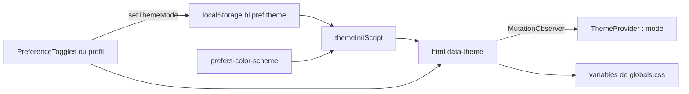

# Design system

Le design system du web tient en deux endroits : les variables CSS et les utilitaires de [`frontend-web/src/app/globals.css`](src:frontend-web/src/app/globals.css), et une douzaine de composants dans [`frontend-web/src/components/ui`](src:frontend-web/src/components/ui). Il reprend la charte de l'application mobile, issue de la maquette Figma : fond gris très clair, cartes blanches très arrondies, jaune « soleil » `#FFDA38` pour les mises en avant, encre bleu nuit `#1D2637` pour le texte et les boutons sombres, teintes pastel (lavande, menthe, pêche) pour distinguer les familles d'information, police Inter et icônes SVG (voir [Thème et composants du mobile](../mobile/theme-composants.md)). Les valeurs sont recopiées depuis [`mobile-app/src/theme/colors.ts`](src:mobile-app/src/theme/colors.ts) : les deux applications ne partagent aucun fichier, la parité se maintient à la main. Aucune maquette du web n'est versionnée dans le dépôt : `globals.css` fait foi.

Tailwind CSS 4 est chargé par `@import 'tailwindcss'` et le plugin PostCSS `@tailwindcss/postcss` ([`postcss.config.mjs`](src:frontend-web/postcss.config.mjs)). Il n'y a pas de fichier `tailwind.config` : la configuration passe par le bloc `@theme inline` du CSS.

## Tokens de couleur

Les couleurs sont définies deux fois : sur `:root` pour le thème clair et sur `[data-theme='dark']` pour le thème sombre. Le bloc `@theme inline` les expose ensuite comme couleurs Tailwind, ce qui permet d'écrire `bg-surface`, `bg-sun` ou `text-fg-muted`.

### Base

| Variable CSS | Classe Tailwind | Clair | Sombre | Usage |
|---|---|---|---|---|
| `--bg` | `bg-background` | `#f6f7fa` | `#0f1626` | Fond de page |
| `--surface` | `bg-surface` | `#ffffff` | `#1a2333` | Cartes, barre latérale, feuilles |
| `--surface-elevated` | `bg-surface-elevated` | `#f0f2f6` | `#222c3e` | Zones en retrait, survol, squelettes, bouton désactivé |
| `--surface-muted` | `bg-surface-muted` | `#f5f6f9` | `#222c3e` | Fonds secondaires |
| `--primary` | `bg-primary`, `text-primary` | `#1d2637` | `#f3f5f9` | Encre : bouton `secondary`, liens forts. S'inverse en sombre |
| `--primary-light` | `bg-primary-light` | `#2c3a52` | `#d5dae3` | Survol du bouton `secondary` |
| `--on-primary` | `text-on-primary` | `#ffffff` | `#1d2637` | Texte posé sur l'encre |
| `--secondary` | `text-secondary` | `#a95837` | `#f0a07f` | Terracotta, gardé pour compatibilité |
| `--text` | `text-fg` | `#1d2637` | `#f3f5f9` | Texte principal |
| `--text-secondary` | `text-fg-secondary` | `#657084` | `#a3acbd` | Texte courant atténué |
| `--text-muted` | `text-fg-muted` | `#8a93a5` | `#7d879a` | Mentions, horodatages |
| `--border` | `border-line` | `#e2e5eb` | `#2c3649` | Bordures des champs et séparateurs |
| `--success` | `bg-success` | `#356c58` | `#7fc4a6` | Pastilles d'état |
| `--warning` | `text-warning` | `#a95837` | `#f0a07f` | Mode démonstration, pause |
| `--error` | `text-error` | `#b4472b` | `#f0a07f` | Erreurs, actions destructrices |
| `--overlay` | `bg-[var(--overlay)]` | `rgba(15, 23, 38, 0.5)` | noir à 60 % | Fond des feuilles modales |

### Famille soleil

| Variable CSS | Classe Tailwind | Clair | Sombre | Usage |
|---|---|---|---|---|
| `--sun` | `bg-sun` | `#ffda38` | `#ffda38` | Bouton principal, carte du tirage, pastille des points, onglet actif des sélecteurs |
| `--sun-light` | `bg-sun-light` | `#ffe979` | `#ffe979` | Survol du bouton principal |
| `--sun-soft` | `bg-sun-soft` | `#fff4b8` | `#fff4b8` | Encarts posés sur la carte jaune |
| `--sun-chip` | `bg-sun-chip` | `#fff7d3` | `#3a3420` | Surtitres en pilule, badges d'avertissement, paliers débloqués |
| `--sun-nav` | `bg-sun-nav` | `#fff3b5` | `#3a3420` | Entrée de navigation active |
| `--on-sun`, `--on-sun-muted` | `text-on-sun`, `text-on-sun-muted` | `#1d2637`, `#4a5263` | identiques | Texte posé sur le jaune |
| `--on-sun-nav` | `text-on-sun-nav` | `#1d2637` | `#ffe979` | Texte de l'entrée de navigation active |

En thème sombre, `--sun-chip` devient un brun foncé : le texte posé dessus passe en jaune grâce à la classe `dark:text-sun` ajoutée à chaque pilule. Le mobile garde au contraire `sunChip` clair dans les deux thèmes.

### Teintes d'accompagnement

| Variable CSS | Classe Tailwind | Clair | Sombre | Usage |
|---|---|---|---|---|
| `--lavender`, `--violet` | `bg-lavender`, `text-violet` | `#eee9ff`, `#7357b1` | `#2a2546`, `#b9a6f0` | Informations, EtherPoints, bouton `soft`, contour de focus |
| `--mint`, `--green` | `bg-mint`, `text-green` | `#e6efea`, `#356c58` | `#1e3329`, `#7fc4a6` | Succès, âge vérifié, portefeuille |
| `--peach`, `--terracotta` | `bg-peach`, `text-terracotta` | `#ffe5d8`, `#a95837` | `#3d2a22`, `#f0a07f` | Erreurs, accès refusé |
| `--coral` | `bg-coral` | `#e87f69` | `#e87f69` | Pastille des notifications non lues, accent ponctuel |

### Ombres

| Variable CSS | Clair | Sombre | Usage |
|---|---|---|---|
| `--card-shadow` | `0 8px 24px rgba(29, 38, 55, 0.06)` | aucune | Ombre douce des cartes et des pilules flottantes |
| `--card-border` | transparent | `#2c3649` | Bordure des cartes : invisible en clair, elle remplace l'ombre en sombre |

Les cartes jaunes (compte à rebours, roue) portent en plus une ombre dorée `0 14px 32px rgba(172, 141, 10, 0.22)`.

Chaque thème déclare aussi `color-scheme`, ce qui adapte les contrôles natifs (barres de défilement, champs) au mode courant.

Le layout racine déclare les mêmes fonds dans `viewport.themeColor` (`#F6F7FA` en clair, `#0F1626` en sombre) pour colorer la barre du navigateur mobile.

## Rayons, typographie et polices

| Token | Valeur | Classe |
|---|---|---|
| `--radius-sm` | 10 px | `rounded-sm` |
| `--radius-md` | 14 px | `rounded-md` |
| `--radius-lg` | 20 px | `rounded-lg` |
| `--radius-xl` | 24 px | `rounded-xl` |
| `--radius-2xl` | 28 px | `rounded-2xl` |

Les composants écrivent aussi souvent leur rayon en valeur fixe (`rounded-[16px]`, `rounded-[24px]`, `rounded-[28px]`) pour coller à la maquette mobile : 24 px pour les cartes, 16 px pour les boutons et les encarts, 28 px pour les feuilles, la barre latérale et la carte du tirage, `rounded-full` pour les pilules.

| Token | Taille et interligne | Classe | Usage typique |
|---|---|---|---|
| `--text-caption` | 12 / 16 px | `text-caption` | Libellés, mentions, badges |
| `--text-small` | 13 / 18 px | `text-small` | Navigation latérale |
| `--text-body` | 15 / 22 px | `text-body` | Texte courant (taille du `body`) |
| `--text-subtitle` | 17 / 24 px | `text-subtitle` | Titres de carte |
| `--text-heading` | 20 / 28 px | `text-heading` | Chiffres mis en avant |
| `--text-title` | 24 / 32 px | `text-title` | Titre de page sur mobile |
| `--text-hero` | 30 / 38 px | `text-hero` | Titre de page à partir de `md` |
| `--text-display` | 44 / 52 px | `text-display` | Accroche de la page publique, cagnotte |

La police est Inter, servie par le site lui-même. [`layout.tsx`](src:frontend-web/src/app/layout.tsx) la charge avec `next/font/local` depuis [`frontend-web/src/app/fonts`](src:frontend-web/src/app/fonts) en cinq fichiers : 400, 500, 600, 700 et 700 italique (ce dernier sert au « Lucky » du logo). Next.js expose la famille dans la variable `--font-inter`, posée sur `<html>`, et `--font-sans` la place en tête de la pile de polices système (`ui-sans-serif, system-ui, -apple-system, 'Segoe UI', Roboto...`), qui sert de repli pendant le chargement (`display: 'swap'`). Les fichiers sont recopiés depuis le paquet `@expo-google-fonts/inter` du mobile, avec la licence SIL Open Font License dans [`LICENSE-inter.txt`](src:frontend-web/src/app/fonts/LICENSE-inter.txt). Aucune requête ne part vers un service de polices tiers. `ui-monospace` reste utilisé pour les adresses et les hash.

Le `body` applique un espacement des lettres de -0,1 px et le lissage `antialiased`. Les titres de page sont en gras avec un espacement négatif (-0,4 px).

## Icônes et logo

[`Icon.tsx`](src:frontend-web/src/components/ui/Icon.tsx) affiche une icône SVG en ligne à partir de [`iconData.ts`](src:frontend-web/src/components/ui/iconData.ts), copie du jeu d'icônes du mobile (45 icônes : onglets, cloche, étoile, ticket, roue, bouclier, logo...). Il reçoit `name` (type `IconName`), `size` (20 px par défaut, la hauteur suit les proportions de l'icône) et `className`. Les tracés utilisent `currentColor` : l'icône prend la couleur du texte du parent. Elle est toujours `aria-hidden`, le libellé doit donc être porté par le bouton ou le lien qui la contient. Aucune bibliothèque d'icônes n'est installée.

Le logo est le « B » encre sur carré jaune `#FFDA38` du mobile (icône `logoSymbol`, identique à [`mobile-app/assets/icons/logo-symbol.svg`](src:mobile-app/assets/icons/logo-symbol.svg)). Il sert aussi de favicon par [`frontend-web/src/app/icon.svg`](src:frontend-web/src/app/icon.svg), que Next.js déclare automatiquement. `Brand` l'accompagne du mot « Block*Lucky* » avec « Lucky » en italique, comme `BrandLogo` sur mobile.

## Utilitaires et animations

`globals.css` définit trois utilitaires Tailwind (`@utility`) :

| Utilitaire | Effet |
|---|---|
| `card` | Fond `--surface`, bordure `--card-border`, rayon 24 px, ombre `--card-shadow` |
| `eyebrow-caps` | Majuscules et espacement de 0,6 px pour les surtitres |
| `tabular` | Chiffres à chasse fixe pour les montants et les compteurs |

Et cinq animations préfixées `bl-` : `animate-bl-spin` (indicateur de chargement, rotation de la roue du tirage), `animate-bl-shimmer` (squelettes, reçu en attente, pastille « Tirage... »), `animate-bl-slide-up` (ouverture des feuilles), `animate-bl-fade-in` (fond des feuilles), `animate-bl-drop-in` (bandeau de notification). Toutes sont réduites à 0,01 ms quand `prefers-reduced-motion: reduce` est actif (voir [Accessibilité et responsive](accessibilite.md)).

La couche `base` fixe le fond, la couleur et la police du `body`, la sélection de texte (fond `--sun`, texte `--on-sun`), le contour `:focus-visible` (2 px, couleur `--violet`, décalé de 2 px) et le curseur des boutons. Les champs de saisie remplacent ce contour par une bordure couleur `--text` et un halo jaune (`ring-4 ring-sun/30`). La classe `no-print` masque un élément à l'impression.

## Thèmes clair et sombre

Le thème est un attribut `data-theme` sur `<html>`, posé par deux mécanismes :

1. `themeInitScript`, injecté dans `<head>` par [`layout.tsx`](src:frontend-web/src/app/layout.tsx), s'exécute avant le rendu. Il lit `bl.pref.theme` dans `localStorage` ; à défaut, il suit `prefers-color-scheme`. Il pose aussi `lang` selon `bl.pref.language`.
2. [`frontend-web/src/theme/ThemeProvider.tsx`](src:frontend-web/src/theme/ThemeProvider.tsx) observe ces attributs avec un `MutationObserver` via `useSyncExternalStore`, et expose `mode`, `toggleTheme` et `setThemeMode`.



La variante Tailwind `dark:` est redéfinie par `@custom-variant dark` pour suivre `[data-theme='dark']` et non la préférence système. Le rendu serveur suppose toujours `LIGHT|FR` ; `suppressHydrationWarning` sur `<html>` évite l'avertissement de différence d'attributs.

Le choix est mémorisé par navigateur. Depuis `/profil`, il est aussi envoyé au backend par `PUT /user/preferences`, mais cette préférence n'est jamais relue à la connexion. Le thème `SYSTEM` accepté par l'API n'est pas proposé dans l'interface.

## Composants de src/components/ui

| Composant | Fichier | Rôle et props principales |
|---|---|---|
| `Button` | [`Button.tsx`](src:frontend-web/src/components/ui/Button.tsx) | Variantes `primary` (jaune soleil, texte encre, ombre dorée), `secondary` (encre, texte blanc), `outline` (surface bordée), `danger` (surface bordée, texte rouge, survol pêche), `ghost` (transparent), `soft` (lavande, texte violet) ; tailles `md` (52 px de haut, rayon 16 px) et `sm` (40 px, rayon 12 px) ; `loading` remplace le texte par un `Spinner`, désactive le bouton et pose `aria-busy` ; pleine largeur par défaut |
| `LinkButton` | même fichier | Même apparence sur un `Link` Next.js, ou un `<a target="_blank" rel="noopener noreferrer">` si `external` |
| `buttonClasses` | même fichier | Fonction qui renvoie les classes, pour styler un autre élément comme un bouton |
| `Card`, `CardTitle` | [`Card.tsx`](src:frontend-web/src/components/ui/Card.tsx) | Conteneur de rayon 24 px avec `tone` (`surface` avec ombre douce, `elevated`, `sun`, `sunSoft`, `lavender`, `mint`, `peach`, `ink` sur fond `#1d2637`), `padding` (`sm`, `md`, `lg`) et balise configurable (`as`) |
| `Icon` | [`Icon.tsx`](src:frontend-web/src/components/ui/Icon.tsx) | Icône SVG en ligne, voir [Icônes et logo](#icones-et-logo) |
| `Input`, `Textarea`, `Select` | [`Input.tsx`](src:frontend-web/src/components/ui/Input.tsx) | Champ de rayon 14 px avec libellé associé, `hint`, `errorText` relié par `aria-describedby`, `aria-invalid` en cas d'erreur ; au focus, bordure encre et halo jaune |
| `Loader`, `Skeleton` | [`Loader.tsx`](src:frontend-web/src/components/ui/Loader.tsx) | Indicateur avec message (`aria-live="polite"`) et squelettes de 52 px de haut, rayon 16 px |
| `Spinner` | [`Spinner.tsx`](src:frontend-web/src/components/ui/Spinner.tsx) | Cercle animé, `role="status"`, libellé « Chargement » |
| `PageHeader` | [`Misc.tsx`](src:frontend-web/src/components/ui/Misc.tsx) | Titre `h1` de page, sous-titre, surtitre en pilule `sun-chip` et zone d'actions |
| `EmptyState` | même fichier | Carte d'état vide avec pastille jaune, titre, description et action |
| `Alert` | même fichier | Encart arrondi (16 px) teinté selon le ton : `success` menthe, `info` lavande, `warning` jaune pâle, `error` pêche ; `role="alert"` pour une erreur, `role="status"` sinon |
| `Badge`, `StatusDot` | même fichier | Pilule teintée (`neutral`, `primary` menthe, `secondary` lavande, `danger` pêche, `warning` jaune) et pastille d'état décorative |
| `CheckboxCard` | même fichier | Case à cocher native dans une carte cliquable de rayon 16 px, bordure jaune et fond `sun-chip` une fois cochée |
| `ProgressBar` | [`ProgressBar.tsx`](src:frontend-web/src/components/ui/ProgressBar.tsx) | Jauge `role="progressbar"` remplie en jaune, compteur en pilule ; paliers (`milestones`) affichés en tuiles, sur deux colonnes à partir de `sm`, jaunes une fois débloqués |
| `SegmentedTabs` | [`SegmentedTabs.tsx`](src:frontend-web/src/components/ui/SegmentedTabs.tsx) | Onglets `role="tablist"` / `role="tab"` dans une pilule blanche, onglet actif en jaune |
| `ChoicePills` | même fichier | Choix unique `role="radiogroup"` / `role="radio"` (quantités, tranches d'âge), pilules dont l'option choisie passe en encre |
| `Sheet` | [`Sheet.tsx`](src:frontend-web/src/components/ui/Sheet.tsx) | Feuille modale de rayon 28 px : basse sur mobile avec une poignée, centrée à partir de `md`, bouton de fermeture rond avec l'icône `close`, surtitre violet (rouge en ton `danger`), piège de focus, Échap, retour du focus |
| `BackButton` | [`BackButton.tsx`](src:frontend-web/src/components/ui/BackButton.tsx) | Pilule blanche avec une flèche dans un rond ; lien vers `href`, ou `router.back()` sans `href` |

Un bouton désactivé (`disabled`) prend toujours le fond `surface-elevated` et le texte `fg-muted`, quelle que soit sa variante. Un bouton en `loading` garde sa couleur.

Exemple d'usage courant :

```typescript
<Button onClick={handleBuyForSelf} loading={isBuying} disabled={!understood || !isOpen || isPaused}>
  {t('Confirmer', 'Confirm')}
</Button>
```

## Composants de mise en page et métier

Ils s'appuient sur les composants de base :

| Dossier | Composants |
|---|---|
| [`components/layout`](src:frontend-web/src/components/layout) | `AppShell` (barre latérale, en-tête, onglets bas), `PublicShell`, `LegalPage`, `Brand`, `SecurityFooter`, `PreferenceToggles`, `RequireRole`, `AccessDenied`, `GlobalOverlays` |
| [`components/lottery`](src:frontend-web/src/components/lottery) | `WalletCard`, `WinnerClaimCard`, `DemoModeBadge`, `NetworkPill`, `CountdownTimer`, `RouletteAnimation`, `ChatBox`, `TicketCard`, `LeaderboardList`, `TransparencyCharter` |
| [`components/marketplace`](src:frontend-web/src/components/marketplace) | `PointsBalanceCard`, `RewardCard`, `ScratchCanvas` (carte à gratter sur `<canvas>`) |
| [`components/charts`](src:frontend-web/src/components/charts) | `BarList`, `RingMeter`, `KpiTile`, sans dépendance externe |

### Coquilles

`AppShell` ([`AppShell.tsx`](src:frontend-web/src/components/layout/AppShell.tsx)) reprend la structure des écrans mobiles :

| Zone | Rendu |
|---|---|
| Barre latérale (à partir de `lg`) | Carte flottante de 272 px de large, rayon 28 px, décollée des bords de 16 px ; logo, nom de l'espace en pilule `sun-chip`, entrées avec leur icône, entrée active sur fond `sun-nav` ; en bas, thème et langue, adresse du portefeuille avec un bouton rond de déconnexion, puis `SecurityFooter` |
| En-tête | Bandeau translucide flouté ; pour l'espace citoyen, pilule du portefeuille (icône ticket sur fond menthe, adresse raccourcie, masquée sous `sm`), pilule jaune des points avec une étoile, bouton rond de la cloche avec une pastille corail quand des notifications sont non lues |
| Barre basse (sous `lg`) | Barre blanche aux coins supérieurs arrondis (24 px), icône au-dessus du libellé, onglet actif sur fond `sun-nav`, menu « Plus » (icône `settings`) au-delà de cinq entrées, `SecurityFooter` en dessous |

Chaque entrée de navigation (`NavItem`) accepte un champ facultatif `icon`, de type `IconName`. Les trois layouts d'espace le renseignent : par exemple `tabHome` pour Accueil et Pilotage, `ticket`, `trophy` et `bag` pour Tickets, Tirage et Boutique, `idCard`, `shield` et `document` pour Identités, Sécurité et Audit. Une entrée sans icône garde la place vide dans la barre basse.

[`SecurityFooter.tsx`](src:frontend-web/src/components/layout/SecurityFooter.tsx) affiche la mention « Application sécurisée · Aucun argent réel » avec un bouclier, comme le composant du même nom sur mobile. On la retrouve dans `AppShell`, `PublicShell`, `AccessDenied` et les pages de connexion.

`PublicShell` garde son en-tête (logo, lien vers les règles, préférences, bouton « Participer » ou « Mon espace ») et met son pied de page dans une carte, avec des liens en pilules. `LegalPage` ouvre sur un surtitre en pilule jaune. `AccessDenied` présente une carte avec une icône sur fond pêche. `GlobalOverlays` utilise les mêmes feuilles et pilules que le reste de l'interface.

### Graphiques

[`Charts.tsx`](src:frontend-web/src/components/charts/Charts.tsx) exporte `CHART_COLORS`, une palette de cinq tons (`sun`, `violet`, `green`, `terracotta`, `coral`). `BarList` et `RingMeter` acceptent un `tone` facultatif (`sun` par défaut). `KpiTile` accepte en plus de `label`, `value`, `hint` et `tone` (`default`, `primary` sur fond jaune, `secondary` en violet) trois props facultatives : `icon` (pastille ronde en tête de tuile), `accent` (`sun`, `lavender`, `mint` ou `peach`, couleur de cette pastille) et `className`.

Les composants de loterie sont décrits dans [Portefeuille et loterie](portefeuille-loterie.md).

## Modifier la charte

Pour changer une couleur, modifier la variable dans les deux blocs (`:root` et `[data-theme='dark']`) de `globals.css`. Les jetons du web étant recopiés depuis [`mobile-app/src/theme/colors.ts`](src:mobile-app/src/theme/colors.ts), reporter la même valeur côté mobile pour garder les deux supports identiques. Quelques composants écrivent encore l'encre en dur (`#1d2637` dans `Card` ton `ink`, `ChoicePills`, `CheckboxCard`, la roue et le texte de la carte à gratter) : les modifier aussi si l'encre change. Vérifier ensuite le contraste dans les deux thèmes : quelques combinaisons restent sous le seuil AA pour le petit texte (détail dans [Accessibilité et responsive](accessibilite.md#contrastes)).
