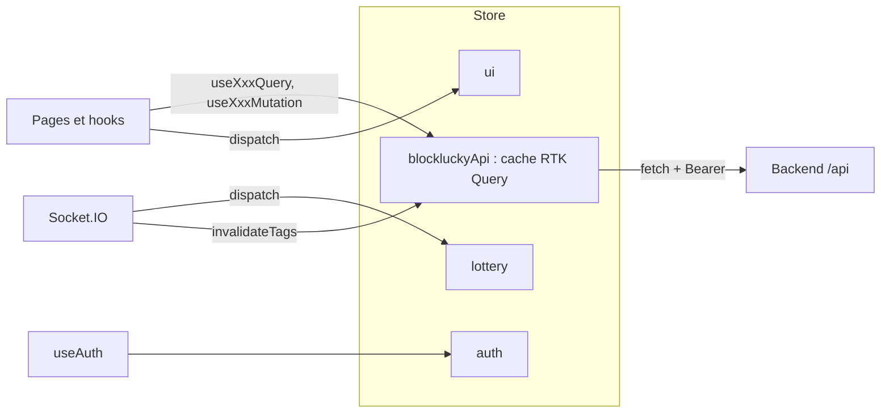

# État et appels API

Le frontend web centralise son état dans un store Redux Toolkit. Les données du serveur passent par RTK Query, qui gère le cache, les états de chargement et l'invalidation. Trois slices classiques gardent ce qui n'est pas une réponse d'API : la session, l'état temps réel de la loterie et les modales globales.

Le store est créé par `makeStore` dans [`frontend-web/src/store/index.ts`](src:frontend-web/src/store/index.ts) et instancié une seule fois dans `Providers`. Les hooks typés `useAppDispatch` et `useAppSelector` sont exportés depuis ce fichier.

## Le client de base

[`frontend-web/src/store/api/baseApi.ts`](src:frontend-web/src/store/api/baseApi.ts) déclare un seul `createApi` (`reducerPath: 'blockluckyApi'`). Les cinq fichiers d'endpoints l'étendent avec `injectEndpoints`, si bien que tout le cache vit sous une seule clé.

| Réglage | Valeur |
|---|---|
| `baseUrl` | `API_BASE_URL`, donc `NEXT_PUBLIC_API_URL` ou `http://localhost:2053/api` |
| `timeout` | 15 000 ms ; au-delà, l'erreur a le statut `TIMEOUT_ERROR` |
| `prepareHeaders` | Ajoute `Authorization: Bearer <token>` si `state.auth.token` existe |
| Garde 401 | `baseQueryWithAuthGuard` efface la session sur 401 si un jeton était présent, sauf pour `/auth/2fa/*` |
| Nouvelle tentative | Aucune : RTK Query ne relance pas les requêtes échouées |

Aucune requête n'envoie d'en-tête `Idempotency-Key`, bien que `POST /lottery/buy` et `POST /lottery/gift` acceptent le middleware d'idempotence du backend. La protection contre le double envoi repose sur le bouton désactivé pendant la requête (voir [Portefeuille et loterie](portefeuille-loterie.md#billetterie)).

## Les tags de cache

`baseApi` déclare douze types de tags. Une requête qui fournit un tag est rejouée automatiquement quand une mutation l'invalide, si un composant l'observe encore.

| Tag | Fourni par | Invalidé par |
|---|---|---|
| `User` | `getProfile`, `getReferrals` | `socialLogin`, `verify2FA`, `disable2FA`, `completeQuest`, `updatePreferences`, `buyTicket`, `giftTicket`, `claimReward`, `submitIdentity` |
| `Lottery` | `getLotteryStatus`, `getLeaderboard`, `getMyTransactions` | `buyTicket`, `giftTicket`, `claimPrize`, `triggerDraw`, `refundRound`, `toggleCircuitBreaker` ; événement `draw:winner` |
| `Wallet` | `getWallet` | `buyTicket`, `giftTicket`, `claimPrize` ; erreurs de solde ; événement `draw:winner` |
| `Marketplace` | `getCatalog`, `getRewardDetail`, `getMyCodes` | `claimReward`, `redeemCode`, `setPartnerStatus`, `createOffer`, `uploadCodes` |
| `Points` | `getPointsBalance` | `socialLogin`, `completeQuest`, `buyTicket`, `giftTicket`, `claimReward` |
| `Quests` | `getQuests` | `completeQuest` |
| `Notifications` | `getNotifications` | aucune mutation |
| `Admin` | `getAdminDashboard`, `getAnalyticsDashboard` | `triggerDraw`, `refundRound`, `toggleCircuitBreaker`, `withdrawTreasury`, `setPartnerStatus` ; événement `draw:winner` |
| `Partners` | `getPartners`, `getPartnerConsumption` | `createPartner`, `createOffer`, `uploadCodes`, `redeemCode`, `setPartnerStatus`, `createStaffAccount`, `updateStaffRole` |
| `Audit` | `getAuditLogs` | `toggleCircuitBreaker`, `withdrawTreasury`, `setPartnerStatus`, `exportReport`, `decideIdentityVerification`, `createStaffAccount`, `updateStaffRole` |
| `Identity` | `getIdentityVerifications`, `getIdentityStatus` | `decideIdentityVerification`, `submitIdentity` |
| `Accounts` | `getStaffAccounts` | `createStaffAccount`, `updateStaffRole` |

Le tag `Notifications` n'est jamais invalidé : la liste des notifications ne change qu'au rechargement ou par `refetchNotifications`.

## Endpoints par fichier

Les hooks sont générés par RTK Query : `useXxxQuery` pour une lecture, `useXxxMutation` pour une écriture. Les types de réponse sont dans [`frontend-web/src/types`](src:frontend-web/src/types). Toutes les réponses suivent l'enveloppe `ApiResponse<T>` du backend (`success`, `message`, `data`), décrite dans [Réponses et erreurs](../backend/reponses-erreurs.md).

### authApi

[`frontend-web/src/store/api/authApi.ts`](src:frontend-web/src/store/api/authApi.ts)

| Endpoint | Méthode et route | Type |
|---|---|---|
| `getOnboarding` | `GET /auth/onboarding` | query |
| `socialLogin` | `POST /auth/login` ; la page de connexion envoie `acceptTerms: true` | mutation |
| `setup2FA` | `POST /auth/2fa/setup` | mutation |
| `verify2FA` | `POST /auth/2fa/verify` avec `userId`, `code` et `loginTicket` facultatif | mutation |
| `disable2FA` | `POST /auth/2fa/disable` | mutation |
| `logout` | `POST /auth/logout` (jeton passé en argument) | mutation |
| `getProfile` | `GET /user/profile` | query |
| `getIdentityStatus` | `GET /user/identity` : statut de la vérification d'âge, dates d'envoi et de décision, motif d'un refus ; appelé par le hook `useAgeVerification`, relancé au montage et au retour du focus | query |
| `submitIdentity` | `POST /user/identity` avec `front` et `back` en data URL | mutation |
| `getReferrals` | `GET /user/referrals` | query |
| `getQuests` | `GET /user/quests` | query |
| `completeQuest` | `POST /user/quests/complete` | mutation |
| `updatePreferences` | `PUT /user/preferences` | mutation |
| `getNotifications` | `GET /user/notifications` | query |
| `exportGdprData` | `GET /user/gdpr/export` | mutation |
| `requestGdprDeletion` | `POST /user/gdpr/delete-request` | mutation |
| `confirmGdprDeletion` | `POST /user/gdpr/confirm-delete` | mutation |

`exportGdprData` est déclaré en mutation alors que la route est un `GET` : l'export ne se lance qu'au clic et n'est jamais mis en cache.

### lotteryApi

[`frontend-web/src/store/api/lotteryApi.ts`](src:frontend-web/src/store/api/lotteryApi.ts)

| Endpoint | Méthode et route | Type |
|---|---|---|
| `getLotteryStatus` | `GET /lottery/status` | query |
| `getLeaderboard` | `GET /lottery/leaderboard` | query |
| `getTransparencyCharter` | `GET /lottery/transparency-charter` ; plus appelé par aucune page depuis que `TransparencyCharter` lit `content/legal.ts` | query |
| `getMyTransactions` | `GET /lottery/my-tickets?page=1&limit=25` par défaut | query |
| `buyTicket` | `POST /lottery/buy` avec `quantity`, `retryAttempt` | mutation |
| `giftTicket` | `POST /lottery/gift` avec `recipientEmail`, `personalMessage` | mutation |
| `getWallet` | `GET /lottery/wallet` | query |
| `claimPrize` | `POST /lottery/claim-prize` avec `contractRoundId` | mutation |
| `triggerDraw` | `POST /lottery/draw` | mutation |
| `refundRound` | `POST /lottery/refund` | mutation |

### marketplaceApi

[`frontend-web/src/store/api/marketplaceApi.ts`](src:frontend-web/src/store/api/marketplaceApi.ts)

| Endpoint | Méthode et route | Type |
|---|---|---|
| `getCatalog` | `GET /marketplace/catalog` | query |
| `getRewardDetail` | `GET /marketplace/rewards/:rewardId` | query |
| `getPointsBalance` | `GET /marketplace/points` | query |
| `claimReward` | `POST /marketplace/claim` | mutation |
| `redeemCode` | `POST /marketplace/redeem` | mutation |
| `getMyCodes` | `GET /marketplace/my-codes` | query |

### adminApi

[`frontend-web/src/store/api/adminApi.ts`](src:frontend-web/src/store/api/adminApi.ts)

| Endpoint | Méthode et route | Type |
|---|---|---|
| `getAdminDashboard` | `GET /admin/dashboard` | query |
| `getAnalyticsDashboard` | `GET /analytics/dashboard` | query |
| `toggleCircuitBreaker` | `POST /admin/circuit-breaker` avec `paused`, `reason` | mutation |
| `withdrawTreasury` | `POST /admin/treasury/withdraw` avec `multisigWallet`, `amountEth`, `note` | mutation |
| `setPartnerStatus` | `PATCH /admin/partners/:partnerId/status` avec `isActive` | mutation |
| `getAuditLogs` | `GET /admin/audit-logs?limit=100` par défaut | query |
| `exportReport` | `GET /admin/reports/export?format=CSV` ou `PDF` | mutation |
| `getIdentityVerifications` | `GET /admin/identity-verifications` avec `status`, `page`, `limit` | query |
| `getIdentityVerification` | `GET /admin/identity-verifications/:id` ; `keepUnusedDataFor: 0`, les images ne restent pas en cache après la fermeture du panneau | query |
| `decideIdentityVerification` | `POST /admin/identity-verifications/:id/decision` avec `approved` et `note` | mutation |
| `getStaffAccounts` | `GET /admin/accounts` avec `role` (`ADMIN` ou `PARTNER`), `search`, `page`, `limit` ; renvoie `accounts` et la pagination | query |
| `createStaffAccount` | `POST /admin/accounts` avec `email`, `role`, `firstName`, `lastName` et `partnerId` facultatifs ; renvoie `account` et `created` | mutation |
| `updateStaffRole` | `PATCH /admin/accounts/:id/role` avec `role` (`USER`, `PARTNER` ou `ADMIN`) | mutation |

### partnersApi

[`frontend-web/src/store/api/partnersApi.ts`](src:frontend-web/src/store/api/partnersApi.ts)

| Endpoint | Méthode et route | Type |
|---|---|---|
| `getPartners` | `GET /partners` | query |
| `createPartner` | `POST /partners` avec `name`, `logoUrl` | mutation |
| `createOffer` | `POST /partners/offers` | mutation |
| `uploadCodes` | `POST /partners/codes/upload` avec `rewardId` et `codes` ou `csvContent` | mutation |
| `getPartnerConsumption` | `GET /partners/:partnerId/consumption` | query |

La liste exhaustive des routes du backend, avec leurs schémas, est dans [Référence de l'API](../backend/reference-api.md).

## Rafraîchissement

RTK Query garde une réponse en cache tant qu'un composant l'utilise, puis 60 secondes après (réglage par défaut, non modifié). Certaines pages ajoutent un `pollingInterval` :

| Page | Requête | Intervalle |
|---|---|---|
| `/tirage` | `getLotteryStatus` | 15 s |
| `/accueil` | `getLotteryStatus` | 30 s |
| `/mairie` | `getAdminDashboard`, `getLotteryStatus` | 60 s |

Les requêtes liées à la session (`getPointsBalance`, `getNotifications`) utilisent `skip: !isAuthenticated`. `getPartnerConsumption` attend qu'un établissement soit choisi (`skip: !selectedId`). Les autres changements arrivent par les événements Socket.IO décrits dans [Temps réel](temps-reel.md).

## Les slices Redux

### auth

[`frontend-web/src/store/slices/authSlice.ts`](src:frontend-web/src/store/slices/authSlice.ts)

| Champ | Rôle |
|---|---|
| `hydrated` | Vrai après la lecture de `localStorage` ; les gardes attendent ce drapeau |
| `isAuthenticated`, `token`, `user` | Session courante |
| `pendingTwoFactorUserId`, `pendingTwoFactorMethod`, `pendingTwoFactorEmail` | Vérification en cours après `POST /auth/login` |
| `pendingLoginTicket` | Ticket de connexion renvoyé par le backend quand le code de l'application est attendu ; renvoyé avec ce code à `POST /auth/2fa/verify`, effacé par `setCredentials` et `logout` |

Actions : `hydrateSession`, `setCredentials`, `setPendingTwoFactor`, `updateUserPoints`, `updateUserProfile`, `logout`. Le parcours complet est dans [Authentification et routes protégées](authentification.md).

### lottery

[`frontend-web/src/store/slices/lotterySlice.ts`](src:frontend-web/src/store/slices/lotterySlice.ts)

| Champ | Rôle |
|---|---|
| `onlineWaitingUsers` | Nombre de personnes dans la salle du tour (valeur initiale 1) |
| `socketConnected` | État de la connexion Socket.IO |
| `liveChatMessages` | 100 messages au plus, dédoublonnés par `id` ; deux messages d'accueil codés en dur au départ |
| `lastWinnerAnnouncement` | Dernier événement `draw:winner` reçu |
| `isRouletteSpinning` | Animation de la roue |

### ui

[`frontend-web/src/store/slices/uiSlice.ts`](src:frontend-web/src/store/slices/uiSlice.ts) pilote les feuilles modales rendues par `GlobalOverlays` :

| Champ | Feuille | Ouvert par |
|---|---|---|
| `pointsPopup` | « Points crédités » | achat, cadeau, mission, événement `points:awarded` |
| `retryModal` | « Réseau encombré » avec bouton « Réessayer l'achat » | erreur 503 ou `canRetry` à l'achat |
| `queueModal` | « File d'attente active » | erreur 429 |
| `sentryModal` | Message d'erreur générique | autres erreurs de transaction |
| `notificationDrawerOpen` | Tiroir des notifications | bouton « Alertes » de l'en-tête |
| `osPushBanner` | Bandeau de notification simulé (4,5 s) | bouton de `/profil/aide` |

La feuille de file d'attente affiche toujours la position 245 : la valeur est codée en dur dans `showQueueModal(245)`, le backend n'envoie aucune position.

## Gestion des erreurs

Une mutation appelée avec `.unwrap()` rejette avec un objet `FetchBaseQueryError`. Deux formes coexistent :

| Cas | `status` | `data` |
|---|---|---|
| Réponse HTTP du backend | nombre (`400`, `402`, `409`, `503`...) | enveloppe d'erreur : `message` et `errors` (par exemple `contractError`, `canRetry`, `circuitBreaker`) |
| Serveur injoignable | `FETCH_ERROR` | absent |
| Délai dépassé | `TIMEOUT_ERROR` | absent |

`getErrorMessage(err, fallback)` dans `baseApi.ts` renvoie, dans l'ordre : `data.message` du backend, un message fixe « Serveur injoignable » pour `FETCH_ERROR` et `TIMEOUT_ERROR`, sinon le texte de repli. Les pages l'utilisent pour leurs `Alert`.

Les erreurs des transactions de loterie suivent une table plus fine (402, 409, 429, 503, disjoncteur) dans `useBlockLuckyWallet`, décrite dans [Portefeuille et loterie](portefeuille-loterie.md#messages-d-erreur).

Les messages du backend sont rédigés en français. Ils s'affichent tels quels même quand l'interface est en anglais.
