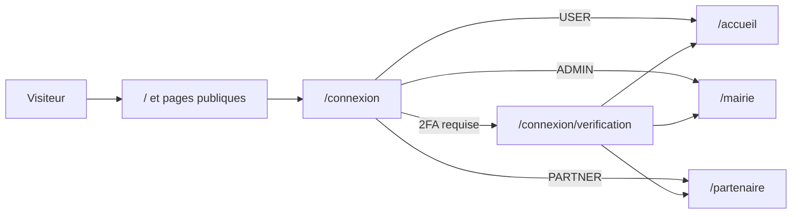

# Pages et espaces

Le dossier [`frontend-web/src/app`](src:frontend-web/src/app) contient 35 fichiers `page.tsx`, donc 35 URL. Elles se répartissent en quatre espaces qui partagent le même design system mais pas les mêmes droits. Cette page en donne l'inventaire complet : URL, rôle, données appelées et droits requis côté client et côté backend.

Toutes les pages, publiques comme privées, reprennent la présentation des écrans de l'application mobile : cartes blanches arrondies sur fond gris clair, carte jaune pour le tirage en cours, pilules et pastilles teintées, icônes du jeu mobile. Les pages citoyennes suivent les écrans mobiles équivalents (accueil, billetterie, tirage, boutique, profil) ; les pages Mairie et partenaires en appliquent les mêmes composants, avec des tuiles d'indicateurs (`KpiTile`) à icône. Le détail des couleurs et des composants est dans [Design system](design-system.md).

## Lire les tableaux

- **Données** : hooks RTK Query (définis dans [État et appels API](etat-api.md)) et endpoint du backend. « Aucune » signifie que la page n'appelle pas l'API.
- **Droit client** : contrôle effectué par [`RequireRole`](authentification.md#garde-des-routes) dans le layout de l'espace. C'est un confort d'interface, pas une protection.
- **Droit backend** : contrôle réel appliqué par les middlewares `authenticate` et `requireRoles` des routes appelées. La matrice complète est dans [Autorisations et matrice des droits](../securite/autorisations.md).

Les pages sans espace (erreurs) sont listées en fin de page.

## Espace public

Dix pages accessibles sans compte. La page d'accueil et la transparence utilisent `PublicShell` ; les cinq pages légales passent par `LegalDocumentPage` de [`LegalPage.tsx`](src:frontend-web/src/components/layout/LegalPage.tsx), qui affiche le document de [`content/legal.ts`](src:frontend-web/src/content/legal.ts) dans la langue choisie ; la connexion et l'invitation sont des pages autonomes. Le pied de page public et la coquille connectée listent les six documents légaux et un bouton « Gérer mes traceurs » (voir [Analytique et consentement](analytique-consentement.md)).

| URL | Fichier | Rôle | Données | Droits |
|---|---|---|---|---|
| `/` | [`page.tsx`](src:frontend-web/src/app/page.tsx) | Page municipale : présentation, compte à rebours, cagnotte, six étapes du parcours, garanties, résultat du tirage, FAQ. Envoie `landing_view` puis `result_view` si un gagnant existe. | `useGetLotteryStatusQuery` (`GET /lottery/status`) | Aucun ; route publique |
| `/transparence` | [`transparence/page.tsx`](src:frontend-web/src/app/transparence/page.tsx) | Règles essentielles (majorité vérifiée, prix du ticket, un ticket par tirage, EtherPoints, clôture, annulation), lien vers `/reglement`, puis charte de transparence. Envoie `rules_view`. | `TransparencyCharter` : texte local de `content/legal.ts` ; `useGetLotteryStatusQuery` (`GET /lottery/status`) pour signaler l'environnement courant (Hardhat, Sepolia ou mode simulé) | Aucun |
| `/cgu` | [`cgu/page.tsx`](src:frontend-web/src/app/cgu/page.tsx) | Conditions générales d'utilisation | Aucune (texte local) | Aucun |
| `/reglement` | [`reglement/page.tsx`](src:frontend-web/src/app/reglement/page.tsx) | Règlement de participation du grand tirage | Aucune (texte local) | Aucun |
| `/confidentialite` | [`confidentialite/page.tsx`](src:frontend-web/src/app/confidentialite/page.tsx) | Politique de confidentialité, puis section « Mon choix de mesure d'audience » avec `ConsentControls` et lien vers `/traceurs` | Aucune (texte local, `localStorage`) | Aucun |
| `/traceurs` | [`traceurs/page.tsx`](src:frontend-web/src/app/traceurs/page.tsx) | Politique relative aux traceurs, puis section « Gérer mes traceurs » avec `ConsentControls` | Aucune (texte local, `localStorage`) | Aucun |
| `/mentions-legales` | [`mentions-legales/page.tsx`](src:frontend-web/src/app/mentions-legales/page.tsx) | Mentions légales : éditeur, direction de la publication, hébergement, contact, liens vers les autres pages d'information. Les anciennes conditions de participation sont passées dans `/cgu` et `/reglement` | Aucune | Aucun |
| `/connexion` | [`connexion/page.tsx`](src:frontend-web/src/app/connexion/page.tsx) | Connexion citoyenne ou professionnelle (`?espace=pro`), vérification de majorité, case obligatoire d'acceptation des CGU et du règlement (`acceptTerms: true`), lien vers la politique de confidentialité, carrousel d'introduction, parrainage. Accepte `?next=` | `useSocialLoginMutation` (`POST /auth/login`), `useGetOnboardingQuery` (`GET /auth/onboarding`) dans le carrousel | Aucun ; redirige si déjà connecté |
| `/connexion/verification` | [`connexion/verification/page.tsx`](src:frontend-web/src/app/connexion/verification/page.tsx) | Saisie du code à 6 chiffres (email ou application TOTP) ; après le code email d'un compte protégé par application, la page reste affichée pour le code TOTP, envoyé avec `pendingLoginTicket` | `useVerify2FAMutation` (`POST /auth/2fa/verify`) | Exige une vérification en attente dans le store, sinon retour à `/connexion` |
| `/invite/[code]` | [`invite/[code]/page.tsx`](src:frontend-web/src/app/invite/[code]/page.tsx) | Lien de parrainage : stocke le code dans `bl.referral.code`, met `utm_source` à `referral` s'il est vide, envoie `REFERRAL_LINK_OPENED`, redirige vers `/` | Aucune (sauf `POST /analytics/track`) | Aucun |

## Espace citoyen

Quatorze pages sous le groupe de routes `(citoyen)`. Le layout [`(citoyen)/layout.tsx`](src:frontend-web/src/app/(citoyen)/layout.tsx) appelle `RequireRole` sans liste de rôles : tout compte authentifié y entre, y compris un administrateur ou un partenaire. Toutes les routes du backend appelées ici exigent `authenticate`, sauf les lectures publiques de la loterie et du catalogue.

| URL | Fichier | Rôle | Données | Droit backend |
|---|---|---|---|---|
| `/accueil` | [`accueil/page.tsx`](src:frontend-web/src/app/(citoyen)/accueil/page.tsx) | Tableau de bord : carte du gagnant, état du réseau, compte à rebours avec son `chrono.mp3` dans les 8 dernières secondes et bouton de son (`CountdownTimer` avec `sound`), achat en un clic d'un ticket, jauge, classement | `useGetLotteryStatusQuery` (rafraîchi toutes les 30 s), `useGetLeaderboardQuery`, `useBlockLuckyWallet` (`POST /lottery/buy`), `WinnerClaimCard` | Statut et classement publics ; achat : connecté |
| `/billetterie` | [`billetterie/page.tsx`](src:frontend-web/src/app/(citoyen)/billetterie/page.tsx) | Achat d'un seul ticket, ou cadeau par email (`?mode=cadeau`), reçu en attente puis confirmé. Un second achat sur le même tour est refusé en 409. Tant que l'âge n'est pas vérifié, alerte avec un lien vers `/profil/identite` et boutons désactivés | `useGetLotteryStatusQuery`, `useBlockLuckyWallet` (`POST /lottery/buy`, `POST /lottery/gift`), `useAgeVerification` (`GET /user/identity`), `WalletCard` (`GET /lottery/wallet`) | Connecté |
| `/tirage` | [`tirage/page.tsx`](src:frontend-web/src/app/(citoyen)/tirage/page.tsx) | Salle de tirage en direct : salle d'attente, roue (son `roue-tirage.mp3` en boucle pendant la rotation), bouton `SoundToggle` dans l'en-tête, preuve VRF, discussion, retrait des gains. Envoie `result_view` | `useGetLotteryStatusQuery` (15 s), `useSocket(round.id)`, `WinnerClaimCard` (`POST /lottery/claim-prize`) | Statut public ; retrait : connecté |
| `/historique` | [`historique/page.tsx`](src:frontend-web/src/app/(citoyen)/historique/page.tsx) | Tickets avec liens vers l'explorateur et galerie des badges POAP | `useGetMyTransactionsQuery` (`GET /lottery/my-tickets`) | Connecté |
| `/boutique` | [`boutique/page.tsx`](src:frontend-web/src/app/(citoyen)/boutique/page.tsx) | Catalogue des offres des commerces partenaires, solde de points | `useGetCatalogQuery` (`GET /marketplace/catalog`), `usePoints` (`GET /marketplace/points`) | Catalogue public ; points : connecté |
| `/boutique/[rewardId]` | [`boutique/[rewardId]/page.tsx`](src:frontend-web/src/app/(citoyen)/boutique/[rewardId]/page.tsx) | Détail d'une offre et échange contre des EtherPoints ; enregistre le code obtenu dans `bl.marketplace.lastClaim` puis redirige vers `/boutique/carte` | `useGetRewardDetailQuery` (`GET /marketplace/rewards/:id`), `useClaimRewardMutation` (`POST /marketplace/claim`), `usePoints` | Détail public ; échange : connecté |
| `/boutique/carte` | [`boutique/carte/page.tsx`](src:frontend-web/src/app/(citoyen)/boutique/carte/page.tsx) | Carte à gratter qui révèle le dernier code obtenu | Aucune : lit `bl.marketplace.lastClaim` dans `localStorage` | Aucun appel |
| `/boutique/mes-codes` | [`boutique/mes-codes/page.tsx`](src:frontend-web/src/app/(citoyen)/boutique/mes-codes/page.tsx) | Codes partenaires déjà obtenus | `useGetMyCodesQuery` (`GET /marketplace/my-codes`) | Connecté |
| `/profil` | [`profil/page.tsx`](src:frontend-web/src/app/(citoyen)/profil/page.tsx) | Passeport citoyen : portefeuille, statistiques, thème et langue, liens vers la sécurité, la vérification d'identité, le RGPD et l'aide, parrainage et partage, missions citoyennes, déconnexion | `WalletCard`, `useGetReferralsQuery`, `useGetQuestsQuery`, `useCompleteQuestMutation`, `useUpdatePreferencesMutation`, `usePoints`, `useAgeVerification` (`GET /user/identity`) | Connecté |
| `/profil/securite` | [`profil/securite/page.tsx`](src:frontend-web/src/app/(citoyen)/profil/securite/page.tsx) | Bloc explicatif « Un ticket par habitant et par tirage » avec le numéro de Joueurs Info Service, état et désactivation de la 2FA, déconnexion de tous les appareils, rappel du rôle RBAC. Le sélecteur de plafond personnel a été retiré avec la route `PUT /user/responsible-limit` | `disable2FA` (`POST /auth/2fa/disable`), `signOutEverywhere` (`POST /auth/logout`) | Connecté |
| `/profil/securite/2fa` | [`profil/securite/2fa/page.tsx`](src:frontend-web/src/app/(citoyen)/profil/securite/2fa/page.tsx) | Activation de la 2FA par application (QR code, clé, codes de secours) ou par email | `setup2FA` (`POST /auth/2fa/setup`), `verifyOtpCode` (`POST /auth/2fa/verify`) | Connecté |
| `/profil/identite` | [`profil/identite/page.tsx`](src:frontend-web/src/app/(citoyen)/profil/identite/page.tsx) | Statut de la vérification d'âge (`NONE`, `PENDING`, `VERIFIED`, `REJECTED` avec le motif de la Mairie) ; si `NONE` ou `REJECTED`, envoi du recto et du verso de la pièce d'identité (JPEG ou PNG, 4 Mo au plus par face) avec consentement | `useAgeVerification` (`GET /user/identity`), `useSubmitIdentityMutation` (`POST /user/identity`) | Connecté |
| `/profil/rgpd` | [`profil/rgpd/page.tsx`](src:frontend-web/src/app/(citoyen)/profil/rgpd/page.tsx) | Export JSON des données, demande puis confirmation d'anonymisation | `useExportGdprDataMutation` (`GET /user/gdpr/export`), `useRequestGdprDeletionMutation`, `useConfirmGdprDeletionMutation` | Connecté ; la confirmation (`POST /user/gdpr/confirm-delete`) n'exige que le jeton |
| `/profil/aide` | [`profil/aide/page.tsx`](src:frontend-web/src/app/(citoyen)/profil/aide/page.tsx) | Charte de transparence et bouton de notification simulée | `TransparencyCharter`, `usePushNotifications` (`GET /user/notifications`) | Connecté pour les notifications |

La navigation de l'espace citoyen expose cinq onglets (Accueil, Tickets, Tirage, Boutique, Profil) et trois entrées réservées au bureau : Historique et POAP, Mes codes, Charte et aide.

## Dashboard Mairie

Sept pages sous [`mairie/layout.tsx`](src:frontend-web/src/app/mairie/layout.tsx), réservées au rôle `ADMIN` côté client. Côté backend, tout le routeur `/admin` applique `authenticate` puis `requireRoles('ADMIN')`. Ce middleware refuse aussi un administrateur qui n'a pas activé la 2FA quand `ADMIN_MFA_REQUIRED` vaut `true` (valeur par défaut, imposée en production) : la page s'affiche alors, mais les appels répondent 403 jusqu'à l'activation depuis `/profil/securite/2fa`.

| URL | Fichier | Rôle | Données | Droit backend |
|---|---|---|---|---|
| `/mairie` | [`mairie/page.tsx`](src:frontend-web/src/app/mairie/page.tsx) | Pilotage : indicateurs (cagnotte, tickets, part Mairie, inscrits, partenaires, récompenses), état du réseau, progression vers 10 000 participants | `useGetAdminDashboardQuery` (`GET /admin/dashboard`, 60 s), `useGetLotteryStatusQuery` (60 s) | `ADMIN` |
| `/mairie/analytique` | [`mairie/analytique/page.tsx`](src:frontend-web/src/app/mairie/analytique/page.tsx) | Indicateurs, répartition par tranche d'âge et part des 18-35 ans, événements par source UTM ; export CSV téléchargé ou rapport imprimable | `useGetAnalyticsDashboardQuery` (`GET /analytics/dashboard`), `useExportReportMutation` (`GET /admin/reports/export?format=`) | `ADMIN` |
| `/mairie/partenaires` | [`mairie/partenaires/page.tsx`](src:frontend-web/src/app/mairie/partenaires/page.tsx) | Liste des commerces, activation ou suspension | `useGetPartnersQuery` (`GET /partners`), `useSetPartnerStatusMutation` (`PATCH /admin/partners/:id/status`) | Liste publique ; changement de statut : `ADMIN` |
| `/mairie/identites` | [`mairie/identites/page.tsx`](src:frontend-web/src/app/mairie/identites/page.tsx) | Vérification d'âge : demandes filtrées par statut (en attente, vérifiées, refusées), 20 par page, des plus anciennes aux plus récentes ; panneau de détail avec dates, adresse du portefeuille, recto et verso déchiffrés tant que la demande est en attente ; approbation, ou refus avec un motif d'au moins 3 caractères envoyé au citoyen | `useGetIdentityVerificationsQuery` (`GET /admin/identity-verifications`), `useGetIdentityVerificationQuery` (`GET /admin/identity-verifications/:id`, jamais gardé en cache), `useDecideIdentityVerificationMutation` (`POST /admin/identity-verifications/:id/decision`) | `ADMIN` ; un administrateur ne peut pas statuer sur sa propre pièce |
| `/mairie/comptes` | [`mairie/comptes/page.tsx`](src:frontend-web/src/app/mairie/comptes/page.tsx) | Comptes Mairie et partenaires : onglets Mairie et Partenaires, recherche par email ou nom, pagination, état de la 2FA et établissements rattachés ; création d'un compte (email, prénom et nom facultatifs, rôle, établissement facultatif pour un partenaire) qui envoie l'invitation `staff-invitation` ; changement ou retrait du rôle après confirmation, sauf sur son propre compte | `useGetStaffAccountsQuery` (`GET /admin/accounts`), `useCreateStaffAccountMutation` (`POST /admin/accounts`), `useUpdateStaffRoleMutation` (`PATCH /admin/accounts/:id/role`), `useGetPartnersQuery` à l'ouverture du formulaire | `ADMIN` ; le backend refuse de modifier son propre rôle et de retirer le dernier compte Mairie, et révoque les sessions du compte modifié |
| `/mairie/securite` | [`mairie/securite/page.tsx`](src:frontend-web/src/app/mairie/securite/page.tsx) | Disjoncteur du contrat (confirmation par le mot `PAUSE`), lancement du tirage, annulation et remboursement du tour, retrait de la part Mairie vers une adresse multisig | `useGetAdminDashboardQuery`, `useGetLotteryStatusQuery`, `useToggleCircuitBreakerMutation`, `useTriggerDrawMutation` (`POST /lottery/draw`), `useRefundRoundMutation` (`POST /lottery/refund`), `useWithdrawTreasuryMutation`, `useSocket()` pour le gagnant | `ADMIN` |
| `/mairie/audit` | [`mairie/audit/page.tsx`](src:frontend-web/src/app/mairie/audit/page.tsx) | Journal des actions d'administration, dont les consultations de pièces d'identité, les décisions et la gestion des comptes (« Compte créé », « Rôle modifié », « Rôle retiré », avec l'email et le rôle), filtre par action, export CSV généré dans le navigateur | `useGetAuditLogsQuery` (`GET /admin/audit-logs`) | `ADMIN` |

## Espace partenaires

Quatre pages sous [`partenaire/layout.tsx`](src:frontend-web/src/app/partenaire/layout.tsx), ouvertes aux rôles `PARTNER` et `ADMIN`. Le layout insère `PartnerSelectionProvider` ([`PartnerSelection.tsx`](src:frontend-web/src/components/partner/PartnerSelection.tsx)) : il charge `GET /partners` et choisit l'établissement courant.

> [!WARNING]
> Le backend rattache un établissement à son compte partenaire par `ownerId`, renseigné à la création de l'établissement ou depuis `/mairie/comptes`, et refuse les actions d'un partenaire sur un établissement qui n'est pas le sien. Le sélecteur du web, lui, n'utilise pas ce rattachement : il devine l'établissement en cherchant la partie locale de l'email dans le nom des commerces (par exemple `boulangerie@etherbay.fr`), sinon prend le premier de la liste, et mémorise le choix dans `bl.partner.selected`. Un partenaire peut donc sélectionner un autre commerce que le sien, dont les appels lui sont alors refusés.

| URL | Fichier | Rôle | Données | Droit backend |
|---|---|---|---|---|
| `/partenaire` | [`partenaire/page.tsx`](src:frontend-web/src/app/partenaire/page.tsx) | Tableau de bord du commerce : consommation des offres et des codes | `useGetPartnerConsumptionQuery` (`GET /partners/:id/consumption`) | `PARTNER` ou `ADMIN` |
| `/partenaire/offres` | [`partenaire/offres/page.tsx`](src:frontend-web/src/app/partenaire/offres/page.tsx) | Création de l'établissement si aucun n'existe, création d'une offre | `useCreatePartnerMutation` (`POST /partners`), `useCreateOfferMutation` (`POST /partners/offers`) | `PARTNER` ou `ADMIN` |
| `/partenaire/codes` | [`partenaire/codes/page.tsx`](src:frontend-web/src/app/partenaire/codes/page.tsx) | Import des codes promo par copier-coller ou fichier CSV, analysés par `parseCodes` avant envoi | `useUploadCodesMutation` (`POST /partners/codes/upload`) | `PARTNER` ou `ADMIN` |
| `/partenaire/validation` | [`partenaire/validation/page.tsx`](src:frontend-web/src/app/partenaire/validation/page.tsx) | Validation en caisse d'un code présenté par un citoyen | `useRedeemCodeMutation` (`POST /marketplace/redeem`) | `PARTNER` ou `ADMIN` |

## Récapitulatif

| Espace | Pages | Garde client | Coquille |
|---|---|---|---|
| Public | 10 | aucune | `PublicShell`, `LegalPage` ou page autonome |
| Citoyen | 14 | connecté | `AppShell` avec actions citoyennes |
| Mairie | 7 | `ADMIN` | `AppShell` |
| Partenaires | 4 | `PARTNER` ou `ADMIN` | `AppShell` et sélection d'établissement |
| Total | 35 | | |

La redirection après connexion est calculée par `homeForRole` dans [`frontend-web/src/hooks/useAuth.ts`](src:frontend-web/src/hooks/useAuth.ts), sauf si un paramètre `next` valide est présent.

## Pages d'erreur

Trois fichiers ne sont pas des pages mais des frontières d'erreur de l'App Router :

| Fichier | Déclenchement | Comportement |
|---|---|---|
| [`not-found.tsx`](src:frontend-web/src/app/not-found.tsx) | URL inconnue | Message 404 bilingue et lien vers `/` |
| [`error.tsx`](src:frontend-web/src/app/error.tsx) | Exception dans une page | Bouton « Réessayer » (`reset`) et affichage du `digest` |
| [`global-error.tsx`](src:frontend-web/src/app/global-error.tsx) | Exception dans le layout racine | Remplace tout le document, avec son propre `<html>` |

## Comptes pour parcourir les espaces

Les comptes du seed (`citoyen@etherbay.fr`, `maire@etherbay.fr`, `boulangerie@etherbay.fr`) et la manière d'obtenir le code de connexion en local sont décrits dans [Comptes de démonstration et connexion](../demarrage/comptes-et-connexion.md). Les comptes Mairie et partenaire se connectent par `/connexion?espace=pro`, qui masque la tranche d'âge et le parrainage.

Pour ajouter une page, suivre [Ajouter une page web](../guides/ajouter-page-web.md).
