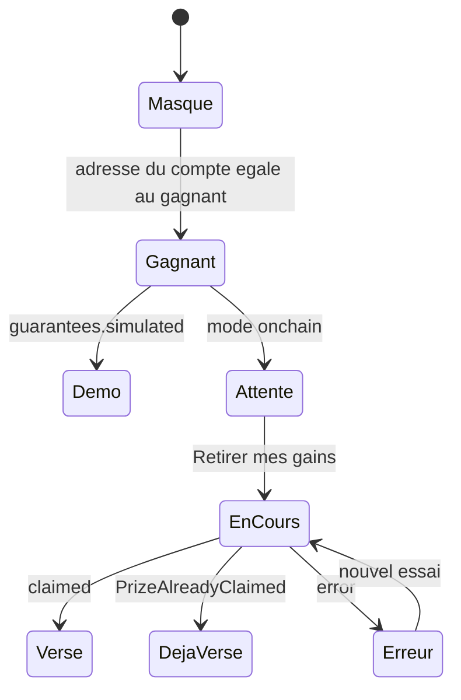

# Portefeuille et loterie

Cette page décrit comment le navigateur affiche le portefeuille intégré du citoyen, achète et offre des tickets, suit le tirage et retire une cagnotte. Le principe à retenir : le web n'a jamais de clé privée. Le citoyen n'installe ni MetaMask ni autre extension. Le backend crée un portefeuille Ethereum par compte, chiffre sa clé, le crédite d'une dotation de bienvenue en ethers fictifs et signe les transactions à sa place. Le navigateur ne fait qu'appeler l'API et afficher les reçus.

Le fonctionnement côté serveur est dans [Portefeuilles intégrés](../integration-blockchain/portefeuilles.md) et [Passerelle du contrat et erreurs](../integration-blockchain/passerelle.md). Le parcours métier complet est dans [Achat et cadeau de ticket](../architecture/flux/achat-cadeau.md) et [Tirage et versement de la cagnotte](../architecture/flux/tirage.md).

## Mode onchain et mode démonstration

Le backend fonctionne en `BLOCKCHAIN_MODE=onchain` (vrai contrat sur une blockchain locale ou Sepolia) ou `simulated` (données en base, sans chaîne). Le frontend ne lit pas cette variable : il déduit le mode des réponses.

| Indice | Source | Utilisé par |
|---|---|---|
| `guarantees.simulated` | `GET /lottery/status` | `DemoModeBadge`, textes du tirage, `WinnerClaimCard` |
| `guarantees.vrfCertified` | `GET /lottery/status` | page `/tirage` (preuve VRF affichée ou non) |
| `mode: 'onchain' \| 'simulated'` | `GET /lottery/wallet` | badge de `WalletCard` |
| `explorerUrl`, `etherscanUrl` | portefeuille, tickets, retrait | liens vers l'explorateur, absents en mode simulé |

En mode simulé, l'interface reste utilisable mais affiche « Mode démonstration » et précise que le tirage n'est pas certifié par Chainlink VRF. Le détail des deux modes est dans [Mode onchain ou simulé](../integration-blockchain/modes.md).

## Composants

### WalletCard

[`frontend-web/src/components/lottery/WalletCard.tsx`](src:frontend-web/src/components/lottery/WalletCard.tsx) appelle `useGetWalletQuery()` (`GET /lottery/wallet`) et affiche :

| Élément | Donnée |
|---|---|
| Titre « Portefeuille BlockLucky intégré » | fixe |
| Badge « Mode démonstration » | si `mode === 'simulated'` |
| Adresse raccourcie (6 caractères de chaque côté), adresse complète en infobulle | `walletAddress` |
| Solde en ethers fictifs, 4 décimales au plus, formaté selon la langue | `balanceEth`, ou « Solde indisponible » si `null` |
| Lien « Voir le portefeuille sur l'explorateur de blocs » | `explorerUrl` si présent |

Un squelette s'affiche pendant le chargement et un message « Portefeuille momentanément indisponible » en cas d'erreur. Le composant est utilisé dans `/billetterie` et `/profil`. Le tag `Wallet` est invalidé après chaque achat, cadeau ou retrait, et à la réception de `draw:winner` : le solde se met à jour seul.

### DemoModeBadge et NetworkPill

[`DemoModeBadge`](src:frontend-web/src/components/lottery/DemoModeBadge.tsx) est un `Badge` de ton `warning` qui ne s'affiche que si sa prop `simulated` est vraie. Il apparaît dans l'en-tête de `/accueil`, `/billetterie` et `/tirage`.

[`NetworkPill`](src:frontend-web/src/components/lottery/NetworkPill.tsx) résume `status.network` : « Participations suspendues par la Mairie » si `isPaused` (ou `circuitBreakerTripped`), « Relais secondaire actif » si `isFallback` (ou `fallbackActive`), sinon « Réseau Ethereum synchronisé » avec la latence si elle est connue.

### WinnerClaimCard

[`frontend-web/src/components/lottery/WinnerClaimCard.tsx`](src:frontend-web/src/components/lottery/WinnerClaimCard.tsx) n'affiche rien, sauf si le portefeuille du compte connecté est le gagnant. Il compare, en minuscules :

- l'adresse de `GET /lottery/wallet` (ou, à défaut, `user.walletAddress`) ;
- le gagnant de `lastWinnerAnnouncement` (événement temps réel) ou, à défaut, `status.round.winnerWallet`.

| État | Affichage |
|---|---|
| Démonstration | Rappel que la cagnotte n'est pas versée sur une blockchain réelle ; pas de bouton |
| Attente | Explication : la plateforme verse automatiquement la cagnotte ; bouton « Retirer mes gains » en secours |
| Versé | Nouveau solde (`walletBalanceEth`) et lien Etherscan (`etherscanUrl`) |
| Déjà versé | « Cagnotte déjà versée sur votre portefeuille » |
| Erreur | `Alert` de ton `warning` (contrat en pause) ou `error` |

Le bouton appelle `claimPrize(contractRoundId)`, donc `POST /lottery/claim-prize`. En mode simulé, le backend refuserait l'appel avec une erreur 409 ; le composant ne propose donc pas le bouton. La carte est placée en haut de `/accueil` et de `/tirage`, dans une zone `aria-live="polite"`.

## Le hook useBlockLuckyWallet

[`frontend-web/src/hooks/useBlockLuckyWallet.ts`](src:frontend-web/src/hooks/useBlockLuckyWallet.ts) regroupe les trois opérations qui déclenchent une transaction signée par le portefeuille intégré.

| Fonction | Appel | Succès | Retour |
|---|---|---|---|
| `purchaseTicket(quantity, retryAttempt)` | `POST /lottery/buy` | Met à jour les points (`updateUserPoints`), ouvre la feuille « Points crédités » | `BuyTicketResponse` ou `null` |
| `sendGiftTicket(recipientEmail, personalMessage)` | `POST /lottery/gift` | Met à jour les points de l'expéditeur, feuille « Ticket offert à... » | `GiftTicketResponse` ou `null` |
| `claimPrize(contractRoundId)` | `POST /lottery/claim-prize` | aucune modale | `ClaimPrizeOutcome` : `claimed`, `already-paid` ou `error` |

Il expose aussi `isBuying`, `isGifting` et `isClaiming`. `purchaseTicket` envoie `ticket_submitted` avant l'appel et `ticket_confirmed` après le succès (voir [Analytique et consentement](analytique-consentement.md)).

Les deux premières fonctions ne lèvent jamais d'exception : elles traduisent l'erreur en feuille modale et renvoient `null`. `claimPrize` renvoie un résultat que le composant affiche lui-même.

### Messages d'erreur

`notifyChainError` applique les règles dans cet ordre. La première qui correspond l'emporte.

| Ordre | Condition | Réaction | Cache invalidé |
|---|---|---|---|
| 1 | `status === 429` (limitation de débit) | Feuille « File d'attente active », position fixe 245 | aucun |
| 2 | `errors.circuitBreaker` vrai (contrat en pause, `EnforcedPause`, réponse 503) | Feuille « Participations suspendues » avec le message du backend ou un texte de repli | `Lottery` |
| 3 | `status === 402` ou `errors.contractError === 'InsufficientFunds'` | Feuille « Solde insuffisant » : la dotation ne couvre pas le ticket et les frais réseau, rien n'a été débité | `Wallet` |
| 4 | `status === 409` (tour fermé, expiré, complet, tirage pas prêt...) | Feuille « Action impossible pour ce tour » avec le message du backend | `Lottery` |
| 5 | achat seulement, `status === 503` ou `errors.canRetry` | Feuille « Réseau encombré » avec bouton « Réessayer l'achat » | aucun |
| 6 | autre cas | Feuille générique avec le message du backend ou le texte de repli | aucun |

Les codes viennent de la table `CONTRACT_ERRORS` de [`backend/src/blockchain/lottery.gateway.ts`](src:backend/src/blockchain/lottery.gateway.ts) : 503 pour `EnforcedPause`, 409 pour `RoundNotOpen`, `RoundExpired`, `RoundSoldOut`, `PrizeAlreadyClaimed`..., 402 pour un solde insuffisant, 503 avec `canRetry` pour un nœud injoignable, 502 avec `canRetry` pour une erreur non reconnue. En mode simulé, `LotteryService.buyTickets` renvoie aussi 503 avec `canRetry` quand le relais échoue. Le plafond personnel de jeu responsable, qui pouvait produire un 400, a été retiré : la seule limite est un ticket par participant et par tour (409).

Le bouton de la feuille « Réseau encombré » rappelle `purchaseTicket(quantity, retryAttempt + 1)` depuis `GlobalOverlays`. Le compteur `retryAttempt` est envoyé au backend, qui le renvoie incrémenté.

Pour `claimPrize`, l'ordre est : `PrizeAlreadyClaimed` donne `already-paid` (et invalide `Wallet`), disjoncteur donne une erreur `warning`, solde insuffisant pour les frais du retrait donne une erreur `error`, tout autre cas donne le message du backend.

## Billetterie

[`frontend-web/src/app/(citoyen)/billetterie/page.tsx`](src:frontend-web/src/app/(citoyen)/billetterie/page.tsx) propose deux onglets (`SegmentedTabs`) : « Acheter pour moi » et « Offrir un ticket ». `?mode=cadeau` ouvre directement le second ; c'est le lien du bouton « Offrir un ticket » de `/accueil`.

### Achat pour soi

La page achète toujours un seul ticket (`purchaseTicket(1, 0)`) : il n'y a pas de choix de quantité.

1. Affichage du total : prix d'un ticket `round.ticketPriceEth` (repli 0,01), « + frais réseau, prélevés sur votre portefeuille BlockLucky », du bonus de 50 points plus le certificat POAP, et de la règle « Un ticket par habitant et par tirage. ».
2. Case obligatoire : « Je comprends que j'engage des ethers fictifs, sans valeur monétaire, dans un tirage pédagogique ».
3. Bouton « Confirmer mon ticket », désactivé tant que la case n'est pas cochée, si le tour n'est pas `OPEN`, si le contrat est en pause ou si l'âge n'est pas vérifié.

Un second achat sur le même tour reçoit `409 Vous avez déjà votre ticket pour ce grand tirage.`, affiché dans la feuille « Action impossible pour ce tour ».

Si `user.ageVerificationStatus` existe et ne vaut pas `VERIFIED`, une alerte s'affiche au-dessus du formulaire et les boutons d'achat et de cadeau sont désactivés :

| Statut | Message | Lien vers `/profil/identite` |
|---|---|---|
| `PENDING` | « Votre pièce d'identité est en cours de vérification par la Mairie. Vous pourrez jouer dès sa validation. » | « Voir le suivi » |
| `NONE`, `REJECTED` | « Vérifiez votre âge pour participer au tirage. » | « Envoyer ma pièce » |

Le statut vient du hook `useAgeVerification` (voir [Vérification d'identité](#verification-d-identite)) : le statut lu par `GET /user/identity`, ou à défaut celui du profil stocké. Sans aucun des deux, rien n'est bloqué côté client : le backend reste seul juge.

Le reçu, à droite, passe par trois états :

| État | Affichage |
|---|---|
| aucun | « Votre reçu apparaîtra ici après confirmation » |
| `pending` | « Demande envoyée, en attente du réseau » et « Ticket en cours de validation » |
| `confirmed` | Pour chaque ticket : hash raccourci, numéro de bloc, date, lien Etherscan ; points gagnés et nouveau solde ; mention « Certificat POAP en cours d'émission » si `poapBadge.status === 'MINT_PENDING'` |

Si l'achat échoue, le reçu revient à l'état vide et la feuille d'erreur s'affiche. Si le backend répond « Vérifiez votre âge pour jouer. » alors que le statut connu de la page ne l'avait pas prévu, c'est la feuille générique qui s'affiche. Le numéro de ticket sur 5 chiffres (`ticketNumber`) renvoyé par l'API n'est pas affiché par le reçu.

> [!NOTE]
> Le texte du reçu en attente affirme qu'un nouvel appui ne créera pas de doublon. Dans les faits, la protection vient du bouton en état `loading` (désactivé, `aria-busy`) et du garde `if (isBuying) return`. Le client n'envoie pas d'en-tête `Idempotency-Key` : deux onglets peuvent donc envoyer deux achats.

### Cadeau

Le formulaire demande l'email du destinataire (`isValidEmail`) et un message personnel de 250 caractères au plus, prérempli. `sendGiftTicket` appelle `POST /lottery/gift`. Un destinataire qui a déjà son ticket pour le tour est refusé en 409. En cas de succès, la page affiche « Ticket envoyé à ... Vous avez reçu +n pts » ; le bonus annoncé est de 75 points (`GIFT_BONUS_POINTS`). Le bouton est désactivé si le tour est fermé ou en pause, ou si l'âge n'est pas vérifié.

### Achat rapide

`/accueil` propose un bouton « Acheter 1 ticket » qui appelle `purchaseTicket(1, 0)` puis relance `getLotteryStatus`. Il n'y a pas de case de compréhension sur ce raccourci : la mention « 1 ticket = 0,01 ETH fictif + frais réseau... aucune somme réelle engagée » figure sous le bouton.

Ce bouton (variante `secondary`, en encre), le lien « Salle de tirage » et la mention sont placés à l'intérieur de la carte jaune du compte à rebours, comme sur l'écran d'accueil du mobile. [`CountdownTimer`](src:frontend-web/src/components/lottery/CountdownTimer.tsx) accepte pour cela une prop facultative `children`, rendue sous l'échéance. L'accueil lui passe aussi `sound` : un bouton `SoundToggle` s'affiche à côté du numéro du tirage et `chrono.mp3` est joué une fois par échéance quand il reste 8 secondes ou moins (`CHRONO_SECONDS`). La carte affiche une pilule encre « Chainlink VRF » ou « Mode démonstration », le numéro du tirage, la cagnotte en grand et l'échéance dans un encart `sun-soft`. Quand les participations sont fermées ou en pause, un message `role="status"` s'ajoute au-dessus du bouton, qui est désactivé.

## Vérification d'identité

[`frontend-web/src/app/(citoyen)/profil/identite/page.tsx`](src:frontend-web/src/app/(citoyen)/profil/identite/page.tsx) répond à `/profil/identite`. On y arrive par le bouton « Vérification d'identité » de `/profil` (libellé « Vérification d'identité : âge vérifié » une fois le statut `VERIFIED`) ou par le lien de l'alerte de la billetterie.

Le statut vient du hook [`useAgeVerification`](src:frontend-web/src/hooks/useAgeVerification.ts), partagé avec `/billetterie` et `/profil`. Il appelle `useGetIdentityStatusQuery` (`GET /user/identity`, tag `Identity`), sauté sans session, relancé à chaque montage et quand la fenêtre reprend le focus. Si le statut reçu diffère de `user.ageVerificationStatus`, il met à jour le profil dans le slice `auth` (`updateUserProfile`) et dans le stockage (`bl.auth.user`). Il renvoie `identity`, `status` (statut reçu, ou à défaut celui du profil), `isLoading`, `isError` et `refetch`. La page affiche `NONE` si aucun statut n'est connu. Le type `IdentityStatus` de [`user.types.ts`](src:frontend-web/src/types/user.types.ts) porte `status`, `submittedAt`, `reviewedAt` et `note`.

| Statut | Badge | Affichage |
|---|---|---|
| `NONE` | « À envoyer » | formulaire d'envoi |
| `PENDING` | « En cours de vérification » | date d'envoi ; pas de formulaire |
| `VERIFIED` | « Âge vérifié » | message de confirmation et bouton « Acheter mon ticket » vers `/billetterie` |
| `REJECTED` | « Refusée » | motif saisi par la Mairie (`note`) s'il existe, puis formulaire pour envoyer une nouvelle pièce |

Le formulaire comporte :

1. deux zones de choix de fichier, recto (« Face avec votre photo ») et verso ; chacune accepte une image JPEG ou PNG de 4 Mo au plus, affiche un aperçu et le nom du fichier, ou une erreur de format ou de taille ;
2. une case de consentement (`CheckboxCard`) : « J'accepte que la Mairie d'EtherBay consulte ma pièce pour vérifier mon âge. Les images sont chiffrées puis effacées dès sa décision. » ;
3. le bouton « Envoyer à la Mairie », désactivé tant que les deux faces et le consentement manquent.

Les images sont lues en data URL par `FileReader` et envoyées par `useSubmitIdentityMutation` (`POST /user/identity` avec `{ front, back }`), qui invalide les tags `Identity` et `User`. En cas de succès, la page passe `ageVerificationStatus` à `PENDING` dans le slice `auth` et dans le profil stocké (`bl.auth.user`), vide le formulaire et affiche « Pièce envoyée. La Mairie la vérifie, vous serez notifié de sa décision. ». En cas d'échec, elle affiche le message du backend.

> [!NOTE]
> Grâce à `useAgeVerification`, une décision de la Mairie est prise en compte au prochain chargement de `/billetterie`, `/profil` ou `/profil/identite`, ou quand l'onglet reprend le focus, sans nouvelle connexion.

Le traitement côté serveur est décrit dans [Utilisateur](../backend/modules/utilisateur.md#verification-d-age).

## Tirage en direct

[`frontend-web/src/app/(citoyen)/tirage/page.tsx`](src:frontend-web/src/app/(citoyen)/tirage/page.tsx) rassemble :

| Bloc | Source |
|---|---|
| Salle d'attente : nombre de personnes en ligne, texte des 10 dernières minutes (`round.inWaitingRoom`) | `draw:waiting-room` via `useSocket(round.id)`, statut rafraîchi toutes les 15 s |
| `WinnerClaimCard` | voir plus haut |
| `RouletteAnimation` : gagnant, identifiant de requête VRF, état « tirage demandé » si le tour est `LOCKED` sans gagnant | `lastWinnerAnnouncement` ou `round.winnerWallet`, `round.chainlinkRequestId` |
| Bloc de certification : preuve affichée seulement si le tirage est certifié, lien vers le contrat sur l'explorateur | `guarantees`, `blockchain.lotteryExplorerUrl` |
| `ChatBox` : discussion et réactions rapides (Bravo, EtherBay, VRF, 10k) | `chat:message`, `chat:send` |

[`RouletteAnimation`](src:frontend-web/src/components/lottery/RouletteAnimation.tsx) dessine la roue de l'écran de tirage du mobile : l'icône `wheel` (dix secteurs alternant jaune pâle, lavande, blanc et pêche, numérotés de 1 à 10) en taille fixe de 260 px, un pointeur encre en haut (jaune en thème sombre) et un moyeu encre marqué « VRF » (ou « Démo » si le tirage n'est pas certifié). Pendant la rotation, la roue tourne avec `animate-bl-spin` et la pastille du haut passe à « Tirage... ». Le gagnant s'affiche ensuite dans une pilule jaune. Les props (`spinning`, `winnerWallet`, `vrfRequestId`, `certified`, `drawRequested`) sont inchangées. Le dessin est en `aria-hidden` : seul le texte sous la roue, dans une zone `aria-live="polite"`, est restitué. Tant que `spinning` est vrai, le composant joue `roue-tirage.mp3` en boucle et l'arrête à la fin de la rotation. La page `/tirage` place un `SoundToggle` dans son en-tête, à côté du badge de mode de démonstration.

Le bouton « Simuler la roue de tirage » ne fait qu'animer la roue pendant 3,5 secondes (`setRouletteSpinning`). Il n'appelle pas l'API et ne tire aucun gagnant.

À l'arrivée de `draw:winner`, la roue tourne pendant 5 secondes ; le gagnant et `WinnerClaimCard` restent masqués pendant la rotation, puis s'affichent quand elle s'arrête. Un gagnant connu seulement par le rafraîchissement du statut, sans l'événement, s'affiche sans rotation.

Le tirage réel est lancé par le keeper du backend ou par la Mairie depuis `/mairie/securite` (`POST /lottery/draw`, rôle `ADMIN`). Le résultat arrive par l'événement `draw:winner`, détaillé dans [Temps réel](temps-reel.md).

## Historique et POAP

`/historique` appelle `GET /lottery/my-tickets` (25 tickets par défaut) et affiche chaque ticket avec `TicketCard` et son lien vers l'explorateur, ainsi que la galerie des badges POAP renvoyés dans `poapBadges`. Les badges sont décrits dans [Badge POAP](../smart-contracts/poap.md).
