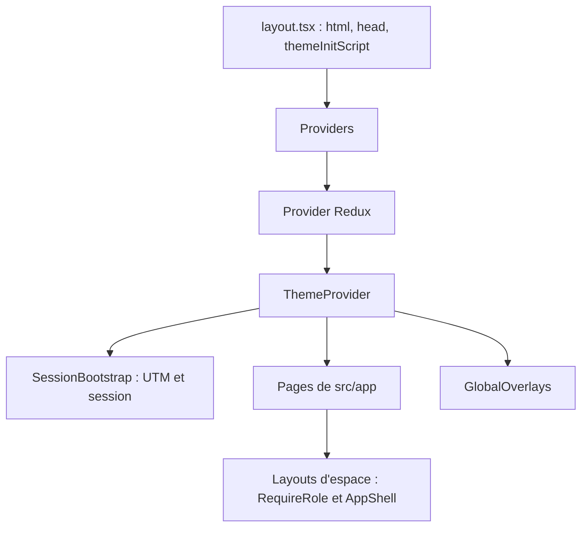

# Stack et structure

Le frontend web est l'interface navigateur de BlockLucky. Il réunit dans une seule application Next.js quatre espaces : la page publique de la Ville, l'espace citoyen, le dashboard de la Mairie et l'espace des commerçants partenaires. Il ne contient aucune logique blockchain : il appelle l'API REST du backend et écoute ses événements Socket.IO. Les transactions sont signées côté serveur par le portefeuille intégré de chaque citoyen (voir [Portefeuilles intégrés](../integration-blockchain/portefeuilles.md)).

Le code se trouve dans [`frontend-web/`](src:frontend-web). Toutes les pages sont des composants client (`'use client'`) : l'App Router sert surtout de routeur de fichiers et de coquille HTML, pas de rendu serveur de données.

## Stack technique

Les versions sont épinglées sans plage dans [`frontend-web/package.json`](src:frontend-web/package.json).

| Rôle | Paquet | Version |
|---|---|---|
| Framework et routeur | `next` (App Router) | 16.4.5 |
| Bibliothèque UI | `react`, `react-dom` | 19.3.1 |
| État global et appels API | `@reduxjs/toolkit` (RTK Query), `react-redux` | 2.14.0, 9.3.1 |
| Temps réel | `socket.io-client` | 4.8.4 |
| Styles | `tailwindcss`, `@tailwindcss/postcss` | 4.3.5 |
| Langage | `typescript` | ~6.0.3 |
| Tests | `vitest`, `@testing-library/react`, `jsdom` | 5.1.0, 16.3.3, 31.0.0 |
| Qualité | `eslint`, `eslint-config-next` | 10.14.0, 16.4.5 |

Node.js 22.12 ou plus est requis (`engines`). La CI lit la version dans le fichier `.nvmrc` à la racine du dépôt.

Aucune bibliothèque de composants, d'icônes, de graphiques ou de formulaires n'est installée. Les graphiques du dashboard sont dessinés en SVG et en CSS dans [`frontend-web/src/components/charts/Charts.tsx`](src:frontend-web/src/components/charts/Charts.tsx). Il n'y a pas non plus de bibliothèque Web3 (ni `ethers`, ni `wagmi`, ni connecteur MetaMask) : les citoyens n'utilisent pas d'extension de portefeuille.

## Arborescence

```text
frontend-web/
├── __tests__/               tests Vitest (lib.test.ts, components.test.tsx)
├── public/.well-known/      security.txt
├── src/
│   ├── app/                 routes App Router, layouts, globals.css
│   │   ├── (citoyen)/       espace citoyen (groupe de routes sans segment d'URL)
│   │   ├── mairie/          dashboard Mairie
│   │   ├── partenaire/      espace partenaires
│   │   └── ...              pages publiques, connexion, erreurs
│   ├── components/
│   │   ├── auth/            OnboardingCarousel
│   │   ├── charts/          BarList, RingMeter, KpiTile
│   │   ├── layout/          AppShell, PublicShell, RequireRole, AccessDenied, GlobalOverlays
│   │   ├── lottery/         WalletCard, WinnerClaimCard, CountdownTimer, ChatBox...
│   │   ├── marketplace/     PointsBalanceCard, RewardCard, ScratchCanvas
│   │   ├── partner/         PartnerSelection (choix de l'établissement)
│   │   └── ui/              Button, Input, Card, Sheet, Loader, Misc...
│   ├── hooks/               useAuth, useBlockLuckyWallet, useSocket, usePoints...
│   ├── lib/                 config, storage, analytics, socket, validators...
│   ├── store/               store Redux, RTK Query (api/) et slices
│   ├── theme/               ThemeProvider (thème et langue)
│   └── types/               types des réponses de l'API
├── Dockerfile
├── next.config.mjs          en-têtes de sécurité, sortie standalone
├── vitest.config.mts
└── .env.example
```

Le dossier `(citoyen)` est un groupe de routes : son nom n'apparaît pas dans l'URL. La page [`frontend-web/src/app/(citoyen)/accueil/page.tsx`](src:frontend-web/src/app/(citoyen)/accueil/page.tsx) répond donc à `/accueil`. Le détail des 29 pages est dans [Pages et espaces](pages.md).

## Point d'entrée et providers

[`frontend-web/src/app/layout.tsx`](src:frontend-web/src/app/layout.tsx) est le layout racine. Il définit les métadonnées (titre, description, Open Graph en `fr_FR`), la couleur de thème du navigateur pour les modes clair et sombre, et injecte dans `<head>` un petit script inline (`themeInitScript`) qui applique le thème et la langue avant le premier rendu pour éviter un flash. Il enveloppe ensuite toute l'application dans `Providers`.

[`frontend-web/src/app/providers.tsx`](src:frontend-web/src/app/providers.tsx) monte, dans cet ordre :

1. le `Provider` Redux, avec un store créé une seule fois par `makeStore` ;
2. le `ThemeProvider` (thème clair ou sombre, français ou anglais) ;
3. `SessionBootstrap`, qui au montage capture `utm_source` dans l'URL puis restaure la session depuis `localStorage` (`hydrateSession`) ;
4. les pages ;
5. `GlobalOverlays`, les feuilles modales globales (points crédités, réseau encombré, file d'attente, erreur réseau, tiroir de notifications).



## Les quatre espaces et leurs layouts

| Espace | Layout | Garde | Coquille |
|---|---|---|---|
| Public | aucun layout dédié | aucune | `PublicShell` ou page autonome |
| Citoyen | [`frontend-web/src/app/(citoyen)/layout.tsx`](src:frontend-web/src/app/(citoyen)/layout.tsx) | `RequireRole` sans rôle : tout compte connecté | `AppShell` avec actions citoyennes (portefeuille, points, alertes) |
| Mairie | [`frontend-web/src/app/mairie/layout.tsx`](src:frontend-web/src/app/mairie/layout.tsx) | `RequireRole roles={['ADMIN']}` | `AppShell` |
| Partenaires | [`frontend-web/src/app/partenaire/layout.tsx`](src:frontend-web/src/app/partenaire/layout.tsx) | `RequireRole roles={['PARTNER', 'ADMIN']}` | `PartnerSelectionProvider` puis `AppShell` |

Chaque layout déclare sa liste d'entrées de navigation (`NavItem`). `AppShell` affiche une barre latérale fixe à partir de 1024 px (`lg`) et, en dessous, une barre d'onglets basse limitée aux cinq premières entrées sans `desktopOnly`. Le fonctionnement de la garde est détaillé dans [Authentification et routes protégées](authentification.md#garde-des-routes).

## Organisation du code applicatif

| Dossier | Contenu | Page détaillée |
|---|---|---|
| `src/store` | Store Redux, `baseApi` RTK Query et cinq fichiers d'endpoints, trois slices | [État et appels API](etat-api.md) |
| `src/hooks` | Hooks métier qui combinent store, API et effets | [Authentification](authentification.md), [Portefeuille et loterie](portefeuille-loterie.md), [Temps réel](temps-reel.md) |
| `src/lib` | Fonctions sans React : configuration, stockage, analytique, client Socket.IO, validateurs, formatage, export | voir ci-dessous |
| `src/components/ui` | Composants de base du design system | [Design system](design-system.md) |
| `src/theme` | Thème et traduction `t(fr, en)` | [Internationalisation](i18n.md) |

Fichiers de `src/lib` :

| Fichier | Rôle |
|---|---|
| [`config.ts`](src:frontend-web/src/lib/config.ts) | URL de l'API et du WebSocket, constantes d'affichage (prix 0,01 ETH, 50 points par ticket, 75 points par cadeau, objectif 10 000 participants) |
| [`storage.ts`](src:frontend-web/src/lib/storage.ts) | Accès protégé à `localStorage` et liste des clés `bl.*` |
| [`analytics.ts`](src:frontend-web/src/lib/analytics.ts) | Événements du parcours et opposition à la mesure |
| [`socket.ts`](src:frontend-web/src/lib/socket.ts) | Client Socket.IO unique |
| [`navigation.ts`](src:frontend-web/src/lib/navigation.ts) | `safeInternalPath`, filtre anti redirection ouverte |
| [`validators.ts`](src:frontend-web/src/lib/validators.ts) | Email, adresse Ethereum, code OTP à 6 chiffres |
| [`formatters.ts`](src:frontend-web/src/lib/formatters.ts), [`date.ts`](src:frontend-web/src/lib/date.ts) | Raccourcis d'adresse et de hash, montants, dates |
| [`download.ts`](src:frontend-web/src/lib/download.ts) | Téléchargement de fichiers texte et rapport imprimable |
| [`codes.ts`](src:frontend-web/src/lib/codes.ts) | Analyse des codes promo collés ou importés en CSV |
| [`wallet.ts`](src:frontend-web/src/lib/wallet.ts) | Adresse factice calculée depuis l'email, envoyée au login (voir [Authentification](authentification.md#adresse-calculee-cote-client)) |

L'alias `@/` pointe vers `src/` (`tsconfig.json` et `vitest.config.mts`).

## Configuration

Deux variables publiques, lues au build et intégrées au bundle, sont documentées dans [`frontend-web/.env.example`](src:frontend-web/.env.example) :

| Variable | Valeur par défaut | Usage |
|---|---|---|
| `NEXT_PUBLIC_API_URL` | `http://localhost:2053/api` | Base des appels RTK Query et de `trackEvent` |
| `NEXT_PUBLIC_WS_URL` | `http://localhost:2053` | Serveur Socket.IO |

Les mêmes valeurs servent de repli dans [`frontend-web/src/lib/config.ts`](src:frontend-web/src/lib/config.ts) et sont reprises par [`frontend-web/next.config.mjs`](src:frontend-web/next.config.mjs) pour construire la directive `connect-src` de la CSP. Une troisième variable, `NEXT_OUTPUT=standalone`, n'est utilisée qu'au build Docker (voir [Tests et build](tests-build.md)). Le préfixe `NEXT_PUBLIC_` rend la valeur visible dans le JavaScript du navigateur : aucun secret ne doit y être placé.

> [!IMPORTANT]
> Les variables `NEXT_PUBLIC_*` sont figées au moment de `npm run build`. Changer l'URL de l'API impose de reconstruire l'application ou l'image Docker, un redémarrage ne suffit pas.

## Scripts npm

| Commande | Effet |
|---|---|
| `npm run dev` | Serveur de développement sur le port 3000 |
| `npm run build` | Build de production |
| `npm run start` | Serveur de production sur le port 3000 |
| `npm run lint` | ESLint avec les règles `core-web-vitals` et `typescript` de Next.js |
| `npm run typecheck` | `tsc --noEmit` |
| `npm test` | Tests Vitest en une passe |
| `npm run test:watch` | Vitest en mode surveillance |

Le démarrage complet avec le backend est décrit dans [Lancer les applications](../demarrage/lancer-les-applications.md).

## Code mort à connaître

Le hook `useGaslessWeb3.ts`, qui présentait les achats comme « sans frais » (gasless), a été supprimé : plus aucun fichier ne l'importait. Il est remplacé par [`useBlockLuckyWallet`](portefeuille-loterie.md#le-hook-useblockluckywallet) : chaque achat est signé par le portefeuille intégré du citoyen et paie les frais réseau sur sa dotation d'ethers fictifs.

