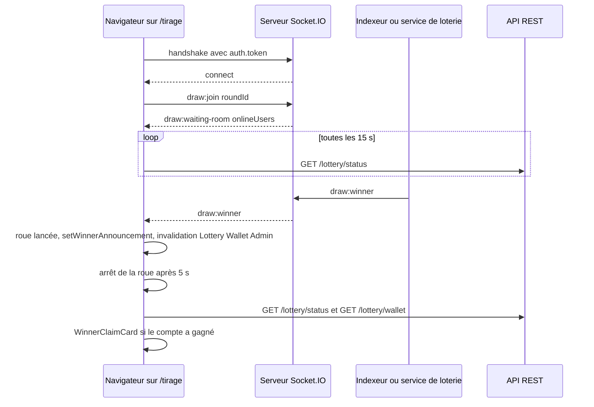

# Temps réel

Le frontend web reçoit quatre types d'événements du serveur Socket.IO du backend : la fréquentation de la salle de tirage, les messages de discussion, l'annonce du gagnant et les points attribués. Il en envoie trois : entrer dans la salle, en sortir, écrire un message. Le reste de l'interface se met à jour par RTK Query (requêtes et `pollingInterval`), décrit dans [État et appels API](etat-api.md).

La liste complète des événements du serveur, avec leurs charges utiles, est dans [Temps réel Socket.IO](../backend/socket-io.md). Le relais entre le worker et le serveur web passe par Redis, voir [Relais temps réel](../integration-blockchain/relais-temps-reel.md).

## Le client Socket.IO

[`frontend-web/src/lib/socket.ts`](src:frontend-web/src/lib/socket.ts) définit un singleton `socketClient` :

| Méthode | Comportement |
|---|---|
| `connect(token)` | Renvoie la connexion existante si le jeton est le même ; sinon ferme l'ancienne et en ouvre une nouvelle vers `WS_BASE_URL` |
| `getSocket()` | Connexion courante ou `null` |
| `disconnect()` | Retire tous les écouteurs, ferme la connexion, oublie le jeton |

Options passées à `io()` :

```typescript
io(WS_BASE_URL, {
  transports: ['websocket', 'polling'],
  autoConnect: true,
  reconnectionAttempts: 5,
  auth: token ? { token } : {},
});
```

Le WebSocket est tenté en premier, avec repli en long polling HTTP. Après cinq échecs de reconnexion, le client abandonne jusqu'au prochain appel de `connect`, c'est-à-dire au prochain montage d'une page qui utilise `useSocket` ou au changement de jeton.

`WS_BASE_URL` vient de `NEXT_PUBLIC_WS_URL` (par défaut `http://localhost:2053`). Son origine, en `http` et en `ws`, est ajoutée à la directive `connect-src` de la CSP (voir [Sécurité du navigateur](securite-navigateur.md)).

### Authentification de la connexion

Le jeton est transmis dans `auth.token` du handshake. Le middleware [`backend/src/socket/socket.middleware.ts`](src:backend/src/socket/socket.middleware.ts) se comporte ainsi :

| Cas | Résultat |
|---|---|
| Pas de jeton | Connexion acceptée en invité (`walletAddress` fictive `0xGuest...`) |
| Jeton valide et non révoqué | Connexion associée au compte |
| Jeton invalide ou révoqué | Connexion refusée avec l'erreur « Invalid authentication token for Socket.IO » |

Un visiteur non connecté peut donc écouter les annonces publiques, mais les messages qu'il écrit portent l'adresse invité.

## Le hook useSocket

[`frontend-web/src/hooks/useSocket.ts`](src:frontend-web/src/hooks/useSocket.ts) branche le client sur le store. Il prend un identifiant de tour optionnel.

| Page | Appel |
|---|---|
| `/tirage` | `useSocket(round?.id)` : rejoint la salle du tour et active la discussion |
| `/mairie/securite` | `useSocket()` : écoute l'annonce du gagnant après un tirage lancé par la Mairie |

Aucune autre page n'ouvre de connexion. Le client reste ouvert après avoir quitté ces pages (le nettoyage retire seulement les écouteurs) et n'est fermé qu'à la déconnexion par `endSession`.

### Événements écoutés

| Événement | Charge utile | Effet |
|---|---|---|
| `connect` | aucune | `setSocketConnected(true)` puis émission de `draw:join` si un tour est connu |
| `disconnect` | aucune | `setSocketConnected(false)` |
| `draw:waiting-room` | `{ active, onlineUsers }` | `setWaitingRoomOnlineCount(onlineUsers)` |
| `chat:message` | `{ id, senderWallet, message, emoji?, timestamp }` | `addLiveChatMessage`, ignoré si l'`id` existe déjà ; 100 messages gardés |
| `draw:winner` | `{ roundId, contractRoundId, winnerWallet, prizePool, vrfProofHash, timestamp }` | `setRouletteSpinning(true)` et `setWinnerAnnouncement`, invalidation des tags `Lottery`, `Wallet` et `Admin`, puis arrêt de la roue 5 secondes plus tard (`WINNER_SPIN_MS`) ; la roue est arrêtée si la page est quittée avant |
| `points:awarded` | `{ userId, amount, reason }` | Feuille « Points crédités » si `userId` est celui du compte connecté |

### Événements émis

| Événement | Quand | Charge utile |
|---|---|---|
| `draw:join` | À la connexion, si `roundId` est fourni | identifiant du tour en base |
| `draw:leave` | Au démontage, si la connexion est active | identifiant du tour |
| `chat:send` | `sendChatMessage(message, emoji)` depuis `ChatBox` | `{ message, emoji }` |

Le serveur place chaque client dans la salle `draw:<roundId>` et renvoie à toute la salle le nouveau nombre de membres. Les messages de discussion sont tronqués à 280 caractères, l'adresse de l'auteur est anonymisée par le serveur, puis le message est diffusé à tous les clients connectés.

Si la connexion est coupée au moment de l'envoi, `sendChatMessage` ajoute le message localement avec l'auteur « Vous (hors ligne) ». Il n'est pas renvoyé plus tard.

## Séquence d'un tirage vu du navigateur



En mode onchain, `draw:winner` et `points:awarded` sont émis par l'indexeur d'événements du contrat ([Indexeur d'événements](../integration-blockchain/indexeur.md)). En mode simulé, `draw:winner` est émis directement par le service de loterie après le tirage simulé.

## Ce qui n'est pas branché

Le fichier [`backend/src/types/socket.types.ts`](src:backend/src/types/socket.types.ts) déclare d'autres événements que le web n'écoute pas :

| Événement | Situation |
|---|---|
| `chat:react` (client vers serveur) et `chat:reaction` | Gérés par le serveur, non utilisés par le web : les « réactions » de `ChatBox` sont envoyées comme texte de message |
| `draw:countdown`, `draw:started` | Déclarés, jamais émis par le backend ; le compte à rebours est calculé dans le navigateur à partir de `drawTargetTime` |
| `queue:position` | Déclaré, jamais émis ; la feuille de file d'attente affiche une position fixe |
| `network:fallback` | Déclaré, jamais émis ; l'état du nœud vient de `GET /lottery/status` |

> [!WARNING]
> `points:awarded` est diffusé à tous les clients connectés (`io.emit`), avec l'identifiant interne du compte et le montant. Le filtrage par `userId` est fait dans le navigateur. N'importe quel client peut donc observer les attributions de points des autres comptes. Un envoi ciblé (salle par utilisateur) serait préférable.

## Compte à rebours

[`frontend-web/src/components/lottery/CountdownTimer.tsx`](src:frontend-web/src/components/lottery/CountdownTimer.tsx) ne dépend pas du temps réel : un `setInterval` d'une seconde recalcule le temps restant à partir de `round.drawTargetTime`, ou décrémente `remainingSeconds` si la date est absente. La valeur affichée porte `aria-live="off"` pour ne pas être annoncée chaque seconde par les lecteurs d'écran. Le statut est rechargé par RTK Query pour corriger une éventuelle dérive. Avec la prop `sound` (utilisée par `/accueil`), le composant affiche `SoundToggle` et joue `chrono.mp3` une seule fois par couple tour et échéance, dans les 8 dernières secondes.

## Sons

[`frontend-web/src/hooks/useSound.ts`](src:frontend-web/src/hooks/useSound.ts) lit les fichiers de [`frontend-web/public/sounds`](src:frontend-web/public/sounds), fournis par l'équipe : `SOUNDS.wheel` (`/sounds/roue-tirage.mp3`) et `SOUNDS.chrono` (`/sounds/chrono.mp3`).

| Élément | Comportement |
|---|---|
| `useSound(src)` | Renvoie `play({ loop? })` et `stop()` ; crée un `HTMLAudioElement` au premier `play`, repart de zéro à chaque lecture, ignore les refus du navigateur |
| Activation | Aucun son avant une interaction de l'utilisateur (`pointerdown`, `keydown`, ou `navigator.userActivation.hasBeenActive`), conformément aux règles de lecture automatique des navigateurs |
| `useSoundPreference()` | `soundEnabled` et `setSoundEnabled`, partagés par `useSyncExternalStore` ; valeur `bl.pref.sound` dans `localStorage` (`'0'` coupe, absent ou `'1'` active), synchronisée entre onglets par l'événement `storage` |
| `SoundToggle` | Bouton rond qui bascule la préférence ; couper arrête aussitôt les sons en cours |

Les sons ne dépendent pas de Socket.IO : la roue sonne quand `RouletteAnimation` tourne, le compte à rebours quand le temps local atteint le seuil.

## Notifications

Les notifications du tiroir « Alertes » ne passent pas par Socket.IO. [`frontend-web/src/hooks/usePushNotifications.ts`](src:frontend-web/src/hooks/usePushNotifications.ts) lit `GET /user/notifications` à la connexion, sans rafraîchissement automatique. Le backend renvoie aujourd'hui une liste fixe de trois notifications codées dans `UserService.getPushNotificationsHistory` ([`backend/src/api/user/user.services.ts`](src:backend/src/api/user/user.services.ts)) : le compteur « Alertes » affiche donc toujours le même nombre de non lues. Le web n'utilise ni l'API Notification du navigateur ni service worker : le bouton « Simuler une notification » de `/profil/aide` affiche seulement un bandeau dans la page pendant 4,5 secondes.

Pour ajouter un événement, suivre [Ajouter un événement temps réel](../guides/ajouter-evenement-socket.md).
