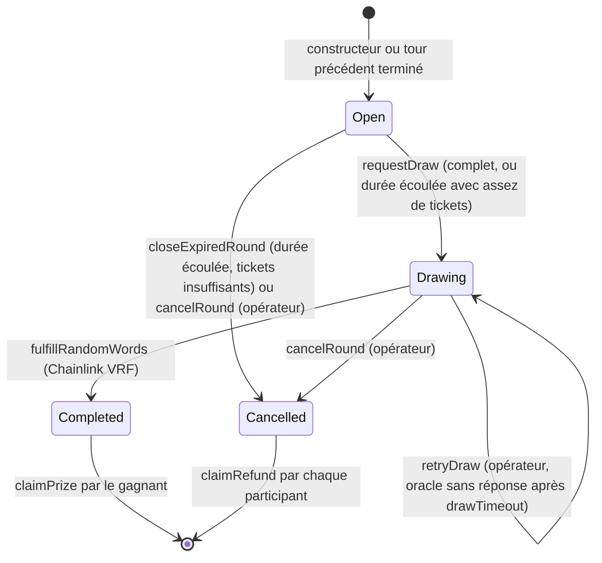

# BlockLucky - Smart contracts

Contrats Solidity de la loterie de fin d'année de la Ville d'EtherBay, avec Hardhat 3, Solidity 0.8.34, OpenZeppelin 5.6.1 et Chainlink VRF v2.5. Les choix d'architecture sont expliqués dans l'[ADR 0004](../docs/adr/0004-smart-contract-ethereum-portefeuille-integre.md).

## Contrats

| Contrat | Rôle |
|---|---|
| `contracts/BlockLucky.sol` | Loterie par tours : achat de tickets en ethers, tirage Chainlink VRF, cagnotte et remboursements en retrait, commission de la Mairie, disjoncteur |
| `contracts/BlockLuckyPOAP.sol` | Badge de participation ERC-721 non transférable, un par participant et par tour |
| `contracts/test/*.sol` | Contrats d'attaque utilisés uniquement par les tests (réentrance, refus de paiement) |

### Cycle d'un tour



Un nouveau tour s'ouvre automatiquement à la fin de chaque tour, qu'il soit terminé (Completed) ou annulé (Cancelled).

### Garanties

| Garantie | Mécanisme |
|---|---|
| Tirage imprévisible et vérifiable | Chainlink VRF v2.5 ; ni la Mairie ni le backend ne choisissent le gagnant |
| Tirage impossible à bloquer | `requestDraw` est appelable par n'importe qui dès que les conditions sont remplies ; compatible Chainlink Automation |
| Fonds jamais bloqués | Cagnotte et remboursements en retrait (`claimPrize`, `claimRefund`) ; tour annulé = remboursement intégral |
| Commission plafonnée | 10 % par défaut, refus au-delà de 20 % (`MAX_FEE_BPS`) ; seule la commission est retirable vers la trésorerie |
| Résistance à la réentrance | Checks-effects-interactions et `ReentrancyGuard` sur toutes les fonctions qui déplacent des fonds |
| Droits séparés | `DEFAULT_ADMIN_ROLE` (Mairie), `OPERATOR_ROLE` (backend), `PAUSER_ROLE` (disjoncteur) |
| Jeu responsable | Plafond de tickets par participant et par tour (`maxTicketsPerPlayer`) |

## Commandes

Prérequis : Node.js 22.12 ou plus récent, Docker pour Slither.

```bash
npm ci
```

| Commande | Effet |
|---|---|
| `npm run build` | Compilation des contrats |
| `npm run typecheck` | Compilation et vérification TypeScript des scripts et tests |
| `npm run lint` | solhint, zéro avertissement toléré |
| `npm test` | 47 tests : 43 en TypeScript (mocha, ethers) et 4 tests de fuzzing en Solidity, 256 exécutions chacun |
| `npm run test:coverage` puis `npm run coverage:check` | Couverture, avec échec sous 100 % des lignes des contrats de production |
| `npm run test:gas` | Coût en gaz de chaque fonction |
| `npm run slither` | Analyse statique Slither 0.11.6 dans Docker, en échec dès le niveau Medium |
| `npm run export:abi` | Copie des ABI dans `backend/src/blockchain/abi/` (`node scripts/export-abi.mjs --check` vérifie qu'elles sont à jour) |

Les constats Slither acceptés sont consignés dans `slither.db.json` :

- **Réentrance après l'appel au coordinateur VRF dans `_requestRandomness`.** Le `requestId` n'est connu qu'après l'appel. Le coordinateur est un contrat de confiance. Le statut du tour passe à `Drawing` avant l'appel, et tous les appelants sont protégés par `nonReentrant`.
- **Usage de `block.timestamp`.** Les tours durent plusieurs heures : quelques secondes de dérive possible ne changent rien.

Tout nouveau constat fait échouer la CI.

## Blockchain locale

Le service `blockchain` de `docker-compose.yml` démarre un nœud Hardhat sur `127.0.0.1:8545`. Il déploie ensuite le coordinateur VRF simulé, `BlockLucky` et `BlockLuckyPOAP`, puis lance un oracle local qui répond aux demandes de tirage.

Les adresses sont déterministes et correspondent aux valeurs par défaut du backend :

| Contrat | Adresse |
|---|---|
| Coordinateur VRF simulé | `0x5FbDB2315678afecb367f032d93F642f64180aa3` |
| BlockLucky | `0xCf7Ed3AccA5a467e9e704C703E8D87F634fB0Fc9` |
| BlockLuckyPOAP | `0x5FC8d32690cc91D4c39d9d3abcBD16989F875707` |

```bash
docker compose up -d --wait blockchain
```

Sans Docker, le même résultat s'obtient avec deux terminaux :

```bash
npm run node
```

```bash
npm run deploy:local && npx hardhat run scripts/local-vrf-responder.ts --network localhost
```

| Variable du déploiement local | Effet |
|---|---|
| `OPERATOR_PRIVATE_KEY` ou `OPERATOR_ADDRESS` | Accorde les rôles opérateur, pause et frappe à l'opérateur du backend, et l'approvisionne (`OPERATOR_FUNDING_ETH`, 1000 par défaut). Inutile si le backend utilise le compte Hardhat n°0 de développement. |
| `TICKET_PRICE_WEI`, `MAX_TICKETS`, `MIN_TICKETS_TO_DRAW`, `MAX_TICKETS_PER_PLAYER`, `ROUND_DURATION_SECONDS`, `MUNICIPALITY_FEE_BPS` | Paramètres des tours. Par défaut : 0,01 ETH, 10 000 tickets, 2 tickets minimum, 100 par participant, 30 minutes en local et 48 heures sur Sepolia, 10 % de commission. |
| `POAP_BASE_URI` | Préfixe des métadonnées des badges, servies par le backend (`/api/v1/lottery/poap/<tour>.json`) |
| `VRF_ORACLE_ACCOUNT_INDEX` | Compte Hardhat qui signe les réponses de l'oracle local (9 par défaut, distinct de l'opérateur) |

Le nœud Hardhat ne conserve pas son état entre deux démarrages. Après un redémarrage du conteneur `blockchain`, il faut aussi réinitialiser la base du backend : `docker compose down -v`, puis relancer les migrations et le seed.

## Déploiement sur Sepolia

Ces étapes demandent des comptes personnels. Elles sont à réaliser par l'équipe.

1. **Portefeuilles.** Créer deux comptes dans MetaMask :
   - l'administrateur de la Mairie, qui déploie les contrats ;
   - l'opérateur du backend, dont la clé ira dans `RELAYER_PRIVATE_KEY`.
2. **ETH de test.** Obtenir de l'ETH Sepolia sur un faucet, par exemple ceux de Google Cloud ou d'Alchemy, pour les deux comptes. L'opérateur paie les dotations de bienvenue (0,1 ETH par citoyen par défaut) et les frais des POAP.
3. **Accès RPC.** Créer un accès RPC Sepolia (Alchemy, Infura ou un nœud public) et une clé d'API Etherscan.
4. **Abonnement Chainlink VRF.**
   - Sur [vrf.chain.link](https://vrf.chain.link), réseau Sepolia, créer un abonnement VRF v2.5 avec le compte administrateur.
   - Le financer en LINK de test (faucet Chainlink) ou en ETH Sepolia.
   - Noter son identifiant.
5. **Secrets dans le keystore chiffré de Hardhat.** Ces valeurs peuvent aussi venir de variables d'environnement. Saisir chacune avec les commandes ci-dessous.

   ```bash
   npx hardhat keystore set SEPOLIA_RPC_URL
   ```

   ```bash
   npx hardhat keystore set SEPOLIA_PRIVATE_KEY
   ```

   ```bash
   npx hardhat keystore set ETHERSCAN_API_KEY
   ```

6. **Déploiement.** Lancer la commande ci-dessous en adaptant l'identifiant, l'adresse et l'URL.
   - Le script vérifie le réseau, la key hash et le financement de l'abonnement.
   - Il ajoute le contrat comme consommateur VRF et accorde les rôles à l'opérateur.
   - Il écrit `deployments/sepolia.json`.

   ```bash
   SEPOLIA_VRF_SUBSCRIPTION_ID=123 OPERATOR_ADDRESS=0x... POAP_BASE_URI=https://api.etherbay.tech/api/v1/lottery/poap/ npm run deploy:sepolia
   ```

7. **Publication du code source sur Etherscan.**

   ```bash
   npx hardhat verify --network sepolia --constructor-args-path deployments/sepolia-blocklucky-args.ts <adresse BlockLucky>
   ```

   ```bash
   npx hardhat verify --network sepolia <adresse BlockLuckyPOAP> <adresse administrateur> https://api.etherbay.tech/api/v1/lottery/poap/
   ```

8. **Configuration du backend.**

   | Variable | Valeur |
   |---|---|
   | `RPC_URL` | Accès RPC Sepolia |
   | `CHAIN_ID` | `11155111` |
   | `CHAIN_START_BLOCK` | `deploymentBlock` de `deployments/sepolia.json` |
   | `CHAIN_CONFIRMATIONS` | `2` |
   | `EXPLORER_URL` | `https://sepolia.etherscan.io` |
   | `LOTTERY_CONTRACT_ADDRESS`, `POAP_CONTRACT_ADDRESS` | Adresses déployées |
   | `RELAYER_PRIVATE_KEY` | Clé de l'opérateur |

Variables facultatives :

- `MAIRIE_ADMIN_ADDRESS` et `MAIRIE_TREASURY_ADDRESS` séparent l'administrateur et la trésorerie du compte qui déploie.
- `SEPOLIA_VRF_COORDINATOR` et `SEPOLIA_VRF_KEY_HASH` remplacent les valeurs officielles Chainlink. Le coordinateur `0x9DdfaCa8183c41ad55329BdeeD9F6A8d53168B1B` et la key hash par défaut sont vérifiés sur la chaîne au déploiement.

## Remix

Les deux contrats compilent tels quels dans [Remix](https://remix.ethereum.org) : Remix résout les imports `@openzeppelin/contracts` et `@chainlink/contracts` depuis npm. Pour une démonstration rapide sans abonnement VRF, déployer d'abord `VRFCoordinatorV2_5Mock` depuis `@chainlink/contracts/src/v0.8/vrf/mocks/`.
